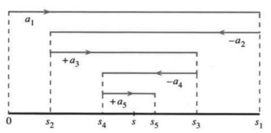

# 10.3 收敛判别法：一般级数

原书 PDF 第461—464页，印刷页448—451。状态：初译，已对照原页自校；待统一复审。

<!-- PDF 461 / 印刷页 448 -->

本节终于允许 $a_n$ 为负数。几何级数 $1-\frac12+\frac14-\frac18+\cdots=\frac23$ 当然可以讨论，级数 $\pi=4-\frac43+\frac45-\frac47+\cdots$ 也可以。〔译注：原书把前一个和误写为 $1/3$，此处明确订正。〕如果把所有符号改为加号，几何级数仍收敛，不过和增大为2。这就是第一个检验：每项取绝对值 $|a_n|$，把级数变回正项级数。

**定义**　如果 $\sum|a_n|$ 收敛，就称 $\sum a_n$ **绝对收敛**。

把负数 $a_n$ 换成 $|a_n|$ 会使和增大。要点是：只要 $\sum|a_n|$ 收敛，原来的 $\sum a_n$ 就一定收敛。

**10G**　若 $\sum|a_n|$ 收敛，则 $\sum a_n$ 绝对收敛。但即使 $\sum|a_n|$ 发散到无穷大，$\sum a_n$ 仍可能收敛，$\pi$ 的级数就是例子。

**例1**　从正项级数 $\frac12+\frac14+\frac18+\cdots$ 出发，把任意几项改成负号，新级数仍绝对收敛。适当选择符号，可以使它收敛到 $-1$ 与1之间的任何一个数。

**例2**　从收敛到 $\ln2$ 的交错级数 $1-\frac12+\frac13-\frac14+\cdots$ 出发，把所有符号改为加号，得到发散到无穷大的调和级数。原来的交错级数不是绝对收敛，而只是**条件收敛**。即使 $\sum|a_n|=\infty$，符号选得巧，级数仍可能条件收敛。

“绝对收敛推出收敛”有一个简短证明。$a_n+|a_n|$ 在 $a_n<0$ 时为零，否则为 $2|a_n|$。与收敛级数 $\sum2|a_n|$ 比较，$\sum(a_n+|a_n|)$ 也收敛。再减去收敛的 $\sum|a_n|$，得到 $\sum a_n$ 收敛，证明完毕。由于转而考察 $|a_n|$，所有正项级数判别法，包括积分、比值、比较等，都能直接拿来判断绝对收敛。

**例3**　从收敛到 $\frac12$ 的几何级数 $\frac13+\frac19+\frac1{27}+\cdots$ 出发，任意改变某些项的符号，新级数都绝对收敛。但这一次，改变符号不能得到 $-\frac12$ 与 $\frac12$ 之间的所有和。所得的和落在第3.7节介绍的那个著名却极稀疏的康托集里。

**例4（预告）**　假设幂级数 $\sum a_nx^n$ 在某个特定的 $x$ 处收敛，那么在每个比它更接近零的 $x$ 处都绝对收敛。第10.6节会证明并使用这一结论，它是幂级数理论中最重要的一步。

**例5**　因为 $\sum1/n^2$ 收敛，所以 $\sum(\cos n)/n^2$ 也收敛。后者的符号没有规律，但 $|\cos n|<1$，跟前者一比就知道它绝对收敛。$\sum(\tan n)/n^2$ 大概不收敛，因为正切不像余弦那样有界。

## 交错级数

级数 $1-\frac12+\frac13-\frac14+\cdots$ 收敛到 $\ln2$，此前我们没有证明。这是交错级数的例子，符号正负交替。此外，它的绝对值 $1,\frac12,\frac13,\frac14,\ldots$ 递减

<!-- PDF 462 / 印刷页 449 -->

并趋于零。“绝对值递减到零”与“符号交替”这两个条件保证收敛。

**10H**　交错级数 $a_1-a_2+a_3-a_4+\cdots$ 若满足每个 $a_{n+1}\le a_n$ 且 $a_n\to0$，就收敛；它可能仅条件收敛，也可能绝对收敛。

最好的证明就在图10.3中。观察 $a_1-a_2+a_3$：它不超过 $a_1$，因为正项 $a_3$ 不大于被减去的 $a_2$。五项和不超过三项和，因为 $a_5\le a_4$。所以奇数项部分和 $s_1,s_3,s_5,\ldots$ 单调不增。

图10.3　绝对值递减到零的交错级数收敛。奇、偶数项部分和从两侧夹住和 $s$。

再看两项和 $a_1-a_2$，然后看四项和、六项和。加上 $a_3-a_4$ 使部分和不减，因为 $a_3\ge a_4$。类似地，$s_6\ge s_4$，因为多加了非负的 $a_5-a_6$。所以 $s_2,s_4,s_6,\ldots$ 单调不减。

$s_{n-1}$ 与 $s_n$ 只差一个数 $\pm a_n$，10H要求它趋于零。因此，递减的奇数项部分和与递增的偶数项部分和趋于同一个极限 $s$。级数收敛到 $s$，而 $s$ 总位于 $s_{n-1}$ 与 $s_n$ 之间。

这种正负交替的模式虽然特殊，却很重要。正项级数 $\sum a_n$ 不一定收敛；相应的交错级数是 $\sum(-1)^{n+1}a_n$。

**例6**　$4-\frac43+\frac45-\frac47+\cdots$ 条件收敛到 $\pi$，因为绝对值递减到零。它绝对收敛吗？不。换成加号后，$4(1+\frac13+\frac15+\cdots)$ 像调和级数一样发散。

**例7**　交错级数 $1-1+1-1+\cdots$ 根本不收敛。10H中的哪个条件不满足？奇数项部分和全部为1，偶数项部分和全部为0，两者没有共同的极限。

## 级数的乘法与重排

第10.1节做过级数的加、减、乘。收敛级数的加减是安全的。若一个级数的部分和 $s_n\to s$，另一个的部分和 $t_n\to t$，则相加后的部分和满足 $s_n+t_n\to s+t$。可乘法更危险：相乘的次序不同，结果就可能不同。更准确地说，条件收敛时，各项的次序很重要；绝对收敛时，次序无关紧要。

<!-- PDF 463 / 印刷页 450 -->

绝对收敛级数可以任意重排，也可以按任意次序累加乘积项，得到正确的和与积。

**10I**　假设 $\sum a_n$ 绝对收敛，$A_1,A_2,\ldots$ 是原各项的任意重排，则 $\sum A_n=\sum a_n$，而重排后的级数也绝对收敛。

**10J**　假设 $\sum a_n=s$ 与 $\sum b_n=t$ 都绝对收敛，则乘积里那无穷多个项 $a_ib_j$，无论按什么次序相加，和都是 $st$。

这里不证明10I、10J，而看只有条件收敛时会发生什么。最熟悉的例子是条件收敛到 $\ln2$ 的 $1-\frac12+\frac13-\frac14+\cdots$。经过重排，它可以条件收敛到任何实数！假设希望和为1000，先依次取正项 $1+\frac13+\cdots$，直到超过1000；再加负项 $-\frac12-\frac14-\cdots$，直到降到1000以下；然后再用尚未使用的正项使其超过1000，如此反复。每一步至少使用一个新项，最终所有项都会用到。极限就是1000。

若不绝对收敛，乘积也会出现奇怪现象：

$$
\begin{aligned}
&\left(1-\frac1{\sqrt2}+\frac1{\sqrt3}-\cdots\right)
\left(1-\frac1{\sqrt2}+\frac1{\sqrt3}-\cdots\right)\\
&\qquad=1-\left(\frac1{\sqrt2}+\frac1{\sqrt2}\right)
+\left(\frac1{\sqrt3}+\frac1{\sqrt4}+\frac1{\sqrt3}\right)-\cdots.
\end{aligned}
$$

左边两个级数都条件收敛，交错项趋于零。右边的级数却发散：括号里成组的项甚至都不趋于零，这个乘积级数完全不对。

最后再强调：绝对收敛才是关键。最重要的级数是幂级数 $\sum a_nx^n$。像几何级数那样，它们在某个 $x$ 的区间上绝对收敛，给出 $x$ 的函数，这正是微积分需要的东西。

接下来研究 $e^x$ 的级数，它处处绝对收敛。从收敛判别的角度看，它过于容易，危险已消失；但从微积分及其应用的角度看，$e^x$ 无条件地是最棒的。

## 10.3 习题

### 阅读填空

若级数 **a** ______ 收敛，就称 $\sum a_n$ 绝对收敛。此时原级数也 **b** ______。但 $\sum a_n$ 可以收敛而不绝对收敛，这称为 **c** ______ 收敛，例子是 **d** ______。

交错级数中，每个 $a_{n+1}$ 的符号都与 $a_n$ **e** ______。再加上条件 **f** ______ 和 **g** ______，级数就收敛，至少可能是条件收敛。部分和 $s_1,s_3,\ldots$ **h** ______，而 $s_2,s_4,\ldots$ **i** ______。$s_n$ 与 $s_{n-1}$ 的差为 **j** ______，所以这两列部分和趋于同一个 $s$。绝对收敛、条件收敛和不收敛的交错级数例子分别为 **k** ______、**l** ______、**m** ______。绝对收敛时，重排能否改变和？条件收敛时呢？

**第1—12题：判断绝对收敛、条件收敛或发散。**

1. $\sum(-1)^{n+1}\frac n{n+3}$。

2. $\sum\frac{(-1)^{n-1}}{\sqrt{n+3}}$。

3. $\sum(-1)^{n+1}\frac1{n!}$。

4. $\sum(-1)^{n+1}\frac{3^n}{n!}$。

5. $\sum(-1)^{n+1}\frac{3\sqrt n}{n+1}$。

6. $\sum(-1)^{n+1}\sin^2n$。

7. $\sum(-1)^{n+1}\ln(1/n)$。

8. $\sum(-1)^{n+1}\frac{\sin^2n}{n}$。

9. $\sum(-1)^{n+1}\frac{n^2}{1+n^4}$。

10. $\sum(-1)^{n+1}2^{1/n}$。

11. $\sum(-1)^{n+1}n^{1/n}$。

12. $\sum(-1)^{n+1}(1-n^{1/n})$。

<!-- PDF 464 / 印刷页 451 -->

13. 假设 $\sum a_n$ 绝对收敛，解释为什么只保留正项也得到收敛级数。

14. 如果所有 $a_n$ 都为负，$\sum a_n$ 能绝对收敛吗？

15. 计算 $s_2,s_4,\ldots$，证明交错级数 $1-\frac12+\frac12-\frac14+\frac13-\frac16+\cdots$ 不收敛。10H的哪个条件不满足？

16. 证明 $\frac23-\frac35+\frac47-\frac59+\cdots$ 不收敛。10H的哪个条件不满足？

17. (a) 绝对值递减到零的交错级数，它的和 $s$ 为什么总在 $s_{n-1}$ 与 $s_n$ 之间？  
    (b) 如果 $s_n$ 截止于正项，$s-s_n$ 为正还是为负？

18. 用第17题为 $s_5=1-\frac12+\frac13-\frac14+\frac15$ 与无穷级数和 $s=\ln2$ 的差给出一个界。

19. 求 $1-\frac1{2!}+\frac1{3!}-\frac1{4!}+\cdots=s$。部分和 $s_4$（高于 $s$）（低于 $s$），相差小于 ______。

20. 为 $s_{100}=\frac1{1^2}-\frac1{2^2}+\frac1{3^2}-\cdots-\frac1{100^2}$ 与 $s=\sum(-1)^{n+1}/n^2$ 的差给出一个界。

21. 从正项级数 $\frac1{1^2}+\frac1{2^2}+\frac1{3^2}+\cdots=\pi^2/6$ 出发，说明第20题交错级数的和为 $\pi^2/12$。

22. 第20题交错级数与第21题正项级数，哪个更快给出 $\pi^2$？比较 $1/101^2-1/102^2+\cdots$ 与 $1/101^2+1/102^2+\cdots$。

23. 若 $\sum a_n$ 不收敛，证明 $\sum|a_n|$ 也不收敛。

24. 寻找能保证 $a_1+a_2-a_3+a_4+a_5-a_6+\cdots$ 收敛的条件，其中每两个正项之后跟一个负项。

25. 把 $\ln2=1-\frac12+\frac13-\frac14+\cdots$ 重排为 $1-\frac12-\frac14+\frac13-\frac16-\frac18+\cdots$，证明新和为 $\frac12\ln2$。（把每个正项与紧随其后的第一个负项合并。）

26. 证明 $1+\frac13-\frac12+\frac15+\frac17-\frac14+\cdots$ 收敛到 $\frac32\ln2$。

27. $1+\frac13-\frac12+\frac15-\frac14+\frac17-\frac16+\cdots$ 的和是多少？

28. 综合 $1+\cdots+1/n-\ln n\to\gamma$ 与 $1-\frac12+\frac13-\cdots\to\ln2$，证明 $1+\frac13+\frac15-\frac12-\frac14-\frac16+\cdots=\ln2$。

29. (a) 证明下列交错级数收敛：

    $$1-\int_1^2\frac{dx}{x}+\frac12-\int_2^3\frac{dx}{x}
    +\frac13-\int_3^4\frac{dx}{x}+\cdots.$$

    (b) 证明其和是欧拉常数 $\gamma$。

30. 证明下列级数收敛，其和为 $\pi/2$：

    $$\int_0^\pi\frac{\sin x}{x}\,dx+
    \int_\pi^{2\pi}\frac{\sin x}{x}\,dx+\cdots
    =\int_0^\infty\frac{\sin x}{x}\,dx.$$

31. $\theta=1$ 弧度的余弦为 $1-1/2!+1/4!-\cdots$。把 $\cos1$ 算到五位正确小数，需要多少项？

32. $\theta=\pi$ 弧度的正弦为 $\pi-\pi^3/3!+\pi^5/5!-\cdots$。把 $\sin\pi$ 算到八位正确小数，需要多少项？

33. 若 $\sum a_n^2$ 与 $\sum b_n^2$ 收敛，证明 $\sum a_nb_n$ 绝对收敛。提示：由 $(a\pm b)^2\ge0$ 得 $2|ab|\le a^2+b^2$。

34. 当 $a_n=(\frac12)^n$、$b_n=(\frac13)^n$ 时，验证施瓦茨不等式 $(\sum a_nb_n)^2\le(\sum a_n^2)(\sum b_n^2)$。

35. $\sum_{n=0}^\infty(a_{n+1}-a_n)$ 在什么条件下收敛？其和是什么？

36. 对一个条件收敛的级数，说明如何重排，使它发散到 $+\infty$。每一项最终都必须纳入，包括负项。

37. 描述乘积 $(1+\frac12+\frac14+\cdots)(1+\frac13+\frac19+\cdots)$ 中的各项，并求其和。

38. 判断正误：  
    (a) 每个交错级数都收敛。  
    (b) 如果 $\sum|a_n|$ 发散，则 $\sum a_n$ 条件收敛。  
    (c) 收敛的正项级数必绝对收敛。  
    (d) 若 $\sum a_n$ 与 $\sum b_n$ 都收敛，则 $\sum(a_n+b_n)$ 收敛。

39. 把 $1+\frac12+\frac14+\cdots$ 删掉某些项，就能得到0与2之间的每个数 $x$。为什么？

40. 适当选择符号，$-1$ 与1之间每个数 $s$ 都能表示为 $\pm\frac12\pm\frac14\pm\frac18\pm\cdots$。（加上 $1=\frac12+\frac14+\frac18+\cdots$，就得到第39题。）哪些符号能给出 $s=-1,0,\frac13$？

41. 证明，无论怎样选择符号，$\pm\frac13\pm\frac19\pm\frac1{27}\pm\cdots$ 都不等于零。

42. 第41题中所有可能的和构成以零为中心的康托集。集合中最小的正数是什么？选择符号，说明 $\frac14$ 属于这个集合。

43. ★ 证明角 $\theta=\frac12(\pi-1)$ 的正切为 $\sin1/(1-\cos1)$。这个角是 $s=-\ln(1-e^i)$ 的虚部。从 $s=\sum e^{in}/n$ 推出非同寻常的等式 $\sum(\sin n)/n=\frac12(\pi-1)$。

44. 假设 $\sum a_n$ 收敛且 $|x|<1$。证明 $\sum a_nx^n$ 绝对收敛。

## 译注与待复审事项

1. 首段原书 $1-1/2+1/4-1/8+\cdots=1/3$ 是明确的算术笔误；公比为 $-1/2$，首项为1，和应为 $2/3$，已带注订正。
2. 10H中的 $a_n$ 表示非负的项的大小；要求单调不增并趋于零。这是充分条件而不是所有交错级数收敛的必要条件。原文“至少条件收敛”容易混淆定义，本稿表达为可能条件收敛，也可能绝对收敛。阅读填空中 $a_n$ 又用作带符号项，须按上下文区分。
3. 例3得到的是平移缩放后的康托集，不是直接等于通常定义在 $[0,1]$ 上的标准康托集。例4中的“更接近零”是绝对值严格更小。
4. 例5对 $\sum(\tan n)/n^2$ 使用“Probably”，只是作者推测，不能从正切无界本身推出这个特定级数发散；本稿保留推测语气，未把它列为已证明结论。
5. 10J的任意顺序乘积求和结论以两个因子级数都绝对收敛为条件。每个乘积项须恰好出现一次；条件收敛时不能据此任意交换、重排或合并。正文所示发散乘积是按对角线分组的柯西乘积。
6. 第1—12题原文总问绝对还是条件收敛，但其中确有发散级数，译稿将“或发散”明示以免强行二选一。第5题原页是 $3\sqrt n/(n+1)$，不是立方根。
7. 第33—34题默认实数序列。第43题需固定复对数分支并证明边界级数取值；原文“This”指角 $\theta$ 而非它的正切。第30题从分块级数收敛到反常积分收敛，还须控制最后一个未完整区间的积分。
