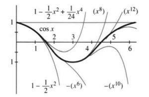
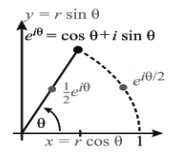

# 10.4　$e^x$、$\sin x$ 与 $\cos x$ 的泰勒级数

原书 PDF 第465—470页；印刷页452—457。状态：初译，已对照原页自校，待统一复审。

<!-- PDF 465 / 印刷页 452 -->

本节从数回到函数。我们研究的不再是 $\sum a_n=s$，而是 $\sum a_nx^n=f(x)$。**和是 $x$ 的函数。**几何级数的各个 $a_n$ 都等于1（包括常数项 $a_0$），其和为 $f(x)=1/(1-x)$。$1+x+x^2+\cdots$ 的各阶导数与 $f$ 的各阶导数相吻合。现在我们另选一组 $a_n$，使它们与另一个函数相吻合。

这个新函数是 $e^x$。它的各阶导数都是 $e^x$。在 $x=0$ 处，函数及其各阶导数都等于1。为了与这些1相吻合，我们在分母中引入阶乘。逐项写出级数为

$$
e^x=1+\frac{x}{1!}+\frac{x^2}{2!}+\frac{x^3}{3!}+\cdots.\tag{1}
$$

$x^n/n!$ 的 $n$ 阶导数正好等于1。**由 $x=0$ 处的各阶导数，我们重建了函数！**当 $x=1$ 时，右边是 $1+1+\tfrac12+\tfrac16+\cdots$，左边是 $e=2.71828\ldots$。当 $x=-1$ 时，这个级数成为 $1-1+\tfrac12-\tfrac16+\cdots$，其和为 $e^{-1}$。

同样的逐项构造也适用于微分方程：

**例1**　求解 $dy/dx=-y$，初始条件为 $x=0$ 时 $y=1$。

**解**　在 $x=0$ 处，零阶导数就是函数本身：$y=1$。方程 $y'=-y$ 给出 $y'=-1$ 和 $y''=-y'=+1$。导数值交替为 $1,-1,1,-1,\ldots$，与 $e^{-x}$ 的交错级数对得上：

$$
y=1-x+\tfrac12x^2-\tfrac16x^3+\cdots=e^{-x}
\qquad\text{（这正是 $y'=-y$ 的解）。}
$$

**例2**　求解 $d^2y/dx^2=-y$，初始条件为 $y=1$、$y'=0$（答案是 $\cos x$）。

**解**　方程给出 $y''=-1$（仍在 $x=0$ 处）。对方程求导得 $y'''=-y'=0$。接着 $y^{(4)}=-y''=+1$。偶数阶导数交替为 $+1$ 与 $-1$，奇数阶导数均为零。能跟这组导数匹配的，是只含偶次幂的级数——它构造出了 $\cos x$：

$$
y=1-\frac{x^2}{2!}+\frac{x^4}{4!}-\frac{x^6}{6!}+\cdots=\cos x.
$$

前两项 $1-\tfrac12x^2$ 在本书前面已出现过。现在我们得到了整个交错级数。与 $e^x$ 的级数作比较（去掉奇次幂项），可知它对所有 $x$ 都绝对收敛。图10.4 里，部分和一次比一次贴得更远，然后才跟 $\cos x$ 脱开。

**图10.4**　余弦级数 $1-x^2/2+x^4/24-\cdots$ 的部分和。图中的 $(x^8)$、$-(x^{10})$ 等标记指相应的最高次项，阶乘分母省略。

<!-- PDF 466 / 印刷页 453 -->

要是想让各项都带加号、不再一正一负，可以取 $e^x$ 与 $e^{-x}$ 的平均。$\cosh x$ 的微分方程是 $d^2y/dx^2=+y$，它给出的各项都是加号：

$$
\tfrac12(e^x+e^{-x})=1+\frac{x^2}{2!}+\frac{x^4}{4!}+\frac{x^6}{6!}+\cdots
\qquad\text{（这就是 $\cosh x$）。}
$$

## 泰勒级数

**用幂来匹配导数**的思想正逐渐成为本章的核心。给定的是某个基点（例如 $x=0$）处的各阶导数，它们是数 $f(0),f'(0),\ldots$。只要选取 $a_n=f^{(n)}(0)/n!$，$a_nx^n$ 的 $n$ 阶导数就等于 $f^{(n)}(0)$。于是级数 $\sum a_nx^n$ 在基点处与 $f(x)$ 有相同的各阶导数。

**10K**　在 $x=0$ 处与 $f(x)$ 及其所有阶导数相吻合的**泰勒级数（Taylor series）**是

$$
f(0)+f'(0)x+\tfrac12f''(0)x^2+\tfrac16f'''(0)x^3+\cdots
=\sum_{n=0}^{\infty}\frac{f^{(n)}(0)}{n!}x^n.
$$

前几项给出我们熟悉的一次近似和二次近似。前面曾提到 $x^3$ 项，但没有使用。现在所有项都齐了——这个“无穷近似”就是要等于 $f(x)$。

这里需要两件事。第一，级数必须收敛。第二，在离开 $x=0$ 的地方，函数也必须符合级数的预测。对于 $e^x$、$\cos x$ 和 $\sin x$，这两点都成立：级数的和等于函数。我们据此继续。

以特殊基点 $x=0$ 展开的泰勒级数也叫作“麦克劳林级数（Maclaurin series）”。

**例3**　求 $f(x)=\sin x$ 在 $x=0$ 附近的泰勒级数。

**解**　所谓 $f^{(n)}(0)$，就是 $f=\sin x$、$f'=\cos x$、$f''=-\sin x$、……在 $x=0$ 处的值。这些值依次是 $0,1,0,-1,0,1,\ldots$。偶数阶导数均为零。把这些值除以相应的阶乘，就得到泰勒级数的系数：

$$
\sin x=x-\tfrac16x^3+\tfrac1{120}x^5-\cdots.\tag{2}
$$

**例4**　求 $f(x)=(1+x)^5$ 在 $x=0$ 附近的泰勒级数。

**解**　这个函数的初始值为 $f(0)=1$。它的导数为 $5(1+x)^4$，所以 $f'(0)=5$。二阶导数为 $5\cdot4\cdot(1+x)^3$，所以 $f''(0)=5\cdot4$。接下来的三个导数值为 $5\cdot4\cdot3$、$5\cdot4\cdot3\cdot2$、$5\cdot4\cdot3\cdot2\cdot1$。**此后的各阶导数均为零。**因此泰勒级数到 $x^5$ 项就终止了：

$$
1+5x+\frac{5\cdot4}{2!}x^2+\frac{5\cdot4\cdot3}{3!}x^3
+\frac{5\cdot4\cdot3\cdot2}{4!}x^4
+\frac{5\cdot4\cdot3\cdot2\cdot1}{5!}x^5.\tag{3}
$$

你也许认出了 $1,5,10,10,5,1$：它们是帕斯卡三角形中出现的二项式系数（第2.2节）。靠匹配导数，我们就看出分母里为什么需要 $0!,1!,2!,\ldots$。

毫无疑问，$x=0$ 是最方便的基点。不过也可以在其他点 $x=a$ 附近构造泰勒级数。原理相同——用幂来匹配导数——只是这回要用的幂换成了 $(x-a)^n$，各阶导数 $f^{(n)}(a)$ 也得在新基点 $x=a$ 处算。

<!-- PDF 467 / 印刷页 454 -->

**泰勒级数的开头是 $f(a)+f'(a)(x-a)$。**这就是 $x=a$ 处的切线近似。整个“无穷近似”以 $a$ 为中心，就在这一点上，它的各阶导数与 $f(x)$ 相同。

**10L**　$f(x)$ 在基点 $x=a$ 附近的泰勒级数为

$$
f(x)=f(a)+f'(a)(x-a)+\tfrac12f''(a)(x-a)^2+\cdots
=\sum_{n=0}^{\infty}\frac{f^{(n)}(a)}{n!}(x-a)^n.\tag{4}
$$

**例5**　求 $f(x)=(1+x)^5$ 在 $x=a=1$ 附近的泰勒级数。

**解**　在 $x=1$ 处，函数值为 $(1+1)^5=32$，一阶导数 $5(1+x)^4$ 的值为 $5\cdot16=80$。计算 $n$ 阶导数，除以 $n!$，再乘以 $(x-1)^n$，得到

$$
32+80(x-1)+80(x-1)^2+40(x-1)^3+10(x-1)^4+(x-1)^5.\tag{5}
$$

这个泰勒级数到 $n=5$ 就终止了，它应当等于 $(1+x)^5$——事实也确实如此。也可以把 $1+x$ 写成 $2+(x-1)$，直接取五次方。这样，$32,16,8,4,2,1$ 分别乘以通常的系数 $1,5,10,10,5,1$，便得到泰勒系数 $32,80,80,40,10,1$。这个级数会终止，任何多项式的泰勒级数都会终止，因为高阶导数为零。

**例6**　求 $f(x)=e^x$ 在基点 $x=1$ 附近的泰勒级数。

**解**　在 $x=1$ 处，函数及其所有阶导数都等于 $e$。因此，泰勒级数各项都有这个常数因子（注意使用的是 $x-1$ 的幂）：

$$
e^x=e+e(x-1)+\frac{e}{2!}(x-1)^2+\frac{e}{3!}(x-1)^3+\cdots.\tag{6}
$$

## 用级数定义函数

我们通常借助三角形的边来定义 $\sin x$ 和 $\cos x$。但也可以从级数出发，用式(2)定义 $\sin x$。逻辑顺序反过来了，却仍然正确：

- 首先，证明级数收敛。
- 其次，证明 $(\sin x)'=\cos x$ 等性质。
- 最后，把用级数给出的定义与三角形的边联系起来。

我们不准备完成这整套工作。通常的定义已经足够好。不过先注意：收敛性没有问题。$\sin x$、$\cos x$ 和 $e^x$ 的级数，其项都具有 $\pm x^n/n!$ 的形式。阶乘使这些级数对所有 $x$ 都收敛。$e^x$ 乘 $e^y$ 的一般法则，也能从级数推出来。式(6)就是典型例子：$e$ 乘以 $(x-1)$ 的各次幂项，这些项相加等于 $e^{x-1}$。所以级数证明了 $e^x=ee^{x-1}$。这只是乘法公式 $(e^x)(e^y)=e^{x+y}$ 的一个例子：

$$
\left(1+x+\frac{x^2}{2}+\cdots\right)
\left(1+y+\frac{y^2}{2}+\cdots\right)
=1+x+y+\frac{x^2}{2}+xy+\frac{y^2}{2}+\cdots.\tag{7}
$$

逐项相乘，得到 $e^{x+y}$ 的级数。对 $e^x$ 的级数逐项求导，仍得到 $e^x$。逐项求导也给出 $\sin x$ 的导数为 $\cos x$：

$$
\frac{d}{dx}\left(x-\frac{x^3}{3!}+\frac{x^5}{5!}-\cdots\right)
=1-\frac{x^2}{2!}+\frac{x^4}{4!}-\cdots.\tag{8}
$$

<!-- PDF 468 / 印刷页 455 -->

这里不需要著名极限 $(\sin x)/x\to1$；在几何推导中，我们曾用它求出导数。三角恒等式变成了无穷级数的恒等式。甚至可以把 $\pi$ 定义为使 $x-\tfrac16x^3+\cdots$ 等于零的第一个正数 $x$。可这个正弦级数还会再回到零，这一点确实不显然；而它回到零的地方在 3.14 附近，就更不显然了。

接下来，我们想用无穷级数来定义 $e^{i\theta}$——也就是虚数 $i\theta$（$i=\sqrt{-1}$ 的一个倍数）的指数函数值。结果 $e^{i\theta}$ 是一个复数，我们要确定它是什么。（这将验证第9.4节的结果。）方法是把 $i\theta$ 同其他实数或复数一样看待，直接代入级数：

**定义**　$e^{i\theta}$ 是下列级数的和：

$$
1+(i\theta)+\frac{1}{2!}(i\theta)^2+\frac{1}{3!}(i\theta)^3+\cdots.\tag{9}
$$

现在利用 $i^2=-1$。偶次幂为 $i^4=+1$、$i^6=-1$、$i^8=+1$、……，无非是让 $-1$ 一次次乘 $-1$，又回到 1。奇次幂为 $i^3=-i$、$i^5=+i$、……。因此 $e^{i\theta}$ 分成实部（不含 $i$）和虚部（乘在 $i$ 前面的部分）：

$$
e^{i\theta}=\left(1-\frac{\theta^2}{2!}+\frac{\theta^4}{4!}-\cdots\right)
+i\left(\theta-\frac{\theta^3}{3!}+\frac{\theta^5}{5!}-\cdots\right).\tag{10}
$$

你认得这两个级数：它们分别是 $\cos\theta$ 和 $\sin\theta$。于是：

**欧拉公式为 $e^{i\theta}=\cos\theta+i\sin\theta$。注意 $e^{2\pi i}=1$。**

**图10.5**　$e^{i\theta}$、$\tfrac12e^{i\theta}$ 与 $e^{i\theta/2}$ 在复平面中的位置；横、纵坐标分别为 $x=r\cos\theta$、$y=r\sin\theta$。

实部是 $x=\cos\theta$，虚部是 $y=\sin\theta$。这两个坐标确定了“复平面”中的点 $e^{i\theta}$。由于 $(\cos\theta)^2+(\sin\theta)^2=1$，它到原点 $(0,0)$ 的距离为 $r=1$，其角度为 $\theta$，如图10.5所示。数 $-1$ 就是 $e^{i\pi}$，距离为 $r=1$，角度为 $\pi$；它位于实轴上零点的左侧。若将 $e^{i\theta}$ 乘以 $r=2$、$r=\tfrac12$ 或任意 $r\geq0$，得到的复数到原点的距离便为 $r$：

$$
\text{复数：}\quad re^{i\theta}=r(\cos\theta+i\sin\theta)
=r\cos\theta+ir\sin\theta=x+iy.
$$

有了 $e^{i\theta}$，负数也有了对数。**$-1$ 的对数是虚数**（它是 $i\pi$，因为 $e^{i\pi}=-1$）。负数也有分数次幂：$-1$ 的一个四次方根为 $(-1)^{1/4}=e^{i\pi/4}$。对微积分更要紧的是：$x^{5/4}$ 的导数为 $\tfrac54x^{1/4}$。这听着再熟悉、再平常不过，但在 $x=-1$ 处，它从来就不许用。

**实数自身的局限留下了缺口，复数把它补全。**

公式 $e^{i\theta}=\cos\theta+i\sin\theta$ 曾被称为“本科数学最大的奥秘之一”。一些作者为了避开无穷级数，不惜采用很勉强的方法。式(10)的证明也许最清楚（我记得曾把它寄给一位正在学习微积分的囚犯）；不过还可以从 $\frac{d}{dx}(e^{ix})=ie^{ix}$ 出发。

**欧拉公式的另一种证明**　复数 $e^{ix}$ 可以写成 $e^{ix}=r(\cos\theta+i\sin\theta)$，其中 $r$ 和 $\theta$ 适当选取。等式两边对 $x$ 求导，并代入 $ie^{ix}$ 的表达式：

$$
(\cos\theta+i\sin\theta)\frac{dr}{dx}
+r(-\sin\theta+i\cos\theta)\frac{d\theta}{dx}
=ir(\cos\theta+i\sin\theta).
$$

比较实部和虚部，得到 $dr/dx=0$、$d\theta/dx=1$。由 $e^{i0}=1$ 可知初值为 $r=1$、$\theta=0$。因此 $r$ 始终为1，$\theta$ 等于 $x$。代回证明开头的式子，便得到欧拉公式 $e^{i\theta}=1(\cos\theta+i\sin\theta)$。

<!-- PDF 469 / 印刷页 456 -->

## 10.4　习题

### 阅读填空

选择 __a__ 级数，是为了在基点处与 $f(x)$ 及其所有 __b__ 相吻合。在 $x=0$ 附近，级数以 $f(0)+\text{__c__}\,x+\text{__d__}\,x^2$ 开始。$x^n$ 的系数为 __e__。对 $f(x)=e^x$，这个级数是 __f__；对 $f(x)=\cos x$，是 __g__；对 $f(x)=\sin x$，是 __h__。若后两个级数中的符号全部为正，对应函数就变成 $\cosh x$ 和 __i__。相加得 $\cosh x+\sinh x=\text{__j__}$。

在 $f(x)$ 围绕 $x=a$ 的泰勒级数中，$(x-a)^n$ 的系数为 $b_n=\text{__k__}$。于是 $b_n(x-a)^n$ 在基点处与 $f$ 有相同的 __l__。例如 $f(x)=x^2$，泰勒系数为 $b_0=\text{__m__}$、$b_1=\text{__n__}$、$b_2=\text{__o__}$。级数 $b_0+b_1(x-a)+b_2(x-a)^2$ 与原来的 __p__ 相等。$e^x$ 在 $x=a$ 附近的级数系数为 $b_n=\text{__q__}$，因此泰勒级数重现了恒等式 $e^x=(\text{__r__})(\text{__s__})$。

我们用级数定义 $e^x$、$\sin x$、$\cos x$，也定义 $e^{i\theta}$。求导式 $\frac{d}{dx}(1+x+\tfrac12x^2+\cdots)=1+x+\cdots$ 对应于 __t__。$1-\tfrac12x^2+\cdots$ 的导数为 __u__。利用 $i^2=-1$，级数 $1+i\theta+\tfrac12(i\theta)^2+\cdots$ 分解为 $e^{i\theta}=\text{__v__}$。将其平方得到 $e^{2i\theta}=\text{__w__}$；其倒数为 $e^{-i\theta}=\text{__x__}$。乘以 $r$ 得到 $re^{i\theta}=\text{__y__}+i\,\text{__z__}$，这联系了一个 __A__ 数的极坐标形式与直角坐标形式。$e^{i\theta}$ 的对数为 __B__。

1. 写出 $e^{2x}$ 的级数，并计算在 $x=0$ 处的各阶导数。给出一个和为 $e^2$ 的数项级数。
2. 写出 $\sin2x$ 的级数，并核对在 $x=0$ 处的三阶导数。给出一个和为 $\sin2\pi=0$ 的数项级数。

第3—8题：求 $f(x)$ 在 $x=0$ 处的各阶导数，并写出具有这些导数值的泰勒级数（按 $x$ 的幂展开）。

3. $f(x)=e^{ix}$。
4. $f(x)=1/(1+x)$。
5. $f(x)=1/(1-2x)$。
6. $f(x)=\cosh x$。
7. $f(x)=\ln(1-x)$。
8. $f(x)=\ln(1+x)$。

第9—14题用级数求解微分方程。

9. 由 $dy/dx=y-2$ 和初值 $y(0)=1$，求 $y$ 在 $x=0$ 处的各阶导数。构造 $y$ 的无穷级数，认出它是哪一个已知函数，并验证该函数满足 $y'=y-2$。
10. 对方程 $y'=cy+s$（$c,s$ 为常数）求导，以求出 $y$ 在 $x=0$ 处的各阶导数。若初值为 $y_0=0$，构造 $y$ 的泰勒级数，并把它与第6.3节中 $y'=cy+s$ 的解对应起来。
11. 求满足 $y''=-y$ 且在 $x=0$ 处 $y=0$、$y'=1$ 的无穷级数。
12. 求满足 $y'=y$ 且在 $x=3$ 处 $y=1$ 的无穷级数（使用 $x-3$ 的幂）。认出 $y$ 是哪一个已知函数。
13. 求满足 $y''=2y'-y$ 且在 $x=0$ 处 $y=0$、$y'=1$ 的无穷级数（按 $x$ 的幂展开）。
14. 用级数求解 $y''=y$，初始条件为 $x=0$ 时 $y=1$、$y'=0$，并认出 $y$ 是哪一个已知函数。
15. 分别求 $f(x)=(1+x)^2$ 在 $x=a=0$ 和 $x=a=1$ 附近的泰勒级数（后者按 $x-1$ 的幂展开）。验证两个级数的和都为 $(1+x)^2$。
16. 求 $f(x)=x^3$ 在 $x=a$ 处的各阶导数，写出以该点为中心的泰勒级数。验证其和为 $x^3$。
17. $(1-x)^5$ 以 $a=1$ 为基点的级数是什么？
18. 写出 $f=\cos x$ 在 $x=2\pi$ 附近的泰勒级数，以及 $f=\cos(x-2\pi)$ 在 $x=0$ 附近的泰勒级数。

第19—24题：计算 $f$ 的各阶导数及其在 $x=1$ 附近的泰勒级数。

19. $f(x)=1/x$。
20. $f(x)=1/(2-x)$。
21. $f(x)=\ln x$。
22. $f(x)=x^4$。
23. $f(x)=e^{-x}$。
24. $f(x)=e^{2x}$。

第25—33题：利用 $e^x$、$\cos x$ 和 $\sin x$ 的级数，写出所给函数在 $x=0$ 附近的泰勒级数的前三个非零项。

25. $xe^{2x}$。
26. $\cos\sqrt{x}$。
27. $(1-\cos x)/x^2$。
28. $\sin x/x$。
29. $\displaystyle\int_0^x\frac{\sin x}{x}\,dx$。
30. $\sin x^2$。
31. $e^{x^2}$。
32. $b^x=e^{x\ln b}$。
33. $e^x\cos x$。
34. **★** 对 $x<0$，$x^n$ 的导数仍为 $nx^{n-1}$：
    $$\frac{d}{dx}(x^n)=\frac{d}{dx}(|x|^ne^{in\pi})=n|x|^{n-1}e^{in\pi}\frac{d|x|}{dx}.$$
    $d|x|/dx$ 是多少？将上述结果改写为 $nx^{n-1}$。
35. 为什么 $f(x)=\sqrt{x}$ 在 $x=0$ 附近没有泰勒级数？求它在 $x=1$ 附近的前两项。
36. 求 $2^x$ 在 $x=0$ 附近的泰勒级数。

第37—44题：求在 $x=0$ 附近的泰勒级数的前三项。

37. $f(x)=\tan^{-1}x$。
38. $f(x)=\sin^{-1}x$。
39. $f(x)=\tan x$。
40. $f(x)=\ln(\cos x)$。
41. $f(x)=e^{\sin x}$。
42. $f(x)=\tanh^{-1}x$。
43. $f(x)=\cos^2x$。
44. $f(x)=\sec^2x$。

<!-- PDF 470 / 印刷页 457 -->

45. 将 $e^{i\theta}=\cos\theta+i\sin\theta$ 与 $e^{-i\theta}=\cos\theta-i\sin\theta$ 相加、相减，求出 $\cos\theta$ 与 $\sin\theta$。
46. $(e^{i\theta})^2$ 等于 $\cos^2\theta+i\sin^2\theta$，还是 $\cos\theta^2+i\sin\theta^2$？
47. 求 $e^{i\pi}$、$e^{i\pi/2}$、$e^{i\pi/4}$ 和 $e^{-i\pi/6}$ 的实部、虚部及99次幂。
48. 1的三个立方根是 $1,e^{2\pi i/3},e^{4\pi i/3}$。（a）求 $e^{2\pi i/3}$ 的实部与虚部。（b）说明为什么 $(e^{2\pi i/3})^3=1$。（c）在直角坐标形式下验证这个等式。
49. $-1=e^{i\pi}$ 的三个立方根是 $e^{i\pi/3}$、______ 和 ______。求它们的和与积。
50. 分别用极坐标形式和直角坐标形式，求 $2e^{i\pi/3}=1+\sqrt3i$ 与 $4e^{i\pi/4}=2\sqrt2+i2\sqrt2$ 的平方。
51. 将 $e^{is}=\cos s+i\sin s$ 与 $e^{it}=\cos t+i\sin t$ 相乘，求 $\cos(s+t)$ 和 $\sin(s+t)$ 的公式。
52. 将 $e^{is}$ 与 $e^{-it}$ 相乘，求 $\cos(s-t)$ 和 $\sin(s-t)$ 的公式。
53. 求 $i$ 的一个对数，再求另一个对数。（在 $e^{\ln i}$ 的指数上加上什么，结果保持不变？）
54. （证明 $e$ 是无理数。）若 $e=p/q$，则
    $$N=p!\left[\frac1e-\left(1-\frac1{1!}+\frac1{2!}-\cdots\pm\frac1{p!}\right)\right]$$
    应为整数。（为什么？）方括号中的数——该交错级数部分和与其和 $1/e$ 之间的差——绝对值小于最后一项的大小 $1/p!$。推出 $|N|<1$ 并得到矛盾，从而证明 $e$ 不可能等于 $p/q$。
55. 用无穷级数求解 $dy/dx=y$，初值为 $x=0$ 时 $y=2$。

## 译注与待复审事项

- 10K、10L 中“匹配各阶导数”应与“级数收敛且其和等于原函数”区分。原书先明确提出这两个要求，但10L仍直接写出与 $f(x)$ 相等的式(4)；该等式不能仅由无限次可导推出，须在泰勒余项趋零的范围内理解。本节所列指数、正弦、余弦的展开成立。
- 例2的绝对收敛比较，对负的实数 $x$ 应用 $e^{|x|}$ 的正项级数作上界。原文笼统写作与 $e^x$ 的级数比较。
- 复对数有多值性；正文的 $\log(-1)=i\pi$、阅读填空的 $\log(e^{i\theta})$ 都是在选定值的意义下使用。分数次幂及其求导需一致选定分支；正文给出的 $e^{i\pi/4}$ 仅为 $-1$ 的一个四次方根。
- “另一种证明”原文开头为“Any complex number is $e^{ix}=\cdots$”，表述不准确；译文按论证对象译为“复数 $e^{ix}$ 可以写成……”。此处还默认了所用极坐标函数的可微性。
- 第29题沿用原书以 $x$ 同时作上限和积分变量的写法；严谨排版可将积分变量改为 $t$。第46题两种候选式均按原书保留。第54题矛盾还需余项不为零，原题要求读者完成推导，译文未补写解答。
