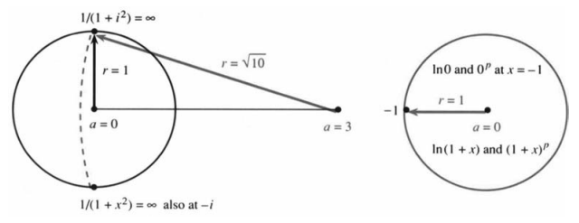

# 10.5　幂级数

原书 PDF 第471—476页；印刷页458—463。状态：初译，已对照原页自校，待统一复审。

<!-- PDF 471 / 印刷页 458 -->

本节研究幂级数的性质。当基点为零时，所用的幂为 $x^n$，级数为 $\sum a_nx^n$。当基点是 $x=a$ 时，所用的幂是 $(x-a)^n$。我们想知道级数在什么条件下、什么范围内，以及以多快的速度收敛到相应函数。$e^x$、$\cos x$ 和 $\sin x$ 的级数对所有 $x$ 都收敛，但 $1/(1-x)$ 显然不是这样。函数越光滑，收敛通常越有利。

首先强调，幂级数并不是唯一的级数。在许多应用中，它也不是最佳选择。另一种选择是正弦函数之和 $f(x)=\sum b_n\sin nx$，称为“傅里叶正弦级数（Fourier sine series）”。它平等地对待各个 $x$，不特别选定一个基点。傅里叶级数容许图像中有跳跃和尖角，既容纳光滑部分，也容纳不光滑部分。相比之下，幂级数在基点附近表现出色，离基点越远，表现越差。泰勒系数 $a_n$ 完全由基点处的信息决定——所有导数都在该点计算。记住泰勒级数的规则：

$$
a_n=\frac{\text{基点处的 $n$ 阶导数}}{n!}=\frac{f^{(n)}(a)}{n!}.\tag{1}
$$

一个很值得注意的事实是：收敛发生在以 $x=a$ 为中心的对称区间内。

**10M**　幂级数 $\sum a_nx^n$ 或者对所有 $x$ 都收敛，或者只在基点 $x=0$ 处收敛，或者有一个**收敛半径（radius of convergence）** $r$：

$$
\sum a_nx^n\quad\text{当 $|x|<r$ 时绝对收敛，当 $|x|>r$ 时发散。}
$$

级数 $\sum x^n/n!$ 对所有 $x$ 都收敛，其和为 $e^x$。级数 $\sum n!x^n$ 除了 $x=0$ 以外，在任何地方都不收敛。几何级数 $\sum x^n$ 当 $|x|<1$ 时绝对收敛，当 $|x|>1$ 时发散，它的收敛半径为 $r=1$。注意，对 $|x|>1$，函数 $1/(1-x)$ 本身完全没有问题；函数仍然存在，但级数已经放弃了。若在距离 $r$ 处出了问题，幂级数就无法越过那里。

当基点为 $x=a$ 时，收敛区间平移为 $|x-a|<r$。在 $a-r$ 与 $a+r$ 之间（关于 $a$ 对称），级数收敛。我们不能预先断定端点 $a\pm r$ 处是发散还是收敛，也不能预先断定是绝对收敛还是条件收敛。现在用一个简单的比较判别法证明区间内部的收敛性。

**10M的证明**　设 $\sum a_nX^n$ 在某个点 $X$ 收敛。我们将证明，当 $|x|<|X|$ 时，$\sum a_nx^n$ 收敛。因此，在 $X$ 处收敛，就意味着在所有更近的点 $x$ 处都收敛（这里“更近”是指更靠近基点0）。证明如下：既然 $\sum a_nX^n$ 收敛，其通项就趋于零。最终有 $|a_nX^n|<1$，从而

$$
|a_nx^n|=|a_nX^n|\,|x/X|^n<|x/X|^n.
$$

与公比为 $|x/X|$ 的几何级数比较，可知 $\sum a_nx^n$ 绝对收敛，因为 $|x/X|<1$。

**例1**　级数 $\sum nx^n/4^n$ 的收敛半径为 $r=4$。

**比值判别法和根值判别法最适合幂级数。**相邻项之比趋于 $x/4$（$nx^n/4^n$ 的 $n$ 次方根也是如此）：

$$
\frac{(n+1)x^{n+1}}{4^{n+1}}\bigg/\frac{nx^n}{4^n}
=\frac{x}{4}\frac{n+1}{n}\longrightarrow L=\frac{x}{4}.
$$

<!-- PDF 472 / 印刷页 459 -->

比值判别法说明，当 $L<1$ 时收敛，即 $|x|<4$。（绝对值问题见节末译注。）

**例2**　正弦级数 $x-x^3/3!+x^5/5!-\cdots$ 的 $r=\infty$，即处处收敛。

$x^{n+2}/(n+2)!$ 与 $x^n/n!$ 的比为 $x^2/[(n+2)(n+1)]$，它趋于 $L=0$。

**例3**　级数 $\sum (x-5)^n/n^2$ 以 $a=5$ 为基点，收敛半径为 $r=1$。

相邻项之比趋于 $L=x-5$，因为 $n^2/(n+1)^2\to1$。当 $|x-5|<1$ 时，级数绝对收敛。这就是以基点为中心的对称区间 $4<x<6$。由于因子 $1/n^2$ 的存在，这个级数恰好也在端点4与6处收敛。这个因子决定了端点收敛性这一微妙问题；但无论把 $n$ 换成什么固定次幂，内部的收敛区间都是 $4<x<6$。

## 收敛到函数：余项与半径 $r$

记住，泰勒级数从函数 $f(x)$ 出发，由基点处的导数产生级数。假设级数收敛：**它收敛到原函数吗？**这涉及余项 $R_n(x)=f(x)-s_n(x)$，即 $f$ 与部分和 $s_n=a_0+\cdots+a_n(x-a)^n$ 的差。**若级数截断在 $n$ 阶导数对应的项 $a_n(x-a)^n$，余项 $R_n$ 就是误差。**

**10N**　假设 $f$ 在从基点 $a$ 到 $x$ 的区间上有 $n+1$ 阶导数。那么，在两者之间的某个点 $c$（其位置未知），$x$ 处的余项满足

$$
R_n(x)=f(x)-s_n(x)=\frac{f^{(n+1)}(c)(x-a)^{n+1}}{(n+1)!}.\tag{2}
$$

截断在 $n$ 阶导数项时的误差，由 $n+1$ 阶导数控制。

你会猜到，这个未知点 $c$ 来自中值定理；猜得对。$n=1$ 时的证明见第3.8节末尾，那里研究的是一次近似的误差 $e(x)$：

$$
R_1(x)=f(x)-f(a)-f'(a)(x-a)=\tfrac12f''(c)(x-a)^2.
$$

对于任意 $n$，证明都要比较 $R_n$ 与 $(x-a)^{n+1}$。它们的 $n+1$ 阶导数分别为 $f^{(n+1)}$ 和 $(n+1)!$。广义中值定理说明，$R_n$ 与 $(x-a)^{n+1}$ 的比，等于这两个导数在某个适当点 $c$ 处的比，这就是式(2)。细节留在第3.8节及第23题，我们主要关心结论：**误差的形式恰好像下一项 $a_{n+1}(x-a)^{n+1}$，只是 $n+1$ 阶导数在 $c$ 处取值，而非在基点 $a$ 处取值。**

**例4**　若 $f=e^x$，则 $n+1$ 阶导数仍为 $e^x$，因此误差为

$$
R_n=e^x-\left(1+x+\cdots+\frac{x^n}{n!}\right)
=e^c\frac{x^{n+1}}{(n+1)!}.\tag{3}
$$

当 $x=1$、$n=2$ 时，误差为 $e-(1+1+\tfrac12)\approx0.218$，右边为 $e^c/6$。未知点为 $c=\ln(0.218\cdot6)\approx0.27$，确实位于基点 $a=0$

<!-- PDF 473 / 印刷页 460 -->

与计算误差的点 $x=1$ 之间。由于 $R_n\to0$，级数收敛到函数。

实际计算中，$n$ 表示需要计算的导数阶数。我们也许希望误差 $|R_n|$ 小于 $10^{-6}$。遗憾的是，式(2)中的高阶导数通常难以估计（$e^x$ 是例外），式(1)中的高阶导数也难以计算。多数实际计算只使用泰勒级数的少数几项。若要提高精度，就把基点移近一些，或者改用其他级数。

函数与收敛半径 $r$ 之间有直接联系。$f(x)=1/(1-x)$ 已经给出一个线索：函数在 $x=1$ 处趋于无穷，而这里也恰好是级数收敛区间的边界。另一个线索来自 $f=1/x$ 在 $x=a=1$ 附近的展开：

$$
\frac1x=\frac1{1-(1-x)}=1+(1-x)+(1-x)^2+\cdots.\tag{4}
$$

这个几何级数在 $|1-x|<1$ 时收敛。收敛在端点 $x=0$ 处终止，那里恰好是 $1/x$ 趋于无穷的地方。**函数出问题的地方阻止了级数继续收敛。**但注意，似乎从不出问题的 $1/(1+x^2)$，其收敛半径也只有 $r=1$：

$$
\frac1{1+x^2}=1-x^2+x^4-x^6+\cdots
\quad\text{只在 $|x|<1$ 时收敛。}
$$

看懂原因之后，你就会明白为什么 $r$ 叫作“半径”。这里有一个圆，函数在圆周上出了问题。圆内不仅有实数，还有复数。虚数点 $i$ 和 $-i$ 位于圆周上。**函数在这些点出问题，因为 $1/(1+i^2)=\infty$。**

复数在幕后起作用。收敛圆一直延伸到 $f(x)$ 最近的“奇点（singularity）”，无论该点是实数、虚数还是一般复数。对于 $1/(1+x^2)$，位于 $i$ 和 $-i$ 的奇点使 $r=1$。若以 $a=3$ 为中心展开，到 $i$ 和 $-i$ 的距离为 $r=\sqrt{10}$。若改为在 $x=-1$ 处趋于无穷的 $\ln(1+x)$，级数 $x-\tfrac12x^2+\tfrac13x^3-\cdots$ 的收敛半径便为 $r=1$。

**图10.6**　收敛半径 $r$ 是基点 $a$ 到最近奇点的距离。左图比较 $a=0$ 与 $a=3$ 到 $i$、$-i$ 的距离；右图示意 $\ln(1+x)$ 与非整次幂 $(1+x)^p$ 在 $x=-1$ 处的问题。图内“also at $-i$”意为“在 $-i$ 处也如此”，“at $x=-1$”意为“在 $x=-1$ 处”。

## 二项式级数

用最后一个级数结束本章：$(1+x)^p$ 在基点 $x=0$ 附近的泰勒级数。典型指数是 $p=\tfrac12$，此时我们要找出

$$
\sqrt{1+x}=1+\tfrac12x+a_2x^2+\cdots
$$

中的各项。

<!-- PDF 474 / 印刷页 461 -->

慢办法是把两边平方，右边得到 $1+x+(2a_2+\tfrac14)x^2+\cdots$。左边是 $1+x$，所以必须取 $a_2=-\tfrac18$ 来消去 $x^2$ 项，接着才能求 $a_3$。快办法是匹配 $f=(1+x)^{1/2}$ 的各阶导数：

$$
\begin{aligned}
f'&=\tfrac12(1+x)^{-1/2},\\
f''&=(\tfrac12)(-\tfrac12)(1+x)^{-3/2},\\
f'''&=(\tfrac12)(-\tfrac12)(-\tfrac32)(1+x)^{-5/2}.
\end{aligned}
$$

在 $x=0$ 处，这些导数分别为 $\tfrac12,-\tfrac14,\tfrac38$。除以 $1!,2!,3!$ 得到

$$
a_1=\tfrac12,\qquad a_2=-\tfrac18,\qquad a_3=\tfrac1{16},\qquad
a_n=\frac1{n!}\left(\tfrac12\right)\left(\tfrac12-1\right)\cdots\left(\tfrac12-n+1\right).
$$

这些就是指数 $p=\tfrac12$ 时的二项式系数。

注意它与第2章二项式的区别。那里指数 $p$ 是正整数；$(1+x)^2=1+2x+x^2$ 的级数到 $x^2$ 就终止。$p=2$ 时的系数为 $1,2,1,0,0,0,\ldots$。若 $p$ 是分数或负数，后面的系数并不为零，可以从 $(1+x)^p$ 的导数求出：

$$
(1+x)^p,\quad p(1+x)^{p-1},\quad p(p-1)(1+x)^{p-2},\quad\ldots,
\quad f^{(n)}=p(p-1)\cdots(p-n+1)(1+x)^{p-n}.
$$

在 $x=0$ 处分别除以 $0!,1!,2!,\ldots,n!$，得到二项式系数

$$
1,\quad p,\quad\frac{p(p-1)}2,\quad\ldots,\quad
\frac{f^{(n)}(0)}{n!}=\frac{p(p-1)\cdots(p-n+1)}{n!}.\tag{5}
$$

当 $p=n$ 时，最后这个二项式系数为 $n!/n!=1$，给出 $(1+x)^n$ 最后的 $x^n$ 项。对于其他非整数或负指数 $p$，二项式级数不会终止，**它在 $|x|<1$ 时收敛**：

$$
(1+x)^p=1+px+\frac{p(p-1)}2x^2+\cdots
=\sum_{n=0}^{\infty}\frac{p(p-1)\cdots(p-n+1)}{n!}x^n.\tag{6}
$$

当 $p=1,2,3,\ldots$ 时，二项式系数 $p!/[n!(p-n)!]$ 表示从 $p$ 位朋友中选出 $n$ 位组成一组的方法数。若有20位朋友，就能以 $(20)(19)/2=190$ 种方式选出其中2位。（原书该阶乘公式有笔误，见译注。）

假设 $p$ 不是正整数。$(1+x)^p$ 在哪里出了问题，使收敛在 $|x|=1$ 处受到阻碍？问题出在 $x=-1$。若 $p<0$，$(1+x)^p$ 趋于无穷；若 $p>0$，例如 $\sqrt{1+x}$，则高阶导数趋于无穷。只有当 $p=n$ 是正整数时，收敛半径才扩大到 $r=\infty$；这时 $(1+x)^n$ 的级数到 $x^n$ 终止，$f$ 不会出问题。

幂级数是函数的一种新形式。它并不简单，但有时却是唯一可用的形式。要计算 $f$，必须对级数求和；要计算 $f$ 的平方，必须将级数相乘。但微积分运算——求导和积分——反而比较容易。这解释了为什么幂级数有助于求解微分方程，而微分方程又是新函数的丰富来源。（在数值计算方面，级数不一定总是好用。）确切地说，是每一个单独的项 $a_nx^n$ 都容易求导和积分；幸运的是，整个级数的收敛半径不会改变。

**若 $f(x)=\sum a_nx^n$ 的收敛半径为 $r$，它的导数和积分也有相同的收敛半径：**

$$
\frac{df}{dx}=\sum na_nx^{n-1},\qquad
\int f(x)\,dx=\sum\frac{a_nx^{n+1}}{n+1}
\quad\text{也在 $|x|<r$ 时收敛。}
$$

**例5**　$1/(1-x)$、它的导数 $1/(1-x)^2$ 和它的积分 $-\ln(1-x)$ 的级数都有 $r=1$，因为它们在 $x=1$ 处都有问题。这三个级数分别为 $\sum x^n$、$\sum nx^{n-1}$ 和 $\sum x^{n+1}/(n+1)$。

<!-- PDF 475 / 印刷页 462 -->

**例6**　逐项积分，可以对以前无法求积分的 $e^{x^2}$ 求积分：

$$
\int e^{x^2}\,dx=\int\left(1+x^2+\frac{x^4}{2!}+\cdots\right)dx
=x+\frac{x^3}{3}+\frac1{2!}\frac{x^5}{5}+\frac1{3!}\frac{x^7}{7}+\cdots.
$$

这个级数处处收敛（$r=\infty$）。$e^{x^2}$ 的导数则从来没有造成困难。

## 10.5　习题

### 阅读填空

若 $|x|<|X|$ 且 $\sum a_nX^n$ 收敛，则级数 $\sum a_nx^n$ 也 __a__。收敛发生在以 __c__ 为中心的 __b__ 区间内。对 $\sum(2x)^n$，收敛半径为 $r=\text{__d__}$；对 $\sum x^n/n!$，半径为 $r=\text{__e__}$。$\sum(x-3)^n$ 在 $|x-3|<\text{__f__}$ 时收敛，此时 $x$ 位于 __g__ 与 __h__ 之间。

从 $f(x)$ 出发，其泰勒级数 $\sum a_nx^n$ 的系数为 $a_n=\text{__i__}$。以 $a$ 为基点时，$(x-a)^n$ 的系数为 __j__。截断在 $x^n$ 项之后的误差称为 __k__ $R_n(x)$，它等于 __l__，其中未知点 $c$ 位于 __m__ 之间。因此，误差由 __n__ 阶导数控制。

收敛圆延伸到 $f(x)$ 首次出问题的点。对 $f=4/(2-x)$，该点为 $x=\text{__o__}$；以 $a=5$ 为基点时，收敛半径为 $r=\text{__p__}$。对 $\sin x$ 与 $\cos x$，半径为 $r=\text{__q__}$。

$\sqrt{1+x}$ 的级数是 $p=\tfrac12$ 时的 __r__ 级数。其系数为 $a_n=\text{__s__}$，收敛半径为 __t__。它的平方是非常短的级数 $1+x$。

第1—6题：求 $f(x)$ 在 $x=0$ 附近的泰勒级数及收敛半径 $r$。$f(x)$ 在哪个点趋于无穷？

1. $f(x)=1/(1-4x)$。
2. $f(x)=1/(1-4x^2)$。
3. $f(x)=e^{1-x}$。
4. $f(x)=\tan x$（展开到 $x^3$ 项）。
5. $f(x)=\ln(e+x)$。
6. $f(x)=1/(1+4x^2)$。

第7—10题：求收敛区间及其所表示的函数。

7. $\displaystyle f(x)=\sum_{n=0}^{\infty}\left(\frac{x-1}{2}\right)^n$。
8. $\displaystyle f(x)=\sum_{n=0}^{\infty}n(x-a)^{n-1}$。
9. $\displaystyle f(x)=\sum_{n=0}^{\infty}\frac1{n+1}(x-a)^{n+1}$。
10. $\displaystyle f(x)=(x-2\pi)-\frac{(x-2\pi)^3}{3!}+\cdots$。
11. 根据 $e^x$ 的级数，写出 $(e^x-1)/x$ 的泰勒级数。该表达式在 $x=0$ 处呈 $0/0$ 型。计算级数在 $x=0$ 处的值，再对 $(e^x-1)/x$ 使用洛必达法则验证。
12. 写出 $xe^x$ 在 $x=0$ 附近的泰勒级数。积分后代入 $x=1$，求 $1/[n!(n+2)]$ 的级数之和。
13. 若 $f(x)$ 是偶函数，即 $f(-x)=f(x)$，那么 $f=\sum a_nx^n$ 中的泰勒系数有什么性质？
14. 试求下列级数的和：（a）$x+x^2-x^3+x^4+x^5-x^6+\cdots$；（b）$1+x^4/4!+x^8/8!+\cdots$；（c）$(x-1)-\tfrac12(x-1)^2+\tfrac13(x-1)^3-\cdots$。
15. 由 $(1-\cos x)/x^2$ 的级数求 $x\to0$ 时的极限，要比洛必达法则更快。
16. 构造一个在 $0<x<2\pi$ 时收敛的幂级数。

第17—24题讨论余项，第25—36题讨论二项式级数。

17. 若余弦级数截断在 $x^8/8!$ 项之前，用式(2)说明余项 $R_7$ 小于 $x^8/8!$。能否也由级数是交错级数得出这个结论？
18. 若以 $x=2\pi$ 为中心的正弦级数保留到第10题中列出的项，用式(2)估计余项。
19. 用式(2)估计几何级数的余项 $R_n=x^{n+1}+x^{n+2}+\cdots$。再精确计算 $R_n$，并在 $n=2$、$x=\tfrac12$ 时求未知点 $c$。
20. 对 $-\ln(1-x)=x+\tfrac12x^2+\tfrac13x^3+R_3$，用式(2)证明在 $x=\tfrac12$ 处 $R_3\leq\tfrac18$。
21. 求第20题中的 $R_n$，并说明级数在 $x=\tfrac12$ 处收敛到原函数（证明 $R_n\to0$）。
22. 通过估计 $R_n$，证明 $e^x$ 在 $x=1$ 附近的泰勒级数在 $n\to\infty$ 时收敛到 $e^x$。
23. （证明 $n=2$ 时的余项公式。）
    （a）求 $R_2,R_2',R_2'',R_2'''$ 在 $x=a$ 处的值。
    （b）计算 $g(x)=(x-a)^3$ 及 $g',g'',g'''$ 在 $x=a$ 处的值。
    （c）哪一个定理给出
    $$\frac{R_2(x)-R_2(a)}{g(x)-g(a)}=\frac{R_2'(c_1)}{g'(c_1)}\ ?$$

<!-- PDF 476 / 印刷页 463 -->

    （d）在
    $$\frac{R_2'(c_1)-R_2'(a)}{g'(c_1)-g'(a)}=\frac{R_2''(c_2)}{g''(c_2)},\qquad
    \frac{R_2''(c_2)-R_2''(a)}{g''(c_2)-g''(a)}=\frac{R_2'''(c)}{g'''(c)}$$
    中，$c_1,c_2,c$ 分别位于哪里？
    （e）合并（a）—（d），得出余项公式(2)。

24. 函数 $f(x)=e^{-1/x^2}$ 在 $x=0$ 处的所有阶导数都等于零，其中定义 $f(0)=0$。$f(0.1)$ 是多少？在 $x=0$ 附近的泰勒级数是什么？收敛半径是多少？级数在哪些点收敛到 $f(x)$？当 $x=1$、$n=1$ 时，式(2)给出的余项估计是什么？
25. （a）求 $1/\sqrt{1-x^2}$ 的二项式级数前三项。（b）积分，求 $\sin^{-1}x$ 的泰勒级数前三项。
26. 证明 $1/\sqrt{1-x}=\sum a_nx^n$ 的二项式系数为 $a_n=1\cdot3\cdot5\cdots(2n-1)/(2^nn!)$。
27. 对 $p=-1$ 和 $p=-2$，求二项式系数的简洁公式。
28. 改换求和指标并补上求和下限，使 $\sum^{\infty}nx^{n-1}=\sum^{\infty}(n+1)x^n$ 成立。
29. 在 $(1-x)^{-1}=\sum x^n$ 中，$x^n$ 的系数是从1位朋友中组成含 $n$ 个成员的一组的方法数（这里不同于通常的二项式选择，允许重复！）。系数为1，也确实只有一种组合：同一位朋友重复 $n$ 次。（a）描述从2位朋友中组成含 $n$ 个成员的一组的所有方法（共有 $n+1$ 种）。（b）从3位朋友中组成含5个成员的一组，有多少种方法？
30. （a）$1+x+x^2+\cdots$ 与自身相乘时，$x^n$ 的系数是什么？写出前三项。（b）$(\sum x^k)^3$ 中 $x^5$ 的系数是什么？
31. 证明 $\sqrt{1+4x}$ 的二项式级数具有整数系数。（注意 $x^n$ 变成 $(4x)^n$。这些系数在树、路径、括号等的计数中很重要。）
32. 在 $1/\sqrt{1+4x}$ 的级数中，证明 $x^n$ 的系数为 $(2n)!/(n!)^2$。（原题符号问题见译注。）

第33—36题：用二项式级数计算，误差小于 $1/1000$。

33. $15^{1/4}$。
34. $1001^{1/3}$。
35. $1.1^{1.1}$。
36. $e^{1/1000}$。
37. 从 $\sec x=1/[1-(1-\cos x)]$ 出发，求 $\sec x$ 到 $x^6$ 项的泰勒级数。收敛半径 $r$（到趋于无穷之点的距离）是多少？
38. 从 $\sec^2x=1/[1-\sin^2x]$ 出发，求到 $x^2$ 项的泰勒级数。将第37题的正割级数平方，验证结果；再对第39题的正切级数求导，验证结果。
39. （级数相除。）对 $\sin x/\cos x$ 作长除法，求 $\tan x$：
    $$\left(x-\frac{x^3}{6}+\frac{x^5}{120}-\cdots\right)\bigg/\left(1-\frac{x^2}{2}+\frac{x^4}{24}-\cdots\right)
    =x+\frac{x^3}{3}+\frac{2x^5}{15}+\cdots.$$
40. （级数复合。）若 $f=a_0+a_1x+a_2x^2+\cdots$、$g=b_1x+b_2x^2+\cdots$，求 $f(g(x))$ 中常数项、$x$ 项和 $x^2$ 项的系数。用 $f=1/(1+x)$、$g=x/(1-x)$ 验证，此时 $f(g(x))=1-x$。
41. （级数相乘。）根据 $\sin x$ 与 $1/(1-x)$ 的级数，求 $f=\sin x/(1-x)$ 的前四项。
42. （级数求逆。）若 $f=a_1x+a_2x^2+\cdots$，求 $g=b_1x+b_2x^2+\cdots$ 中的 $b_1,b_2$，使 $f(g(x))=x$。对 $f=e^x-1$、$g=f^{-1}=\ln(1+x)$，计算 $b_1,b_2$。
43. 通过乘积 $(\sin x)(\sin x)$，或通过 $f(x)=\sin^2x$ 的各阶导数，求级数的前三项。再用一个简单技巧求 $\cos^2x$ 的前四项。
44. 设法求 $f=(1-x)/(1-x^3)$ 的前六个非零项。
45. 求 $1/\sqrt{1-x}$ 的级数的四项，再将级数平方，得到一个几何级数。
46. 对幂级数逐项积分，计算 $\int_0^1e^{-x^2}\,dx$，精确到小数点后三位。
47. 用幂级数计算 $\int_0^1\sin^2t\,dt$，精确到小数点后四位。
48. 说明 $\sum x^n/n$ 在 $x=-1$ 处收敛，但它的导数级数 $\sum x^{n-1}$ 在该处发散。两者怎么会有相同的收敛半径？
49. 由级数计算 $\displaystyle\lim_{x\to0}\frac{\sin x-\tan x}{x^3}$。
50. 若 $a_n$ 的 $n$ 次方根趋于 $L>0$，说明为什么 $\sum a_nx^n$ 的收敛半径为 $r=1/L$。
51. 根据 $(1+\tan x)/(1+x^2)$ 趋于无穷的点，求分别以 $a=0$、$a=1$ 为基点的收敛半径 $r$。

## 译注与待复审事项

- 例1原文把有符号的比值极限记为 $L=x/4$，随后直接用 $L<1$ 推出 $|x|<4$；严谨应用比值判别法应取绝对值，得到 $|x|/4<1$。根值法也应对通项绝对值取根。例3有同类省略，结论 $|x-5|<1$ 正确。
- 10M的证明写出的是“在一个点收敛，则在更靠近中心的点绝对收敛”；取这些点模长的上确界即可得到收敛半径及外部发散性。端点必须另行判断。
- “最近复奇点决定半径”适用于所讨论的复解析函数及相应展开，不是说任何实无限次可导函数都等于泰勒级数；第24题正展示了反例。$1/(1+i^2)=\infty$ 是原书表示极点的非严格写法，分母为零时函数值并未定义。
- 印刷页461原文组合数误写为 $p!/[n!(n-p)!]$，正文明确改为 $p!/[n!(p-n)!]$。$n=0$ 时式(6)的空乘积取1。$p=0$ 也给出终止级数与无穷收敛半径，原文关于“只有正整数”的说法漏掉这一常数情形。
- 积分级数沿用原文省略积分常数的形式，所列为一个原函数；通式须加 $C$。例6“以前无法求积分”指不能用初等函数表示原函数，并非积分不存在。
- 第8题的 $n=0$ 项应按求导后的零项处理；写成从 $n=1$ 起求和可避免在 $x=a$ 处出现 $0\cdot(x-a)^{-1}$ 的形式问题。第17题的误差界应注意绝对值与 $x=0$ 时的等号；交错级数估计另需检查项的递减性。
- 第24题已按原意明确 $f(0)=0$ 为补充定义；$e^{-1/x^2}$ 的表达式本身在零点无定义。第32题原文确实写 $1/\sqrt{1+4x}$，其 $x^n$ 系数应有因子 $(-1)^n$；若改为 $1/\sqrt{1-4x}$，则所给正系数正确。题面保留，未静默改题。
- 第36题归入“用二项式级数”题组，与直接使用指数级数的常见做法不同，按原书保留。第42题构造局部反函数须有 $a_1\ne0$；第50题若要涵盖一般实或复系数，应以 $|a_n|^{1/n}$ 表述。
