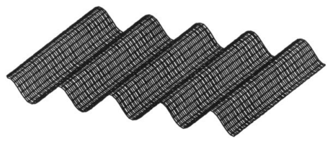
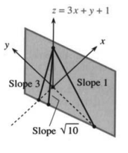
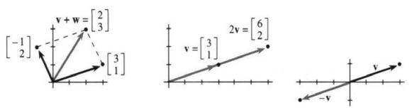
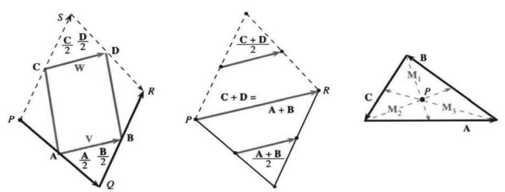
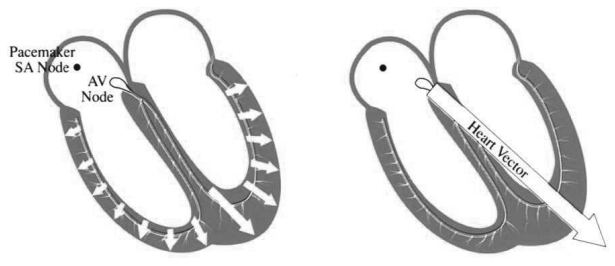
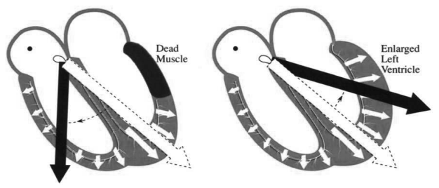
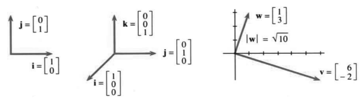
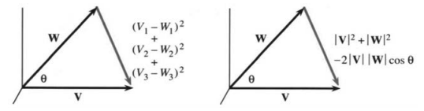
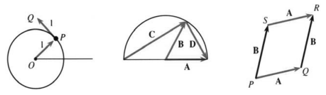

# 第11章　向量与矩阵

原书 PDF 第477—488页；印刷页464—475。本文件含章引言与第11.1节。状态：初译，已对照原页自校，待统一复审。

<!-- PDF 477 / 印刷页 464 -->

本章开启微积分的一个新部分：多维微积分，因为我们的研究将进入更多维度。在前十章中，函数依赖于时间 $t$ 或位置 $x$，但不同时依赖两者。我们研究 $f(t)$ 或 $y(x)$，图像是平面曲线，有一个自变量（$x$ 或 $t$）和一个因变量（$y$ 或 $f$）。现在将遇到同时依赖 $x$ 与 $t$ 的函数 $f(x,t)$，它们的图像是曲面而非曲线。这便把我们带入多元微积分。

从表示函数 $f(x,t)$、$f(x,y)$ 或 $f(x,y,t)$ 的曲面开始。我强调函数，因为函数是微积分的研究对象。

**例7**　$f(x,t)=\cos(x-t)$ 是行波，即运动的余弦曲线。

当 $t=0$ 时，曲线为 $f=\cos x$。时间推移后，曲线向右移动（图11.1）。每取一个 $t$，就得到整个 $x$-$t$ 曲面的一个截面。对于沿弦传播的波，其高度既依赖位置，也依赖时间。

一个类似的函数可以描述绕体育场传播的人浪。每个人起立、坐下，人浪便这样传播开来。

**例8**　$f(x,y)=3x+y+1$ 是一个倾斜的屋顶，不随时间变化。

这个曲面是二维的，你可以在上面四处走动。由于 $3x+y+1$ 是线性函数，它是平的。沿 $y$ 方向，曲面以 $45^\circ$ 的角度上升：$y$ 增加1，$f$ 也增加1，斜率为1。沿 $x$ 方向，屋顶更陡，斜率为3。在两者之间的某个方向上，屋顶最陡，斜率为 $\sqrt{10}$。

**例9**　$f(x,y,t)=\cos(x-y-t)$ 表示带有行波的海面。

这个曲面在运动。每一时刻 $t$，都有一个新的 $x$-$y$ 曲面。这里有三个变量：$x,y$ 表示位置，$t$ 表示时间。我画不出整个函数，因为那需要四个维度！底部坐标是 $x,y,t$，高度是 $f$。另一种办法是用动画展示 $x$-$y$ 曲面随 $t$ 的变化。

在 $t=0$ 时，海面由 $\cos(x-y)$ 给出。波峰沿直线排列：$x-y=0$ 沿着一个波峰，因为 $\cos0=1$；下一个波峰位于平行直线 $x-y=2\pi$ 上，因为 $\cos2\pi=1$。图11.1展示固定时刻的海面。

<!-- PDF 478 / 印刷页 465 -->

直线 $x-y=t$ 给出时刻 $t$ 的一个波峰。水上下运动，就像体育场里的人。**波向岸边传播，水仍留在海中。**

**图11.1**　运动的余弦波带来一个小小的视觉错觉：改变观察角度时，较暗的条带似乎会从上向下移动。

**图11.2**　线性函数给出平面。图内 Slope 意为“斜率”。

当然，多维微积分不只是用来研究波。在商业中，需求是价格和日期的函数；在工程中，速度和温度依赖位置 $x$ 与时间 $t$；生物学同时处理许多变量，而统计学总在寻找 $z=x+2y$ 这样的线性关系。把导数和积分推广到更多维度，是我们面前的一项重要工作。

<!-- PDF 479 / 印刷页 466 -->

# 11.1　向量与点积

在平面内，每一点由两个数描述。用 $x$ 量横向距离，用 $y$ 量向上距离。从原点出发，就到达坐标为 $(x,y)$ 的点。我想用一个向量来描述这次移动：它是从 $(0,0)$ 出发、到 $(x,y)$ 结束的有向线段。这个向量 $\mathbf v$ 有方向，由 $(0,0)$ 指向 $(x,y)$，而非反向。

图中用箭头表示向量。在代数中，$\mathbf v$ 由两个分量给出。若写成列向量，就把 $x$ 写在 $y$ 上面：

$$
\mathbf v=\begin{bmatrix}x\\y\end{bmatrix}
\qquad\text{（$x,y$ 是 $\mathbf v$ 的分量）。}\tag{1}
$$

注意，向量 $\mathbf v$ 用粗体，分量 $x,y$ 用普通字体。† 方向相反的向量 $-\mathbf v$，各分量改变符号。$\mathbf v$ 与 $-\mathbf v$ 相加得到零向量，它与数零不同，也用粗体表示：

$$
-\mathbf v=\begin{bmatrix}-x\\-y\end{bmatrix},\qquad
\mathbf v-\mathbf v=\begin{bmatrix}x-x\\y-y\end{bmatrix}
=\begin{bmatrix}0\\0\end{bmatrix}=\mathbf0.\tag{2}
$$

注意，向量加减是分别对 $x$ 分量和 $y$ 分量进行的：

$$
\mathbf v+\mathbf w=\begin{bmatrix}3\\1\end{bmatrix}
+\begin{bmatrix}-1\\2\end{bmatrix}=\begin{bmatrix}2\\3\end{bmatrix}.\tag{3}
$$

**图11.3**　$\mathbf v+\mathbf w$ 对应平行四边形法则，$2\mathbf v$ 对应伸长，$-\mathbf v$ 对应反向。

向量 $\mathbf v$ 的分量为 $v_1=3$、$v_2=1$。（我用 $v_1$ 表示第一分量，$v_2$ 表示第二分量；也会用 $x,y$，在只有两个分量时这样很方便。）向量 $\mathbf w$ 的分量为 $w_1=-1$、$w_2=2$。相加时把对应分量相加。**作图时，把 $\mathbf w$ 的起点放在 $\mathbf v$ 的终点上。**图11.3显示了这种首尾相接的方式。

## 不依赖坐标的向量

在 $\mathbf v+\mathbf w$ 的首尾相接加法中，我们做了一件新事情：把向量 $\mathbf w$ 移离原点。它的长度与方向都没有改变！新箭头与原箭头平行，只是起点不同；向量仍是原来的向量。

定义向量不需要原点，也不需要 $x,y$ 轴。坐标轴的用途是给出分量，也就是横向、纵向的距离 $x,y$。计算时需要这些数，

† 另一种向量记号是 $\vec v$。即使没有箭头，你也会认出向量。

<!-- PDF 480 / 印刷页 467 -->

但首尾相接的加法 $\mathbf v+\mathbf w$、伸长为 $2\mathbf v$，或线性组合 $2\mathbf v+3\mathbf w$，都不需要 $x,y$ 坐标。有些应用依赖坐标，有些不依赖。

一般说来，物理可以不借助坐标轴工作，也就是“与坐标无关”。速度有方向和大小，但不固定在某一点。力也有方向和大小，可以作用在任何地方，而非只能作用在原点。相比之下，一个表示五种股票价格的向量并不在空间中自由漂移：每个分量都有意义，相当于五个坐标轴，而且我们知道价格为零意味着什么。介绍几个不依赖坐标轴的几何与物理例子之后，再回到带坐标的向量。

**例1（几何）**　取空间中的任意四边形，连接四条直边的中点。一个令人惊讶的事实是：**这四个中点共面。**不仅如此，它们还构成平行四边形。

坦率说，这很奇妙。图11.4a印在平面纸张上，不能充分展示这个问题。请想象向量 $\mathbf A,\mathbf D$ 向上伸出，$\mathbf B,\mathbf C$ 以不同角度向下。注意，把四条边表示成向量多么容易，完全不用管坐标轴与原点。

我要证明 $\mathbf V=\mathbf W$。这就说明四个中点形成平行四边形。$\mathbf V$ 是什么？它从 $\mathbf A$ 的中点出发，终止于 $\mathbf B$ 的中点。底部的小三角形给出 $\mathbf V=\tfrac12\mathbf A+\tfrac12\mathbf B$。这是向量加法：$\tfrac12\mathbf B$ 的尾端接在 $\tfrac12\mathbf A$ 的头端，两者合起来等于直接到达终点的 $\mathbf V$。同理，$\mathbf W=\tfrac12\mathbf C+\tfrac12\mathbf D$。看出这些关系就是证明的核心。

还剩一步：为什么 $\tfrac12\mathbf A+\tfrac12\mathbf B$ 等于 $\tfrac12\mathbf C+\tfrac12\mathbf D$？也就是为什么 $\mathbf A+\mathbf B=\mathbf C+\mathbf D$？（两边乘以2。）问题问对了，答案便显而易见。首尾相接的 $\mathbf A+\mathbf B$ 把我们带到点 $R$，$\mathbf C+\mathbf D$ 也把我们带到 $R$。证明归结为一行：

$$
\mathbf A+\mathbf B=\overrightarrow{PR}=\mathbf C+\mathbf D;
\quad\text{所以 }\mathbf V=\tfrac12\mathbf A+\tfrac12\mathbf B
=\mathbf W=\tfrac12\mathbf C+\tfrac12\mathbf D.
$$

**图11.4**　四个中点组成平行四边形（$\mathbf V=\mathbf W$）；三条中线交于 $P$。

**例2（仍是几何）**　在任意三角形中，从各顶点连到对边中点。用向量证明：**这三条线交于一点。**第38题求图11.4c中的交点。第37题指出，三个中线向量之和为零。

<!-- PDF 481 / 印刷页 468 -->

**例3（医学）**　心电图显示许多小向量的和，这些小向量表示心壁中的电压。在心脏科医生关注的下列两种情况下，这个和——心电向量 $\mathbf V$——会怎样变化？

- 情况1：心脏的一部分坏死（梗死，infarction）。
- 情况2：心脏的一部分异常增厚（肥厚，hypertrophy）。

心脏病发作会使部分心肌坏死。瓣膜缺陷或高血压会使心脏负荷过重。在情况1中，供血中断导致缺氧，细胞死亡；在情况2中，压力过高可使心壁增厚到原来的三倍。原因可能是化学性的，也可能是机械性的；我们看到的效应则是电性的。

**仪器把小向量相加，再向十二个方向作“投影”。**

双臂、左腿与胸部的导联给出身体中的十二个方向。每张曲线图表示 $\mathbf V$ 在其中一个方向上的分量。三个投影——竖直平面内的两个，加上用于前后方向的第2导联——给出图11.5中的“平均QRS向量”。它是心室开始收缩时的合向量 $\mathbf V$。左心室较大，所以心电向量通常指向左下方。（导联描述按原文保留，见译注。）

**图11.5**　去极化瞬间，$\mathbf V$ 是许多小电压向量的和。图内 Pacemaker / SA Node：起搏点／窦房结；AV Node：房室结；Heart Vector：心电向量。

**图11.6**　$\mathbf V$ 的变化显示坏死心肌与负荷过重的心肌。Dead Muscle：坏死心肌；Enlarged Left Ventricle：增大的左心室。

我们很快会讨论投影，但这里关心的是 $\mathbf V$ 本身。心电图如何识别这些问题？

<!-- PDF 482 / 印刷页 469 -->

**情况1：心脏病发作。**坏死细胞不再对电势作贡献，一些小向量消失了，因此合向量 $\mathbf V$ 转向远离梗死部分的方向。

**情况2：心肌肥厚。**负荷过重增加了对电势的贡献，一些向量比正常时更大，因此 $\mathbf V$ 转向增厚的部分。

当 $\mathbf V$ 指向异常方向时，心电图曲线便可定位问题。各幅曲线中的 $P,Q,R,S,T$ 波都可能提示不同部位的肥厚。梗死一般发生在需要最多血液供应的左心室。供氧减少时，左心室首先受到影响，结果可能是心脏病发作（原文并列为心肌梗死、冠状动脉闭塞）。第11.2节将说明心电图上的投影如何指示位置。

先来介绍向量的基本事实：分量、长度和点积。

## 坐标向量与长度

用向量计算需要坐标轴与坐标。心脏的示意图可以不依赖坐标，但计算需要数值。向量由分量确定。**沿坐标轴的单位向量，在平面中是 $\mathbf i,\mathbf j$，在空间中是 $\mathbf i,\mathbf j,\mathbf k$：**

$$
\begin{aligned}
\text{二维：}\quad&\mathbf i=\begin{bmatrix}1\\0\end{bmatrix},\quad
\mathbf j=\begin{bmatrix}0\\1\end{bmatrix};\\
\text{三维：}\quad&\mathbf i=\begin{bmatrix}1\\0\\0\end{bmatrix},\quad
\mathbf j=\begin{bmatrix}0\\1\\0\end{bmatrix},\quad
\mathbf k=\begin{bmatrix}0\\0\\1\end{bmatrix}.
\end{aligned}
$$

注意，进入三维多么容易！唯一变化是向量有三个分量。$\mathbf i,\mathbf j$（或 $\mathbf i,\mathbf j,\mathbf k$）的组合产生平面内所有向量 $\mathbf v$（或空间内所有向量 $\mathbf V$）：

$$
\mathbf v=3\mathbf i+\mathbf j=\begin{bmatrix}3\\1\end{bmatrix},\qquad
\mathbf V=\mathbf i+2\mathbf j-2\mathbf k=\begin{bmatrix}1\\2\\-2\end{bmatrix}.
$$

**这些向量也写成 $\mathbf v=(3,1)$、$\mathbf V=(1,2,-2)$。**向量的分量也是一个点的坐标，因为向量从原点指向该点。点与向量关系如此密切，以至于我们允许用同样的坐标记号：$P=(x,y,z)$，$\mathbf v=(x,y,z)=x\mathbf i+y\mathbf j+z\mathbf k$。

和 $\mathbf v+\mathbf V$ 完全没有意义，因为这两个向量属于不同维度。

由分量可求长度。$(3,1)$ 的长度为 $\sqrt{3^2+1^2}=\sqrt{10}$，直接来自直角三角形。在三维中，还要把第三个分量的平方加进去。$\mathbf V=(x,y,z)$ 的长度为 $|\mathbf V|=\sqrt{x^2+y^2+z^2}$。

**竖线表示长度，起到绝对值的对应作用。**$\mathbf v=3\mathbf i+\mathbf j$ 的长度是从 $(0,0)$ 到 $(3,1)$ 的距离：

$$
|\mathbf v|=\sqrt{v_1^2+v_2^2}=\sqrt{10},\qquad
|\mathbf V|=\sqrt{1^2+2^2+(-2)^2}=3.
$$

**单位向量是长度为1的向量。**将 $\mathbf v,\mathbf V$ 分别除以自身长度，得到同方向的单位向量：

<!-- PDF 483 / 印刷页 470 -->

$$
\frac{\mathbf v}{|\mathbf v|}=\begin{bmatrix}3/\sqrt{10}\\1/\sqrt{10}\end{bmatrix},\qquad
\frac{\mathbf V}{|\mathbf V|}=\begin{bmatrix}1/3\\2/3\\-2/3\end{bmatrix}.
$$

**11A**　每个非零向量都有正的长度 $|\mathbf v|$。$\mathbf v$ 的方向由单位向量 $\mathbf u=\mathbf v/|\mathbf v|$ 给出。长度乘以方向向量等于 $\mathbf v$。

平面内的单位向量由它与 $x$ 轴的夹角 $\theta$ 决定：

$$
\mathbf u=\begin{bmatrix}\cos\theta\\\sin\theta\end{bmatrix}
=(\cos\theta)\mathbf i+(\sin\theta)\mathbf j,
\qquad |\mathbf u|^2=\cos^2\theta+\sin^2\theta=1.
$$

在三维空间中，单位向量的分量就是它的“方向余弦”：

$$
\mathbf U=(\cos\alpha)\mathbf i+(\cos\beta)\mathbf j+(\cos\gamma)\mathbf k;
\quad\alpha,\beta,\gamma\text{ 分别是与 }x,y,z\text{ 轴的夹角。}
$$

于是 $\cos^2\alpha+\cos^2\beta+\cos^2\gamma=1$。我们一边用数做代数，一边用向量做几何。看出怎样同时研究代数和几何，是笛卡尔的伟大贡献。

**图11.7**　坐标向量 $\mathbf i,\mathbf j,\mathbf k$。垂直向量满足 $\mathbf v\cdot\mathbf w=(6)(1)+(-2)(3)=0$。

## 两个向量的点积

向量有两种基本运算：第一是相加，$\mathbf v+\mathbf w$；第二是与标量相乘，如 $7\mathbf v$ 或 $-2\mathbf w$。自然会问：两个向量怎样相乘？主要的回答是，没有一个像普通数乘法那样统一的乘法。但有一种极其重要的运算，从两个向量得到一个数。通常在两向量之间写一个点，如 $\mathbf v\cdot\mathbf w$，因此称为**点积（dot product）**。

**定义1**　点积等于长度 $|\mathbf v|$ 乘以长度 $|\mathbf w|$，再乘以夹角的余弦：

$$
\mathbf v\cdot\mathbf w=|\mathbf v||\mathbf w|\cos\theta,
\qquad\theta=\mathbf v\text{ 与 }\mathbf w\text{ 的夹角。}
$$

**例**　$\begin{bmatrix}3\\0\end{bmatrix}$ 长为3，$\begin{bmatrix}2\\2\end{bmatrix}$ 长为 $\sqrt8$，夹角为 $45^\circ$。

点积为 $|\mathbf v||\mathbf w|\cos\theta=(3)(\sqrt8)(1/\sqrt2)$，化简得6。长度中的平方根被余弦中的平方根“抵消”了。还有第二种更简单的计算方法，从一开始就不需要平方根。

<!-- PDF 484 / 印刷页 471 -->

**定义2**　点积 $\mathbf v\cdot\mathbf w$ 是对应分量分别相乘后再相加：

$$
\mathbf v\cdot\mathbf w=v_1w_1+v_2w_2,\qquad
\begin{bmatrix}3\\0\end{bmatrix}\cdot\begin{bmatrix}2\\2\end{bmatrix}
=(3)(2)+(0)(2)=6.
$$

第一种形式 $|\mathbf v||\mathbf w|\cos\theta$ 不依赖坐标；第二种形式 $v_1w_1+v_2w_2$ 用坐标计算。下面说明4会解释两者为什么相等。

**11B**　三维向量的**点积**，也称**数量积（scalar product）**或**内积（inner product）**，为

$$
\mathbf V\cdot\mathbf W=|\mathbf V||\mathbf W|\cos\theta
=V_1W_1+V_2W_2+V_3W_3.\tag{4}
$$

若两向量垂直，则 $\theta=90^\circ$，$\cos\theta=0$，所以 $\mathbf V\cdot\mathbf W=0$。

$$
\begin{bmatrix}1\\2\\3\end{bmatrix}\cdot\begin{bmatrix}4\\5\\6\end{bmatrix}=32
\quad\text{（不垂直）};\qquad
\begin{bmatrix}2\\2\\-1\end{bmatrix}\cdot\begin{bmatrix}-1\\2\\2\end{bmatrix}=0
\quad\text{（垂直）}.
$$

这两个点积32和0都等于 $|\mathbf V||\mathbf W|\cos\theta$。第二个例子中，$\cos\theta$ 必须为零。角度是 $\pi/2$ 或 $-\pi/2$，两种情形都是直角。幸好 $\theta$ 与 $-\theta$ 的余弦相同，所以不必决定角度的正负。

**说明1**　当 $\mathbf V=\mathbf W$ 时，角度为零，余弦却不为零！此时 $\cos\theta=1$，$\mathbf V\cdot\mathbf V=|\mathbf V|^2$。**向量与自身的点积等于长度平方：**

$$
\mathbf V\cdot\mathbf V=(V_1,V_2,V_3)\cdot(V_1,V_2,V_3)
=V_1^2+V_2^2+V_3^2=|\mathbf V|^2.\tag{5}
$$

**说明2**　$\mathbf i=(1,0,0)$ 与 $\mathbf j=(0,1,0)$ 的点积为 $\mathbf i\cdot\mathbf j=0$，因为坐标轴互相垂直。同理 $\mathbf i\cdot\mathbf k=0$、$\mathbf j\cdot\mathbf k=0$。它们又是单位向量，所以 $\mathbf i\cdot\mathbf i=\mathbf j\cdot\mathbf j=\mathbf k\cdot\mathbf k=1$。

**说明3**　点积的三个性质使代数运算保持简单：

$$
\begin{aligned}
1.\quad&\mathbf V\cdot\mathbf W=\mathbf W\cdot\mathbf V,\\
2.\quad&(c\mathbf V)\cdot\mathbf W=c(\mathbf V\cdot\mathbf W),\\
3.\quad&(\mathbf U+\mathbf V)\cdot\mathbf W=\mathbf U\cdot\mathbf W+\mathbf V\cdot\mathbf W.
\end{aligned}
$$

$\mathbf V$ 加倍（$c=2$），点积也加倍。将 $\mathbf V$ 分成 $\mathbf i,\mathbf j,\mathbf k$ 分量，点积就分成三部分。由于交换律，同样也能拆开 $\mathbf W$。$\mathbf i,\mathbf j,\mathbf k$ 两两形成的九个点积只可能是0或1；同时展开 $\mathbf V$ 和 $\mathbf W$，便重新得到正确的点积公式。

**图11.8**　分别用坐标与余弦定理计算长度平方 $(\mathbf V-\mathbf W)\cdot(\mathbf V-\mathbf W)$。

<!-- PDF 485 / 印刷页 472 -->

$$
\mathbf V\cdot\mathbf W=V_1\mathbf i\cdot W_1\mathbf i
+V_2\mathbf j\cdot W_2\mathbf j+V_3\mathbf k\cdot W_3\mathbf k+\text{六个零项}
=V_1W_1+V_2W_2+V_3W_3.
$$

**说明4**　**点积的两种形式相等。**分别用坐标与余弦定理计算 $|\mathbf V-\mathbf W|^2$：

$$
\begin{aligned}
\text{用坐标：}\quad&|\mathbf V-\mathbf W|^2=(V_1-W_1)^2+(V_2-W_2)^2+(V_3-W_3)^2,\\
\text{用余弦定理：}\quad&|\mathbf V-\mathbf W|^2=|\mathbf V|^2+|\mathbf W|^2-2|\mathbf V||\mathbf W|\cos\theta.
\end{aligned}
$$

比较这两行。第一行中 $V_1^2,V_2^2,V_3^2$ 的和与余弦定理中的 $|\mathbf V|^2$ 相等；$W_1^2+W_2^2+W_3^2$ 同样对应 $|\mathbf W|^2$。因此含因子 $-2$ 的部分也相等（可以在心中把 $-2$ 约去）。两种定义一致：

$$
-2(V_1W_1+V_2W_2+V_3W_3)=-2|\mathbf V||\mathbf W|\cos\theta=-2\mathbf V\cdot\mathbf W.
$$

余弦定理不依赖坐标，适用于所有三角形，甚至在 $n$ 维空间中也成立。图11.8给出的向量形式为 $|\mathbf V-\mathbf W|^2=|\mathbf V|^2-2\mathbf V\cdot\mathbf W+|\mathbf W|^2$。在点积中的这个应用，是余弦定理短暂的高光时刻。

**说明5**　点积是计算夹角余弦的最佳方式：

$$
\cos\theta=\frac{\mathbf V\cdot\mathbf W}{|\mathbf V||\mathbf W|}.\tag{6}
$$

以下例子覆盖从0到 $\pi$ 的一系列夹角：

| 向量及关系 | $\cos\theta$ | $\theta$ |
|---|---|---|
| $\mathbf i$ 与 $3\mathbf i$ 同向 | $1$ | $0$ |
| $\mathbf i\cdot(\mathbf i+\mathbf j)=1>0$ | $1/\sqrt2$ | $\pi/4$ |
| $\mathbf i$ 与 $\mathbf j$ 垂直，点积为0 | $0$ | $\pi/2$ |
| $\mathbf i\cdot(-\mathbf i+\mathbf j)=-1<0$ | $-1/\sqrt2$ | $3\pi/4$ |
| $\mathbf i$ 与 $-3\mathbf i$ 反向 | $-1$ | $\pi$ |

**说明6**　**柯西—施瓦茨不等式（Cauchy–Schwarz inequality）** $|\mathbf V\cdot\mathbf W|\leq|\mathbf V||\mathbf W|$ 来自 $|\cos\theta|\leq1$。

左边等于 $|\mathbf V||\mathbf W||\cos\theta|$，永远不超过右边 $|\mathbf V||\mathbf W|$。这是数学中的一个关键不等式，许多其他不等式可由它导出：

$$
\text{几何平均数 }\sqrt{xy}\leq\text{算术平均数 }\tfrac12(x+y)
\quad(x\geq0,\ y\geq0),
$$

$$
\text{三角不等式：}\quad |\mathbf V+\mathbf W|\leq|\mathbf V|+|\mathbf W|
\quad\text{（三个模长是三角形边长）。}
$$

这些例子及其他例子见第39—44题。当 $|\cos\theta|=1$ 且两向量 ______ 时，施瓦茨不等式 $|\mathbf V\cdot\mathbf W|\leq|\mathbf V||\mathbf W|$ 取等号。

<!-- PDF 486 / 印刷页 473 -->

## 11.1　习题

### 阅读填空

向量有长度和 __a__。若 $\mathbf v$ 的分量为6和 $-8$，则长度为 $|\mathbf v|=\text{__b__}$，方向单位向量为 $\mathbf u=\text{__c__}$。$|\mathbf v|$ 与 $\mathbf u$ 的乘积为 __d__。这个向量从 $(0,0)$ 指向点 $x=\text{__e__}$、$y=\text{__f__}$。将坐标向量 $\mathbf i=\text{__g__}$、$\mathbf j=\text{__h__}$ 组合，得到 $\mathbf v=\text{__i__}\,\mathbf i+\text{__j__}\,\mathbf j$。

向量相加时，把它们的 __k__ 相加。$(6,-8)$ 与 $(1,0)$ 的和为 __l__。为了从几何上看出 $\mathbf v+\mathbf i$，把 $\mathbf i$ 的 __m__ 放在 $\mathbf v$ 的 __n__ 上。这些向量形成一个 __o__，其一条对角线为 $\mathbf v+\mathbf i$，另一条为 __p__。向量 $2\mathbf v$ 和 $-\mathbf v$ 分别为 __q__ 和 __r__，长度分别为 __s__ 和 __t__。

在没有坐标轴和坐标的空间中，$\mathbf V$ 的尾端可以放在 __u__。两个具有相同 __v__ 的向量是同一个向量。若三角形先沿 $\mathbf V$，再沿 $\mathbf W$ 前进，则第三边为 __w__。从 $\mathbf V$ 中点连到 $\mathbf W$ 中点的向量为 __x__，它与第三边 __y__。不依赖坐标的点积形式为 $\mathbf V\cdot\mathbf W=\text{__z__}$。

用分量表示，$\mathbf V\cdot\mathbf W=\text{__A__}$，$(1,2,1)\cdot(2,-3,7)=\text{__B__}$。若 __C__，两向量垂直；若 __D__，两向量平行。$\mathbf V\cdot\mathbf V$ 等于 __E__。$\mathbf U+\mathbf V$ 与 $\mathbf W$ 的点积等于 __F__。两向量夹角满足 $\cos\theta=\text{__G__}$。当 $\mathbf V\cdot\mathbf W<0$ 时，$\theta$ 是 __H__。$\mathbf i+\mathbf j$ 与 $\mathbf i+\mathbf k$ 的夹角为 __I__。柯西—施瓦茨不等式为 __J__；对 $\mathbf V=\mathbf i+\mathbf j$、$\mathbf W=\mathbf i+\mathbf k$，它成为 $1\leq\text{__K__}$。

第1—4题：计算 $\mathbf V+\mathbf W$、$2\mathbf V-3\mathbf W$、$|\mathbf V|^2$、$\mathbf V\cdot\mathbf W$ 和 $\cos\theta$。

1. $\mathbf V=(1,1,1)$，$\mathbf W=(-1,-1,-1)$。
2. $\mathbf V=\mathbf i+\mathbf j$，$\mathbf W=\mathbf j-\mathbf k$。
3. $\mathbf V=\mathbf i-2\mathbf j+\mathbf k$，$\mathbf W=\mathbf i+\mathbf j-2\mathbf k$。
4. $\mathbf V=(1,1,1,1)$，$\mathbf W=(1,2,3,4)$。
5. （a）求一个垂直于 $(v_1,v_2)$ 的向量。（b）求两个垂直于 $(v_1,v_2,v_3)$ 的向量。
6. 求两个既垂直于 $(1,1,0)$、又彼此垂直的向量。
7. 什么向量垂直于所有二维向量？什么向量平行于所有三维向量？
8. 对第1—4题，构造与 $\mathbf V$ 同方向的单位向量。
9. 若 $\mathbf v,\mathbf w$ 都是单位向量，$\mathbf v\cdot\mathbf w$ 的几何意义是什么？$(\mathbf v\cdot\mathbf w)\mathbf v$ 的几何意义是什么？对 $\mathbf v=\mathbf i$、$\mathbf w=(3/5)\mathbf i+(4/5)\mathbf j$ 作图。
10. 写出所有与 $(1,0)$ 成角 $\theta$ 的单位向量，再写出所有与它成该角的向量。
11. 判断下列三维空间中的说法正误：（1）若 $\mathbf U,\mathbf V$ 都与 $\mathbf W$ 成 $30^\circ$，则 $\mathbf U+\mathbf V$ 也如此。（2）若它们都与 $\mathbf W$ 成 $90^\circ$，则 $\mathbf U+\mathbf V$ 也如此。（3）若它们都与 $\mathbf W$ 成 $90^\circ$，则它们互相垂直，即 $\mathbf U\cdot\mathbf V=0$。
12. 从 $\mathbf W=(1,2,3)$ 中减去 $\mathbf V=(1,1,1)$ 的一个倍数，使 $\mathbf W-c\mathbf V$ 垂直于 $\mathbf V$。画出 $\mathbf V,\mathbf W,\mathbf W-c\mathbf V$。
13. （a）从钟面中心指向十二个小时刻度的十二个向量，和 $\mathbf V$ 是多少？（b）去掉指向4点的向量，求其余十一个的和。（c）若指向1、2、3点的向量各缩短一半，求十二个向量的和。
14. （a）从十二个钟面向量中去掉一个或多个，使合向量长度 $|\mathbf V|$ 尽可能大。（b）若向量改从顶端出发，即原点移到12点，$\mathbf v_{12}=\mathbf0$，新和 $\mathbf V^*$ 是多少？
15. 若 $P=(1,1,0)$、$O=(0,0,0)$、$Q=(1,2,-2)$，用向量方法求角 $POQ$。
16. （a）画单位向量 $\mathbf u_1=(\cos\theta,\sin\theta)$ 与 $\mathbf u_2=(\cos\phi,\sin\phi)$，用点积求 $\cos(\theta-\phi)$ 的公式。（b）将 $\mathbf u_2$ 旋转 $90^\circ$，画出所得单位向量 $\mathbf u_3$，用点积求 $\sin(\theta+\phi)$ 的公式。
17. 描述所有使 $\mathbf v=x\mathbf i+y\mathbf j$ 满足下列条件的点 $(x,y)$：（a）$|\mathbf v|=2$；（b）$|\mathbf v-\mathbf i|=2$；（c）$\mathbf v\cdot\mathbf i=2$；（d）$\mathbf v\cdot\mathbf i=|\mathbf v|$。
18. **重要。**若 $\mathbf A,\mathbf B$ 是从原点出发的两个不平行向量，描述：（a）$t$ 取所有实数时 $t\mathbf B$ 的终点；（b）$\mathbf A+t\mathbf B$ 的终点；（c）$s,t$ 取所有实数时 $s\mathbf A+t\mathbf B$ 的终点；（d）满足 $\mathbf v\cdot\mathbf A=\mathbf v\cdot\mathbf B$ 的向量 $\mathbf v$。
19. （a）若 $\mathbf v+2\mathbf w=\mathbf i$、$2\mathbf v+3\mathbf w=\mathbf j$，求 $\mathbf v,\mathbf w$。（b）若 $\mathbf v=\mathbf i+\mathbf j$、$\mathbf w=3\mathbf i+4\mathbf j$，则 $\mathbf i=\underline{\qquad}\mathbf v+\underline{\qquad}\mathbf w$。
20. 若 $P=(0,0)$、$R=(0,1)$，选择 $Q$ 使角 $PQR=90^\circ$。所有可能的 $Q$ 位于一个 ______ 上。
21. （a）选取 $d$，使 $\mathbf A=2\mathbf i+3\mathbf j$ 垂直于 $\mathbf B=9\mathbf i+d\mathbf j$。（b）求同时垂直于 $\mathbf A=\mathbf i+\mathbf j+\mathbf k$ 和 $\mathbf B=\mathbf i-\mathbf k$ 的向量 $\mathbf C$。
22. 若船相对水的速度为 $\mathbf V$，水相对陆地的速度为 $\mathbf W$，那么 ______。船的速率不是 $|\mathbf V|+|\mathbf W|$，而是 ______。

<!-- PDF 487 / 印刷页 474 -->

23. 求立方体体对角线与下列直线的夹角：（a）一条棱；（b）一个面的对角线；（c）另一条体对角线。选择相交的直线。
24. 画出例1中空间四边形里的三角形 $PQR$。用几何方法而非向量，说明 $PR$ 的长度是 $\mathbf V$ 的两倍。同理，$|PR|=2|\mathbf W|$。而且 $\mathbf V$ 与 $\mathbf W$ 平行，因为它们都平行于 ______。于是仍得到 $\mathbf V=\mathbf W$。
25. （a）若 $\mathbf A,\mathbf B$ 为单位向量，证明它们与 $\mathbf A+\mathbf B$ 所成的角相等。（b）若单位向量 $\mathbf A,\mathbf B,\mathbf C$ 满足 $\mathbf A+\mathbf B+\mathbf C=\mathbf0$，则它们构成一个 ______ 三角形，任意两个向量的夹角为 ______。
26. （a）在平面内求一组不同于 $\mathbf i,\mathbf j$ 的互相垂直单位向量 $\mathbf I,\mathbf J$。（b）求一组不同于 $\mathbf i,\mathbf j,\mathbf k$ 的两两垂直单位向量 $\mathbf I,\mathbf J,\mathbf K$。
27. 若 $\mathbf I,\mathbf J$ 垂直，分别与 $\mathbf A=a\mathbf I+b\mathbf J$ 作点积，求 $a,b$。
28. 设 $\mathbf I=(\mathbf i+\mathbf j)/\sqrt2$、$\mathbf J=(\mathbf i-\mathbf j)/\sqrt2$。验证 $\mathbf I\cdot\mathbf J=0$，并把 $\mathbf A=2\mathbf i+3\mathbf j$ 写成 $a\mathbf I+b\mathbf J$。（最佳方法：使用第27题的 $a,b$ 公式。另一方法：由 $\mathbf I,\mathbf J$ 解出 $\mathbf i,\mathbf j$，代入 $\mathbf A$。）
29. （a）点 $P$ 以速率1沿单位圆运动（见图），求位置向量 $\overrightarrow{OP}$ 和速度向量 $\overrightarrow{PQ}$。（b）改为速率2。
30. 和 $(\mathbf A\cdot\mathbf i)^2+(\mathbf A\cdot\mathbf j)^2+(\mathbf A\cdot\mathbf k)^2$ 等于 ______。
31. 在半圆中，用 $\mathbf A,\mathbf B$ 表示 $\mathbf C,\mathbf D$，证明 $\mathbf C\cdot\mathbf D=0$，即它们成直角。

32. 对角线 $PR$ 满足 $|PR|^2=(\mathbf A+\mathbf B)\cdot(\mathbf A+\mathbf B)=\mathbf A\cdot\mathbf A+\mathbf A\cdot\mathbf B+\mathbf B\cdot\mathbf A+\mathbf B\cdot\mathbf B$。加上另一条对角线的 $|QS|^2$，证明平行四边形法则：$|PR|^2+|QS|^2$ 等于四条边长的平方和。
33. 若 $(1,2,3)$、$(3,4,7)$、$(2,1,2)$ 是平行四边形的三个顶点，求所有可能的第四个顶点。
34. 平行四边形的两条对角线为 $\mathbf A+\mathbf B$ 和 ______。若它们等长，证明 $\mathbf A\cdot\mathbf B=0$，该图形是一个 ______。
35. 从地心指向西雅图的向量为 $a\mathbf i+b\mathbf j+c\mathbf k$。（a）沿西雅图所在的纬线圆移动时，$a,b,c$ 的哪两个函数保持不变？$\mathbf k$ 指向北极。（b）沿西雅图所在经度的经线移动时，$a,b,c$ 的哪两个函数保持不变？（c）附加题：估计你当前位置的 $a,b,c$。经过格林尼治的 $0^\circ$ 经线满足 $b=0$。
36. 若 $|\mathbf A+\mathbf B|^2=|\mathbf A|^2+|\mathbf B|^2$，证明 $\mathbf A$ 垂直于 $\mathbf B$。
37. 图11.4中，中线从顶点指向对边中点。用 $\mathbf A,\mathbf B,\mathbf C$ 表示 $\mathbf M_1,\mathbf M_2,\mathbf M_3$，证明 $\mathbf M_1+\mathbf M_2+\mathbf M_3=\mathbf0$。$\mathbf A,\mathbf B,\mathbf C$ 之间满足什么关系？
38. 沿每条中线从顶点出发走全长的 $2/3$，到达的是同一点。这意味着 $\mathbf A+\tfrac23\mathbf M_3=\tfrac23\mathbf M_2=\underline{\qquad}$。证明这三个向量相等。
39. （a）对 $\mathbf V=\mathbf i+2\mathbf j+2\mathbf k$、$\mathbf W=2\mathbf i+2\mathbf j+\mathbf k$，验证施瓦茨不等式 $|\mathbf V\cdot\mathbf W|\leq|\mathbf V||\mathbf W|$。（b）当 $\mathbf V=(\sqrt x,\sqrt y)$、$\mathbf W=(\sqrt y,\sqrt x)$ 时，不等式变成什么？
40. 在施瓦茨不等式中适当选取 $\mathbf W$，证明 $(V_1+V_2+V_3)^2\leq3(V_1^2+V_2^2+V_3^2)$。$\mathbf W$ 是什么？
41. 对 $a\mathbf i+b\mathbf j$ 和 $c\mathbf i+d\mathbf j$，施瓦茨不等式为 $(a^2+b^2)(c^2+d^2)\geq(ac+bd)^2$。展开说明两边之差非负。
42. 若 $\mathbf A+\mathbf B+\mathbf C=\mathbf0$，这些向量形成三角形。三角不等式 $|\mathbf A+\mathbf B|\leq|\mathbf A|+|\mathbf B|$ 表明任一边长小于 ______。证明来自施瓦茨不等式：
    $$|\mathbf A+\mathbf B|^2=\mathbf A\cdot\mathbf A+2\mathbf A\cdot\mathbf B+\mathbf B\cdot\mathbf B
    \leq|\mathbf A|^2+\underline{\qquad}+|\mathbf B|^2=(|\mathbf A|+|\mathbf B|)^2.$$
43. 判断正误，并给出理由或例子：（a）$|\mathbf V+\mathbf W|^2$ 永不大于 $|\mathbf V|^2+|\mathbf W|^2$。（b）在真正的三角形中，$|\mathbf V+\mathbf W|$ 永不等于 $|\mathbf V|+|\mathbf W|$。（c）$\mathbf V\cdot\mathbf W=\mathbf W\cdot\mathbf V$。（d）垂直于 $\mathbf i+\mathbf j+\mathbf k$ 的向量沿一条直线排列。
44. 若 $\mathbf V=\mathbf i+2\mathbf k$，选择 $\mathbf W$ 使 $\mathbf V\cdot\mathbf W=|\mathbf V||\mathbf W|$，并且 $|\mathbf V+\mathbf W|=|\mathbf V|+|\mathbf W|$。

<!-- PDF 488 / 印刷页 475 -->

45. 甲烷分子中，碳原子位于 $(0,0,0)$，氢原子位于 $(1,1,-1)$、$(1,-1,1)$、$(-1,1,1)$、$(-1,-1,-1)$。求：（a）氢原子之间的距离；（b）从碳原子指向各氢原子的向量之间的夹角。
46. （a）求一个同时与 $\mathbf i,\mathbf j$ 成 $45^\circ$ 的向量 $\mathbf V$。（b）求一个同时与 $\mathbf i,\mathbf j$ 成 $60^\circ$ 的向量 $\mathbf W$。（c）说明为什么没有向量同时与 $\mathbf i,\mathbf j$ 成 $30^\circ$。

## 译注与待复审事项

- 章引言例题编号原书为7、8、9，照录。函数 $3x+y+1$ 按教材习惯称“线性函数”，严格线性代数术语为仿射函数。行波的海面与心电图均为原书的简化教学模型。
- 印刷页469原书三维 $\mathbf k$ 误写为 $(0,1,0)^T$，正文明确改为 $(0,0,1)^T$。印刷页470图11.7中 $\mathbf k=(0,0,1)^T$ 的标注正确，原图保留。
- 向量“可任意移动”指自由向量的数学表示；物理中力的实际作用效果仍可能依赖作用点，原文此处未讨论力矩。
- 心电图段落忠实保留原书的概略医学叙述。“第2导联用于前后方向”、将心脏病发作／心肌梗死／冠状动脉闭塞并列等表述需要医学专业复核，未作为已验证的诊断结论。此处仅翻译所给教材，不据此扩写医学建议。
- 求夹角和方向单位向量须排除零向量。通常两非零向量的夹角取 $[0,\pi]$；原文在直角例子使用 $\pm\pi/2$，保留其余弦不受方向影响的说明。零向量的点积公式由分量定义成立。
- 例1以及三角形中线的讨论默认相应图形非退化。第7题关于“平行于所有向量”的说法涉及零向量的约定；第11题第（2）项、25题（a）应注意向量和可能为零，此时夹角无定义。题目保持原意，不补写答案。
- 第16题（b）由所述旋转直接得到的是正弦差角关系；得到和角公式还需替换角度符号，原题未详述。第30题原书把末项误排为 $(\mathbf A\cdot\mathbf k^2)$，译文按平方和结构明确写成 $(\mathbf A\cdot\mathbf k)^2$。第42题原书最后平方位置有误，译文写为 $(|\mathbf A|+|\mathbf B|)^2$；“小于”适用于非退化三角形，退化时应为“不大于”。

