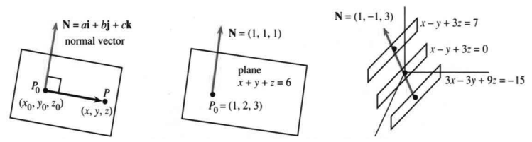
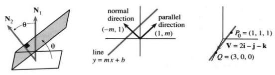
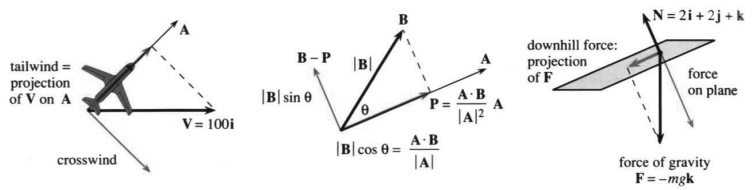
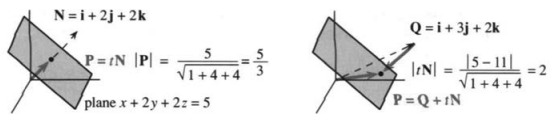
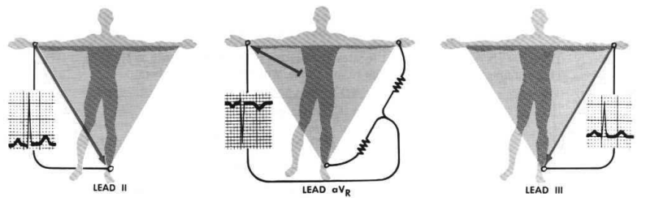
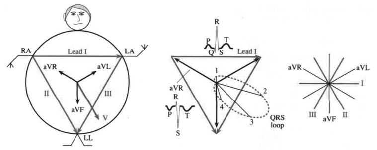

# 11.2　平面与投影

原书 PDF 第489—498页；印刷页476—485。状态：初译，已对照原页自校，待统一复审。

<!-- PDF 489 / 印刷页 476 -->

最重要的“曲线”是直线，最重要的函数是线性函数。这两句话把我们带回本书开头：$mx+b$ 的图像是一条直线。现在的目标是进入三维，那里函数的图像是曲面。最终会遇到弯曲的曲面，但微积分从与直线相对应的平坦曲面开始：

最重要的曲面是什么？**平面。**最重要的函数是什么？**仍是线性函数。**

求出平面的方程，就把平面的几何概念转化为代数。这里不只是一般公式，还要能求出某个具体平面的具体方程。

直线由一点 $(x_0,y_0)$ 和斜率 $m$ 确定。点斜式为 $y-y_0=m(x-x_0)$。这是一次方程，在 $y=y_0$、$x=x_0$ 时成立，并且 $dy/dx=m$。对于平面，仍从一个特定点出发，现在它是 $(x_0,y_0,z_0)$。但平面的斜率不那么简单：许多平面都以 $45^\circ$ 的角度上升，即“斜率为1”，所以还需要更多信息。

平面的方向用向量 $\mathbf N$ 描述。这个向量不沿平面，而是垂直于平面。平面内有许多方向，垂直于平面的方向却只有一条轴向。沿这个垂直方向的向量称为**法向量（normal vector）**。

法向量 $\mathbf N$ 可以指向“上”或“下”。它的长度不是关键，常常将其化为单位向量，记为 $\mathbf n$。知道 $\mathbf N$ 和点 $P_0=(x_0,y_0,z_0)$，就知道平面（图11.9）。要求方程，我们转向代数，并使用判断垂直关系的关键工具——点积。

$\mathbf N$ 的分量为 $(a,b,c)$，也就是 $\mathbf N=a\mathbf i+b\mathbf j+c\mathbf k$。**它垂直于平面内的每一个方向。**一个典型方向，是从 $P_0$ 指向平面内另一点 $P=(x,y,z)$。

**图11.9**　平面的法向量。平行平面可以使用同一个法向量 $\mathbf N$。normal vector：法向量；plane：平面。

从 $P_0$ 到 $P$ 的向量分量为 $(x-x_0,y-y_0,z-z_0)$。该向量在平面内，所以与 $\mathbf N$ 的点积为零。

**11C**　经过 $P_0$、垂直于 $\mathbf N=(a,b,c)$ 的平面，其方程为

$$
(a,b,c)\cdot(x-x_0,y-y_0,z-z_0)=0,
\quad\text{即}\quad a(x-x_0)+b(y-y_0)+c(z-z_0)=0.\tag{1}
$$

当点 $P$ 的坐标 $x,y,z$ 满足此方程时，$P$ 就在平面上。

<!-- PDF 490 / 印刷页 477 -->

**例1**　经过 $P_0=(1,2,3)$、垂直于 $\mathbf N=(1,1,1)$ 的平面，方程为 $(x-1)+(y-2)+(z-3)=0$，也可写成 $x+y+z=6$。

注意三点。第一，$P_0$ 在平面上，因为 $1+2+3=6$。第二，从 $x+y+z=6$ 中 $x,y,z$ 的系数可直接认出 $\mathbf N=(1,1,1)$。第三，可以将 $\mathbf N$ 改为 $(2,2,2)$，也可以将 $P_0$ 改为 $(8,2,-4)$：前者仍垂直于平面，后者仍在平面上，因为 $8+2-4=6$。

新法向量 $\mathbf N=(2,2,2)$ 给出 $2(x-1)+2(y-2)+2(z-3)=0$，即 $2x+2y+2z=12$。法线方向相同，平面也相同。

新点 $P_0=(8,2,-4)$ 给出 $(x-8)+(y-2)+(z+4)=0$，仍是 $x+y+z=6$ 的另一种形式。我们只需要一个垂直于平面的 $\mathbf N$ 和一个位于平面上的 $P_0$。

**例2**　经过 $(1,2,4)$、具有相同法向量 $\mathbf N=(1,1,1)$ 的平面，方程不同：$(x-1)+(y-2)+(z-4)=0$，即 $x+y+z=7$，而不是6。**常数分别为7和6的这两个平面平行。**

从 $a(x-x_0)+b(y-y_0)+c(z-z_0)=0$ 出发，常把 $ax_0+by_0+cz_0$ 移到右边，并将这个常数记为 $d$。

**11D**　将含 $P_0$ 坐标的项移到右侧，平面方程为 $\mathbf N\cdot P=d$：

$$
ax+by+cz=ax_0+by_0+cz_0=d.\tag{2}
$$

不同的 $d$ 给出平行平面；$d=0$ 给出经过原点的平面。

**例3**　平面 $x-y+3z=0$ 经过原点 $(0,0,0)$。由方程可直接读出法向量 $\mathbf N=(1,-1,3)$。点 $P_0=(1,1,0)$ 和 $P=(1,4,1)$ 都满足方程；坐标相减得到沿平面的向量 $\mathbf V=(0,3,1)$，并有 $\mathbf N\cdot\mathbf V=0$。

平行平面 $x-y+3z=d$ 具有相同的 $\mathbf N$，但 $d$ 不同。若 $d\ne0$，它们不经过原点，因为左边代入 $x=y=z=0$ 后，右边必须为0。注意 $3x-3y+9z=-15$ 也与上述平面平行。图11.9中 $\mathbf N$ 变成 $3\mathbf N$，方向却不变。

**例4**　**两平面的夹角等于其法向量的夹角。**

平面 $x-y+3z=0$ 与 $3y+z=0$ 垂直，因为 $(1,-1,3)\cdot(0,3,1)=0$。平面 $z=0$ 与 $y=0$ 也垂直，因为 $(0,0,1)\cdot(0,1,0)=0$；它们就是 $xy$ 平面和 $xz$ 平面。平面 $x+y=0$ 与 $x+z=0$ 成 $60^\circ$，因为

$$
\cos60^\circ=\frac{(1,1,0)\cdot(1,0,1)}{\sqrt2\sqrt2}=\tfrac12.
$$

两平面夹角的余弦为 $|\mathbf N_1\cdot\mathbf N_2|/(|\mathbf N_1||\mathbf N_2|)$，见图11.10。

<!-- PDF 491 / 印刷页 478 -->

**图11.10**　平面间的角等于法线间相应的角；与直线平行和垂直的方向；经过 $P_0,Q$ 的空间直线。normal direction：法线方向；parallel direction：平行方向；line：直线。

**说明1**　我们给出了用 $m$ 表示的直线“点斜式”，以及用 $\mathbf N$ 表示的平面“点法式”。直线的法向量 $\mathbf N$ 是什么？

向量 $\mathbf V=(1,m)$ 平行于直线 $y=mx+b$：沿直线横向走1，就向上走 $m$。垂直向量是 $\mathbf N=(-m,1)$，点积 $\mathbf N\cdot\mathbf V=-m+m=0$。于是点法式与点斜式一致：

$$
-m(x-x_0)+1(y-y_0)=0\quad\text{等价于}\quad y-y_0=m(x-x_0).\tag{3}
$$

**说明2**　平面的点斜式是什么？困难在于，平面沿 $x$ 方向和 $y$ 方向有不同斜率。函数 $f(x,y)=m(x-x_0)+M(y-y_0)$ 有两个导数 $m,M$。

暂且说到这里。第13章中，“斜率”将变成“偏导数”。

## 空间中的直线

在三维中，直线不像平面那样简单。**空间直线需要两个方程。**每个方程给出一个平面，直线是两个平面的交集。

**方程 $x+y+z=3$ 与 $2x+3y+z=6$ 确定一条直线。**

直线上两点为 $P_0=(1,1,1)$、$Q=(3,0,0)$。它们同时满足两个方程，所以都在两个平面上，也就位于交线上。用 $Q$ 的坐标减去 $P_0$ 的坐标，得到直线的方向向量 $\mathbf V=2\mathbf i-\mathbf j-\mathbf k$。

**直线经过 $P_0=(1,1,1)$，方向为 $\mathbf V=2\mathbf i-\mathbf j-\mathbf k$。**

从 $(x_0,y_0,z_0)=(1,1,1)$ 出发，加上任意倍数 $t\mathbf V$，得到 $x=1+2t$、$y=1-t$、$z=1-t$。它们是向量方程 $P=P_0+t\mathbf V$ 的各个分量，这个方程生成整条直线。

问题在这里：直线需要两个方程，或者一个带参数 $t$ 的向量方程，两种形式都不如 $ax+by+cz=d$ 简单。有些书仍会继续详细介绍两种形式。我尝试过后认为，这些细节可以暂缓。参数方程是第12章的主题，空间直线将是第一个例子。这里的向量和平面已足够我们研究，特别是向量向另一个向量或平面上的投影。

## 向量的投影

向量 $\mathbf B$ 在另一向量 $\mathbf A$ 上的投影是什么？$\mathbf B$ 有一部分沿着 $\mathbf A$，那就是投影；另一部分垂直于 $\mathbf A$。现在计算这两部分，分别记为 $\mathbf P$ 与 $\mathbf B-\mathbf P$。

<!-- PDF 492 / 印刷页 479 -->

几何中，投影涉及 $\cos\theta$；代数中，我们用与 $\cos\theta$ 密切相关的点积。应用中，$\mathbf B$ 可能是速度 $\mathbf V$ 或力 $\mathbf F$：

一架飞机向东北飞行，同时有每小时100英里的风向正东吹。$\mathbf V=(100,0)$ 在飞行方向 $\mathbf A$ 上的投影是什么？

重力使球沿平面 $2x+2y+z=0$ 向下滚动。$\mathbf F=(0,0,-mg)$ 沿平面以及垂直于平面的投影各是什么？

$\mathbf V$ 沿 $\mathbf A$ 的分量给出顺风推动作用，另一分量则给出侧风。类似地，平行于斜面的力使球运动。把两个分量加起来，便重新得到 $\mathbf V$ 或 $\mathbf F$。

**图11.11**　风速 $\mathbf V$、力 $\mathbf F$ 和向量 $\mathbf B$ 的投影。tailwind：顺风；crosswind：侧风；downhill force：沿斜面向下的力；force on plane：作用在平面上的力；force of gravity：重力；projection：投影。

现在计算 $\mathbf B$ 在 $\mathbf A$ 上的投影，记作 $\mathbf P$。既然已知它沿着 $\mathbf A$，可以用两种方式描述：一是给出沿 $\mathbf A$ 的有向长度，二是把投影向量 $\mathbf P$ 表示为 $\mathbf A$ 的倍数。

图11.11b给出投影 $\mathbf P$ 及其长度，斜边长为 $|\mathbf B|$。图中的长度为 $|\mathbf P|=|\mathbf B|\cos\theta$，垂直分量 $\mathbf B-\mathbf P$ 的长度为 $|\mathbf B|\sin\theta$。夹角小于 $90^\circ$ 时，余弦为正；$\mathbf A,\mathbf B$ 垂直时，余弦与投影 $\mathbf P$ 都为零。夹角大于 $90^\circ$ 时，$|\mathbf B|\cos\theta$ 为负，投影指向 $-\mathbf A$，实际长度是 $|\mathbf B||\cos\theta|$。除非角度为 $0^\circ,30^\circ,45^\circ,60^\circ,90^\circ$，我们不想专门计算余弦，也确实没有必要：点积会自动完成它。

$$
|\mathbf A||\mathbf B|\cos\theta=\mathbf A\cdot\mathbf B,
\quad\text{所以沿 $\mathbf A$ 的有向长度为}\quad
|\mathbf B|\cos\theta=\frac{\mathbf A\cdot\mathbf B}{|\mathbf A|}.\tag{4}
$$

注意，在式(4)中，$\mathbf A$ 的长度最终会约去。$\mathbf A$ 加倍，$\mathbf P$ 不变；$\mathbf B$ 加倍，投影才加倍。

向量 $\mathbf P$ 又是什么？它沿 $\mathbf A$ 的有向长度是 $(\mathbf A\cdot\mathbf B)/|\mathbf A|$。若 $\mathbf A$ 是单位向量，则 $|\mathbf A|=1$，投影就是 $(\mathbf A\cdot\mathbf B)\mathbf A$。一般情况下，要将 $\mathbf A$ 除以 $|\mathbf A|$ 才成为单位向量。于是 $\mathbf B$ 沿 $\mathbf A$ 的投影为

$$
\mathbf P=(\text{有向长度})(\text{单位向量})
=\left(\frac{\mathbf A\cdot\mathbf B}{|\mathbf A|}\right)
\left(\frac{\mathbf A}{|\mathbf A|}\right)
=\frac{\mathbf A\cdot\mathbf B}{|\mathbf A|^2}\mathbf A.\tag{5}
$$

<!-- PDF 493 / 印刷页 480 -->

**例5**　风速 $\mathbf V=(100,0)$，飞行方向 $\mathbf A=(1,1)$，求 $\mathbf P$。$\mathbf V$ 指向东，$\mathbf A$ 指向东北。$\mathbf V$ 在 $\mathbf A$ 上的投影为

$$
|\mathbf P|=\frac{\mathbf A\cdot\mathbf V}{|\mathbf A|}=\frac{100}{\sqrt2},\qquad
\mathbf P=\frac{\mathbf A\cdot\mathbf V}{|\mathbf A|^2}\mathbf A
=\frac{100}{2}(1,1)=(50,50).
$$

**例6**　将 $\mathbf F=(0,0,-mg)$ 投影到法向量为 $\mathbf N=(2,2,1)$ 的平面上。

$\mathbf F$ 沿 $\mathbf N$ 的投影还不是答案，但先计算它：

$$
\frac{\mathbf F\cdot\mathbf N}{|\mathbf N|}=-\frac{mg}{3},\qquad
\mathbf P=\frac{\mathbf F\cdot\mathbf N}{|\mathbf N|^2}\mathbf N
=-\frac{mg}{9}(2,2,1).
$$

$\mathbf P$ 是 $\mathbf F$ 垂直于平面的分量，不使球沿平面移动。平面内的分量为差 $\mathbf F-\mathbf P$。任意向量 $\mathbf B$ 都可分成沿 $\mathbf A$ 和垂直于 $\mathbf A$ 的两部分：

**投影 $\mathbf P=\dfrac{\mathbf A\cdot\mathbf B}{|\mathbf A|^2}\mathbf A$ 垂直于剩余分量 $\mathbf B-\mathbf P$。**

**例7**　将 $\mathbf B=\mathbf i-\mathbf j$ 写成两个向量的和，其中 $\mathbf P$ 平行于 $\mathbf A=3\mathbf i+\mathbf j$，$\mathbf B-\mathbf P$ 垂直于 $\mathbf A$。注意 $\mathbf A\cdot\mathbf B=2$。

**解**

$$
\mathbf P=\frac{\mathbf A\cdot\mathbf B}{|\mathbf A|^2}\mathbf A
=\frac2{10}\mathbf A=\frac6{10}\mathbf i+\frac2{10}\mathbf j,
\qquad\mathbf B-\mathbf P=\frac4{10}\mathbf i-\frac{12}{10}\mathbf j.
$$

检查：$\mathbf P\cdot(\mathbf B-\mathbf P)=(6/10)(4/10)-(2/10)(12/10)=0$，两投影互相垂直。

勾股关系：$|\mathbf P|^2+|\mathbf B-\mathbf P|^2=|\mathbf B|^2$。也核对一下：$0.4+1.6=2.0$。

**问**　什么时候 $\mathbf P=\mathbf0$？**答**　当 $\mathbf A$ 与 $\mathbf B$ 垂直时。

**例8**　求平面 $x+2y+2z=5$ 上距离原点最近的点。

从原点出发的最短路线沿法向量 $\mathbf N$。指向最近点的向量 $\mathbf P$（图11.12）是 $\mathbf N$ 的 $t$ 倍，其中 $t$ 待求。要求 $\mathbf P=t\mathbf N$ 在平面上，就能求出 $t$。

平面的法向量为 $\mathbf N=(1,2,2)$，所以 $\mathbf P=t\mathbf N=(t,2t,2t)$。要位于平面上，必须满足

$$
t+2(2t)+2(2t)=5,\quad\text{即 }9t=5,\quad t=\tfrac59.\tag{6}
$$

因此 $\mathbf P=\tfrac59\mathbf N=(5/9,10/9,10/9)$。这确定了最近点，距离为 $\tfrac59|\mathbf N|=5/3$。

这个例子很重要，值得记住其字母形式：

**11E**　平面 $ax+by+cz=d$ 上距离 $(0,0,0)$ 最近的点是

$$
P=\frac{(da,db,dc)}{a^2+b^2+c^2},\qquad
\text{距离为 }\frac{|d|}{\sqrt{a^2+b^2+c^2}}.\tag{7}
$$

步骤完全相同。$\mathbf N$ 的分量为 $a,b,c$，最近点是它的倍数 $(ta,tb,tc)$。该点在平面上的条件为 $a(ta)+b(tb)+c(tc)=d$，

<!-- PDF 494 / 印刷页 481 -->

所以 $t=d/(a^2+b^2+c^2)$。点 $(ta,tb,tc)=t\mathbf N$ 就是式(7)中的点。到平面的距离为 $|t\mathbf N|=|d|/|\mathbf N|$。

**图11.12**　指向最近点 $P$ 的位移向量是 $t\mathbf N$。距离由式(7)、(9)给出。plane：平面。

**问**　平面到任意点 $Q=(x_1,y_1,z_1)$ 的距离是多少？

**答**　从 $Q$ 到 $P$ 的向量是倍数 $t\mathbf N$，即 $P=Q+t\mathbf N$。它到达平面的条件为 $P\cdot\mathbf N=d$，于是再次求 $t$：

$$
(Q+t\mathbf N)\cdot\mathbf N=d
\quad\Longrightarrow\quad t=\frac{d-Q\cdot\mathbf N}{|\mathbf N|^2}.\tag{8}
$$

新出现的 $Q\cdot\mathbf N$ 进入点到平面的距离公式：

$$
\text{距离}=|t\mathbf N|=\frac{|d-Q\cdot\mathbf N|}{|\mathbf N|}
=\frac{|d-ax_1-by_1-cz_1|}{\sqrt{a^2+b^2+c^2}}.\tag{9}
$$

点在平面上时，距离为零，因为 $ax_1+by_1+cz_1=d$。当 $Q=\mathbf i+3\mathbf j+2\mathbf k$ 时，图中 $Q\cdot\mathbf N=11$，距离为2。

## 心电向量的投影

心电图的导联连接右臂、左臂和左腿。电压由你的身体产生，仪器把读数放大并记录。还有六个胸导联，用来增加前后方向的信息，在心脏各处进行监测。我们将集中讨论较大的“爱因托芬三角形（Einthoven triangle）”，它以心电图发明者命名。

曲线展示电压随时间的变化。第一条记录两臂之间的电势差；导联II连接左腿与右臂；导联III补成三角形，其三边大致相等（特别是当你的体态略有些不对称时）。所以这些投影基于 $60^\circ$ 与 $120^\circ$ 的角度。

心电向量 $\mathbf V$ 是许多小向量的和，所有向量都移到同一原点。它表示细胞动作电位的净效应，即许多小电偶极子合成为一个电偶极子。起搏点（窦房结，S-A node）启动冲动。心房去极化，在图上形成P波。实际上，心电向量走过一个P环，而曲线只显示它的投影。冲动到达房室结，停顿后迅速通过心室，于是产生QRS波群，即曲线上大而尖锐的变化。

<!-- PDF 495 / 印刷页 482 -->

**图A**　曲线显示运动的心电向量在各导联方向上的分量。图中 LEAD 意为“导联”。原书版权说明：这些插图经许可转载自医学博士 Frank H. Netter 的《CIBA医学插图集》（CIBA Collection of Medical Illustrations）。©1978 CIBA-GEIGY，保留所有权利。

**整个QRS时限不应超过 $1/10$ 秒**（记录纸上的 $2\tfrac12$ 小格）。$\mathbf V$ 起初指向右肩，与导联方向相反，所以曲线略向下偏移，这就是小而负的Q波。随后心电向量扫向左腿，在位置3和4，它在导联I（两臂之间）上的投影很大且为正。R波是各导联中的第一次向上偏移。闭合向量环时出现负的S波，在导联I与aVR中最明显。

**问题1**　由双臂与左腿得到的曲线，真正独立的有几条？

**答**　只有两条！在一个平面内，心电向量 $\mathbf V$ 有两个分量。知道两个投影，就能算出其余投影，心电图仪替我们完成这些计算。不同向量在不同投影中更容易看清。数学家也许会采用 $90^\circ$ 的夹角，把一个电极放到你的喉部。

**问题2**　这些电压有什么关系？aVR导联是什么？

**答**　将心电向量 $\mathbf V$ 投影到三角形各边：

$$
\mathbf L_{\mathrm I}-\mathbf L_{\mathrm {II}}+\mathbf L_{\mathrm {III}}=\mathbf0
\quad\text{（导联向量形成三角形）},
$$

$$
V_{\mathrm I}-V_{\mathrm {II}}+V_{\mathrm {III}}
=\mathbf V\cdot\mathbf L_{\mathrm I}-\mathbf V\cdot\mathbf L_{\mathrm {II}}
+\mathbf V\cdot\mathbf L_{\mathrm {III}}=0.
$$

aVR导联为 $-\tfrac12\mathbf L_{\mathrm I}-\tfrac12\mathbf L_{\mathrm {II}}$。这是纯粹的代数关系，不需要新增导线。由向量相加，它指向右臂电极。若其他导联长度为2，它的长度就是 $\sqrt3$。再加上指向左臂和左足的aVL、aVF，就有六个按等角排列的导联。可以想象它们从胸部同一原点伸出。

**问题3**　若心电向量 $\mathbf V=2\mathbf i-\mathbf j$，记录到哪些电势差？

**答**　三角形各边的导联长度为2，仪器对 $\mathbf V$ 作投影：

- 导联I为水平向量 $2\mathbf i$，所以 $\mathbf V\cdot\mathbf L_{\mathrm I}=4$。
- 导联II为角度 $-60^\circ$ 的向量 $\mathbf i-\sqrt3\mathbf j$，所以 $\mathbf V\cdot\mathbf L_{\mathrm {II}}=2+\sqrt3$。
- 导联III为角度 $-120^\circ$ 的向量 $-\mathbf i-\sqrt3\mathbf j$，所以 $\mathbf V\cdot\mathbf L_{\mathrm {III}}=-2+\sqrt3$。

第一与第三个结果相加等于第二个。最大的R波出现在导联I和II中。在aVR上，$\mathbf V$ 的投影为负（第46题），将标为S波。

**问题4**　电势本身（而不仅是电势差）怎样？中心处为零吗？

<!-- PDF 496 / 印刷页 483 -->

**图B**　心电向量沿QRS环运动，投影表现为心电图上的尖峰。RA：右臂；LA：左臂；LL：左腿；Lead：导联；QRS loop：QRS环；aVR、aVL、aVF为导联名称。

**答**　我们规定它为零，它就为零。电势含有任意常数 $C$，就像不定积分；电势差则像定积分。心脏科医生定义一个电势为零的“中心端”。

$\mathbf V$ 在一个环内的平均值是平均心电向量 $\mathbf H$。根据第5章，求平均值需要积分 $\int\mathbf V\,dt$。医生没有时间逐一积分，就寻找QRS波群下有向面积为零的导联；此时 $\mathbf H$ 的方向（电轴）垂直于该导联。关于微积分在医学中的应用，还有许多话可以讲。

## 11.2　习题

### 阅读填空

空间平面由一点 $P_0=(x_0,y_0,z_0)$ 和一个分量为 $(a,b,c)$ 的 __a__ 向量 $\mathbf N$ 确定。点 $P=(x,y,z)$ 在平面上的条件，是 $\mathbf N$ 与 __b__ 的点积为零（答案不是 $P$！）。该平面方程为 $a(\text{__c__})+b(\text{__d__})+c(\text{__e__})=0$，也可写成 $ax+by+cz=d$，其中 $d=\text{__f__}$。平行平面具有相同的 __g__ 和不同的 __h__。经过原点的平面有 $d=\text{__i__}$。

经过 $P_0=(2,1,0)$、垂直于 $\mathbf N=(3,4,5)$ 的平面方程为 __j__。平面上另一个点为 $P=(0,0,\text{__k__})$。从 $P_0$ 到 $P$ 的向量为 __l__，它与 $\mathbf N$ __m__（用点积检查）。经过 $P_0=(2,1,0)$、垂直于 $z$ 轴的平面，其 $\mathbf N=\text{__n__}$，方程为 __o__。

$\mathbf B$ 沿 $\mathbf A$ 方向的标量分量为 __p__，其中 $\theta$ 是两向量夹角。它等于 $\mathbf A\cdot\mathbf B$ 除以 __q__。投影向量 $\mathbf P$ 是 $|\mathbf B|\cos\theta$ 乘以沿 $\mathbf A$ 方向的 __r__ 向量。于是 $\mathbf P=(|\mathbf B|\cos\theta)(\mathbf A/|\mathbf A|)$ 化简为 __s__。当 $\mathbf B$ 加倍时，$\mathbf P$ __t__；当 $\mathbf A$ 加倍时，$\mathbf P$ __u__。若 $\mathbf B$ 反向，$\mathbf P$ __v__；若 $\mathbf A$ 反向，$\mathbf P$ __w__。

当 $\mathbf B$ 为速度向量时，$\mathbf P$ 表示 __x__；当 $\mathbf B$ 为力向量时，$\mathbf P$ 是 __y__。$\mathbf B$ 垂直于 $\mathbf A$ 的分量等于 __z__。从 $(0,0,0)$ 到平面 $ax+by+cz=d$ 的最短路线沿 __A__ 向量，距离为 __B__，平面上最近点为 $P=\text{__C__}$。从 $Q=(x_1,y_1,z_1)$ 到该平面的距离为 __D__。

第1—6题：在平面上找两点 $P,P_0$ 及一个法向量 $\mathbf N$，验证 $\mathbf N\cdot(P-P_0)=0$。

1. $x+2y+3z=0$。
2. $x+2y+3z=6$。
3. $yz$ 平面。
4. 经过 $(0,0,0)$、垂直于 $\mathbf i+\mathbf j-\mathbf k$ 的平面。
5. 经过 $(1,1,1)$、垂直于 $\mathbf i+\mathbf j-\mathbf k$ 的平面。
6. 经过 $(0,0,0)$、$(1,0,0)$、$(0,1,1)$ 的平面。

第7—10题：求平面的 $x,y,z$ 方程。

7. 经过 $P_0=(1,2,-1)$，垂直于 $\mathbf N=\mathbf i+\mathbf j$。
8. 经过 $P_0=(1,2,-1)$，垂直于 $\mathbf N=\mathbf i+2\mathbf j-\mathbf k$。
9. 经过 $(1,0,1)$，平行于 $x+2y+z=0$。

<!-- PDF 497 / 印刷页 484 -->

10. 经过 $(x_0,y_0,z_0)$，平行于 $x+y+z=1$。
11. 法向量为 $\mathbf N$ 的平面，何时平行于向量 $\mathbf V$？何时垂直于 $\mathbf V$？
12. （a）若两个平面互相垂直，如前墙与侧墙，一个平面内的每条直线是否都垂直于另一个平面内的每条直线？（b）若第三个平面垂直于第一个，它与第二个可能是（平行）（垂直）（成 $45^\circ$ 角）。
13. 说明为什么一个平面不能：（a）同时包含 $(1,2,3)$ 与 $(2,3,4)$，并垂直于 $\mathbf N=\mathbf i+\mathbf j$；（b）垂直于 $\mathbf N=\mathbf i+\mathbf j$，同时平行于 $\mathbf V=\mathbf i+\mathbf k$；（c）同时包含 $(1,0,0)$、$(0,1,0)$、$(0,0,1)$、$(1,1,1)$；（d）在法向量为 $\mathbf i+\mathbf j-\mathbf k$ 时包含 $(1,1,-1)$（也许可以）；（e）经过原点，而方程为 $ax+by+cz=1$。
14. 方程 $3x+4y+7z-t=0$ 给出四维空间中的一个超平面。求法向量 $\mathbf N$ 及超平面上的两点 $P,Q$，检查 $(P-Q)\cdot\mathbf N=0$。
15. 经过 $(x,y,z)$、垂直于 $a\mathbf i+b\mathbf j+c\mathbf k$ 的平面，在 ______ 时经过 $(0,0,0)$，在 ______ 时经过 $(x_0,y_0,z_0)$。
16. 三维中的一条曲线是 ______ 个曲面的交集；四维中的一条直线是 ______ 个超平面的交集。
17. （平面间夹角。）求 $x+2y+2z=0$ 与以下平面夹角的余弦：（a）$x+2z=0$；（b）$x+2z=5$；（c）$x=0$。
18. $\mathbf N$ 垂直于平面，$\mathbf V$ 沿一条直线。画出直线与平面的夹角 $\theta$，说明为什么 $(\mathbf V\cdot\mathbf N)/(|\mathbf V||\mathbf N|)$ 对应 $\sin\theta$，而非 $\cos\theta$。求 $xy$ 平面与 $\mathbf V=\mathbf i+\mathbf j+\sqrt2\mathbf k$ 的夹角。

第19—26题：求 $\mathbf B$ 沿 $\mathbf A$ 的投影 $\mathbf P$，并求 $|\mathbf P|$。

19. $\mathbf A=(4,2,4)$，$\mathbf B=(1,-1,0)$。
20. $\mathbf A=(1,-1,0)$，$\mathbf B=(4,2,4)$。
21. $\mathbf B$ 是与 $\mathbf A$ 成 $60^\circ$ 的单位向量。
22. $\mathbf B$ 是与 $\mathbf A$ 成 $60^\circ$、长度为2的向量。
23. $\mathbf B=-\mathbf A$。
24. $\mathbf A=\mathbf i+\mathbf j$，$\mathbf B=\mathbf i+\mathbf k$。
25. $\mathbf A$ 垂直于 $x-y+z=0$，$\mathbf B=\mathbf i+\mathbf j$。
26. $\mathbf A$ 垂直于 $x-y+z=5$，$\mathbf B=\mathbf i+\mathbf j+5\mathbf k$。
27. 力 $\mathbf F=3\mathbf i-4\mathbf k$ 作用于点 $(1,2,2)$。朝向原点的力分量有多大？竖直向下的力分量有多大？物体在力 $\mathbf F$ 作用下沿什么方向运动？
28. $\mathbf B$ 沿 $\mathbf A$ 的投影为 $\mathbf P=\underline{\qquad}$；垂直于 $\mathbf A$ 的投影为 ______。检查两投影的点积。
29. 点 $P=(x,y,z)$ 在平面 $ax+by+cz=5$ 上，条件为 $P\cdot\mathbf N=|P||\mathbf N|\cos\theta=5$。由于 $\cos\theta$ 最大为1，$|P|$ 的最小值为 ______，这就是 ______ 之间的距离。
30. 喷气式飞机的空速为500，风速为50。还需要什么信息才能计算飞机相对地面的速率？该速率是多少？
31. 平面 $x+y-z=1$ 到 $(0,0,0)$、$(1,1,-1)$ 的距离分别是多少？求各自最近的点。
32. 描述所有到平面 $x+2y+2z=3$ 的距离为1的点。
33. 从 $Q=(2,1,1)$ 到平面 $x+y+z=0$ 的最短路线沿向量 ______。点 $P=Q+t\mathbf N=(2+t,1+t,1+t)$ 在平面上的条件为 $t=\text{______}$。此时 $P=\text{______}$，最短距离为 ______。（这个距离不是 $|P|$。）
34. 经过 $(1,1,1)$、垂直于 $\mathbf N=\mathbf i+2\mathbf j+2\mathbf k$ 的平面，到 $(0,0,0)$ 的距离为 ______。
35. （两平面间距离。）$2x-2y+z=1$ 平行于 $2x-2y+z=3$，因为 ______。在第一个平面上选位置向量 $Q$，求 $t$ 使 $Q+t\mathbf N$ 位于第二个平面。距离为 $|t\mathbf N|=\text{______}$。
36. 平面 $x+y+5z=7$ 与 $3x+2y+z=1$ 的距离为零，因为 ______。

第37—41题中，所有点与向量都在 $xy$ 平面内。

37. 直线 $3x+4y=10$ 垂直于向量 $\mathbf N=\text{______}$。直线上距离原点最近的点为 $P=t\mathbf N$。求 $t,P,|P|$。
38. 画直线 $x+2y=4$ 与向量 $\mathbf N=\mathbf i+2\mathbf j$。距离 $Q=(3,3)$ 最近的点为 $P=Q+t\mathbf N$。求 $t$ 和 $P$。
39. 用一种新方法求第37题中的 $P$：使 $x^2+y^2=x^2+(10/4-3x/4)^2$ 最小。用微积分求最优的 $x,y$。
40. 要追上以每秒8米从 $(0,0)$ 前往 $(4,0)$ 的毒贩，你必须以每秒 ______ 米从 $(0,3)$ 前往 $(4,0)$。你的速度向量在对方速度向量上的投影长度为 ______。
41. 用向量证明，点 $(x_1,y_1)$ 到直线 $ax+by=d$ 的距离为 $|d-ax_1-by_1|/\sqrt{a^2+b^2}$。
42. 三个点就能确定一个平面，为什么 $ax+by+cz=d$ 含有四个数 $a,b,c,d$？什么时候 $ex+fy+gz=1$ 表示同一平面？
43. （用微积分求投影。）$\mathbf B-t\mathbf A$ 与自身的点积为 $|\mathbf B|^2-2t\mathbf A\cdot\mathbf B+t^2|\mathbf A|^2$。（a）它在 $t=\text{______}$ 时取得最小值。（b）此时 $t\mathbf A$ 是 ______ 的投影。画一张包含 $\mathbf B,t\mathbf A,\mathbf B-t\mathbf A$ 的图，胜过千言万语。
44. 从方程怎样判断两个平面：（a）平行；（b）垂直；（c）成 $45^\circ$ 角？

第45—48题讨论心电图与心电向量。

<!-- PDF 498 / 印刷页 485 -->

45. aVR导联为 $-\tfrac12\mathbf L_{\mathrm I}-\tfrac12\mathbf L_{\mathrm {II}}$。求指向左臂与左足的aVL、aVF导联，证明 $\mathrm{aVR}+\mathrm{aVL}+\mathrm{aVF}=\mathbf0$。它们从中心以 $120^\circ$ 间隔伸出。
46. 求问题3中 $\mathbf V=2\mathbf i-\mathbf j$ 在aVR导联上的投影。
47. 若电势为 $\varphi_{\mathrm{RA}}=1$（右臂）、$\varphi_{\mathrm{LA}}=2$、$\varphi_{\mathrm{LL}}=-3$，求心电向量 $\mathbf V$。电势差就是 $\mathbf V$ 的相应投影读数。
48. 若 $\mathbf V$ 垂直于导联 $\mathbf L$，该导联读数为 ______。若 $\int\mathbf V(t)\,dt$ 垂直于 $\mathbf L$，为什么该读数曲线下的有向面积为零？

## 译注与待复审事项

- 平面法向量须非零，即 $a,b,c$ 不全为零；投影到向量 $\mathbf A$ 的公式须有 $\mathbf A\ne\mathbf0$。平面夹角通常取 $[0,\pi/2]$，因此要用点积的绝对值；法向量本身的夹角也可能为其补角。
- 原文把 $|\mathbf B|\cos\theta$ 多次称为“长度”，但钝角时为负。译文在一般公式处明确为“有向长度”或“标量分量”，非负投影长度为 $|\mathbf B||\cos\theta|$。第18题若取通常非负的线面夹角，分子也须取绝对值。
- 空间直线写成两平面交线，须两平面相交且法向量不平行；第16题关于曲面交集的说法也隐含独立性及局部非退化条件。第42题的三个点须不共线。
- 心电图段落、QRS时限及波形判读均按原书翻译，是原书的简化教学叙述，未做现代临床复核。这里的导联向量未归一化，$\mathbf V\cdot\mathbf L$ 表示模型规定的电压读数，不能与前文除以 $|\mathbf L|$ 的单位方向标量投影混为一谈。
- 平均心电向量的完整时间平均公式应为 $(1/T)\int_0^T\mathbf V(t)\,dt$；原文只说明需要积分。导联“等角”宜理解为六条无向轴按 $30^\circ$ 间隔排列，不能理解为六个有向射线均按 $60^\circ$ 排列。
- 图A的第三方版权署名按原书保留，不能将原书获准转载的说明理解为译稿获得新的出版授权。
- 第27题的力直接确定加速度方向；物体瞬时速度或运动轨迹还取决于初始条件。原题只问“沿什么方向运动”，此处保留题意并指出省略条件。第30题原书没有给速率单位，译文不补造。
