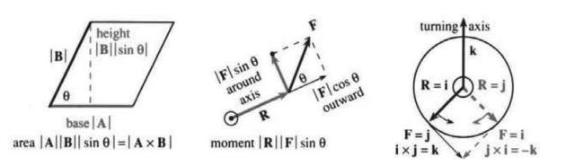
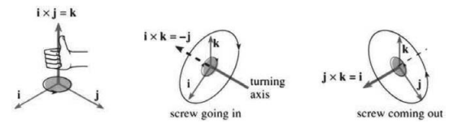
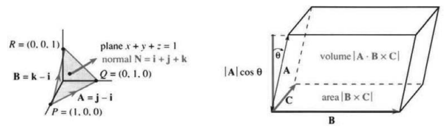

# 11.3　叉积与行列式

原书 PDF 第499—508页；印刷页486—495。状态：初译，已对照原页自校，待统一复审。

<!-- PDF 499 / 印刷页 486 -->

我们说过向量不能直接相乘，接着又介绍了点积。现在再“自相矛盾”一次，定义叉积。$\mathbf A\cdot\mathbf B$ 是数，而**叉积 $\mathbf A\times\mathbf B$ 是向量**，有长度和方向：

**长度为 $|\mathbf A||\mathbf B||\sin\theta|$，方向垂直于 $\mathbf A$ 和 $\mathbf B$。**

叉积（cross product），也称向量积（vector product），这里仅在三维中定义。$\mathbf A,\mathbf B$ 位于经过原点的平面内，$\mathbf A\times\mathbf B$ 沿法向量 $\mathbf N$，垂直于该平面。剩下还没说的是：它沿 $\mathbf N$ 指“上”还是指“下”。

叉积的长度依赖于 $\sin\theta$，而点积涉及 $\cos\theta$。点积在两向量同向时取得最大的正值（$\cos0=1$）；叉积的模在两向量垂直时最大（$\sin(\pi/2)=1$）。对任意夹角都有

$$
|\mathbf A\cdot\mathbf B|^2+|\mathbf A\times\mathbf B|^2
=|\mathbf A|^2|\mathbf B|^2\cos^2\theta+|\mathbf A|^2|\mathbf B|^2\sin^2\theta
=|\mathbf A|^2|\mathbf B|^2.\tag{1}
$$

这将成为几何与代数之间的桥梁。**本节从定义出发，经公式、体积，走到行列式。**式(6)、(14)是计算叉积的关键公式。

注意 $\mathbf A\times\mathbf A=\mathbf0$，这里是零向量而不是数零。两向量平行时，夹角的正弦为零，所以 $\mathbf A\times\mathbf B=\mathbf0$。垂直时 $\sin\theta=1$，$|\mathbf A\times\mathbf B|=|\mathbf A||\mathbf B|$，等于以它们为边的矩形面积。

下面四个例子引出叉积。

**例1（几何）**　求平行四边形与三角形的面积。

从原点出发的 $\mathbf A,\mathbf B$ 构成三角形的两条边，也生成图11.13中的平行四边形，面积是三角形的两倍。

平行四边形面积等于底乘以高，这里的高是垂直高度而不是斜边长。底为 $|\mathbf A|$，高为 $|\mathbf B||\sin\theta|$；取绝对值是因为高度和面积不能为负。因此面积等于叉积的长度：

$$
\text{平行四边形面积}=|\mathbf A||\mathbf B||\sin\theta|=|\mathbf A\times\mathbf B|.\tag{2}
$$

**图11.13**　面积 $|\mathbf A\times\mathbf B|$ 与力矩大小 $|\mathbf R\times\mathbf F|$。叉积垂直于相应的图面。height：高；base：底；area：面积；around axis：绕轴；outward：向外；moment：力矩；turning axis：转轴。

**例2（物理）**　力矩向量 $\mathbf T=\mathbf R\times\mathbf F$ 产生转动。

力 $\mathbf F$ 作用在点 $(x,y,z)$ 上。当它平行于位置向量 $\mathbf R=x\mathbf i+y\mathbf j+z\mathbf k$ 时，力沿径向作用，不产生绕原点的转动。当 $\mathbf F$ 垂直于 $\mathbf R$ 时，力产生转动。角度介于两者之间时，力就分成径向分量

<!-- PDF 500 / 印刷页 487 -->

$|\mathbf F|\cos\theta$ 和转动分量 $|\mathbf F|\sin\theta$。后者乘以距离 $|\mathbf R|$，就是力矩 $|\mathbf R||\mathbf F|\sin\theta$。

这个力矩给出力矩向量 $\mathbf T=\mathbf R\times\mathbf F$ 的大小和符号；$\mathbf T$ 的方向沿转轴，垂直于 $\mathbf R$ 和 $\mathbf F$。

**例3**　叉积向上还是向下？使用右手法则。

对物理学家来说，力与力矩大概已经很清楚。不那么有物理直觉的人则想亲眼看见东西转起来。† 想象一张唱片或光盘绕穿过中心的轴转动。

在盘上某一点推一下。若沿径向向外推（这不太容易做到），盘不会转动；转动来自“绕轴”的力。盘可以向两个方向转，取决于力与位置向量之间的角度。因此需要符号约定，这就是右手法则：

**右手四指从 $\mathbf A$ 弯向 $\mathbf B$ 时，拇指指向 $\mathbf A\times\mathbf B$。**

对图11.14中的 $\mathbf i,\mathbf j,\mathbf k$，规则最简单，而这已足够。四指从 $\mathbf i$ 弯向 $\mathbf j$，拇指就沿 $\mathbf k$。$x,y,z$ 轴构成“右手系”。由于 $|\mathbf i|=|\mathbf j|=1$、$\sin(\pi/2)=1$，$\mathbf i\times\mathbf j$ 的长度为1，所以 $\mathbf i\times\mathbf j=\mathbf k$。在位置 $\mathbf i$ 处沿 $\mathbf j$ 方向施力，盘逆时针转，角速度向量朝上。

把 $\mathbf i,\mathbf j$ 的次序颠倒，力作用在位置 $\mathbf j$，方向朝 $\mathbf i$，盘就顺时针转（原文说唱片与光盘实际如此转动）。四指从 $\mathbf j$ 弯向 $\mathbf i$，拇指向下，所以 $\mathbf j\times\mathbf i=-\mathbf k$。这是一个惊人规则的特例：

$$
\text{叉积满足反交换律：}\quad\mathbf B\times\mathbf A=-(\mathbf A\times\mathbf B).\tag{3}
$$

这相当不寻常。汉密尔顿发现这条规律时，19世纪的代数学完全习惯了 $AB=BA$；这一发现引起了一场思想革命。交换律对数来说古老而平常，对点积来说新鲜但仍平常；到了向量积这里，看到的却是相反的规律。矩阵乘法一般既不满足交换律，也不满足这种反交换律。

**图11.14**　$\mathbf i\times\mathbf j=\mathbf k=-(\mathbf j\times\mathbf i)$；$\mathbf i\times\mathbf k=-\mathbf j=-(\mathbf k\times\mathbf i)$；$\mathbf j\times\mathbf k=\mathbf i=-(\mathbf k\times\mathbf j)$。screw going in：螺钉旋入；screw coming out：螺钉旋出；turning axis：转轴。

**例4**　螺钉旋入或旋出墙壁也遵循右手法则。

刚才盘和力都在 $xy$ 平面内。（我们可不想把唱片弄坏。）转轴上下延伸。想把叉积看得更全面，就得把一颗螺钉拧进墙里。

图11.14b把 $xz$ 平面当作墙面，螺钉沿 $y$ 方向。从 $x$ 转向 $z$，螺钉旋入墙壁，也就是沿负 $y$ 方向。

† 每个人都是天生的数学家，这是本书背后的公理。

<!-- PDF 501 / 印刷页 488 -->

也就是说，$\mathbf i\times\mathbf k=-\mathbf j$。顺时针拧，螺钉进入；要取出螺钉，就从 $\mathbf k$ 转向 $\mathbf i$，于是 $\mathbf k\times\mathbf i=+\mathbf j$。

概括起来，$\mathbf k\times\mathbf i=\mathbf j$、$\mathbf j\times\mathbf k=\mathbf i$ 都取正号，因为 $kij,jki$ 与 $ijk$ 具有相同的“循环次序”；反循环次序取负号。$z,x,y$ 轴和 $y,z,x$ 轴也像 $x,y,z$ 一样组成右手系。

## 叉积的公式

现在开始讲叉积的代数。它是计算中绕不过去的一步，而且算出来很漂亮。$|\mathbf A||\mathbf B||\sin\theta|$ 中的平方根将在式(6)的叉积公式中消失。（点积 $|\mathbf A||\mathbf B|\cos\theta$ 中的平方根也消失了；但若用 $|\mathbf A||\mathbf B|\tan\theta$，情况就糟糕了。）叉积是向量，因此要找三个分量。

从二维情况开始。向量 $a_1\mathbf i+a_2\mathbf j$ 和 $b_1\mathbf i+b_2\mathbf j$ 位于 $xy$ 平面，它们的叉积必沿 $z$ 方向。因此 $\mathbf A\times\mathbf B=\underline{\qquad}\mathbf k$，最多只有一个非零分量。它必为带适当符号的 $|\mathbf A||\mathbf B|\sin\theta$，但我们希望有更好的公式。有两种简洁办法：代数方法（a），以及用点积把几何接进来的方法（b）。

**（a）**

$$
\begin{aligned}
(a_1\mathbf i+a_2\mathbf j)\times(b_1\mathbf i+b_2\mathbf j)
={}&a_1b_1(\mathbf i\times\mathbf i)+a_1b_2(\mathbf i\times\mathbf j)\\
&+a_2b_1(\mathbf j\times\mathbf i)+a_2b_2(\mathbf j\times\mathbf j).
\end{aligned}\tag{4}
$$

右边依次为 $\mathbf0,a_1b_2\mathbf k,-a_2b_1\mathbf k,\mathbf0$。所以叉积为 $(a_1b_2-a_2b_1)\mathbf k$。

**（b）**　将 $\mathbf B=b_1\mathbf i+b_2\mathbf j$ 顺时针旋转 $90^\circ$，得到 $\mathbf B^*=b_2\mathbf i-b_1\mathbf j$。长度不变，且 $\mathbf B\cdot\mathbf B^*=0$。旋转后的角度使相应的正弦变成余弦，因此

$$
|\mathbf A||\mathbf B|\sin\theta=\mathbf A\cdot\mathbf B^*
=\begin{bmatrix}a_1\\a_2\end{bmatrix}\cdot\begin{bmatrix}b_2\\-b_1\end{bmatrix}
=a_1b_2-a_2b_1.\tag{5}
$$

**11F**　在 $xy$ 平面内，$\mathbf A\times\mathbf B=(a_1b_2-a_2b_1)\mathbf k$。以 $\mathbf A,\mathbf B$ 为边的平行四边形面积为 $|a_1b_2-a_2b_1|$；三角形 $OAB$ 的面积为 $\tfrac12|a_1b_2-a_2b_1|$。

**例5**　若 $\mathbf A=\mathbf i+2\mathbf j$、$\mathbf B=4\mathbf i+5\mathbf j$，则叉积为 $(1\cdot5-2\cdot4)\mathbf k=-3\mathbf k$。平行四边形面积为3，三角形面积为 $3/2$。叉积中的负号不出现在面积里。

**注意**　把叉积拆成四个叉积是正确的，但不能轻易从 $|\mathbf A||\mathbf B|\sin\theta$ 推出。方法（a）的依据，要到下面说明1才交代。代数学家可能改换定义，从分配律和反交换律出发：

$$
\mathbf A\times(\mathbf B+\mathbf C)=(\mathbf A\times\mathbf B)+(\mathbf A\times\mathbf C),
\qquad\mathbf A\times\mathbf B=-(\mathbf B\times\mathbf A).
$$

## 三个分量的叉积公式

进入三维后，目标是计算叉积的三个分量，而不只是长度。方法（a）把两个向量都分解为 $\mathbf i,\mathbf j,\mathbf k$ 分量，产生九个叉积：

$$
(a_1\mathbf i+a_2\mathbf j+a_3\mathbf k)\times(b_1\mathbf i+b_2\mathbf j+b_3\mathbf k)
=a_1b_1(\mathbf i\times\mathbf i)+a_1b_2(\mathbf i\times\mathbf j)+\text{另外七项}.
$$

<!-- PDF 502 / 印刷页 489 -->

记住 $\mathbf i\times\mathbf i=\mathbf j\times\mathbf j=\mathbf k\times\mathbf k=\mathbf0$，所以三项消失。其余六项两两配对，请注意循环模式：

$$
\boxed{\mathbf A\times\mathbf B=(a_2b_3-a_3b_2)\mathbf i
+(a_3b_1-a_1b_3)\mathbf j+(a_1b_2-a_2b_1)\mathbf k.}\tag{6}
$$

当 $a_3=b_3=0$ 时，$\mathbf k$ 分量正是前面的二阶结果。$\mathbf i$ 分量涉及下标2、3；$\mathbf j$ 分量涉及3、1；$\mathbf k$ 分量涉及1、2。式(14)将把这个公式写成“行列式”，许多人用那种形式计算叉积。

**例6**

$$
\begin{aligned}
&(\mathbf i+2\mathbf j+3\mathbf k)\times(4\mathbf i+5\mathbf j+6\mathbf k)\\
&=(2\cdot6-3\cdot5)\mathbf i+(3\cdot4-1\cdot6)\mathbf j
+(1\cdot5-2\cdot4)\mathbf k=-3\mathbf i+6\mathbf j-3\mathbf k.
\end{aligned}
$$

$-3,6,-3$ 是三个分量，千万不要把它们相加。

**说明1**　三维公式(6)还需要与几何定义的叉积吻合。一种方法是像刚才那样，在 $\mathbf A,\mathbf B$ 所在平面内把 $\mathbf B$ 旋转成 $\mathbf B^*$。幸好还有更简单的检查方法。式(6)中的向量满足叉积的四个几何要求：垂直于 $\mathbf A$、垂直于 $\mathbf B$、长度正确、满足右手法则。长度在第16题中检查；这里检查它与 $\mathbf A$ 的点积为零：

$$
\mathbf A\cdot(\mathbf A\times\mathbf B)
=a_1(a_2b_3-a_3b_2)+a_2(a_3b_1-a_1b_3)+a_3(a_1b_2-a_2b_1)=0.\tag{7}
$$

**说明2（选读）**　勾股公式 $a^2+b^2=c^2$ 有一个优美推广：不再考虑三角形边长，而考虑在 $yz,xz,xy$ 平面上的投影面积。例6中平行四边形面积的平方为 $3^2+6^2+3^2$。

换成三角形，各面积减半。图11.15a的三个投影三角形面积均为 $1/2$，其勾股关系为 $(1/2)^2+(1/2)^2+(1/2)^2=(\text{三角形 }PQR\text{ 的面积})^2$。

**例7**　$P=(1,0,0)$、$Q=(0,1,0)$、$R=(0,0,1)$ 位于一个平面上，求其方程。

一般思路是：对任意 $P,Q,R$，先找平面内的两个向量 $\mathbf A,\mathbf B$，再计算法向量 $\mathbf N=\mathbf A\times\mathbf B$。

**解**　从 $P$ 到 $Q$ 的向量分量为 $-1,1,0$，即 $\mathbf A=\mathbf j-\mathbf i$；同理，从 $P$ 到 $R$ 的向量为 $\mathbf B=\mathbf k-\mathbf i$。两者位于图11.15的平面内，所以 $\mathbf N=\mathbf A\times\mathbf B$ 与平面垂直：

$$
(\mathbf j-\mathbf i)\times(\mathbf k-\mathbf i)
=(\mathbf j\times\mathbf k)-(\mathbf i\times\mathbf k)
-(\mathbf j\times\mathbf i)+(\mathbf i\times\mathbf i)
=\mathbf i+\mathbf j+\mathbf k.\tag{8}
$$

法向量为 $\mathbf i+\mathbf j+\mathbf k$，平面方程是 $x+y+z=d$。选择 $d=1$，就使平面包含 $P,Q,R$。所求方程为 $x+y+z=1$。

**例8**　同一个三角形 $PQR$ 的面积是多少？

**解**　面积为叉积长度的一半，而 $|\mathbf A\times\mathbf B|=|\mathbf i+\mathbf j+\mathbf k|=\sqrt3$，所以面积为 $\sqrt3/2$。

<!-- PDF 503 / 印刷页 490 -->

**图11.15**　$PQR$ 的面积为 $\sqrt3/2$；$\mathbf N=\overrightarrow{PQ}\times\overrightarrow{PR}$；平行六面体体积为 $|\mathbf A\cdot(\mathbf B\times\mathbf C)|$。plane：平面；normal：法向量；volume：体积；area：面积。

## 行列式与体积

我们接近一段漂亮的代数了。平面向量 $a_1\mathbf i+a_2\mathbf j$ 和 $b_1\mathbf i+b_2\mathbf j$ 是平行四边形的两条边，面积是 $a_1b_2-a_2b_1$，必要时取相反数使其非负。把这四个数写成一个“方阵”，求面积所用的组合称为“矩阵的行列式”：

$$
\text{矩阵 }\begin{bmatrix}a_1&a_2\\b_1&b_2\end{bmatrix},\qquad
\text{行列式 }\begin{vmatrix}a_1&a_2\\b_1&b_2\end{vmatrix}=a_1b_2-a_2b_1.
$$

这是一个 $2\times2$ 矩阵（用方括号）和一个二阶行列式（用竖线）。矩阵是四个数的排列，行列式则是一个数。例如：

$$
\begin{vmatrix}2&1\\4&3\end{vmatrix}=6-4=2,\quad
\begin{vmatrix}2&1\\2&1\end{vmatrix}=0,\quad
\begin{vmatrix}1&0\\0&1\end{vmatrix}=1.
$$

第二个没有面积，因为 $\mathbf A=\mathbf B$；第三个是单位正方形，$\mathbf A=\mathbf i,\mathbf B=\mathbf j$。

现在进入行列式最有用的三维情形。平行四边形变成平行六面体（parallelepiped）。“盒子”这个词短得多，所以我们也用它，但请记住这个盒子可能是斜的，就像矩形变成平行四边形，夹角一般不等于 $90^\circ$。从原点出发的三条棱为 $\mathbf A=(a_1,a_2,a_3)$、$\mathbf B=(b_1,b_2,b_3)$、$\mathbf C=(c_1,c_2,c_3)$。只有当 $\mathbf A\cdot\mathbf B=\mathbf A\cdot\mathbf C=\mathbf B\cdot\mathbf C=0$ 时，三条棱才两两垂直。

**盒子的体积是多少？**直角情形很容易，是长乘宽乘高，即 $|\mathbf A||\mathbf B||\mathbf C|$。盒子一斜（图11.15），就得用垂直高度，而不是斜棱长。

有一个漂亮的体积公式。$\mathbf B,\mathbf C$ 给出底面的平行四边形，$|\mathbf B\times\mathbf C|$ 是底面积，这个叉积垂直向上。第三个向量 $\mathbf A$ 斜向上，垂直高度为 $|\mathbf A|\cos\theta$。因此体积是底面积乘以 $|\mathbf A|\cos\theta$，也就是 $\mathbf A$ 与 $\mathbf B\times\mathbf C$ 的点积（一般情形取绝对值）。

**11G**　**标量三重积（混合积）**是 $\mathbf A\cdot(\mathbf B\times\mathbf C)$。平行六面体体积为 $|\mathbf A\cdot(\mathbf B\times\mathbf C)|$。

重要的是：混合积是数，不是向量。若 $\mathbf A$ 与 $\mathbf B,\mathbf C$ 共面，盒子完全压平，体积为零；此时 $\mathbf B\times\mathbf C$ 垂直于

<!-- PDF 504 / 印刷页 491 -->

$\mathbf A$，点积便为零。

有用的关系是

$$
\mathbf A\cdot(\mathbf B\times\mathbf C)=(\mathbf A\times\mathbf B)\cdot\mathbf C
=\mathbf C\cdot(\mathbf A\times\mathbf B)=\mathbf B\cdot(\mathbf C\times\mathbf A).
$$

这些都来自同一个盒子，只是选不同的面作底，体积不变。图11.15以 $\mathbf B,\mathbf C$ 作底，也可以选择 $\mathbf A,\mathbf B$ 或 $\mathbf A,\mathbf C$。但混合积 $\mathbf A\cdot(\mathbf C\times\mathbf B)$ 符号相反，因为 $\mathbf C\times\mathbf B=-(\mathbf B\times\mathbf C)$。次序 $ACB$ 与 $ABC,CAB,BCA$ 的循环次序不同。

用式(6)计算 $\mathbf B\times\mathbf C$，得到

$$
\mathbf A\cdot(\mathbf B\times\mathbf C)
=a_1(b_2c_3-b_3c_2)+a_2(b_3c_1-b_1c_3)+a_3(b_1c_2-b_2c_1).\tag{9}
$$

数 $a_1,a_2,a_3$ 分别乘以二阶行列式，得到三阶行列式！有三项取正号，如 $a_1b_2c_3$；另三项取负号，如 $-a_1b_3c_2$。正项的下标为循环次序 $123,231,312$，负项为反循环次序 $132,213,321$。把九个分量写成 $3\times3$ 矩阵，式(9)所给的组合就是三阶行列式：

$$
\text{矩阵}=\begin{bmatrix}a_1&a_2&a_3\\b_1&b_2&b_3\\c_1&c_2&c_3\end{bmatrix},\qquad
\text{行列式}=\mathbf A\cdot(\mathbf B\times\mathbf C)
=\begin{vmatrix}a_1&a_2&a_3\\b_1&b_2&b_3\\c_1&c_2&c_3\end{vmatrix}.
$$

式(9)将九个数变成一个数。每次取三个相乘，但并非任何组合都允许，例如 $a_1b_1c_2$ 就不允许。**每一行、每一列都必须恰好出现一次。**于是得到六项：

$$
\begin{vmatrix}a_1&a_2&a_3\\b_1&b_2&b_3\\c_1&c_2&c_3\end{vmatrix}
=a_1b_2c_3+a_2b_3c_1+a_3b_1c_2-a_1b_3c_2-a_2b_1c_3-a_3b_2c_1.\tag{10}
$$

诀窍在正负号。向右下方的循环乘积取正号：

$$
\begin{vmatrix}2&1&1\\1&2&1\\1&1&2\end{vmatrix}
=2\cdot2\cdot2+1\cdot1\cdot1+1\cdot1\cdot1
-2\cdot1\cdot1-1\cdot1\cdot2-1\cdot2\cdot1
=8+1+1-2-2-2=4.
$$

熟练以后，可以心算六个乘积，只写 $8+1+1-2-2-2=4$。它既是行列式的值，也是此处的体积。

特别地，若三个向量为 $\mathbf i,\mathbf j,\mathbf k$，盒子就是单位立方体：

$$
\text{立方体体积}=\begin{vmatrix}1&0&0\\0&1&0\\0&0&1\end{vmatrix}
=1+0+0-0-0-0=1.
$$

**若 $\mathbf A,\mathbf B,\mathbf C$ 共面，体积为零。**行列式为零是判定三个向量共面的条件。下例中，第 $A$ 行等于第 $B$ 行减第 $C$ 行：

$$
\begin{aligned}
\begin{vmatrix}0&1&-1\\-1&1&0\\-1&0&1\end{vmatrix}
={}&0\cdot1\cdot1+1\cdot0\cdot(-1)+(-1)\cdot(-1)\cdot0\\
&-0\cdot0\cdot0-1\cdot(-1)\cdot1-(-1)\cdot1\cdot(-1)=0.
\end{aligned}\tag{11}
$$

矩阵里的零让计算简单了：三个正号乘积均为零，仅有的两个非零项互相抵消。

<!-- PDF 505 / 印刷页 492 -->

若把三个 $-1$ 都改为 $+1$，行列式就变成 $-2$。即使九个元素都为正，行列式也可能为负！负行列式只是意味着行向量 $\mathbf A,\mathbf B,\mathbf C$ 构成“左手系”。符号多给的这份左右手信息很有用，只是体积要取绝对值。

在更高维中，行列式也给出体积。物理中的四维描述时空，十维用于超弦；数学使用所有维度。一个 $8\times8$ 矩阵中的64个数，给出八维盒子的体积，其展开有 $8!=40\,320$ 项，而非 $3!=6$ 项。学生一施压，这个公式我就略去了。

**问**　点 $(x,y,z)$ 什么时候位于经过原点、包含 $\mathbf B,\mathbf C$ 的平面？

位置向量 $\mathbf A=x\mathbf i+y\mathbf j+z\mathbf k$ 要位于该平面，混合积必须为零。因此平面方程就是“行列式等于零”。以 $\mathbf B=\mathbf j-\mathbf i$、$\mathbf C=\mathbf k-\mathbf i$ 为例：

$$
\begin{aligned}
\begin{vmatrix}x&y&z\\-1&1&0\\-1&0&1\end{vmatrix}
={}&x\cdot1\cdot1+y\cdot0\cdot(-1)+z\cdot0\cdot(-1)\\
&-x\cdot0\cdot0-y\cdot1\cdot(-1)-z\cdot1\cdot(-1)=0.
\end{aligned}\tag{12}
$$

这就是 $x+y+z=0$。法向量 $\mathbf N=\mathbf B\times\mathbf C$ 的分量为 $1,1,1$。

## 用行列式表示叉积

三阶与二阶行列式之间有一个必须了解的联系：第一行的数分别乘以由其他行组成的行列式：

$$
\begin{vmatrix}a_1&a_2&a_3\\b_1&b_2&b_3\\c_1&c_2&c_3\end{vmatrix}
=a_1\begin{vmatrix}b_2&b_3\\c_2&c_3\end{vmatrix}
-a_2\begin{vmatrix}b_1&b_3\\c_1&c_3\end{vmatrix}
+a_3\begin{vmatrix}b_1&b_2\\c_1&c_2\end{vmatrix}.\tag{13}
$$

原书着重标出的 $a_1(b_2c_3-b_3c_2)$ 给出六项中的两项。六个乘积都含有一个 $a$、一个 $b$、一个 $c$，分别来自不同列。列1、2、3共有 $3!=6$ 种排列。注意 $a_3$ 乘的是由第1、2列形成的行列式。

式(13)与式(9)、(10)完全相同，只是用不同方式看到同样六项。新的形式突出 $a_2$ 前面的负号，常见错误正是忘掉这个负号。四阶行列式展开时，$a_1,-a_2,a_3,-a_4$ 将分别乘以三阶行列式。

关键一步来了：把叉积写成行列式。第一行放向量 $\mathbf i,\mathbf j,\mathbf k$，另两行放 $\mathbf A,\mathbf B$ 的分量。这个“行列式”恰好就是叉积：

$$
\mathbf A\times\mathbf B
=\begin{vmatrix}\mathbf i&\mathbf j&\mathbf k\\a_1&a_2&a_3\\b_1&b_2&b_3\end{vmatrix}
=\mathbf i\begin{vmatrix}a_2&a_3\\b_2&b_3\end{vmatrix}
-\mathbf j\begin{vmatrix}a_1&a_3\\b_1&b_3\end{vmatrix}
+\mathbf k\begin{vmatrix}a_1&a_2\\b_1&b_2\end{vmatrix}.\tag{14}
$$

这次着重强调带负号的 $\mathbf j$ 分量。式(14)没有什么深奥数学，把三个向量与六个数混在一个行列式中也许“不合规矩”，

<!-- PDF 506 / 印刷页 493 -->

但它确实有效，是记忆与计算叉积的好办法。式(8)的例子 $(\mathbf j-\mathbf i)\times(\mathbf k-\mathbf i)$ 中，把两向量分量放入最后两行：

$$
\begin{vmatrix}\mathbf i&\mathbf j&\mathbf k\\-1&1&0\\-1&0&1\end{vmatrix}
=\mathbf i\begin{vmatrix}1&0\\0&1\end{vmatrix}
-\mathbf j\begin{vmatrix}-1&0\\-1&1\end{vmatrix}
+\mathbf k\begin{vmatrix}-1&1\\-1&0\end{vmatrix}
=\mathbf i+\mathbf j+\mathbf k.
$$

这里突出 $\mathbf k$ 分量，再次看出 $a_1b_2-a_2b_1$。与式(11)比较，那里第一行为 $0,1,-1$，混合积是一个数0；这里叉积则是向量 $\mathbf i+\mathbf j+\mathbf k$。

**复习问题1**　把第一行 $\mathbf i,\mathbf j,\mathbf k$ 换成 $3,4,5$，行列式是多少？

**答**　$3\cdot1+4\cdot1+5\cdot1=12$。这个混合积是一个盒子的体积。

**复习问题2**　什么时候 $\mathbf A\times\mathbf B=\mathbf0$？什么时候 $\mathbf A\cdot(\mathbf B\times\mathbf C)=0$？前者是零向量，后者是数零。

**答**　前者在 $\mathbf A,\mathbf B$ 共线时成立；后者在 $\mathbf A,\mathbf B,\mathbf C$ 共面时成立。

**复习问题3**　平行四边形面积 $|\mathbf A\times\mathbf B|$ 等于一个二阶行列式吗？

**答**　若 $\mathbf A,\mathbf B$ 位于 $xy$ 平面，可以这样计算；一般情况则不行。（面积须取行列式绝对值，见译注。）

**复习问题4**　向量三重积 $(\mathbf A\times\mathbf B)\times\mathbf C$ 和 $\mathbf A\times(\mathbf B\times\mathbf C)$ 是什么？

**答**　还没计算。它们是第47题中的两个新向量。

**复习问题5**　求经过原点、包含 $\mathbf A=\mathbf i+\mathbf j+2\mathbf k$ 和 $\mathbf B=\mathbf i+\mathbf k$ 的平面，并求这两个向量的叉积。

**答**　位置向量 $\mathbf P=x\mathbf i+y\mathbf j+z\mathbf k$ 垂直于 $\mathbf N=\mathbf A\times\mathbf B$，因此

$$
\mathbf P\cdot(\mathbf A\times\mathbf B)
=\begin{vmatrix}x&y&z\\1&1&2\\1&0&1\end{vmatrix}=x+y-z=0,
\quad\mathbf A\times\mathbf B=
\begin{vmatrix}\mathbf i&\mathbf j&\mathbf k\\1&1&2\\1&0&1\end{vmatrix}
=\mathbf i+\mathbf j-\mathbf k.
$$

## 11.3　习题

### 阅读填空

叉积 $\mathbf A\times\mathbf B$ 是一个 __a__，长度为 __b__，方向与 $\mathbf A,\mathbf B$ __c__。该长度是一个 __d__ 的面积，其底为 $|\mathbf A|$，高为 __e__。当 $\mathbf A=a_1\mathbf i+a_2\mathbf j$、$\mathbf B=b_1\mathbf i+b_2\mathbf j$ 时，面积为 __f__，可由一个二阶 __g__ 求出。一般有 $|\mathbf A\cdot\mathbf B|^2+|\mathbf A\times\mathbf B|^2=\text{__h__}$。

叉积的规则为 $\mathbf A\times\mathbf A=\text{__i__}$、$\mathbf A\times\mathbf B=-(\text{__j__})$、$\mathbf A\times(\mathbf B+\mathbf C)=\mathbf A\times\mathbf B+\text{__k__}$。特别地，要用 __l__ 手法则决定叉积方向。四指从 $\mathbf A$ 弯向 $\mathbf B$，不超过 $180^\circ$，则 __m__ 指向 __n__。由此 $\mathbf i\times\mathbf j=\text{__o__}$、$\mathbf i\times\mathbf k=\text{__p__}$、$\mathbf j\times\mathbf k=\text{__q__}$。

$a_1\mathbf i+a_2\mathbf j+a_3\mathbf k$ 与 $b_1\mathbf i+b_2\mathbf j+b_3\mathbf k$ 的叉积为 $\text{__r__}\,\mathbf i+\text{__s__}\,\mathbf j+\text{__t__}\,\mathbf k$。向量 $\mathbf A=\mathbf i+\mathbf j+\mathbf k$、$\mathbf B=\mathbf i+\mathbf j$ 的叉积为 __u__，也可写成三阶行列式 __v__。垂直于经过 $(0,0,0)$、$(1,1,1)$、$(1,1,0)$ 的平面的法向量为 $\mathbf N=\text{__w__}$。以三点为顶点的三角形面积为 __x__，它是以 __y__ 为第四顶点的平行四边形面积的一半。

从原点出发的向量 $\mathbf A,\mathbf B,\mathbf C$ 确定一个 __z__。其体积 $|\mathbf A\cdot(\text{__A__})|$ 来自一个三阶 __B__。展开共有六项，其中 __C__ 项取正号，__D__ 项取负号；每项都从每一行和每一 __E__ 各取一个元素。以 $(1,0,0)$、$(0,0,1)$ 和

<!-- PDF 507 / 印刷页 494 -->

$(0,1,0)$ 为行的行列式等于 __F__。该盒子是一个 __G__，但按给定顺序，三条棱构成 __H__ 手系。

若 $\mathbf A,\mathbf B,\mathbf C$ 共面，混合积为 __I__。取 $\mathbf A=x\mathbf i+y\mathbf j+z\mathbf k$，第一行包含字母 __J__，于是包含 $\mathbf B,\mathbf C$ 的平面方程为 $\text{__K__}=0$。若 $\mathbf B=\mathbf i+\mathbf j$、$\mathbf C=\mathbf k$，方程为 __L__，$\mathbf B\times\mathbf C=\text{__M__}$。

一个三阶行列式可拆成 __N__ 个二阶行列式，它们来自第2、3行，分别乘以第1行元素。如果第一行为 $\mathbf i,\mathbf j,\mathbf k$，这个行列式等于 __O__ 积。其 $\mathbf j$ 分量为 __P__，含有很容易忘记的 __Q__ 号。

第1—8题：用式(6)或行列式(14)计算叉积，其中任选一题用两种方法计算。

1. $(\mathbf i\times\mathbf j)\times\mathbf k$。
2. $(\mathbf i\times\mathbf j)\times\mathbf i$。
3. $(2\mathbf i+3\mathbf j)\times(\mathbf i+\mathbf k)$。
4. $(2\mathbf i+3\mathbf j+\mathbf k)\times(2\mathbf i+3\mathbf j-\mathbf k)$。
5. $(2\mathbf i+3\mathbf j+\mathbf k)\times(\mathbf i-\mathbf j-\mathbf k)$。
6. $(\mathbf i+\mathbf j-\mathbf k)\times(\mathbf i-\mathbf j+\mathbf k)$。
7. $(\mathbf i+2\mathbf j+3\mathbf k)\times(4\mathbf i-9\mathbf j)$。
8. $(\mathbf i\cos\theta+\mathbf j\sin\theta)\times(\mathbf i\sin\theta-\mathbf j\cos\theta)$。
9. 什么时候 $|\mathbf A\times\mathbf B|=|\mathbf A||\mathbf B|$？什么时候 $|\mathbf A\cdot(\mathbf B\times\mathbf C)|=|\mathbf A||\mathbf B||\mathbf C|$？
10. 判断正误：（a）$\mathbf A\times\mathbf B$ 永远不等于 $\mathbf A\cdot\mathbf B$。（b）若叉积与点积都为零，则 $\mathbf A=\mathbf0$ 或 $\mathbf B=\mathbf0$。（c）若 $\mathbf A\times\mathbf B=\mathbf A\times\mathbf C$ 且 $\mathbf A\ne\mathbf0$，则 $\mathbf B=\mathbf C$。

第11—16题：先用式(1)求叉积长度，再直接计算叉积及其长度。

11. $\mathbf A=\mathbf i+\mathbf j+\mathbf k$，$\mathbf B=\mathbf i$。
12. $\mathbf A=\mathbf i+\mathbf j$，$\mathbf B=\mathbf i-\mathbf j$。
13. $\mathbf A=-\mathbf B$。
14. $\mathbf A=\mathbf i+\mathbf j$，$\mathbf B=\mathbf j+\mathbf k$。
15. $\mathbf A=a_1\mathbf i+a_2\mathbf j$，$\mathbf B=b_1\mathbf i+b_2\mathbf j$。
16. $\mathbf A=(a_1,a_2,a_3)$，$\mathbf B=(b_1,b_2,b_3)$。

第16题是一般情况；式(1)证明式(6)所得向量的长度正确。

17. 用 $\mathbf A=\mathbf i,\mathbf B=\mathbf j,\mathbf C=\mathbf k$ 检验，判断正误：（a）$\mathbf A\times(\mathbf A\times\mathbf B)=\mathbf0$；（b）$\mathbf A\cdot(\mathbf B\times\mathbf C)=(\mathbf A\times\mathbf B)\cdot\mathbf C$；（c）$\mathbf A\cdot(\mathbf B\times\mathbf C)=\mathbf C\cdot(\mathbf B\times\mathbf A)$；（d）$(\mathbf A-\mathbf B)\times(\mathbf A+\mathbf B)=2(\mathbf A\times\mathbf B)$。
18. （a）由反交换律推出 $\mathbf A\times\mathbf A=\mathbf0$。（b）将 $(\mathbf A+\mathbf B)\times(\mathbf A+\mathbf B)$ 拆成四项，推出 $\mathbf A\times\mathbf B=-(\mathbf B\times\mathbf A)$。

第19—22题：求平面的法向量。

19. $(2,1,0)\cdot(x,y,z)=4$。
20. $3x+4z=5$。
21. $\begin{vmatrix}x&y&z\\1&1&0\\0&1&1\end{vmatrix}=2$。
22. $\begin{vmatrix}x&y&z\\1&1&1\\1&1&2\end{vmatrix}=0$。

第23—29题：求所述平面的法向量 $\mathbf N$ 及方程。

23. 包含 $(2,1,1)$、$(1,2,1)$、$(1,1,2)$。
24. 包含 $(0,1,2)$、$(1,2,3)$、$(2,3,4)$。
25. 经过 $(0,0,0)$、$(1,1,1)$、$(a,b,c)$。若 $a=b=c$ 会怎样？
26. 平行于 $\mathbf i+\mathbf j$ 和 $\mathbf k$。
27. $\mathbf N$ 与 $\mathbf i,\mathbf j$ 都成 $45^\circ$。
28. $\mathbf N$ 与 $\mathbf i,\mathbf j$ 都成 $60^\circ$。
29. $\mathbf N$ 与 $\mathbf i,\mathbf j$ 都成 $90^\circ$。
30. 以 $\mathbf i,\mathbf j$ 为边的三角形，其面积是相应平行四边形的 ______。以 $\mathbf i,\mathbf j,\mathbf k$ 为棱的四面体，其体积是相应盒子的 ______。附加题：四维中，以 $\mathbf i,\mathbf j,\mathbf k,\mathbf l$ 为棱的“单纯形”体积为 ______。
31. 若 $(x,y,z)$、$(1,1,0)$、$(1,2,1)$ 位于同一个过原点平面上，哪个行列式为零？它给出什么平面方程？
32. 各举一个右手向量组和左手向量组的例子，不要只用 $\mathbf i,\mathbf j,\mathbf k$。
33. $\mathbf B=3\mathbf i+\mathbf j$ 在 $xy$ 平面内顺时针旋转 $90^\circ$ 后，$\mathbf B^*=\text{______}$；逆时针旋转 $90^\circ$ 后为 ______；旋转 $180^\circ$ 后为 ______。
34. 由式(6)验证 $\mathbf B\cdot(\mathbf A\times\mathbf B)=0$。
35. 计算 $\begin{vmatrix}1&2&3\\2&3&4\\3&4&6\end{vmatrix}$、$\begin{vmatrix}2&1&0\\1&2&1\\0&1&2\end{vmatrix}$、$\begin{vmatrix}1&0&2\\0&3&0\\2&0&1\end{vmatrix}$。
36. 下列哪些等于 $\mathbf A\times\mathbf B$？$(\mathbf A+\mathbf B)\times\mathbf B$；$(-\mathbf B)\times(-\mathbf A)$；$|\mathbf A||\mathbf B||\sin\theta|$；$(\mathbf A+\mathbf C)\times(\mathbf B-\mathbf C)$；$\tfrac12(\mathbf A-\mathbf B)\times(\mathbf A+\mathbf B)$。
37. 比较两边六项，证明
    $$\begin{vmatrix}a_1&b_1&c_1\\a_2&b_2&c_2\\a_3&b_3&c_3\end{vmatrix}
    =\begin{vmatrix}a_1&a_2&a_3\\b_1&b_2&b_3\\c_1&c_2&c_3\end{vmatrix}.$$
    矩阵经过“转置”，行列式不变。
38. 比较六项，证明
    $$\begin{vmatrix}a_1&a_2&a_3\\b_1&b_2&b_3\\c_1&c_2&c_3\end{vmatrix}
    =-b_1\begin{vmatrix}a_2&a_3\\c_2&c_3\end{vmatrix}
    +b_2\begin{vmatrix}a_1&a_3\\c_1&c_3\end{vmatrix}
    -b_3\begin{vmatrix}a_1&a_2\\c_1&c_2\end{vmatrix}.$$
    这叫“按第2行展开”。注意负号。

<!-- PDF 508 / 印刷页 495 -->

39. 在下式中选定符号并补出二阶行列式：
    $$\begin{vmatrix}a_1&a_2&a_3\\b_1&b_2&b_3\\c_1&c_2&c_3\end{vmatrix}
    =\pm c_1\begin{vmatrix}a_2&a_3\\b_2&b_3\end{vmatrix}
    \pm c_2\underline{\qquad}\pm c_3\underline{\qquad}.$$
40. 证明 $(\mathbf A\times\mathbf B)+(\mathbf B\times\mathbf C)+(\mathbf C\times\mathbf A)$ 垂直于 $\mathbf B-\mathbf A$、$\mathbf C-\mathbf B$、$\mathbf A-\mathbf C$。

第41—44题计算三角形面积。

41. 由说明2中的三维勾股关系，例7三角形面积的平方为 $(\sqrt3/2)^2=(1/2)^2+(1/2)^2+(1/2)^2$。若 $P=(a,0,0)$、$Q=(0,b,0)$、$R=(0,0,c)$，求 $PQR$ 面积，并用 $\tfrac12|\mathbf A\times\mathbf B|$ 检查。
42. $xy$ 平面内的三角形顶点为 $(a_1,b_1)$、$(a_2,b_2)$、$(a_3,b_3)$。其面积 $A$ 是某平行四边形的一半。找出该平行四边形的两条边，说明为什么
    $$A=\tfrac12|(a_2-a_1)(b_3-b_1)-(a_3-a_1)(b_2-b_1)|.$$
43. 用第42题求顶点为 $(2,1)$、$(4,2)$、$(1,2)$ 的三角形面积 $A$。第四顶点放在哪里可以形成平行四边形？
44. 将第42题的三角形提升到 $z=1$ 平面，顶点成为 $(a_1,b_1,1)$、$(a_2,b_2,1)$、$(a_3,b_3,1)$。三角形面积的 $1/3$，就是以原点与三顶点构成的倒置棱锥体积。该棱锥体积是相应盒子体积的 $1/6$，所以 $\tfrac13(\text{三角形面积})=\tfrac16(\text{盒子体积})$，从而
    $$\text{三角形面积}=\tfrac12\begin{vmatrix}a_1&b_1&1\\a_2&b_2&1\\a_3&b_3&1\end{vmatrix}.$$
    用这个行列式求第43题的面积 $A$。（一般须取绝对值，见译注。）
45. （1）$\mathbf A=a_1\mathbf i+a_2\mathbf j+a_3\mathbf k$ 与 $\mathbf B=b_1\mathbf i+b_2\mathbf j+b_3\mathbf k$ 在 $xy$ 平面上的投影为 ______。（2）以两者为边的平行四边形，其投影面积为 ______。（3）一般事实：向法向单位向量为 $\mathbf n$ 的平面投影，所得面积为 $(\mathbf A\times\mathbf B)\cdot\mathbf n$。对 $\mathbf n=\mathbf k$ 验证。
46. （a）对 $\mathbf A=\mathbf i+\mathbf j-4\mathbf k$、$\mathbf B=-\mathbf i+\mathbf j$，计算叉积分别与 $\mathbf i,\mathbf j,\mathbf k$ 的点积。由第45题，它们对应在 $yz,xz,xy$ 平面上的投影面积。（b）平方后相加，求 $|\mathbf A\times\mathbf B|^2$；这就是说明2中的空间勾股公式。
47. （a）三重叉积 $(\mathbf A\times\mathbf B)\times\mathbf C$ 在 $\mathbf A,\mathbf B$ 的平面内，因为它垂直于叉积 ______。（b）当 $\mathbf A=a_1\mathbf i+a_2\mathbf j+a_3\mathbf k$、$\mathbf B=b_1\mathbf i+b_2\mathbf j+b_3\mathbf k$、$\mathbf C=\mathbf i$ 时，计算 $(\mathbf A\times\mathbf B)\times\mathbf C$。（c）当 $\mathbf C=\mathbf i$ 时，计算 $(\mathbf A\cdot\mathbf C)\mathbf B-(\mathbf B\cdot\mathbf C)\mathbf A$，应与（b）相同。对 $\mathbf C=\mathbf j$、$\mathbf C=\mathbf k$，乃至 $\mathbf C=c_1\mathbf i+c_2\mathbf j+c_3\mathbf k$ 都如此。这证明了不易记住的公式
    $$(\mathbf A\times\mathbf B)\times\mathbf C=(\mathbf A\cdot\mathbf C)\mathbf B-(\mathbf B\cdot\mathbf C)\mathbf A.\tag{*}$$
48. 将式(*)两边与 $\mathbf D$ 作点积，证明
    $$(\mathbf A\times\mathbf B)\cdot(\mathbf C\times\mathbf D)
    =(\mathbf A\cdot\mathbf C)(\mathbf B\cdot\mathbf D)-(\mathbf B\cdot\mathbf C)(\mathbf A\cdot\mathbf D).$$
49. 经过 $P=(0,1,1)$、$Q=(1,0,1)$、$R=(1,1,0)$ 的平面，垂直于叉积 $\mathbf N=\text{______}$。求平面方程和三角形 $PQR$ 的面积。
50. 设 $P=(1,0,-1)$、$Q=(1,1,1)$、$R=(2,2,1)$。选择 $S$ 使 $PQRS$ 成为平行四边形，并计算其面积。再选择 $T,U,V$ 使 $OPQRSTUV$ 成为盒子（平行六面体），计算其体积。

## 译注与待复审事项

- 原书文本提取常丢失叉号，所有叉积均对照原图恢复为 $\times$，与点积 $\cdot$ 区分。平行反向向量的夹角为 $\pi$ 而非0，叉积仍为零；正文用“正弦为零”涵盖两种情形。
- 式(5)需使用从 $\mathbf A$ 到 $\mathbf B$ 的有向角。旋转后点积的夹角余弦为 $\cos(\theta-\pi/2)=\sin\theta$；原书前一句把旋转前后角度仍写成同一个 $\theta$，且竖线排版有缺漏。译文以文字说明角度转换，保留正确的式(5)。
- 印刷页488末尾九项展开首项原书误写 $a_1b_2(\mathbf i\times\mathbf i)$；译文明确改为 $a_1b_1(\mathbf i\times\mathbf i)$。该项本身为零，但系数仍应正确。
- 复习问题3、第44题和第45题的普通面积一般应取相应行列式或点积的绝对值。原文部分地方未写绝对值，严格说给出的是有向面积；题面保留并注明，不能一概把负值称为面积。
- 原书关于汉密尔顿、唱片旋转和十维超弦的叙述按历史教材原意保留，未另作史实或当代物理核验。右手螺钉例子默认普通右旋螺纹。
- 通过两个向量确定唯一平面，须两者线性无关。第24题三点共线；第26—29题未指定平面位置，通常只能确定方向或一族平面。第47题“在两向量的平面内”的表述在退化时须以它们的线性张成理解。
- 第17题对一组向量的检验只能反驳普遍命题，不能单凭检验成立就证明其普遍性。原题要求照录；证明仍需已给出的叉积性质。
