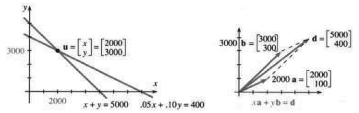
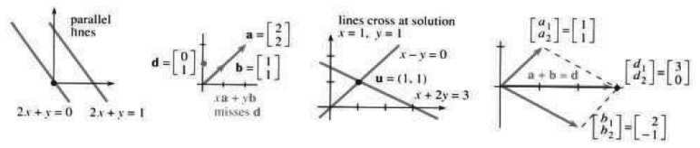
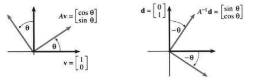
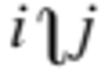
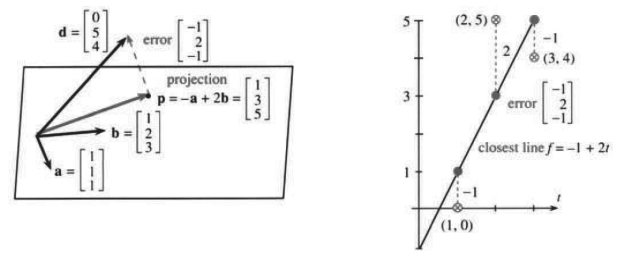

# 11.4　矩阵与线性方程

原书 PDF 第509—519页；印刷页496—506。状态：初译，已对照原页自校，待统一复审。

<!-- PDF 509 / 印刷页 496 -->

我们正从几何走向代数。最终还是要回到微积分，那里研究的是非线性函数——不过线性方程得先讲。第1章中，$y=mx+b$ 给出一条直线。两个方程给出两条直线；若它们相交，交点就同时满足两个方程，我们要找的正是它。

三个含 $x,y,z$ 的方程给出三个平面，通常交于一点。问题仍是求交点，也就是三个方程的共同解。

最终的问题是解含 $n$ 个未知数的 $n$ 个方程。$n$ 维空间中的 $n$ 个超平面在解处相交。我们需要一个判据来确定它们是否相交，也需要求出解。这些都是线性代数的目标。线性代数与微积分共同处于纯数学和应用数学的核心。†

像任何学科一样，线性代数需要良好的记号。为了表达和求解方程，我们引入“矩阵”。**问题将写成 $A\mathbf u=\mathbf d$，解将写成 $\mathbf u=A^{-1}\mathbf d$。**接下来要理解方程从何而来、答案从何而来，以及矩阵 $A$ 和 $A^{-1}$ 的含义。

## 两个未知数的两个方程

线性代数没有理由特别偏爱某个变量。$y-y_0=m(x-x_0)$ 把 $y$ 与 $x$ 区别对待，更合适的直线方程是 $ax+by=d$。当 $b=0$ 时，它包含 $x=5$ 这样的竖直线；前一种形式不能使用所谓 $m=\infty$ 的斜率。本节研究两条直线：

$$
\begin{cases}a_1x+b_1y=d_1,\\a_2x+b_2y=d_2.\end{cases}\tag{1}
$$

同时求解两个方程，就是要求 $(x,y)$ 位于两条直线上。实际问题是：两直线在哪里相交？数学家的问题是：解是否存在？是否唯一？

理解一切是不可能的。生活里有些事，你永远不知道是怎么回事，等你明白过来，已经太晚。但两个未知数的两个方程不应留下任何谜团。这个方程组有三种写法：按行、按列、用矩阵。请都看看，因为建立问题通常比求解更难，也更重要。随后我们才回到现实，计算 $x,y$。

**例1**　若货币市场账户年利率为5%，存款账户年利率为10%，应怎样分配5000美元，使每年利息为400美元？

**按行建立方程。**$x$ 美元按5%计息，利息为 $0.05x$；$y$ 美元按10%计息，利息为 $0.10y$。一行表示本金，一行表示利息：

$$
\begin{cases}x+y=5000,\\0.05x+0.10y=400.\end{cases}\tag{2}
$$

† 有些应用以线性代数为主，另一些以微积分为主，两者都不可缺少。更完整的论述见作者《线性代数及其应用》（Linear Algebra and Its Applications，Harcourt Brace Jovanovich，1988年第3版）以及许多其他教材。

<!-- PDF 510 / 印刷页 497 -->

**同一方程组按列写。**式(2)的左边是 $x$ 乘一个向量，再加 $y$ 乘另一个向量；右边是第三个向量：

$$
x\begin{bmatrix}1\\0.05\end{bmatrix}+y\begin{bmatrix}1\\0.10\end{bmatrix}
=\begin{bmatrix}5000\\400\end{bmatrix}.\tag{3}
$$

**同一方程组用矩阵写。**把两个未知数 $x,y$ 放入向量 $\mathbf u$，把与它们相乘的四个系数放入二阶矩阵 $A$，左侧就成为矩阵乘向量：

$$
A\mathbf u=\begin{bmatrix}1&1\\0.05&0.10\end{bmatrix}\begin{bmatrix}x\\y\end{bmatrix}
=\begin{bmatrix}5000\\400\end{bmatrix}.\tag{4}
$$

现在你看出“行”和“列”来自哪里了：就是矩阵的行和列。行给出式(2)中的各个方程，列给出式(3)中的向量方程。矩阵乘向量之所以这样定义，就是要让这些写法彼此一致：

$$
\text{按行：}\quad
\begin{bmatrix}a_1&b_1\\a_2&b_2\end{bmatrix}\begin{bmatrix}x\\y\end{bmatrix}
=\begin{bmatrix}a_1x+b_1y\\a_2x+b_2y\end{bmatrix}
\quad\text{（每行给出一个点积）};
$$

$$
\text{按列：}\quad
\begin{bmatrix}a_1&b_1\\a_2&b_2\end{bmatrix}\begin{bmatrix}x\\y\end{bmatrix}
=x\begin{bmatrix}a_1\\a_2\end{bmatrix}+y\begin{bmatrix}b_1\\b_2\end{bmatrix}
\quad\text{（列向量的线性组合）}.
$$

$A$ 是**系数矩阵**，$\mathbf u$ 是未知向量，右边的已知向量是 $\mathbf d$，分量为5000、400。矩阵方程是 $A\mathbf u=\mathbf d$。

**图11.16**　$A\mathbf u=\mathbf d$ 的每一行给出一条直线，每一列给出一个向量。

当方程和未知数更多时，记号 $A\mathbf u=\mathbf d$ 仍然适用。每个方程对应矩阵的一行，通常共 $m$ 行；每个未知数对应一列，通常共 $n$ 列。两个方程、三个未知数给出 $2\times3$ 长方形矩阵；六个方程、六个未知数给出 $6\times6$ 方阵。熟悉矩阵的最好办法就是使用它。还要注意英文复数 matrices 的发音，读作“matrisees”，不是“matrixes”。

**实际问题的答案**　$x=2000,y=3000$。它是行图像中两直线的交点，也给出列图像中正确的线性组合。矩阵方程同时验证两者，因为既可按行也可按列相乘，结果都是 $\mathbf d$：

$$
\begin{bmatrix}1&1\\0.05&0.10\end{bmatrix}\begin{bmatrix}2000\\3000\end{bmatrix}
=\begin{bmatrix}2000+3000\\0.05(2000)+0.10(3000)\end{bmatrix}
=\begin{bmatrix}5000\\400\end{bmatrix}=\mathbf d.
$$

<!-- PDF 511 / 印刷页 498 -->

**奇异情形**　行图像中的直线在解处相交。但有一种情况会出问题：两条不同的平行直线永不相交，没有解；若两直线重合，则有无穷多个解：

$$
\text{平行直线：}\begin{cases}2x+y=0,\\2x+y=1;\end{cases}
\qquad\text{同一直线：}\begin{cases}2x+y=0,\\4x+2y=0.\end{cases}\tag{5}
$$

列图像中也出现同样的问题。设列向量为 $\mathbf a,\mathbf b$，方程 $A\mathbf u=\mathbf d$ 就是 $x\mathbf a+y\mathbf b=\mathbf d$。我们要找出系数 $x,y$，让这个组合给出 $\mathbf d$。奇异情形中，$\mathbf a,\mathbf b$ 沿同一直线（图11.17），除非 $\mathbf d$ 恰好也在这条直线上，否则任何组合都不能得到它。

**图11.17**　行、列两种图像：奇异情形（无解）与非奇异情形（$x=y=1$）。parallel lines：平行直线；lines cross at solution：直线在解处相交；misses $\mathbf d$：不能到达 $\mathbf d$。

投资问题是非奇异的，$2000\mathbf a+3000\mathbf b=\mathbf d$。图中还画出了下例。

**例2**　矩阵 $A$ 乘 $\mathbf u=(1,1)$，解出 $x+2y=3$ 与 $x-y=0$：

$$
A\mathbf u=\begin{bmatrix}1&2\\1&-1\end{bmatrix}\begin{bmatrix}1\\1\end{bmatrix}
=\begin{bmatrix}1+2\\1-1\end{bmatrix}=\begin{bmatrix}3\\0\end{bmatrix};
\quad\text{按列：}\begin{bmatrix}1\\1\end{bmatrix}+\begin{bmatrix}2\\-1\end{bmatrix}
=\begin{bmatrix}3\\0\end{bmatrix}.
$$

行图像中的交点为 $(1,1)$，列图像中的系数为 $x=y=1$。一倍 $\mathbf a$ 加一倍 $\mathbf b$ 就是右侧 $\mathbf d$。

## 用行列式求解

到目前为止，只是直接写出了答案。真正的问题是：$x,y$ 还未知的时候，怎么把它们求出来。用字母写出方程：

$$
a_1x+b_1y=d_1,\qquad a_2x+b_2y=d_2.
$$

关键是消去 $x$。第一式乘 $a_2$，第二式乘 $a_1$，后者减前者，得到

$$
(a_1b_2-a_2b_1)y=a_1d_2-a_2d_1.\tag{6}
$$

若要消去 $y$，用第一式的 $b_2$ 倍减去第二式的 $b_1$ 倍：

$$
(b_2a_1-b_1a_2)x=b_2d_1-b_1d_2.\tag{7}
$$

<!-- PDF 512 / 印刷页 499 -->

括号中的量正是二阶行列式！回顾第11.3节：

$$
\begin{bmatrix}a_1&b_1\\a_2&b_2\end{bmatrix}\text{ 的行列式为 }
\begin{vmatrix}a_1&b_1\\a_2&b_2\end{vmatrix}=a_1b_2-a_2b_1.
$$

这个数出现在式(6)、(7)左边。式(7)右边也是行列式，只是把 $a$ 列换成 $d$ 列；式(6)右边则把 $b$ 列换成 $d$ 列。因此 $x,y$ 是行列式之比，由克拉默法则给出。

**11H　克拉默法则（Cramer's Rule）**

$$
x=\frac{\begin{vmatrix}d_1&b_1\\d_2&b_2\end{vmatrix}}
{\begin{vmatrix}a_1&b_1\\a_2&b_2\end{vmatrix}},\qquad
y=\frac{\begin{vmatrix}a_1&d_1\\a_2&d_2\end{vmatrix}}
{\begin{vmatrix}a_1&b_1\\a_2&b_2\end{vmatrix}}.
$$

投资例子用三个行列式求解，它们分别取自三列：

$$
\begin{vmatrix}1&1\\0.05&0.10\end{vmatrix}=0.05,\quad
\begin{vmatrix}5000&1\\400&0.10\end{vmatrix}=100,\quad
\begin{vmatrix}1&5000\\0.05&400\end{vmatrix}=150.
$$

克拉默法则给出 $x=100/0.05=2000$、$y=150/0.05=3000$。奇异情形是 $A$ 的行列式为零，不能用它作除数。

**11I**　当 $\det A=0$ 时，克拉默法则失效，这就是奇异情形。行图像中的直线平行或重合，列向量线性相关。

**例3**　直线 $2x+y=0$ 与 $2x+y=1$ 平行，行列式为零：

$$
\begin{bmatrix}2&1\\2&1\end{bmatrix}\begin{bmatrix}x\\y\end{bmatrix}
=\begin{bmatrix}0\\1\end{bmatrix},\qquad
\det A=\begin{vmatrix}2&1\\2&1\end{vmatrix}=0.
$$

图11.17a中两直线不相交。注意列向量：$(2,2)^T$ 是 $(1,1)^T$ 的倍数。

最后说一点：二阶方程组足够小，各种求解方法都适用。克拉默法则用行列式，较大系统用消元法，三阶正处在两者的交界处。还有第三种办法，解仍是同一个，来自下面要介绍的逆矩阵 $A^{-1}$。不过逆矩阵更多是表达答案的符号，而非新的计算办法，因为求 $A^{-1}$ 仍需用行列式或消元法。

## 矩阵的逆

符号 $A^{-1}$ 读作“A的逆”，表示一个能解 $A\mathbf u=\mathbf d$ 的矩阵。我把 $A$ 看作将 $\mathbf u$ 变成 $\mathbf d$ 的矩阵，$A^{-1}$ 则把 $\mathbf d$ 变回 $\mathbf u$。若 $A\mathbf u=\mathbf d$，则 $\mathbf u=A^{-1}\mathbf d$，前提是逆矩阵存在。这恰好类似函数与反函数：$g(x)=y$、$x=g^{-1}(y)$。目标是由已知的 $A$ 求 $A^{-1}$。

<!-- PDF 513 / 印刷页 500 -->

第一种方法很直接。克拉默法则给出 $\mathbf u$ 的分量 $x,y$，可从中读出 $A^{-1}$，前提是 $D=a_1b_2-a_2b_1\ne0$。$D=\det A$，我们除以它：

$$
\mathbf u=\frac1D\begin{bmatrix}b_2d_1-b_1d_2\\-a_2d_1+a_1d_2\end{bmatrix}
=A^{-1}\mathbf d=\frac1D\begin{bmatrix}b_2&-b_1\\-a_2&a_1\end{bmatrix}
\begin{bmatrix}d_1\\d_2\end{bmatrix}.\tag{8}
$$

右边的矩阵（四个元素都要乘 $1/D$）就是 $A^{-1}$。注意符号与下标的排列。**$D\ne0$ 时逆矩阵存在，这很重要。**解由矩阵与向量相乘得到。重复一次乘法规则：

**定义**　矩阵 $M$ 乘向量 $\mathbf v$，得到由各行点积组成的向量：

$$
M\mathbf v=\begin{bmatrix}\text{第1行}\\\text{第2行}\end{bmatrix}[\mathbf v]
=\begin{bmatrix}(\text{第1行})\cdot\mathbf v\\(\text{第2行})\cdot\mathbf v\end{bmatrix}.\tag{9}
$$

式(8)对应 $M=A^{-1}$、$\mathbf v=\mathbf d$。看例1：

$$
A=\begin{bmatrix}1&1\\0.05&0.10\end{bmatrix},\quad\det A=0.05,\quad
A^{-1}=\frac1{0.05}\begin{bmatrix}0.10&-1\\-0.05&1\end{bmatrix}
=\begin{bmatrix}2&-20\\-1&20\end{bmatrix}.
$$

这就是逆矩阵。它乘以 $\mathbf d$，给出解 $\mathbf u$：

$$
A^{-1}\mathbf d=\begin{bmatrix}2&-20\\-1&20\end{bmatrix}\begin{bmatrix}5000\\400\end{bmatrix}
=\begin{bmatrix}2(5000)-20(400)\\-5000+20(400)\end{bmatrix}
=\begin{bmatrix}2000\\3000\end{bmatrix}.
$$

公式完全有效，可你还得看到一条直接的办法，能走到 $A^{-1}\mathbf d$：**将 $A\mathbf u=\mathbf d$ 两边左乘 $A^{-1}$。**乘法在左边“消去” $A$，剩下 $\mathbf u=A^{-1}\mathbf d$。下面解释它。

## 矩阵乘法

要了解矩阵的威力，必须把矩阵相乘。$A^{-1}$ 乘 $A\mathbf u$ 是矩阵乘向量，但也可以先让 $A^{-1}$ 乘 $A$。这是矩阵乘矩阵，得到另一个很特殊的矩阵 $A^{-1}A$，再让它乘 $\mathbf u$。

矩阵乘矩阵的规则直接来自矩阵乘向量的规则。向量可看成只有一列的矩阵；列一多，$MV$ 就按列拆开，成为并排的矩阵乘向量。

**定义**　矩阵 $M$ 乘矩阵 $V$，得到由点积组成的矩阵：

$$
MV=\begin{bmatrix}\text{第1行}\\\text{第2行}\end{bmatrix}
\begin{bmatrix}\mathbf v_1&\mathbf v_2\end{bmatrix}
=\begin{bmatrix}
(\text{第1行})\cdot\mathbf v_1&(\text{第1行})\cdot\mathbf v_2\\
(\text{第2行})\cdot\mathbf v_1&(\text{第2行})\cdot\mathbf v_2
\end{bmatrix}.\tag{10}
$$

**例4**

$$
\begin{bmatrix}1&2\\3&4\end{bmatrix}\begin{bmatrix}5&6\\7&8\end{bmatrix}
=\begin{bmatrix}1\cdot5+2\cdot7&1\cdot6+2\cdot8\\3\cdot5+4\cdot7&3\cdot6+4\cdot8\end{bmatrix}
=\begin{bmatrix}19&22\\43&50\end{bmatrix}.
$$

<!-- PDF 514 / 印刷页 501 -->

**例5**　$A^{-1}$ 乘 $A$ 得到“单位矩阵” $\begin{bmatrix}1&0\\0&1\end{bmatrix}$：

$$
A^{-1}A=\frac1D\begin{bmatrix}b_2&-b_1\\-a_2&a_1\end{bmatrix}
\begin{bmatrix}a_1&b_1\\a_2&b_2\end{bmatrix}
=\frac1D\begin{bmatrix}a_1b_2-a_2b_1&0\\0&-a_2b_1+a_1b_2\end{bmatrix}
=\begin{bmatrix}1&0\\0&1\end{bmatrix}.\tag{11}
$$

单位矩阵记为 $I$，主对角线上为1，其余为0。它像数1一样起作用：**每个向量都满足 $I\mathbf u=\mathbf u$。**

**11J（逆矩阵与单位矩阵）**　$AA^{-1}=I$、$A^{-1}A=I$、$I\mathbf u=\mathbf u$。

$$
A=\begin{bmatrix}a&b\\c&d\end{bmatrix},\qquad
A^{-1}=\frac1D\begin{bmatrix}d&-b\\-c&a\end{bmatrix},\qquad
\begin{bmatrix}1&0\\0&1\end{bmatrix}\begin{bmatrix}x\\y\end{bmatrix}
=\begin{bmatrix}x\\y\end{bmatrix}.\tag{12}
$$

注意 $a,b,c,d$ 的位置，采用这些字母时 $D=ad-bc$。

下一节进入三个方程，代数会更复杂，四阶更甚。要写出 $A^{-1}$ 并不容易，所以二阶公式我们多停留一会儿——那里每一步都容易核对。$A\mathbf u=\mathbf d$ 两边左乘逆矩阵，得到 $A^{-1}A\mathbf u=A^{-1}\mathbf d$，左边就是 $I\mathbf u=\mathbf u$。

**图11.18**　正向旋转将 $\mathbf v$ 变成 $A\mathbf v$；反向旋转将 $\mathbf d$ 变成 $A^{-1}\mathbf d$。

**例6**　$A=\begin{bmatrix}\cos\theta&-\sin\theta\\\sin\theta&\cos\theta\end{bmatrix}$ 将任意 $\mathbf v$ 旋转角度 $\theta$，得到 $A\mathbf v$。

**问题1**　$\mathbf v=(1,0)^T$ 被旋转到哪里？

**问题2**　$A^{-1}$ 是什么？

**问题3**　哪个向量 $\mathbf u$ 被旋转为 $\mathbf d=(0,1)^T$？

**解1**

$$
A\mathbf v=\begin{bmatrix}\cos\theta&-\sin\theta\\\sin\theta&\cos\theta\end{bmatrix}
\begin{bmatrix}1\\0\end{bmatrix}=\begin{bmatrix}\cos\theta\\\sin\theta\end{bmatrix}.
$$

<!-- PDF 515 / 印刷页 502 -->

**解2**　$\det A=1$，所以

$$
A^{-1}=\begin{bmatrix}\cos\theta&\sin\theta\\-\sin\theta&\cos\theta\end{bmatrix},
$$

它表示旋转 $-\theta$。

**解3**　若 $A\mathbf u=\mathbf d$，则

$$
\mathbf u=A^{-1}\mathbf d=\begin{bmatrix}\cos\theta&\sin\theta\\-\sin\theta&\cos\theta\end{bmatrix}
\begin{bmatrix}0\\1\end{bmatrix}=\begin{bmatrix}\sin\theta\\\cos\theta\end{bmatrix}.
$$

**历史附记**　我很惊讶地得知，我们今天用的矩阵记号，竟然又是莱布尼茨提出来的。第 $i$ 行、第 $j$ 列的元素记为 $a_{ij}$。单位矩阵中 $a_{11}=a_{22}=1$、$a_{12}=a_{21}=0$。这些内容出现在查尔斯·道奇森的一本线性代数书中；世人更熟悉他的笔名刘易斯·卡罗尔，也就是《爱丽丝漫游奇境》的作者。遗憾的是，他更喜欢用自己的记号——在 $i,j$ 之间放一个向左弯的积分形符号——代替 $a_{ij}$。“我把这个符号转向左边，以避免与 $\int$ 混淆的任何可能。”这可把他的排字工逼疯了。

## 向平面投影＝用直线作最小二乘拟合

用一个真正的应用结束本节。从三维向量 $\mathbf a,\mathbf b,\mathbf d$ 出发，最终得到二元方程组。有两个优点：第一，即使这些向量变成 $n$ 维，代数形式也不变，实际当中就是这样；第二，背后有一个微积分问题，即用直线拟合数据点。

问题有三种看似不同的表述：

1. 尽可能好地求解 $x\mathbf a+y\mathbf b=\mathbf d$，这里有三个方程、两个未知数 $x,y$。
2. 将向量 $\mathbf d$ 投影到 $\mathbf a,\mathbf b$ 所在平面。
3. 找到与三个给定点最接近的直线，即“最小二乘”直线。

图11.19显示三维向量 $\mathbf d$ 位于 $\mathbf a,\mathbf b$ 所在平面之上，投影为 $\mathbf p=x\mathbf a+y\mathbf b$。系数 $x,y$ 未知，我们要找出它们。计算仍用点积，因为点积总是处理直角的关键。

差 $\mathbf d-\mathbf p$ 是“误差”。这里必有误差，因为 $\mathbf a,\mathbf b$ 的组合不能精确产生 $\mathbf d$，否则 $\mathbf d$ 本来就在平面内。投影 $\mathbf p$ 是最靠近 $\mathbf d$ 的点，服从基本规律：**误差垂直于平面。**因此误差同时垂直于 $\mathbf a,\mathbf b$：

$$
\mathbf a\cdot(x\mathbf a+y\mathbf b-\mathbf d)=0,\qquad
\mathbf b\cdot(x\mathbf a+y\mathbf b-\mathbf d)=0.\tag{13}
$$

把它们写成关于两个未知数的方程：

$$
\begin{cases}
(\mathbf a\cdot\mathbf a)x+(\mathbf a\cdot\mathbf b)y=\mathbf a\cdot\mathbf d,\\
(\mathbf b\cdot\mathbf a)x+(\mathbf b\cdot\mathbf b)y=\mathbf b\cdot\mathbf d.
\end{cases}\tag{14}
$$

这就是统计学中著名的**正规方程（normal equations）**，用于求 $x,y,\mathbf p$。

**例7**　取 $\mathbf a=(1,1,1)$、$\mathbf b=(1,2,3)$、$\mathbf d=(0,5,4)$，求解式(14)：

$$
\begin{cases}3x+6y=9,\\6x+14y=22\end{cases}
\quad\Longrightarrow\quad x=-1,\ y=2,
\quad\mathbf p=-\mathbf a+2\mathbf b=(1,3,5).
$$

注意，我们并没有精确求解下面三个方程，因为它们无解：

$$
x\mathbf a+y\mathbf b=\mathbf d:\quad
\begin{cases}x+y=0,\\x+2y=5,\\x+3y=4,\end{cases}
\qquad A=\begin{bmatrix}1&1\\1&2\\1&3\end{bmatrix}.\tag{15}
$$

<!-- PDF 516 / 印刷页 503 -->

右侧为 $\mathbf d=(0,5,4)$ 时没有解，因为它不在 $\mathbf a,\mathbf b$ 的平面内；换成 $\mathbf p=(1,3,5)$ 就有解 $x=-1,y=2$，因为 $\mathbf p$ 在平面内。误差 $\mathbf d-\mathbf p=(-1,2,-1)$ 垂直于两列 $(1,1,1)$、$(1,2,3)$，也就垂直于它们张成的平面。

**同一个例子，改写为直线拟合问题**　用一条直线尽可能贴近点 $(1,0)$、$(2,5)$、$(3,4)$——按最小二乘的意义。

两点确定一条直线，可这里要 $f=x+yt$ 穿过三个点，于是得到式(15)的三个方程——两个未知数满足不了。因此只能将就着取图11.19b中那条最接近的直线。下面还会用微积分重新求出它。

注意，数据点高度为 $0,5,4$，最接近直线的对应高度为 $1,3,5$，这正是 $\mathbf d$ 与 $\mathbf p$ 的分量！高度 $1,3,5$ 能落在同一直线上，$0,5,4$ 则不能。第一幅图中，$\mathbf p=(1,3,5)$ 在平面内，$\mathbf d=(0,5,4)$ 不在。平面内的向量对应于能排在一条直线上的高度。

还有一个对应：系数 $x=-1,y=2$ 既给出投影 $-\mathbf a+2\mathbf b$，也给出最佳直线 $f=-1+2t$。所有数字同时出现在两幅图中。

**图11.19**　平面投影为 $(1,3,5)$，系数为 $-1,2$；最佳直线的高度为 $1,3,5$，系数同样为 $-1,2$；两幅图中的误差都是 $-1,2,-1$。projection：投影；error：误差；closest line：最佳拟合直线。

**说明**　求最佳直线是一个微积分问题：使平方和最小。使 $E$ 最小的 $x,y$ 给出最小二乘解：

$$
E(x,y)=(x+y-0)^2+(x+2y-5)^2+(x+3y-4)^2.\tag{16}
$$

这是式(15)三个误差的平方和，也是直线与三个数据点之间竖直误差的平方和。几何上投影使误差最小，代数上正规方程使误差最小，现在微积分把 $E$ 的导数设为零，也达到同一个目的。

新的特点是：$E$ 依赖 $x,y$ 两个变量，因此有两个偏导数。在最小点，两者都为零，于是得到两个方程：

$$
\begin{aligned}
\text{对 }x\text{ 的导数为零：}\quad&2(x+y)+2(x+2y-5)+2(x+3y-4)=0,\\
\text{对 }y\text{ 的导数为零：}\quad&2(x+y)+2(x+2y-5)(2)+2(x+3y-4)(3)=0.
\end{aligned}
$$

两边除以2，正是正规方程 $3x+6y=9$、$6x+14y=22$。微积分得到的最优 $x,y$ 仍是 $-1,2$。

<!-- PDF 517 / 印刷页 504 -->

对 $x$ 求导时把 $y$ 当作常数，对 $y$ 求导时把 $x$ 当作常数，这些就是偏导数。第13章将把这种最小二乘方法作为偏导数的重要应用。

现在概括最小二乘问题：寻找最接近 $n$ 个数据点的直线。实际中 $n$ 可能是1000，而非3。各点横坐标为 $b_1,b_2,\ldots,b_n$，纵坐标为 $d_1,d_2,\ldots,d_n$。向量 $\mathbf b,\mathbf d$ 与 $\mathbf a=(1,1,\ldots,1)$ 一起确定投影，即最靠近 $\mathbf d$ 的组合 $\mathbf p=x\mathbf a+y\mathbf b$。在 $n$ 维中问题仍一样：误差 $\mathbf d-\mathbf p$ 垂直于 $\mathbf a,\mathbf b$。用点积检验，$\mathbf p\cdot\mathbf a=\mathbf d\cdot\mathbf a$、$\mathbf p\cdot\mathbf b=\mathbf d\cdot\mathbf b$，得到

$$
\begin{cases}(\mathbf a\cdot\mathbf a)x+(\mathbf a\cdot\mathbf b)y=\mathbf a\cdot\mathbf d,\\
(\mathbf b\cdot\mathbf a)x+(\mathbf b\cdot\mathbf b)y=\mathbf b\cdot\mathbf d,
\end{cases}
\quad\text{即}\quad
\begin{cases}nx+(\sum b_i)y=\sum d_i,\\
(\sum b_i)x+(\sum b_i^2)y=\sum b_id_i.
\end{cases}\tag{17}
$$

**11K**　最小二乘问题把 $\mathbf d$ 投影到 $\mathbf a,\mathbf b$ 张成的平面。在 $n$ 维中，投影是 $\mathbf p=x\mathbf a+y\mathbf b$；在二维数据图中，最佳直线是 $f=x+yt$。正规方程(17)给出最佳 $x,y$。

## 11.4　习题

### 阅读填空

方程 $3x+y=8$、$x+y=6$ 合成向量方程 $x\,\text{__a__}+y\,\text{__b__}=\text{__c__}=\mathbf d$。左边是 $A\mathbf u$，系数矩阵为 $A=\text{__d__}$，未知向量为 $\mathbf u=\text{__e__}$。$A$ 的行列式为 __f__，所以问题不是 __g__ 的。行图像显示两条相交的 __h__；列图像显示 $x\mathbf a+y\mathbf b=\mathbf d$，其中 $\mathbf a=\text{__i__}$、$\mathbf b=\text{__j__}$。逆矩阵 $A^{-1}=\text{__k__}$，解为 $\mathbf u=A^{-1}\mathbf d=\text{__l__}$。

矩阵乘向量产生一个由各行点 __m__ 组成的向量，也产生各 __n__ 的线性组合：

$$
\begin{bmatrix}\mathbf A\\\mathbf B\end{bmatrix}[\mathbf u]
=\begin{bmatrix}\underline{\qquad}\\\underline{\qquad}\end{bmatrix},\qquad
\begin{bmatrix}\mathbf a&\mathbf b\end{bmatrix}\begin{bmatrix}x\\y\end{bmatrix}
=[\underline{\qquad}],\qquad
\begin{bmatrix}3&1\\1&1\end{bmatrix}\begin{bmatrix}1\\5\end{bmatrix}
=\begin{bmatrix}\underline{\qquad}\\\underline{\qquad}\end{bmatrix}.
$$

若元素为 $a,b,c,d$，行列式 $D=\text{__o__}$，逆矩阵是 $[\text{__p__}]$ 除以 $D$。克拉默法则把解的分量写为行列式之比：$x=\text{__q__}/D$、$y=\text{__r__}/D$。

矩阵乘矩阵 $MV$ 给出由点积组成的矩阵，点积来自 __s__ 的行与 __t__ 的列：

$$
\begin{bmatrix}\mathbf A\\\mathbf B\end{bmatrix}[\mathbf v_1\ \mathbf v_2]
=\begin{bmatrix}\_&\_\\\_&\_\end{bmatrix},\qquad
\begin{bmatrix}3&1\\1&1\end{bmatrix}\begin{bmatrix}1&2\\5&6\end{bmatrix}
=\begin{bmatrix}\_&\_\\\_&\_\end{bmatrix},
$$

$$
\begin{bmatrix}3&1\\1&1\end{bmatrix}\begin{bmatrix}1/2&-1/2\\-1/2&3/2\end{bmatrix}
=\begin{bmatrix}\_&\_\\\_&\_\end{bmatrix},\qquad
\begin{bmatrix}1&0\\0&1\end{bmatrix}[A]=\begin{bmatrix}\_&\_\\\_&\_\end{bmatrix}.
$$

最后一行包含 __u__ 矩阵，记为 $I$。它满足对每个相应维度矩阵 $A$ 都有 $IA=AI=\text{__v__}$，对每个向量都有 $I\mathbf u=\text{__w__}$。逆矩阵满足 $A^{-1}A=\text{__x__}$。因此，将 $A\mathbf u=\mathbf d$ 两边左乘 __y__，得 $\mathbf u=\text{__z__}$。当 __A__ 时，没有逆矩阵。

组合 $x\mathbf a+y\mathbf b$ 是 $\mathbf d$ 的投影，当且仅当误差 __B__ 垂直于 __C__ 和 __D__。若 $\mathbf a=(1,1,1)$、$\mathbf b=(1,2,3)$、$\mathbf d=(0,8,4)$，则关于 $x,y$ 的方程为 __E__。求解也得到最接近数据点 $(1,0)$、__G__、$(3,4)$ 的 __F__。解为 $x=0,y=2$，所以最佳直线为 __H__。投影 $0\mathbf a+2\mathbf b=\text{__I__}$，三个误差分量为 __J__。检查垂直性：$\text{__K__}=0$、$\text{__L__}=0$。用微积分求解时，$x,y$ 使平方和 $E=\text{__M__}$ 最小。

第1—8题：求两条直线的交点 $(x,y)$，若相交的话；说明右侧向量怎样表示为左侧列向量的线性组合，若能表示的话；并求行列式 $D$。

1. $x+y=7$，$x-y=3$。
2. $2x+y=11$，$x+y=6$。

<!-- PDF 518 / 印刷页 505 -->

3. $3x-y=8$，$x-3y=0$。
4. $x+2y=3$，$2x+4y=7$。
5. $2x-4y=0$，$x-2y=0$。
6. $10x+y=1$，$x+y=1$。
7. $ax+by=0$，$2ax+2by=2$。
8. $ax+by=1$，$cx+dy=1$。
9. 用克拉默法则解第3题。
10. 尝试用克拉默法则解第4题。
11. 第5题中，克拉默法则给出的比值是什么形式？
12. 若 $A=I$，说明克拉默法则怎样解 $A\mathbf u=\mathbf d$。
13. 画出第1题的行图像与列图像。
14. 画出第6题的行图像与列图像。
15. 求第1题中的 $A^{-1}$。
16. 若 $ad-bc=1$，求第8题中的 $A^{-1}$。
17. 当行图像中的两条直线 ______ 时，二阶方程组是奇异的。若一个方程是另一个方程的 ______，方程组仍可解；此时两直线 ______，解的个数为 ______。
18. 在无解或有无穷多个解时，尝试使用克拉默法则：$3x+y=0,\ 6x+2y=2$；或者 $3x+y=1,\ 6x+2y=2$。
19. 当 $A$ 的列向量 ______ 时，$A\mathbf u=\mathbf d$ 为奇异系统。若右侧 $\mathbf d$ ______，解存在；在这种可解情形中，解的个数为 ______。
20. 方程 $x-y=d_1$、$9x-9y=d_2$ 可解的条件为 ______。
21. 假设美国人口 $x=0.25$ 十亿，国外人口 $y=5$ 十亿。美国境内4%的人迁出，国外2%的人迁入，求迁移后的境内人口 $d_1$ 与境外人口 $d_2$。写成 $A\mathbf u=\mathbf d$，并求矩阵 $A$。
22. 第21题中，矩阵列和 $a_1+a_2$、$b_1+b_2$ 有什么特别之处？说明为什么 $d_1+d_2=x+y$。
23. 按相同百分比迁移后，境内人口为 $d_1=0.58$ 十亿，境外人口为 $d_2=4.92$ 十亿。建立并求解两个方程，求原来的人口 $x,y$。
24. 求第21—23题中 $A$ 的行列式和逆矩阵，检查 $A^{-1}A=I$。
25. 方程 $ax+y=0$、$x+ay=0$ 总有解 $x=y=0$。$a$ 取哪两个值时还有其他解？其他解是什么？
26. 方程 $ax+by=0$、$cx+dy=0$ 总有解 $x=y=0$。当两直线 ______ 时还有其他解；这发生在 $a,b,c,d$ 满足 ______ 时。
27. 求 $A=\begin{bmatrix}2&4\\3&5\end{bmatrix}$ 的行列式及逆矩阵，再对 $2A,A^{-1},-A,I$ 做同样计算。
28. 证明 $\det(A^{-1})=1/\det A$，其中
    $$A^{-1}=\begin{bmatrix}d/(ad-bc)&-b/(ad-bc)\\-c/(ad-bc)&a/(ad-bc)\end{bmatrix}.$$
29. 计算 $AB,BA,BC,CB$，其中
    $$A=\begin{bmatrix}1&4\\2&-1\end{bmatrix},\quad B=\begin{bmatrix}3&1\\1&1\end{bmatrix},\quad C=\begin{bmatrix}1&1\\0&2\end{bmatrix}.$$
    验证结合律：$(AB)C=A(BC)$。
30. （a）求上题 $A,B,AB,BA$ 的行列式。（b）猜想 $BC$ 行列式的规律，并检验。
31. 对 $A=\begin{bmatrix}a&b\\c&d\end{bmatrix}$、$B=\begin{bmatrix}e&f\\g&h\end{bmatrix}$，写出 $AB$，将其行列式因式分解为 $(ad-bc)(eh-fg)$，从而得到 $\det(AB)=(\det A)(\det B)$。
32. 一般 $\det(A+B)\ne\det A+\det B$。各找一个不等与相等的例子。
33. 求 $A=\begin{bmatrix}1&4\\0&2\end{bmatrix}$ 与 $B=\begin{bmatrix}2&2\\0&1\end{bmatrix}$ 的逆矩阵，检查 $A^{-1}A=I$、$BB^{-1}=I$。
34. 在第33题中计算 $AB$ 及其逆矩阵，检查后者等于 $B^{-1}A^{-1}$。
35. 矩阵乘积 $ABB^{-1}A^{-1}$ 等于 ______ 矩阵，因此 $AB$ 的逆为 ______。重要的是，第29题的结合律允许先计算 $BB^{-1}$。
36. 矩阵乘积 $C^{-1}B^{-1}A^{-1}ABC$ 等于 ______ 矩阵，因此 $ABC$ 的逆为 ______。
37. 方程 $x+2y+3z=0$ 与 $4x+5y+cz=0$ 总有非零解。要求向量 $\mathbf u=(x,y,z)$ 与 $\mathbf v=(1,2,3)$、$\mathbf w=(4,5,c)$ ______，所以取 $\mathbf u=\text{______}$。
38. 求 $\mathbf a=(1,1,1)$、$\mathbf b=(-1,0,1)$ 的组合 $\mathbf p=x\mathbf a+y\mathbf b$，使它最接近 $\mathbf d=(2,6,4)$。（a）解正规方程(14)，求 $x,y$。（b）检查 $\mathbf d-\mathbf p$ 垂直于 $\mathbf a,\mathbf b$。
39. 在平面中标出 $(-1,2)$、$(0,6)$、$(1,4)$。用第38题的 $x,y$ 画直线 $x+yt$，标出数据点与直线之间向上或向下的三个误差，并与第38题比较。
40. 解式(14)，求 $\mathbf a=(1,1,1)$、$\mathbf b=(-1,1,2)$ 最接近 $\mathbf d=(1,1,3)$ 的组合。画出对应于数据点 $(-1,1)$、$(1,1)$、$(2,3)$ 的直线。三个误差组成什么向量？它垂直于什么？

<!-- PDF 519 / 印刷页 506 -->

41. $d_1,d_2,d_3$ 满足什么条件时，点 $(0,d_1)$、$(1,d_2)$、$(2,d_3)$ 共线？
42. 求完成交换 $x,y$ 以及投影的矩阵：
    $$M\begin{bmatrix}x\\y\end{bmatrix}=\begin{bmatrix}y\\x\end{bmatrix},\qquad
    P\begin{bmatrix}x\\y\end{bmatrix}=\begin{bmatrix}x\\0\end{bmatrix}.$$
43. 乘以 $P=\begin{bmatrix}0.5&0.5\\0.5&0.5\end{bmatrix}$，将 $\mathbf u$ 投影到与横轴成 $45^\circ$ 的直线。（a）求 $\mathbf u=(1,0)^T$ 的投影 $P\mathbf u$。（b）为什么 $P^2=P$？（c）$P^{-1}$ 存在吗？哪些向量满足 $P\mathbf u=\mathbf0$？
44. 设 $\mathbf u\ne\mathbf0$，但 $A\mathbf u=\mathbf0$。则 $A^{-1}$ 不可能存在，否则它将乘以 ______，却产生 $\mathbf u$。

## 译注与待复审事项

- 克拉默法则与逆矩阵公式均要求行列式非零。11I原页框内为“$\det A=0$”；两直线也可能重合。若某行系数全零，就不再表示一条普通直线；“一个列向量为另一个的倍数”在全零退化情形宜统一说成列线性相关。
- 图11.16右图上方为 $3000\mathbf b=(3000,300)^T$，原图保留。第37题原书漏写第一方程的 $=0$，按其后“同时垂直于两向量”的题意补出。
- 最小二乘直线最小化的是竖直残差平方和，并非各点到直线的垂直距离平方和。唯一确定系数要求列向量 $\mathbf a,\mathbf b$ 线性无关；在直线拟合中，即各横坐标不全相同。一般函数导数为零只是必要条件，此处平方和为凸二次函数，故正规方程确实给出最小值。
- 第27题的矩阵经原页核对为第一行 $(2,4)$、第二行 $(3,5)$，并非按提取文本顺序误读成 $(2,3),(4,5)$。
- 投资利率、人口数量是原书设定的练习数据，不作为当前事实。关于莱布尼茨和道奇森的历史叙述按原书保留；特殊旧记号另保留原文小图，未用错误的普通积分符号替代。
