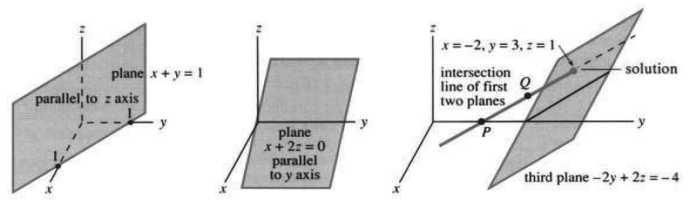
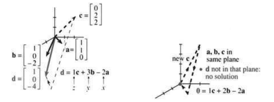
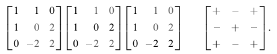
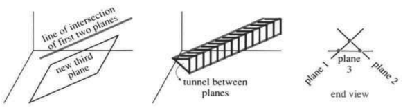
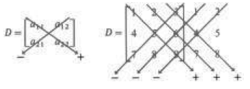

# 11.5 线性代数

原书 PDF 第520–529页，印刷页507–516。状态：初译，待复审。

<!-- PDF 520 / 印刷页 507 -->

本节从二维进入三维。有三个未知数 $x,y,z$，也有三个方程。这里正处在公式与算法的交汇处——这是真正的线性代数。公式靠行列式直接给出解；算法则用消元法，最后得出数值 $x,y,z$。实际计算中，结果来得很快。**计算机用消元法解线性方程组。**

非线性方程也有类似情形。二次方程 $ax^2+bx+c=0$ 用公式求解。三次方程用牛顿法求解（虽然也有公式）。方程里带 $x^5$ 或 $x^{10}$ 时，求解就完全交给算法了。

既然处在交汇点，我们就向两边都看一看。本节要把几何、行列式和三阶矩阵联系起来，内容不少：

1. 行图像：三个平面在解处相交。
2. 列图像：向量方程把各列组合起来。
3. 公式：行列式与克拉默法则。
4. 矩阵乘法与 $A^{-1}$。
5. 算法：高斯消元法。

我们的目标一部分是三维微积分，另一部分是 $n$ 维代数。还有第三种可能：你明年不再学习数学。如果真是这样，我希望你仍会用数学。线性方程在如此广泛的应用中都那么基本、那么重要，因此值得在本节投入精力。

我们需要一个例子。矩阵含有零，既方便又符合实际。实际问题中的大多数方程都相当简单——一千个方程，每个都有990个零系数，是完全合理的。下面是一个三元一次方程组：

$$
\begin{aligned}x+y&=1,\\x+2z&=0,\\-2y+2z&=-4.\end{aligned}\tag{1}
$$

在矩阵—向量形式中，未知向量 $\mathbf u$ 的分量为 $x,y,z$。右端的 $1,0,-4$ 放进 $\mathbf d$。包括三个零在内的九个系数构成矩阵 $A$：

$$
\begin{bmatrix}1&1&0\\1&0&2\\0&-2&2\end{bmatrix}
\begin{bmatrix}x\\y\\z\end{bmatrix}
=\begin{bmatrix}1\\0\\-4\end{bmatrix},
\qquad\text{即 }A\mathbf u=\mathbf d.\tag{2}
$$

目标是从几何上理解这个方程组，然后求解。

## 行图像：相交的平面

先看第一个方程 $x+y=1$。在 $xy$ 平面内，它给出一条直线；在三维中，它是一个平面。它具有通常的形式 $ax+by+cz=d$，只是 $c$ 恰好为零。这个平面容易想象（图11.20a），因为它沿那条直线竖直向下延伸。方程 $x+y=1$ 允许 $z$ 取任何值，因此图像包含直线上方和下方的所有点。

第二个方程 $x+2z=0$ 给出经过原点的第二个平面。**右端为零时，点 $(0,0,0)$ 满足方程。**这次方程不含 $y$，所以平面包含整条 $y$ 轴。所有点

<!-- PDF 521 / 印刷页 508 -->

$(0,y,0)$ 都满足 $x+2z=0$。平面的法向量为 $\mathbf N=\mathbf i+2\mathbf k$。在图11.20b中，这个平面横向穿过，而不是竖直向下。

在引入第三个方程以前，先把前两个合起来看。**两个平面的交集是一条直线。**在三维空间里，描述一条直线要用两个方程，不是一个。直线上的点必须同时满足 $x+y=1$ 和 $x+2z=0$。一个方便的点是 $P=(0,1,0)$，另一个是 $Q=(-1,2,\tfrac12)$。经过 $P,Q$ 的直线向两端延伸。

解在这条直线上。第三个平面决定它的具体位置。

图11.20　第一个平面、第二个平面，以及它们的交线在解处与第三个平面相交。

第三个方程 $-2y+2z=-4$ 给出第三个平面。右端不为零，因此它不经过原点。重要的是**三个平面相交的那个点**。前两个平面的交线穿过第三个平面。我们用行列式（但消元法更好）求得 $x=-2,y=3,z=1$。这个解满足三个方程，也位于三个平面上。

简单说说四元一次方程组。第一个方程可能是 $x+y+z-t=0$。它表示四维空间中的一个三维“超平面”。（在物理中，这就是时空。）第二个方程给出第二个超平面，它与第一个的交集是二维的。第三个方程（第三个超平面）把交集缩减为一条直线。第四个超平面与这条直线交于一点，也就是解。它满足四个方程，位于四个超平面上。本课程中，三维就够了。

## 列图像：列向量的组合

有一种极其重要的方法，可以重写这三个方程。在式(1)中它们彼此分开，在式(2)中它们进入了一个矩阵。现在把它们写成一个向量方程：

$$
x\begin{bmatrix}1\\1\\0\end{bmatrix}
+y\begin{bmatrix}1\\0\\-2\end{bmatrix}
+z\begin{bmatrix}0\\2\\2\end{bmatrix}
=\begin{bmatrix}1\\0\\-4\end{bmatrix}.\tag{3}
$$

**矩阵的各列分别乘以 $x,y,z$。**这是看待矩阵与向量相乘的一种特别方式：**$A\mathbf u$ 是 $A$ 的各列的一个组合。**我们要寻找数 $x,y,z$，使这个组合产生右端 $\mathbf d$。

列向量 $\mathbf a,\mathbf b,\mathbf c$ 见图11.21a。向量方程是 $x\mathbf a+y\mathbf b+z\mathbf c=\mathbf d$。满足它的组合必然仍为 $x=-2,y=3,z=1$。这与行图像中三个平面的交点一致。

<!-- PDF 522 / 印刷页 509 -->

图11.21　列向量组合得到 $\mathbf d$；列向量组合得到零向量（奇异情形）。

## 行列式与逆矩阵

介绍叉积的一节给出了三阶行列式的两个公式。一个是混合积 $\mathbf a\cdot(\mathbf b\times\mathbf c)$，另一个把六项写出来：

$$
\det A=\mathbf a\cdot(\mathbf b\times\mathbf c)
=a_1(b_2c_3-b_3c_2)+a_2(b_3c_1-b_1c_3)+a_3(b_1c_2-b_2c_1).
$$

从几何上看，这是一个平行六面体的体积。列向量 $\mathbf a,\mathbf b,\mathbf c$ 是从原点出发的三条棱。本例的行列式和体积都是2：

$$
\begin{vmatrix}a_1&b_1&c_1\\a_2&b_2&c_2\\a_3&b_3&c_3\end{vmatrix}
=\begin{vmatrix}1&1&0\\1&0&2\\0&-2&2\end{vmatrix}
=\begin{aligned}[t]&(1)(0)(2)-(1)(-2)(2)+(1)(-2)(0)\\&-(1)(1)(2)+(0)(1)(2)-(0)(0)(0)\end{aligned}
=2.
$$

这次计算中有一点小小的“不老实”，现在交代清楚。第11.3节的向量 $\mathbf A,\mathbf B,\mathbf C$ 是各行；本节的 $\mathbf a,\mathbf b,\mathbf c$ 是各列。这没有关系，因为两种方式得到的行列式相同。任何矩阵都可以“转置”——交换行与列——而不改变行列式。六项（第一项为 $a_1b_2c_3$）的次序可能不同，但仍是同样的六项。本例中矩阵含零，因此四项为零。六项的和为 $D=\det A=2$。

因为 $D$ 不为零，所以方程组可解。三个平面交于一点。列向量 $\mathbf a,\mathbf b,\mathbf c$ 构成一个真正的平行六面体，没有被压平到同一平面内（体积为零）。求解要**除以 $D$**，只有 $D=\det A$ 不为零才可以这样做。

> **11L**　当行列式 $D$ 不为零时，$A$ 有逆矩阵：$AA^{-1}=A^{-1}A=I$。于是方程组 $A\mathbf u=\mathbf d$ 有且只有一个解 $\mathbf u=A^{-1}\mathbf d$。

三阶单位矩阵 $I$ 写在式(5)的末尾。总有 $I\mathbf u=\mathbf u$。

现在求 $A^{-1}$，先用字母，再用数值。最简洁的公式，要用 $A$ 各列向量的叉积——这是三阶矩阵特有的公式。

$$
\text{每个元素都除以 }D:\qquad
A^{-1}=\frac1D\begin{bmatrix}\mathbf b\times\mathbf c\\\mathbf c\times\mathbf a\\\mathbf a\times\mathbf b\end{bmatrix}.\tag{4}
$$

要检验此公式，就乘以 $A$。**矩阵乘法产生的矩阵，元素全是点积**：第一个矩阵的行乘第二个矩阵的列。$A^{-1}A=I$：

<!-- PDF 523 / 印刷页 510 -->

$$
\frac1D\begin{bmatrix}\mathbf b\times\mathbf c\\\mathbf c\times\mathbf a\\\mathbf a\times\mathbf b\end{bmatrix}
\begin{bmatrix}\mathbf a&\mathbf b&\mathbf c\end{bmatrix}
=\frac1D\begin{bmatrix}
\mathbf a\cdot(\mathbf b\times\mathbf c)&\mathbf b\cdot(\mathbf b\times\mathbf c)&\mathbf c\cdot(\mathbf b\times\mathbf c)\\
\mathbf a\cdot(\mathbf c\times\mathbf a)&\mathbf b\cdot(\mathbf c\times\mathbf a)&\mathbf c\cdot(\mathbf c\times\mathbf a)\\
\mathbf a\cdot(\mathbf a\times\mathbf b)&\mathbf b\cdot(\mathbf a\times\mathbf b)&\mathbf c\cdot(\mathbf a\times\mathbf b)
\end{bmatrix}
=\begin{bmatrix}1&0&0\\0&1&0\\0&0&1\end{bmatrix}.\tag{5}
$$

右侧有六个混合积为零。它们位于非对角位置，例如 $\mathbf b\cdot(\mathbf b\times\mathbf c)$，同一个向量出现两次。因为 $\mathbf b\times\mathbf c$ 垂直于 $\mathbf b$，所以这个混合积为零。其他各项也一样，例如 $\mathbf a\cdot(\mathbf a\times\mathbf b)=0$。这是两条棱相同的平行六面体的体积。六个非对角位置的零，是完全压平的平行六面体的体积。

**主对角线上的混合积都等于 $D$。**向量的顺序可以是 $abc,bca,cab$，平行六面体的体积不变。除以专门放在矩阵外面的这个数 $D$，就得到单位矩阵 $I$ 中的1。

现在改用数值。目标是求出 $A^{-1}$ 并检验。

**例1**　矩阵

$$
A=\begin{bmatrix}1&1&0\\1&0&2\\0&-2&2\end{bmatrix}
\quad\text{的逆矩阵为}\quad
A^{-1}=\frac12\begin{bmatrix}4&-2&2\\-2&2&-2\\-2&2&-1\end{bmatrix}.
$$

这是由公式得到的，必须检查。一定不要忘记计算 $A^{-1}A$（或 $AA^{-1}$）。矩阵乘法远比计算 $A^{-1}$ 的公式容易。我们突出显示第三行与第一列相乘，点积为零：

$$
\frac12\begin{bmatrix}4&-2&2\\-2&2&-2\\-2&2&-1\end{bmatrix}
\begin{bmatrix}1&1&0\\1&0&2\\0&-2&2\end{bmatrix}
=\frac12\begin{bmatrix}4-2&4-4&-4+4\\-2+2&-2+4&4-4\\-2+2&-2+2&4-2\end{bmatrix}
=\begin{bmatrix}1&0&0\\0&1&0\\0&0&1\end{bmatrix}.
$$

**关于 $A^{-1}$ 的说明。**求逆需要 $D\ne0$。我们要除以 $D=\det A$。叉积 $\mathbf b\times\mathbf c,\mathbf c\times\mathbf a,\mathbf a\times\mathbf b$ 给出了简洁的 $A^{-1}$ 表达式，但容易出错。我们宁愿不写 $\mathbf i,\mathbf j,\mathbf k$。需要计算九个二阶行列式；下面是完整的 $A^{-1}$，其中包含九个“代数余子式”，每个都除以 $D$：

$$
A^{-1}=\frac1D\begin{bmatrix}
b_2c_3-b_3c_2&b_3c_1-b_1c_3&b_1c_2-b_2c_1\\
c_2a_3-c_3a_2&c_3a_1-c_1a_3&c_1a_2-c_2a_1\\
a_2b_3-a_3b_2&a_3b_1-a_1b_3&a_1b_2-a_2b_1
\end{bmatrix}.\tag{6}
$$

**要点：**除了那个 $1/D$，$A^{-1}$ 的第一行用不到 $A$ 的第一列。换句话说，$\mathbf b\times\mathbf c$ 不含 $\mathbf a$。下面的二阶行列式给出 $4,-2,2$；这些数在 $A^{-1}$ 第一行中都要除以 $D=2$：

（7）

第二个突出显示的行列式看起来是 $+2$，而不是 $-2$。但右边的**符号矩阵**规定，$A^{-1}$ 中那个位置要带负号。把 $b_1c_3-b_3c_1$ 变号，就得到式(6)第一行的代数余子式 $b_3c_1-b_1c_3$。

再说一次：**要求 $A^{-1}$ 的某一行，划去 $A$ 中相应的列；求出三个二阶行列式，使用符号矩阵，再除以 $D$。**

<!-- PDF 524 / 印刷页 511 -->

**例2**

$$
B=\begin{bmatrix}1&1&1\\0&1&1\\0&0&1\end{bmatrix},
\qquad D=1,\qquad
B^{-1}=\begin{bmatrix}1&-1&0\\0&1&-1\\0&0&1\end{bmatrix}.\tag{8}
$$

计算 $BB^{-1}=I$ 可以检查算术是否正确。注意，$B$ 中的 $\begin{smallmatrix}1&1\\1&1\end{smallmatrix}$ 怎样在 $B^{-1}$ 第一行产生零。要求 $B^{-1}$ 的第一行第三列，就忽略 $B$ 的第一列和第三行。（还要注意：三角矩阵求逆，结果仍是三角矩阵。）负号来自符号矩阵。

## 解 $\mathbf u=A^{-1}\mathbf d$

我们求 $A^{-1}$，是为了解方程 $A\mathbf u=\mathbf d$。乘以 $A^{-1}$ 得到 $I\mathbf u=A^{-1}\mathbf d$。矩阵变成单位矩阵，$I\mathbf u$ 等于 $\mathbf u$，立即得到解：

$$
\mathbf u=A^{-1}\mathbf d
=\frac1D\begin{bmatrix}\mathbf b\times\mathbf c\\\mathbf c\times\mathbf a\\\mathbf a\times\mathbf b\end{bmatrix}\begin{bmatrix}\mathbf d\end{bmatrix}
=\frac1D\begin{bmatrix}\mathbf d\cdot(\mathbf b\times\mathbf c)\\\mathbf d\cdot(\mathbf c\times\mathbf a)\\\mathbf d\cdot(\mathbf a\times\mathbf b)\end{bmatrix}.\tag{9}
$$

把分量 $x,y,z$ 写成**行列式之比**，就得到克拉默法则：

> **11M（克拉默法则）**　解为
> $$
> x=\frac{|\mathbf d\ \mathbf b\ \mathbf c|}{|\mathbf a\ \mathbf b\ \mathbf c|},\qquad
> y=\frac{|\mathbf a\ \mathbf d\ \mathbf c|}{|\mathbf a\ \mathbf b\ \mathbf c|},\qquad
> z=\frac{|\mathbf a\ \mathbf b\ \mathbf d|}{|\mathbf a\ \mathbf b\ \mathbf c|}.\tag{10}
> $$

右端 $\mathbf d$ 依次替换列 $\mathbf a,\mathbf b,\mathbf c$。所有分母都为 $D=\mathbf a\cdot(\mathbf b\times\mathbf c)$。$x$ 的分子就是式(9)中的行列式 $\mathbf d\cdot(\mathbf b\times\mathbf c)$。第二个分子与第二个分量 $\mathbf d\cdot(\mathbf c\times\mathbf a)$ 相同，因为循环次序正确。第三个行列式以 $\mathbf a,\mathbf b,\mathbf d$ 为列，等于 $A^{-1}\mathbf u$ 中的混合积 $\mathbf d\cdot(\mathbf a\times\mathbf b)$。因此式(10)与式(9)相同。

**例A：**乘以 $A^{-1}$，求出已知的解 $x=-2,y=3,z=1$：

$$
\mathbf u=A^{-1}\mathbf d
=\frac12\begin{bmatrix}4&-2&2\\-2&2&-2\\-2&2&-1\end{bmatrix}\begin{bmatrix}1\\0\\-4\end{bmatrix}
=\frac12\begin{bmatrix}4-8\\-2+8\\-2+4\end{bmatrix}
=\begin{bmatrix}-2\\3\\1\end{bmatrix}.
$$

**例B：**当 $\mathbf d$ 为列向量 $(6,5,4)$ 时，乘以 $B^{-1}$ 解 $B\mathbf u=\mathbf d$：

$$
\mathbf u=B^{-1}\mathbf d
=\begin{bmatrix}1&-1&0\\0&1&-1\\0&0&1\end{bmatrix}\begin{bmatrix}6\\5\\4\end{bmatrix}
=\begin{bmatrix}1\\1\\4\end{bmatrix}.
\qquad\text{检验： }B\mathbf u
=\begin{bmatrix}1&1&1\\0&1&1\\0&0&1\end{bmatrix}\begin{bmatrix}1\\1\\4\end{bmatrix}
=\begin{bmatrix}6\\5\\4\end{bmatrix}.
$$

<!-- PDF 525 / 印刷页 512 -->

**例C：**把 $\mathbf d=(6,5,4)$ 依次放入 $B$ 的各列。克拉默法则给出 $\mathbf u=(1,1,4)$：

$$
\begin{vmatrix}6&1&1\\5&1&1\\4&0&1\end{vmatrix}=1,\qquad
\begin{vmatrix}1&6&1\\0&5&1\\0&4&1\end{vmatrix}=1,\qquad
\begin{vmatrix}1&1&6\\0&1&5\\0&0&4\end{vmatrix}=4,
\quad\text{都除以 }D=\begin{vmatrix}1&1&1\\0&1&1\\0&0&1\end{vmatrix}=1.
$$

这个法则让满页都是行列式。这几个行列式，用眼睛就能核对，不必写出六项（三项为正，三项为负）。

$A^{-1}$ 的公式虽备受尊重，却很少实际登场。这套公式的代数形式在某些方面很美，可计算机不用它们。在大型计算中，计算机并不求 $A^{-1}$，而是直接求解。

现在来看奇异情形 $D=0$。几何—代数—算法都必然出现障碍。之后再介绍算法：高斯消元法。

## 奇异情形

改变矩阵的一个元素，就可能使行列式变成零。混合积 $\mathbf a\cdot(\mathbf b\times\mathbf c)$，也就是体积，变成 $D=0$。平行六面体被压平，矩阵成为奇异矩阵。本例中，把右下角元素从2改为4就会发生这种情况：

$$
S=\begin{bmatrix}1&1&0\\1&0&2\\0&-2&4\end{bmatrix}
\qquad\text{的行列式为 }D=0.
$$

这改变的不止是逆矩阵——它**使逆矩阵不再存在**。我们不能再除以 $D$。没有 $S^{-1}$。

行图像和列图像会怎样？二元一次方程组遇到奇异情形，两条直线平行。现在行图像有三个平面，它们未必平行。本例中，**平面并不平行**。法向量是 $S$ 的各行，指向不同方向。但这些平面却无法经过同一个点。

情况更微妙一些。两个平面的交线不与第三个平面相交。交线平行于该平面，一直位于它的上方（图11.22a）。把三个平面都画出来，它们形成一个敞开的隧道。三个平面怎么会交不到一点上，图像比数字说得更多。第三幅图是端视图，平面直入纸面。每两个平面交于一条直线，但这些直线不相交于一点。

图11.22　奇异情形的行图像：没有共同交点，没有解。

两个平面平行时，行列式同样为零。矩阵的一行是另一行的倍数。极端情形是三个平面全部平行，例如九个元素全为1的矩阵。

<!-- PDF 526 / 印刷页 513 -->

列图像也必然出现问题。在前一节的二阶奇异情形中，各列在同一直线上。**现在三个列向量在同一平面内。**只有 $\mathbf d$ 恰好落在这个特定平面内，各列的组合才能凑出它。大多数向量 $\mathbf d$ 都在平面外，所以大多数奇异方程组无解。

**当行列式为零时，$A\mathbf u=\mathbf d$ 要么无解，要么有无穷多个解。**

## 消元算法

回到三阶例子 $A\mathbf u=\mathbf d$。如果直接给你这几个方程，你不会想到行列式。你会从第一个方程入手——而且完全正确。它给出 $x=1-y$，代入下一个方程就消去了 $x$：

$$
\begin{cases}x+y=1,\\x+2z=0,\\-2y+2z=-4\end{cases}
\xrightarrow{x=1-y}
\begin{cases}1-y+2z=0,\\-2y+2z=-4.\end{cases}
$$

先停一下。右侧是关于 $y,z$ 的二元一次方程组。第一个方程和第一个未知数被消去了，正合我们的心意。但这一步的安排还不够好，因为一个“1”跑到了左边。常数该留在右边，格式该保持原样。更好的办法是**用第二个方程减去第一个方程**，完成同一步骤：

$$
\begin{cases}x+y=1,\\x+2z=0,\\-2y+2z=-4\end{cases}
\longrightarrow
\begin{cases}-y+2z=-1,\\-2y+2z=-4.\end{cases}\tag{11}
$$

方程相同，安排更好。现在看左上角的项 $-y$。其系数 $-1$ 是**第二个主元**。（第一个主元是 $+1$，即第一个左上角位置 $x$ 的系数。）接着做下一步消元：

- 计划：用下面的方程减去“主元方程”的某个倍数。
- 目标：在主元下方产生零，从而消去 $y$。
- 方法：减去主元方程的2倍，以消去 $-2y$。

$$
\begin{cases}-y+2z=-1,\\-2y+2z=-4\end{cases}
\longrightarrow -2z=-2.\tag{12}
$$

**回代**之后，答案就出来了。式(12)给出 $z=1$，式(11)给出 $y=3$，再由第一个方程得到 $x=-2$。这比行列式快得多。你可能会问：为什么还用克拉默法则？问得好。

算具体的数值，消元法更好：更快，也更可靠。（要检查错误，把 $-2,3,1$ 代回原方程。）该算法**既不求行列式，也不求逆矩阵**，就能得到答案。用字母做运算时，才用得上 $\det A$ 和 $A^{-1}$。

按确定的次序（从上往下），步骤如下：

- 从方程2减去方程1的某个倍数，使其中出现 $0x$。
- 从方程3减去方程1的某个倍数，使其中出现 $0x$。
- 从方程3减去新的方程2的某个倍数，使其中出现 $0y$。

<!-- PDF 527 / 印刷页 514 -->

**例**（注意主元下方出现的零）：

$$
\begin{cases}x+y+z=1,\\2x+5y+3z=7,\\4x+7y+6z=11\end{cases}
\longrightarrow
\begin{cases}x+y+z=1,\\3y+z=5,\\3y+2z=7\end{cases}
\longrightarrow
\begin{cases}x+y+z=1,\\3y+z=5,\\z=2.\end{cases}
$$

消元得到**三角形方程组**。对角线下方的系数都是零。先有 $z=2$，再得 $y=1$，最后得 $x=-2$。**回代可以快速解三角形方程组。**

最后一个例子，试一试把右下角元素从2改为4之后的奇异方程组 $S\mathbf u=\mathbf d$。由于 $D=0$，不存在逆矩阵 $S^{-1}$。消元也不能得到解，因为它产生不可能的等式 $0=-2$：

$$
\begin{cases}x+y=1,\\x+2z=0,\\-2y+4z=-4\end{cases}
\longrightarrow
\begin{cases}x+y=1,\\-y+2z=-1,\\-2y+4z=-4\end{cases}
\longrightarrow
\begin{cases}x+y=1,\\-y+2z=-1,\\0=-2.\end{cases}
$$

三个平面没有共同交点——一开始这并不明显。代数从 $D=0$ 发现这一情况，消元则从 $0=-2$ 发现它。本章结束的地方，正是我的线性代数教材开始的地方。

最后说明一点。实际计算时，你会用专业人员写好的程序。步骤与上面相同：从第一个方程下方的每个方程中减去第一个方程的某个倍数，以消去第一个未知数 $x$。未知数和方程都少了一个，消元重新开始。（并行计算机会同时执行许多步骤。）程序里还有些额外指令，专门用来减少舍入误差。你只看到结果！但知道计算机在做什么，会更令人满意。

归根结底，解线性方程组是解非线性方程组的关键步骤。微分学的核心思想，就是在一点附近做线性化。

## 11.5 习题

### 阅读填空

三个未知数的三个方程可以写成 $A\mathbf u=\mathbf d$。**(a)____** $\mathbf u$ 的分量是 $x,y,z$，而 $A$ 是一个 **(b)____**。行图像为每个方程给出一个 **(c)____**。前两个平面交于一条 **(d)____**，三个平面交于一个 **(e)____**，它就是 **(f)____**。列图像从 **(g)____** 的各列得到向量 $\mathbf a,\mathbf b,\mathbf c$，把它们组合起来得到 **(h)____**。向量方程为 **(i)____** $=\mathbf d$。

$A$ 的行列式是混合积 **(j)____**。它是一个平行六面体的体积，从原点出发的三条棱为 **(k)____**。若 $\det A=$ **(l)____**，方程组就是 **(m)____**。否则存在一个 **(n)____**矩阵，使 $A^{-1}A=$ **(o)____**（**(p)____**矩阵）。这时 $A\mathbf u=\mathbf d$ 的解为 $\mathbf u=$ **(q)____**。

$A^{-1}$ 的各行是叉积 $\mathbf b\times\mathbf c$、**(r)____**、**(s)____**，再除以 $D$。$A^{-1}$ 的元素是二阶 **(t)____** 除以 $D$。左上角元素等于 **(u)____**。计算 $A^{-1}$ 某一行所需的二阶行列式，不使用 $A$ 中相应的 **(v)____**。

解为 $\mathbf u=A^{-1}\mathbf d$。第一个分量 $x$ 是行列式之比：$|\mathbf d\ \mathbf b\ \mathbf c|$ 除以 **(w)____**。当 $\det A=$ **(x)____** 时，克拉默法则失效。此时列向量 $\mathbf a,\mathbf b,\mathbf c$ 位于同一 **(y)____** 内。若 $\mathbf d$ 不在这个 **(z)____** 上，$x\mathbf a+y\mathbf b+z\mathbf c=\mathbf d$ 无解。在奇异的行图像中，平面1与平面2的交线与第三个平面 **(A)____**。

实际计算中，用 **(B)____** 计算 $\mathbf u$。算法先减去第一行的某个倍数，从 **(c)____** 中消去 $x$。若前两个方程为 $x-y=1$ 与 $3x+z=7$，这一步消元剩下

<!-- PDF 528 / 印刷页 515 -->

**(D)____**。同样，从第三个方程中消去 $x$，然后消去 **(E)____**。方程组通过回 **(F)____** 求解。方程组无解时，会得到像 **(G)____** 这样的不可能等式。对于 $x-y=1,3x+z=7$，如果第三个方程为 **(H)____**，方程组就无解。

**第1–4题改写为矩阵方程 $A\mathbf u=\mathbf d$（不要求解）。**

1. $\mathbf d=(0,0,8)$ 是 $\mathbf a=(1,2,0)$、$\mathbf b=(2,3,2)$ 与 $\mathbf c=(2,5,2)$ 的一个组合。
2. 平面 $x+y=0$、$x+y+z=1$ 与 $y+z=0$ 相交于 $\mathbf u=(x,y,z)$。
3. 点 $\mathbf u=(x,y,z)$ 在平面 $x=y$、$y=z$、$x-z=1$ 上。
4. $\mathbf a=(1,0,0)$、$\mathbf b=(0,2,0)$ 与 $\mathbf c=(0,0,3)$ 的一个组合等于 $\mathbf d=(5,2,0)$。
5. 用两种方法说明第3题无解：求 $A$ 的行列式；组合各方程得到 $0=1$。
6. 用两种方法解第2题：凭直觉以及使用克拉默法则。
7. 用两种方法解第4题：直接观察，以及计算对角矩阵 $A=\begin{bmatrix}1&0&0\\0&2&0\\0&0&3\end{bmatrix}$ 的行列式和逆矩阵。
8. 用消元法解第1题中的三个方程。
9. 向量 $\mathbf b,\mathbf c$ 在一个垂直于向量 ____ 的平面内。若向量 $\mathbf a$ 也在该平面内，它也与这个向量垂直，于是 $\mathbf a\cdot$ ____ $=0$。各列共面的矩阵，其 ____ 为 ____。
10. 平面 $a_1x+b_1y+c_1z=d_1$ 垂直于其法向量 $\mathbf N_1=$ ____。平面 $a_2x+b_2y+c_2z=d_2$ 垂直于 $\mathbf N_2=$ ____。两个平面交于一条同时垂直于这两个向量的直线，所以该直线平行于它们的 ____ 积。若这条直线也平行于第三个平面、垂直于 $\mathbf N_3$，方程组就是 ____。矩阵没有 ____；当 $(\mathbf N_1\times\mathbf N_2)\cdot\mathbf N_3=0$ 时就会出现这种情况。

**第11–24题使用以下矩阵 $A,B,C$：**

$$
A=\begin{bmatrix}1&4&0\\0&2&6\\0&0&3\end{bmatrix},\qquad
B=\begin{bmatrix}0&0&1\\2&1&0\\6&4&0\end{bmatrix},\qquad
C=\begin{bmatrix}1&-1&-3\\-1&2&0\\0&-1&3\end{bmatrix}.
$$

11. 求行列式 $|A|,|B|,|C|$。由于 $A$ 是三角矩阵，其行列式是乘积 ____。
12. 求 $B$ 的每一对列向量的叉积（共三个）。
13. 求上面 $A,B$ 的逆矩阵。检验 $A^{-1}A=I$ 和 $B^{-1}B=I$。
14. 解 $A\mathbf u=\begin{bmatrix}1\\0\\0\end{bmatrix}$ 和 $B\mathbf u=\begin{bmatrix}1\\0\\0\end{bmatrix}$。对这样的右端 $\mathbf d$，为什么 $\mathbf u$ 是逆矩阵的第一列？
15. 假设矩阵的三个列向量各自的分量和都为零，如上面的 $C$。每列与 $\mathbf v=(1,1,1)$ 的点积是 ____。三个列向量都在同一个 ____ 内。$C$ 的行列式必为 ____。
16. 求 $C\mathbf u=\mathbf0$ 的一个非零解。求 $C\mathbf u=\mathbf0$ 的所有解。
17. 任取一个垂直于 $\mathbf v=(1,1,1)$ 的右端 $\mathbf d$，解 $C\mathbf u=\mathbf d$，再找出第二个解。
18. 任取一个不垂直于 $\mathbf v=(1,1,1)$ 的右端 $\mathbf d$。通过消元（得到一个不可能的等式）说明 $C\mathbf u=\mathbf d$ 无解。
19. 计算矩阵乘积 $AB$，再求它的行列式。$\det(AB)$ 与 $\det A,\det B$ 有什么关系？
20. 计算矩阵乘积 $BC,CB$。$CB$ 的每一列的分量和都是 ____，其行列式为 ____。
21. 将 $A$ 的每个元素与 $C$ 的对应元素相加，求 $A+C$。检查 $A+C$ 的行列式是否等于 $\det A+\det C$。
22. 把 $A$ 的每个元素乘以2，求 $2A$。$2A$ 的行列式等于 $A$ 的行列式的 ____ 倍。
23. $A$ 的哪四个元素所组成的子式，除以 $D=\det A$ 后给出 $A^{-1}$ 左上角的元素 $p$？$A$ 的哪四个元素给出 $A^{-1}$ 第一行第二列的元素 $q$？求 $p,q$。
24. 由 $B$ 的前两行组成的二阶行列式分别为 $-1$（第2、3列）、$-2$（第1、3列）和 ____（第1、2列）。这些数除以 ____ 并将 ____ 变号后，放入 $B^{-1}$ 的第三 ____。
25. 为什么每个逆矩阵 $A^{-1}$ 都有逆矩阵？
26. 由乘法 $ABB^{-1}A^{-1}=I$ 可知，$AB$ 的逆矩阵为 ____。各个逆矩阵按 ____ 的次序出现。如果你先穿袜子、再穿鞋，那么逆过程从脱掉 ____ 开始。
27. 求下列四个**置换矩阵**的行列式：

$$
P=\begin{bmatrix}0&1&0\\1&0&0\\0&0&1\end{bmatrix},\quad
Q=\begin{bmatrix}0&0&1\\0&1&0\\1&0&0\end{bmatrix},\quad
PQ=\begin{bmatrix}0&1&0\\0&0&1\\1&0&0\end{bmatrix},\quad QP=\underline{\qquad}.
$$

   用各个置换矩阵乘 $\mathbf u=(x,y,z)$，求 $P\mathbf u,Q\mathbf u,PQ\mathbf u,QP\mathbf u$。

28. 找出全部六个三阶置换矩阵（包括 $I$），每行每列都只有一个1。哪些是“偶”的（行列式为1），哪些是“奇”的（行列式为 $-1$）？
29. 二阶置换矩阵有多少个（包括 $I$）？四阶的有多少个？

<!-- PDF 529 / 印刷页 516 -->

30. 用置换矩阵 $P$ 乘任意矩阵 $A$，说明 $PA$ 与 $A$ 的关系。把顺序反过来，说明 $AP$ 与 $A$ 的关系。
31. 用后两个方程减去第一个方程，消去 $x$；再利用新的第二个方程，从新的第三个方程中消去 $y$：

$$
\text{(a) }\begin{cases}x+y+z=2,\\x+3y+3z=0,\\x+3y+7z=2;\end{cases}
\qquad
\text{(b) }\begin{cases}x+y=1,\\x+z=3,\\y+z=5.\end{cases}
$$

   消元后，通过回代求 $z,y,x$。

32. 用消元和回代求解：

$$
\text{(a) }\begin{cases}x+2y+2z=0,\\2x+3y+5z=0,\\2y+2z=8;\end{cases}
\qquad
\text{(b) }\begin{cases}x-y=1,\\x-z=4,\\y-z=7.\end{cases}
$$

33. 利用方程1，从方程2中消去 $x$：

$$
\begin{cases}x+2y+2z=0,\\2x+4y+5z=0,\\2y+2z=8.\end{cases}
$$

   为什么新的第二个方程不能消去第三个方程中的 $y$？方程组有解，还是奇异的？

   **注：**如果消元在“主元位置”产生零，试着把这个主元方程与下面的一个方程交换。只要有完整的一组主元，消元就能成功。

34. 第32(a)题的主元为 $1,-1,4$。当它们在消元过程中沿对角线出现时，将其圈出。验证主元的乘积等于行列式。（行列式就是这样计算的。）
35. 求第31题中的主元与行列式。
36. 求 $A=\begin{bmatrix}1&1&0\\0&1&1\\0&0&1\end{bmatrix}$ 以及 $B=A^2$ 的逆矩阵。
37. 符号 $a_{ij}$ 表示第 $i$ 行第 $j$ 列的元素。求第36题中的 $a_{12},a_{21}$。公式 $\sum a_{ij}b_{jk}$ 给出矩阵乘积 $AB$ 的哪一行、哪一列的元素？
38. 写出一个三阶奇异矩阵 $S$，其中任意两行都不平行。找出第1、2行的一个组合，使它平行于第3行；再找出第1、2列的一个组合，使它平行于第3列。求 $S\mathbf u=\mathbf0$ 的一个非零解。
39. 计算下图的行列式。二阶矩阵可逆的条件是 ____。三阶矩阵（是）（不是）可逆的。

