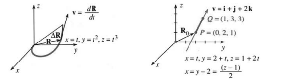
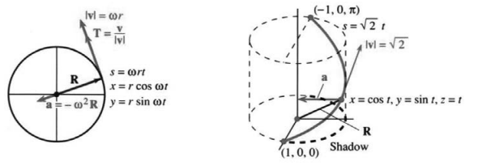
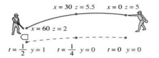

# 第12章　沿曲线的运动
# 12.1 位置向量

原书 PDF 第530–537页，印刷页517–524。状态：初译，待复审。

<!-- PDF 530 / 印刷页 517 -->

本章讨论“向量函数”。向量 $2\mathbf i+4\mathbf j+8\mathbf k$ 是常向量；向量 $\mathbf R(t)=t\mathbf i+t^2\mathbf j+t^3\mathbf k$ 则在运动。它是参数 $t$ 的函数，而 $t$ 通常表示时间。在每个时刻 $t$，位置向量 $\mathbf R(t)$ 确定运动物体的位置：

$$
\text{位置向量}=\mathbf R(t)=x(t)\mathbf i+y(t)\mathbf j+z(t)\mathbf k.\tag{1}
$$

本例中，$x=t,y=t^2,z=t^3$。随着 $t$ 变化，这些点描出一条**空间曲线**。参数 $t$ 告诉我们物体何时经过曲线上的每一点。常向量 $2\mathbf i+4\mathbf j+8\mathbf k$ 是 $t=2$ 时刻的位置向量 $\mathbf R(2)$。

应该提出哪些问题？每个学微积分的学生都知道第一个问题：求导数。只要有东西在动，海军就向它敬礼，我们就对它求导。每个瞬间，沿曲线运动的物体都有一个速率和一个方向。这些信息都在另一个向量函数里——速度向量 $\mathbf v(t)$，它是 $\mathbf R(t)$ 的导数：

$$
\mathbf v(t)=\frac{d\mathbf R}{dt}
=\frac{dx}{dt}\mathbf i+\frac{dy}{dt}\mathbf j+\frac{dz}{dt}\mathbf k.\tag{2}
$$

由于 $\mathbf i,\mathbf j,\mathbf k$ 是固定向量，它们的导数为零。在极坐标中，$\mathbf i,\mathbf j$ 被运动的向量取代。这时乘积法则会让速度 $\mathbf v$ 多出一些项（第12.4节）。

有两种重要的匀速运动：**沿直线**和**沿圆周**（直线上 $\mathbf v$ 为常向量，圆周上 $\mathbf v$ 与圆相切）。这两种我们都要详细研究。本节还要算出任意运动 $\mathbf R(t)$ 的速率、路程和加速度。

式(2)是速度 $d\mathbf R/dt$ 的计算规则，并不是它的定义。定义要回到基本概念，而且不依赖坐标：

$$
\frac{d\mathbf R}{dt}
=\lim_{\Delta t\to0}\frac{\Delta\mathbf R}{\Delta t}
=\lim_{\Delta t\to0}\frac{\mathbf R(t+\Delta t)-\mathbf R(t)}{\Delta t}.
$$

再强调一次：$\mathbf R$ 是向量，所以 $\Delta\mathbf R$ 是向量，$d\mathbf R/dt$ 也是向量。图12.1把这三个向量都画了出来（$t$ 不是向量！）。这张图点明了几何上的关键事实：**速度 $\mathbf v=d\mathbf R/dt$ 与曲线相切。**

<!-- PDF 531 / 印刷页 518 -->

向量 $\Delta\mathbf R$ 从曲线上一点指向附近另一点。除以 $\Delta t$ 改变它的长度，不改变其方向。两点越靠越近，这个方向也就越来越贴近曲线的切线。

**例1**

$$
\mathbf R(t)=t\mathbf i+t^2\mathbf j+t^3\mathbf k,\qquad
\mathbf v(t)=\mathbf i+2t\mathbf j+3t^2\mathbf k.
$$

随着 $t$ 增大，曲线向上弯起。$t=0$ 时速度为 $\mathbf v=\mathbf i$。因为 $\mathbf j,\mathbf k$ 分量都是零，切线沿 $x$ 轴。$t=1$ 时速度为 $\mathbf i+2\mathbf j+3\mathbf k$，曲线正在上升。

要求在 $xy$ 平面上的投影，去掉 $\mathbf k$ 分量即可。投影上的位置为 $t\mathbf i+t^2\mathbf j$，沿投影的速度为 $\mathbf i+2t\mathbf j$。投影是一条平面曲线。

图12.1　位置向量 $\mathbf R$、增量 $\Delta\mathbf R$、速度 $d\mathbf R/dt$。图12.2　含参数 $t$ 和不含参数 $t$ 的直线方程。

**例2**　匀速直线运动：**速度向量 $\mathbf v$ 是常向量。**

速率与方向都不变。位置向量满足 $d\mathbf R/dt=\mathbf v$：

$$
\mathbf R(t)=\mathbf R_0+t\mathbf v
\qquad(\mathbf R_0\text{ 固定，}\mathbf v\text{ 固定，}t\text{ 变化}).\tag{3}
$$

这是向量形式的**直线方程**。当然有 $d\mathbf R/dt=\mathbf v$。起点 $\mathbf R_0=x_0\mathbf i+y_0\mathbf j+z_0\mathbf k$ 已知，速度 $\mathbf v=v_1\mathbf i+v_2\mathbf j+v_3\mathbf k$ 也已知。把 $x,y,z$ 三个分量分开写，直线方程(3)就成了

$$
\text{直线的参数方程：}\qquad
x=x_0+tv_1,\quad y=y_0+tv_2,\quad z=z_0+tv_3.\tag{4}
$$

沿直线的速率为 $|\mathbf v|=\sqrt{v_1^2+v_2^2+v_3^2}$，方向由单位向量 $\mathbf v/|\mathbf v|$ 给出。对 $x,y,z$ 有三个方程，消去 $t$ 就只剩两个。由式(4)，参数 $t$ 等于 $(x-x_0)/v_1$，也等于 $(y-y_0)/v_2$ 和 $(z-z_0)/v_3$。于是这些比值彼此相等，$t$ 就消失了：

$$
\text{直线的无参数方程：}\qquad
\frac{x-x_0}{v_1}=\frac{y-y_0}{v_2}=\frac{z-z_0}{v_3}.\tag{5}
$$

例如 $x=y/2=z/3$。此时 $(x_0,y_0,z_0)=(0,0,0)$，直线经过原点。直线上另一点是 $(x,y,z)=(2,4,6)$。由于 $t$ 消失了，我们无法知道何时到达这个点，也不知道运动得多快。方程 $x/4=y/8=z/12$ 给出同一条直线。没有 $t$，就无法确定速度 $\mathbf v=d\mathbf R/dt$。

**例3**　求经过 $P=(0,2,1)$ 与 $Q=(1,3,3)$ 的直线方程。

**解**　有多种选择！$\mathbf R_0$ 可以指向直线上的任一点。速度 $\mathbf v$ 也随便取：从 $P$ 指向 $Q$ 的那个向量，乘上任何倍数都行。$\mathbf R_0$ 的选择决定从哪里出发，$\mathbf v$ 则控制运动的速率。

从 $P$ 到 $Q$ 的向量为 $\mathbf i+\mathbf j+2\mathbf k$。$1,1,2$ 这三个数，是把 $1,3,3$ 分别减去 $0,2,1$ 得来的。先把这个 $\mathbf i+\mathbf j+2\mathbf k$ 当作第一种速度，再取它的两倍作

<!-- PDF 532 / 印刷页 519 -->

第二种速度。起点也选两个：$\mathbf R_0=P$ 是一个，$\mathbf R_0=Q$ 是另一个。同一条直线写出了两个表达式，一个是 $P+t\mathbf v$，一个是 $Q+t(2\mathbf v)$：

$$
\mathbf R(t)=(2\mathbf j+\mathbf k)+t(\mathbf i+\mathbf j+2\mathbf k),
\qquad
\mathbf R^*(t)=(\mathbf i+3\mathbf j+3\mathbf k)+t(2\mathbf i+2\mathbf j+4\mathbf k).
$$

向量 $\mathbf R(t)$ 给出 $x=t,y=2+t,z=1+2t$。同一时刻，$\mathbf R^*$ 位于同一直线上的另一个点：$x^*=1+2t,y^*=3+2t,z^*=3+4t$。若在 $\mathbf R$ 中取 $t=1$，在 $\mathbf R^*$ 中取 $t=0$，得到的点都是 $(1,3,3)$，但到达时间不同。你从这里就能看出参数是怎么起作用的：它既告诉你“在哪里”，也告诉你“在什么时候”。若 $t$ 从 $-\infty$ 变化到 $+\infty$，一条直线上的所有点也都在另一条上。路径相同，但这对“双胞胎”的速率不同。

**问题1**　这对双胞胎何时相遇？何时 $\mathbf R(t)=\mathbf R^*(t)$？

**答**　在 $t=-1$ 时相遇，此时 $\mathbf R=\mathbf R^*=-\mathbf i+\mathbf j-\mathbf k$。

**问题2**　$P,Q$ 之间的线段（不向外延伸）有什么方程？

**答**　在 $\mathbf R(t)$ 的方程中，让 $t$ 从0到1（不超出）：

$$
x=t,\qquad y=2+t,\qquad z=1+2t
\qquad[\text{线段对应 }0\le t\le1].\tag{6}
$$

$t=0$ 时从 $P=(0,2,1)$ 出发，$t=1$ 时到达 $Q=(1,3,3)$。

**问题3**　不含参数 $t$ 的直线方程是什么？

**答**　由式(6)解出 $t$，或使用式(5)：$x/1=(y-2)/1=(z-1)/2$。

**问题4**　直线上哪一点最接近原点？

**答**　$x^2+y^2+z^2=t^2+(2+t)^2+(1+2t)^2$ 的导数为 $8+12t$。在 $t=-2/3$ 时导数为零，因此最近点是 $(-2/3,4/3,-1/3)$。〔译注：此处原书计算有误，已改正，详见节末。〕

**问题5**　直线在哪里与平面 $x+y+z=11$ 相交？

**答**　式(6)给出 $x+y+z=3+4t=11$，故 $t=2$。交点为 $x=t=2,y=t+2=4,z=1+2t=5$。

**问题6**　哪条直线经过 $(3,1,1)$，并垂直于平面 $x-y-z=1$？

**答**　平面的法向量是 $\mathbf N=\mathbf i-\mathbf j-\mathbf k$。取它为 $\mathbf v$。指向 $(3,1,1)$ 的位置向量为 $\mathbf R_0=3\mathbf i+\mathbf j+\mathbf k$，于是 $\mathbf R=\mathbf R_0+t\mathbf v$。

## 比较直线和平面

直线有一个参数，或者两个方程。给定起点和速度：$(x,y,z)=(x_0,y_0,z_0)+t(v_1,v_2,v_3)$，便直接知道哪些点在直线上。也可以消去 $t$，得到式(5)中的两个方程。

平面有一个方程，或者两个参数！方程为 $ax+by+cz=d$，它间接告诉我们哪些点在平面上。（我们知道的不是 $x,y,z$，而是它们满足的方程；得到的也不是平面内的方向 $\mathbf v,\mathbf w$，而是垂直方向 $\mathbf N=(a,b,c)$。）用参数表示，直线包含 $\mathbf R_0+t\mathbf v$，平面包含 $\mathbf R_0+t\mathbf v+s\mathbf w$。平面用参数 $t,s$ 表示显得繁琐，直线用参数表示则显得方便。

问题5、6把直线与平面联系起来。再看两个问题，另见第41–44题。

**问题7**　直线 $\mathbf R_0+t\mathbf v$ 何时平行于平面？何时垂直于平面？

**答**　前者的判据是 $\mathbf v\cdot\mathbf N=0$，后者是 $\mathbf v\times\mathbf N=\mathbf0$。

<!-- PDF 533 / 印刷页 520 -->

**例4**　求包含点 $P_0=(1,2,1)$ 和直线 $(1,0,0)+t(2,0,-1)$ 的平面。这个向量 $\mathbf v$ 将位于平面内。

**解**　向量 $\mathbf v=2\mathbf i-\mathbf k$ 沿直线方向。向量 $\mathbf w=2\mathbf j+\mathbf k$ 从 $(1,0,0)$ 指向 $(1,2,1)$。它们的叉积为

$$
\mathbf N=\mathbf v\times\mathbf w
=\begin{vmatrix}\mathbf i&\mathbf j&\mathbf k\\2&0&-1\\0&2&1\end{vmatrix}
=2\mathbf i-2\mathbf j+4\mathbf k.
$$

平面 $2x-2y+4z=2$ 的法向量正是这个 $\mathbf N$，它也包含点 $(1,2,1)$。

## 速率、方向、路程、加速度

回到 $\mathbf R(t)$ 描出的曲线。导数 $\mathbf v(t)=d\mathbf R/dt$ 是沿曲线的速度向量。**速率**是 $\mathbf v$ 的大小：

$$
\text{速率}=|\mathbf v|=\sqrt{(dx/dt)^2+(dy/dt)^2+(dz/dt)^2}.\tag{7}
$$

速度向量的**方向**是 $\mathbf v/|\mathbf v|$。$\mathbf v$ 除以自己的长度，得到的就是单位向量。**单位切向量 $\mathbf v/|\mathbf v|$ 记作 $\mathbf T$。**

直线的切向量保持不变；曲线的切向量改变方向。

**例5（重要）**　对匀速圆周运动，求 $\mathbf v,|\mathbf v|,\mathbf T$：

$$
x=r\cos\omega t,\qquad y=r\sin\omega t,\qquad z=0.
$$

**解**　位置向量为 $\mathbf R=r\cos\omega t\,\mathbf i+r\sin\omega t\,\mathbf j$。速度为

$$
\mathbf v=\frac{d\mathbf R}{dt}
=-\omega r\sin\omega t\,\mathbf i+\omega r\cos\omega t\,\mathbf j
\qquad(\text{切向量，不是单位切向量}).
$$

速率等于半径 $r$ 乘以角速度 $\omega$：

$$
|\mathbf v|=\sqrt{(-\omega r\sin\omega t)^2+(\omega r\cos\omega t)^2}=\omega r.
$$

单位切向量为 $\mathbf v$ 除以 $|\mathbf v|$：

$$
\mathbf T=-\sin\omega t\,\mathbf i+\cos\omega t\,\mathbf j
\qquad(\sin^2\omega t+\cos^2\omega t=1,\text{故长度为1}).
$$

接着考虑走过的**路程**。沿曲线的路程总记作 $s$，称为**弧长**。我不知道为什么用 $s$——当然不是因为它是 speed（速率）的首字母。事实上，速率是路程除以时间。比值 $s/t$ 给出平均速率，$ds/dt$ 是瞬时速率。我们又回到了第1章和第8.3节，讨论速率与路程的关系：

$$
\text{速率 }|\mathbf v|=\frac{ds}{dt},\qquad
\text{路程 }s=\int\frac{ds}{dt}\,dt=\int|\mathbf v(t)|\,dt.
$$

注意 $|\mathbf v|,s,t$ 都是标量。方向向量为 $\mathbf T$：

$$
\mathbf T=\frac{\mathbf v}{|\mathbf v|}
=\frac{d\mathbf R/dt}{ds/dt}
=\frac{d\mathbf R}{ds}
=\text{单位切向量}.\tag{8}
$$

图12.3中，弦长（直的）是 $|\Delta\mathbf R|$，弧长（弯的）是 $\Delta s$。当 $\Delta\mathbf R$ 与 $\Delta s$ 趋于零时，比值 $|\Delta\mathbf R/\Delta s|$ 趋于 $|\mathbf T|=1$。

<!-- PDF 534 / 印刷页 521 -->

最后考虑**加速度向量 $\mathbf a(t)$**。它是速度的变化率（不是速率的变化率）：

$$
\mathbf a=\frac{d\mathbf v}{dt}=\frac{d^2\mathbf R}{dt^2}
=\frac{d^2x}{dt^2}\mathbf i+\frac{d^2y}{dt^2}\mathbf j+\frac{d^2z}{dt^2}\mathbf k.\tag{9}
$$

图12.3　匀速圆周运动；沿螺旋线向上走半圈。图内 Shadow＝投影。

匀速直线运动，例如 $x=t,y=2+t,z=1+2t$，没有加速度，二阶导数全部为零。匀速圆周运动则有加速度。开车时，踩油门或刹车会产生加速度；**转动方向盘也会产生加速度**。此时改变的是速度向量，而非速率。

**例6**　求圆周运动的路程 $s(t)$ 与加速度 $\mathbf a(t)$。

**解**　例5的速率为 $ds/dt=\omega r$。积分后，路程为 $s=\omega rt$。到时刻 $t$，转过的角度为 $\omega t$；半径为 $r$，所以路程恰好是 $\omega t$ 乘以 $r$。注意 $\omega$ 的量纲是 $1/\text{时间}$。（角度没有量纲。）在 $t=2\pi/\omega$ 时已经绕圆一周，路程达到 $s=2\pi r$，并不是回到 $s=0$。

加速度为 $\mathbf a=d^2\mathbf R/dt^2$。记住 $\mathbf R=r\cos\omega t\,\mathbf i+r\sin\omega t\,\mathbf j$：

$$
\mathbf a(t)=-\omega^2r\cos\omega t\,\mathbf i-\omega^2r\sin\omega t\,\mathbf j.\tag{10}
$$

其方向与 $\mathbf R$ 相反。这是一种特殊运动，没有踩油门或刹车，所有加速度都来自转弯。大小为 $|\mathbf a|=\omega^2r$，具有正确量纲 $\text{距离}/(\text{时间})^2$。

**例7**　沿螺旋线 $\mathbf R=\cos t\,\mathbf i+\sin t\,\mathbf j+t\mathbf k$ 运动，求 $\mathbf v,s,\mathbf a$。

**解**　速度为 $\mathbf v=-\sin t\,\mathbf i+\cos t\,\mathbf j+\mathbf k$，速率为

$$
\frac{ds}{dt}=|\mathbf v|=\sqrt{\sin^2t+\cos^2t+1}=\sqrt2\quad(\text{常数}).
$$

于是路程为 $s=\sqrt2t$。$t=\pi$ 时转完半圈。沿投影走过的路程为 $\pi$（半个圆）；螺旋线的倾角为 $45^\circ$，因此沿螺旋线的路程是 $\sqrt2\pi$。

单位切向量等于速度除以速率，加速度是 $d\mathbf v/dt$：

$$
\mathbf T=\frac{-\sin t\,\mathbf i+\cos t\,\mathbf j+\mathbf k}{\sqrt2},
\qquad \mathbf a=-\cos t\,\mathbf i-\sin t\,\mathbf j.
$$

<!-- PDF 535 / 印刷页 522 -->

**例8**　沿椭圆 $x=\cos t,y=2\sin t,z=0$ 运动，求 $\mathbf v,s,\mathbf a$。

**解**　求导得到 $\mathbf v=-\sin t\,\mathbf i+2\cos t\,\mathbf j$，以及 $|\mathbf v|=\sqrt{\sin^2t+4\cos^2t}$。这就是速率 $ds/dt$。轮到路程 $s$，麻烦就来了（也可以说是正常的事）。恒等式 $\sin^2t+\cos^2t=1$ 不能把速率化简。我们没法把 $ds/dt$ 积出来，得到 $s$ 的初等函数公式。平方根难倒了我们。

加速度 $-\cos t\,\mathbf i-2\sin t\,\mathbf j$ 仍指向中心。这并不是地球绕太阳的运动。路径虽是椭圆，速率却不对。第12.4节将介绍一张英镑纸币上太阳位置的严重错误。

> **12A**　沿曲线运动的基本公式为
> $$
> \mathbf v=\frac{d\mathbf R}{dt},\qquad
> \mathbf a=\frac{d\mathbf v}{dt},\qquad
> |\mathbf v|=\frac{ds}{dt},\qquad
> \mathbf T=\frac{\mathbf v}{|\mathbf v|}
> =\frac{d\mathbf R/dt}{ds/dt}=\frac{d\mathbf R}{ds}.
> $$

假设已知加速度 $\mathbf a(t)$、初速度 $\mathbf v_0$ 和初位置 $\mathbf R_0$，那么 $\mathbf v(t)$ 与 $\mathbf R(t)$ 也就确定了。对各分量积分：

$$
\begin{aligned}
\mathbf a(t)=\text{常向量}
&\Rightarrow\mathbf v(t)=\mathbf v_0+\mathbf a t
\Rightarrow\mathbf R(t)=\mathbf R_0+\mathbf v_0t+\tfrac12\mathbf a t^2,\\
\mathbf a(t)=\cos t\,\mathbf k
&\Rightarrow\mathbf v(t)=\mathbf v_0+\sin t\,\mathbf k
\Rightarrow\mathbf R(t)=\mathbf R_0+\mathbf v_0t+(1-\cos t)\mathbf k.
\end{aligned}
$$

〔译注：第二行原书漏掉常向量 $\mathbf k$；这里使 $\mathbf R(0)=\mathbf R_0$，详见节末。〕

## 棒球的曲线

Edwards与Penney的微积分教材中有一段很好的曲线球讨论。这里作简要介绍（选读）。球离开投手的手时，离地5英尺：$\mathbf R_0=0\mathbf i+0\mathbf j+5\mathbf k$。初速度为 $\mathbf v_0=120\mathbf i-2\mathbf j+2\mathbf k$（120英尺/秒超过80英里/小时）。加速度包括重力产生的 $-32\mathbf k$，再加上自旋产生的新项。若自旋轴沿 $z$ 轴，而球沿 $x$ 轴飞行，那么这个加速度沿 $y$ 方向。（它来自叉积 $\mathbf k\times\mathbf i$——球两侧存在压强差。）优秀投手可达到 $\mathbf a=16\mathbf j-32\mathbf k$。击球手则赶紧积分，越快越好：

$$
\mathbf v(t)=\mathbf v_0+\mathbf a t
=120\mathbf i+(-2+16t)\mathbf j+(2-32t)\mathbf k,
$$

$$
\mathbf R(t)=\mathbf R_0+\mathbf v_0t+\tfrac12\mathbf a t^2
=120t\mathbf i+(-2t+8t^2)\mathbf j+(5+2t-16t^2)\mathbf k.
$$

注意 $t^2$。自旋的影响起初很小，随后突然变大（每个击球手都知道）。重力的影响也一样，球开始下坠。$t=1/2$ 时，$\mathbf i$ 分量为60英尺，球到达击球手；$\mathbf j$ 分量为1英尺，$\mathbf k$ 分量为2英尺——曲线球低低地掠过外角。

在 $t=1/4$，也就是击球手看到球飞至半途时，$\mathbf j$ 分量为零。看上去，它会正对着本垒板飞过来。

图12.4　曲线球接近本垒板；飞至半途时，它仍在正对本垒板的直线上。

<!-- PDF 536 / 印刷页 523 -->

## 12.1 习题

### 阅读填空

沿曲线的位置向量 **(a)____** 随参数 $t$ 改变。速度为 **(b)____**，加速度为 **(c)____**。若位置为 $\mathbf i+t\mathbf j+t^2\mathbf k$，则 $\mathbf v=$ **(d)____**，$\mathbf a=$ **(e)____**。本例的速率为 $|\mathbf v|=$ **(f)____**，它等于 $ds/dt$，其中 $s$ 度量 **(g)____**。于是 $s=\int$ **(h)____**。切向量的方向与 **(i)____** 相同，但 $\mathbf T$ 是一个 **(j)____** 向量。一般地，$\mathbf T=$ **(k)____**，本例中 $\mathbf T=$ **(l)____**。

匀速直线运动有 $\mathbf a=$ **(m)____**。若直线为 $x=y=z$，单位切向量为 $\mathbf T=$ **(n)____**。若速率为 $|\mathbf v|=\sqrt3$，速度向量为 $\mathbf v=$ **(o)____**。若初位置是 $(1,0,0)$，位置向量为 $\mathbf R(t)=$ **(p)____**。直线的一般方程为 $x=x_0+tv_1,y=$ **(q)____**，$z=$ **(r)____**。用向量记号写成 $\mathbf R(t)=$ **(s)____**。消去 $t$ 后得到 $(x-x_0)/v_1=(y-y_0)/v_2=$ **(t)____**。空间直线需要 **(u)____** 个方程，平面需要 **(v)____** 个。直线有一个参数，平面有 **(w)____** 个。以 $|\mathbf v|=3$ 从 $\mathbf R_0=(1,0,0)$ 沿直线运动到 $(2,2,2)$，有 $\mathbf R(t)=$ **(x)____**。

匀速圆周运动（半径 $r$、角速度 $\omega$）有 $x=$ **(y)____**，$y=$ **(z)____**，$z=0$。速度为 $\mathbf v=$ **(A)____**，速率为 $|\mathbf v|=$ **(B)____**，加速度为 $\mathbf a=$ **(C)____**，其大小是 **(D)____**，方向是 **(E)____**。把向上运动 $\mathbf R=t\mathbf k$ 与这个圆周运动结合，就得到沿 **(F)____** 的运动。这时 $\mathbf v=$ **(G)____**，$|\mathbf v|=$ **(H)____**。

1. 画出参数方程 $x=t,y=t^3$ 的曲线。求 $t=1$ 时的速度向量和速率。
2. 画出参数方程 $x=1+t,y=1-t$ 的路径。求路径的 $xy$ 方程及沿路径运动的速率。
3. 对圆 $x=\cos t,y=\sin t$，先用链式法则，再用几何说明为何 $dy/dx=-\cot t$。
4. 找出曲线 $x=6t,y=6t-t^2$ 的最高点。这条曲线是 ____。加速度 $\mathbf a$ 是什么？
5. 求曲线 $x=e^t,y=e^{-t}$ 在 $t=0$ 时的速度向量和切线的 $xy$ 方程。曲线本身的 $xy$ 方程是什么？
6. 描述下列曲线的形状：(a) $x=2^t,y=4^t$；(b) $x=4^t,y=8^t$；(c) $x=4^t,y=4t$。

   **注：**求“参数方程”就是求 $x(t),y(t)$，必要时还要求 $z(t)$。

7. 求过 $P=(1,2,4)$ 和 $Q=(5,5,4)$ 的直线的参数方程。你得到的速率很可能是5；修改方程，使速率成为10。你选的 $\mathbf R_0$ 很可能是 $P$；把起点改为 $Q$。
8. 求任意一个垂直于第7题直线的平面的方程；再求任意一条与该直线垂直的直线的方程。
9. 从 $(2,3,4)$ 出发，以速度 $\mathbf v=\mathbf i-\mathbf k$ 沿直线运动，位置向量为 $\mathbf R(t)=$ ____。若把速度改为 $t\mathbf i-t\mathbf k$，则 $\mathbf R(t)=$ ____。路径仍为 ____。
10. 求从 $t=0$ 时的 $P=(3,1,-2)$ 出发、在 $t=3$ 沿直线到达 $Q=(0,0,0)$ 的匀速运动参数方程。速率是多少？改变参数，使速率成为 $e^t$。
11. 方程 $x-1=\tfrac12(y-2)=\tfrac13(z-2)$ 描述一条 ____。同一路径的参数方程可为 $x=1+t,y=$ ____，$z=$ ____；也可为 $x=1+2t,y=$ ____，$z=$ ____。
12. 求从 $x=1,y=0$ 出发、以速率 $e^t$ 绕单位圆运动的参数方程。何时完成一周？
13. 路径 $x=2y=3z=6t$ 是一条 ____，运动速率为 ____。若限制 $t\ge1$，路径的起点为 ____。若限制 $0\le t\le1$，路径是一条 ____。
14. 求直线 $x=1+t,y=2-t$ 上距原点最近的点。它何时、何处与过原点的 $45^\circ$ 直线相交？求一条它永不相交的直线的方程。
15. (a) 两条平行直线 $x=y$ 和 $x=y+1$ 相距多远？(b) 点 $x=t,y=t$ 与点 $x=t,y=t+1$ 相距多远？(c) 若速率不同，即 $x=t,y=t$ 与 $x=2t,y=2t+1$，两点的最小距离是多少？
16. 哪些向量与 $\mathbf R=t\mathbf i+t^2\mathbf j$ 描出相同路径？沿路径运动的速率可以不同。(a) $2t\mathbf i+2t^2\mathbf j$；(b) $2t\mathbf i+4t^2\mathbf j$；(c) $-t\mathbf i+t^2\mathbf j$；(d) $t^3\mathbf i+t^6\mathbf j$。
17. 求直线 $y=mx+b$ 的一种参数形式。
18. 直线 $x=1+v_1t,y=2+v_2t$ 经过原点的条件是 ____ $v_1+$ ____ $v_2=0$。除非 ____ $v_1+$ ____ $v_2=0$，否则它与 $45^\circ$ 直线 $y=x$ 相交。
19. 求下列运动的速度 $\mathbf v$、速率 $|\mathbf v|$ 和单位切向量 $\mathbf T$：(a) $\mathbf R=t\mathbf i+t^{-1}\mathbf j$；(b) $\mathbf R=t\cos t\,\mathbf i+t\sin t\,\mathbf j$；(c) $\mathbf R=(t+1)\mathbf i+(2t+1)\mathbf j+(2t+2)\mathbf k$。
20. 若速度 $(dx/dt)\mathbf i+(dy/dt)\mathbf j$ 始终垂直于位置向量 $x\mathbf i+y\mathbf j$，利用它们的点积说明 $x^2+y^2$ 为常数。该点始终在一个圆上。
21. 求两条具有相同速度 $\mathbf v=\cos t\,\mathbf i+\sin t\,\mathbf j$ 的路径 $\mathbf R(t)$。再求第三条路径，使其速度不同但加速度相同。
22. 若加速度是常向量，路径必定是 ____。若路径为直线，加速度向量必定 ____。
23. 若 $x=t+\cos t,y=t-\sin t$，求最小和最大速率。说明 $|\mathbf a|$ 为常数而 $\mathbf a$ 不是。该点绕一个圆运动，同时圆心沿哪条直线运动？

<!-- PDF 537 / 印刷页 524 -->

24. 求 $x(t),y(t)$，使点以速率1沿圆 $(x-1)^2+(y-3)^2=4$ 运动。
25. 一个球以 $x=\cos2t,y=\sin2t$ 绕圆运动，在 $t=\pi/8$ 沿切线飞出。求离开点，以及较晚时刻 $t$ 的位置（直线运动；计算其恒定速度 $\mathbf v$）。
26. 为什么 $|\mathbf a|$ 通常不同于 $d^2s/dt^2$？给出一个不相等的例子，再给出一个相等的例子。
27. 改变参数 $t$，使沿螺旋线 $\mathbf R=\cos t\,\mathbf i+\sin t\,\mathbf j+t\mathbf k$ 运动的速率从 $\sqrt2$ 变为1。把新参数记作 $s$。
28. 求直线 $x=1+6t,y=2+3t,z=2t$ 上的速率 $ds/dt$。积分求出从 $(1,2,0)$ 到 $(13,8,4)$ 的长度 $s$，再用 $12^2+6^2+4^2$ 检验。
29. 对曲线 $x=\tan t,y=\sec t$，求 $\mathbf v,|\mathbf v|,\mathbf a$。这是什么曲线？何时趋于无穷远，沿哪条直线趋近？
30. 构造以速率 $t$ 沿螺旋线运动的参数方程。
31. 假设单位切向量 $\mathbf T(t)$ 是 $\mathbf R(t)$ 的导数。这对速率意味着什么？举一个非圆形的例子。
32. 沿没有参数的路径 $y=f(x)$ 运动时，无法求出 ____，但仍能在路径每一点求出 ____。

**第33–36题求相应路径的 $x(t),y(t)$。**

33. 以速率2绕由 $x=0,x=1,y=0,y=1$ 围成的正方形运动。公式分为四段。
34. 以速率 $e^{-t}$ 绕单位圆运动。能绕完一整圈吗？
35. 以大小为 $|\mathbf a|=1$ 的加速度绕半径4的圆运动。
36. 以恒加速度 $-\mathbf j$ 沿 $y$ 轴上下运动，在 $t=10$ 时回到 $(0,0)$。
37. 判断正误：正确的说明理由，错误的举反例。(a) 若对所有 $t$ 都有 $|\mathbf R|=1$，则 $|\mathbf v|$ 为常数。(b) 若 $\mathbf a=\mathbf0$，则 $\mathbf R$ 为常向量。(c) 若 $\mathbf v\cdot\mathbf v$ 为常数，则 $\mathbf v\cdot\mathbf a=0$。(d) 若 $\mathbf v\cdot\mathbf R=0$，则 $\mathbf R\cdot\mathbf R$ 为常数。(e) 不存在满足 $\mathbf v=\mathbf a$ 的路径。
38. 求 $t\mathbf i+t^2\mathbf j+t^3\mathbf k$ 在 $xz$ 平面上投影的位置向量。这条曲线会在某处平行于直线 $x=y=z$ 吗？
39. 在椭圆 $x=a\cos t,y=b\sin t$ 上，从中心量起的角 $\theta$ 不等于 $t$，因为 ____。
40. 两个质点从 $(1,0)$ 赛跑到 $(0,1)$。一个沿 $x=\cos t,y=\sin t$ 运动，另一个沿 $x=1+v_1t,y=v_2t$ 运动。选择 $v_1,v_2$，使第二个质点速率较小却先到达。
41. 空间中两条直线分别为 $\mathbf R(t)=P+t\mathbf v$ 和 $\mathbf R(t)=Q+t\mathbf w$。有四种可能：平行、重合、相交或异面。根据向量 $\mathbf v,\mathbf w$ 和 $\mathbf u=Q-P$（连接两条直线），判断各属哪种情形：(a) 若 ____ 平行，两条直线平行。(b) 若 ____ 平行，两条直线重合。(c) 若 ____ 不平行，但 ____ 在同一平面内，两条直线相交。(d) 若混合积 $\mathbf u\cdot(\mathbf v\times\mathbf w)$ 为 ____，两条直线异面。
42. 若两条直线异面（不在同一平面内），用 $\mathbf u,\mathbf v,\mathbf w$ 写出它们之间距离的公式。$\mathbf u$ 未必同时垂直于两条直线，因此将它投影到一个同时垂直于两者的向量上。
43. 从 $Q$ 到直线 $P+t\mathbf v$ 的距离，是 $\mathbf u=Q-P$ 在垂直于 $\mathbf v$ 的方向上的投影长度。$Q=(9,4,5)$ 到直线 $x=1+t,y=1+2t,z=3+2t$ 的距离是多少？
44. 用微积分解第43题：把 $x,y,z$ 的表达式代入 $(x-9)^2+(y-4)^2+(z-5)^2$ 并求最小值。直线上的哪一点 $(x,y,z)$ 最接近 $(9,4,5)$？
45. 参数练习，从 $x=F(t),y=G(t)$ 出发。(a) 关于 $45^\circ$ 直线的镜像为 $x=$ ____，$y=$ ____。(b) 把曲线 $x=t^3,y=t^2$ 写成 $y=f(x)$。(c) 为什么 $x=t^2,y=t^3$ 不能写成 $y=f(x)$？(d) 若 $F$ 可逆，则 $t=F^{-1}(x)$，$y=$ ____ $(x)$。
46. 从12:00到1:00，一只蜗牛沿分针匀速向外爬行（一小时爬一米）。以 $(0,0)$ 为起点，求时刻 $t$ 的位置。

## 译注与待复审事项

- 印刷页519问题4把 $t^2+(2+t)^2+(1+2t)^2$ 的导数印为 $8+8t$，并给出 $t=-1$ 与最近点 $(-1,1,-1)$。展开为 $6t^2+8t+5$ 后，导数应为 $12t+8$；已将答案改为 $t=-2/3$、点 $(-2/3,4/3,-1/3)$。这是更正原书已有解答，不是补写习题答案。
- 印刷页522在给定初位置 $\mathbf R_0$ 后，将第二个积分结果写成 $\mathbf R_0+\mathbf v_0t-\cos t\,\mathbf k$，其 $t=0$ 值不是 $\mathbf R_0$。正文已补为 $\mathbf R_0+\mathbf v_0t+(1-\cos t)\mathbf k$ 并显式标注。
- 单位切向量及式(8)要求速度非零；直线参数式要求方向向量非零。式(5)的分式要求相应 $v_i\ne0$，零分量应改写成对应坐标恒定。平面的双参数表示要求两个方向向量线性无关。问题7的“平行”包含方向平行而直线可能位于平面内的情形。
- 圆周运动的 $|\mathbf v|=\omega r$ 与给出的 $\mathbf T$ 默认 $r>0,\omega>0$；一般速率为 $|\omega|r$。路程公式默认从 $t=0$ 累计、初始路程为零且向正时间运动。例8“不能积分”指无一般初等原函数，定积分与椭圆积分仍可定义路程。
- 原文称除以 $\Delta t$ 不改变方向，按正时间增量说明；负增量会反向，但差商仍给出相同导数极限。印刷页520提到图12.3中的弦与弧标记，现有原图并未清楚画出这些增量，保留其文字交叉引用。
- 阅读填空先说直线 $x=y=z$，随后给定不在此直线上的初点 $(1,0,0)$；后一句宜理解为沿相同方向的另一条直线。第22题恒加速度路径包括直线等退化情形；第30题速率 $t$ 要求非负时间。第38题的“这条曲线”指代略有歧义，原措辞保留；第39题椭圆退化为圆时有例外。
- 棒球部分为作者引用教材中的简化恒加速度模型；“突然变大”是对二次时间项效果的描述，不表示加速度发生跳变。各单位及数值按原文保留。
