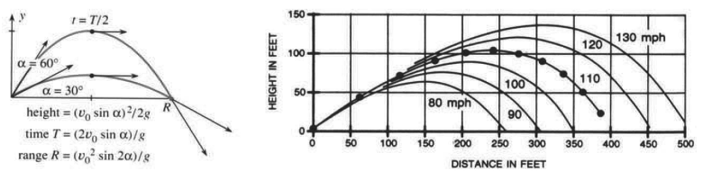
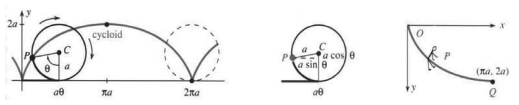
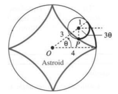
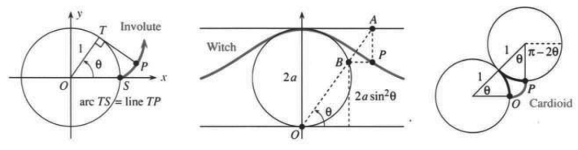

# 12.2 平面运动：抛体与摆线

原书 PDF 第538–543页，印刷页525–530。状态：初译，待复审。

<!-- PDF 538 / 印刷页 525 -->

上一节从 $\mathbf R(t)$ 出发，由位置向量计算 $\mathbf v,\mathbf a$。现在从更基本的信息求 $\mathbf R(t)$ 本身。物理定律支配抛体运动，车轮的运动产生摆线（机器人学问题中会遇到它）。抛体飞行时没有摩擦，所以只受重力。

这些运动发生在一个平面内。位置的两个分量为 $x$（横向）和 $y$（向上）。抛体随 $t$ 改变而运动，所以我们要找 $x(t),y(t)$。无论投篮、开枪，还是安安静静地给草坪浇水，都必须朝正确方向瞄准（不能直接瞄向目标）。如果水管以10米/秒的速度喷水，能喷到12米外的汽车吗？

通常的初位置是 $(0,0)$，有些飞行从更高的 $(0,h)$ 开始。初速度为 $(v_0\cos\alpha,v_0\sin\alpha)$，其中 $v_0$ 是速率，$\alpha$ 是与水平方向的夹角。重力加速度完全竖直：$d^2y/dt^2=-g$。因此水平速度保持初值，向上速度的变化量为 $-gt$：

$$
\frac{dx}{dt}=v_0\cos\alpha,\qquad
\frac{dy}{dt}=v_0\sin\alpha-gt.
$$

水平距离 $x(t)$ 持续增大，高度 $y(t)$ 先增加后减少。把速度积分就得到位置（若从高处出发，再给 $y$ 加上 $h$）：

$$
\text{抛体轨迹为 }\quad
x(t)=(v_0\cos\alpha)t,\qquad
 y(t)=(v_0\sin\alpha)t-\tfrac12gt^2.\tag{1}
$$

这条路径是抛物线，但没有写成 $y=ax^2+bx+c$。消去 $t$ 就能这样写，不过会失去时间信息。无参数的抛物线写成 $y(x)$，这里则有 $x(t),y(t)$。

基本问题是：**抛体在哪里落地？**抛物线的情形，解 $y(x)=0$ 得到的是位置 $x$；抛体则要解 $y(t)=0$，得到的是落地时刻，不是地点。若落地时刻为 $T$，则 $x(T)$ 给出地点。

信息都在这里。虽然需要两步而不是一步，但我们知道得更多。

**例1**　水以10米/秒的速度（即 $v_0$）离开水管，以角度 $\alpha$ 向上喷出。求 $y$ 再次为零的时刻 $T$，以及落地点。

**解**　当 $y=(10\sin\alpha)T-\tfrac12gT^2=0$ 时飞行结束。飞行时间为 $T=(20\sin\alpha)/g$。此时的水平距离为

$$
x(T)=(10\cos\alpha)T=\frac{200\cos\alpha\sin\alpha}{g}.
$$

这就是**射程** $R$。抛体（或水管喷出的水）在 $x=R$ 处落地。化简一下：把 $200\cos\alpha\sin\alpha$ 换成 $100\sin2\alpha$。由于 $g=9.8$ 米/秒$^2$，**水喷不到汽车**：

$$
R=\frac{100\sin2\alpha}{9.8}\le\frac{100}{9.8}<12.
$$

当 $\sin2\alpha=1$（$\alpha=45^\circ$）时射程最大。要达到12米，可以站在梯子上（第17题）。棒球受到空气阻力时，最佳击出角更接近 $35^\circ$。图12.5画出了对称抛物线（没有空气阻力），以及下降得更陡的不对称飞行轨迹。

> **12B**　当 $y=0$，即 $(v_0\sin\alpha)T=\tfrac12gT^2$ 时，达到飞行时间 $T$ 和水平射程 $R=x(T)$：
> $$
> T=\frac{2v_0\sin\alpha}{g},\qquad
> R=(v_0\cos\alpha)T=\frac{v_0^2\sin2\alpha}{g}.
> $$

<!-- PDF 539 / 印刷页 526 -->

图12.5　射程 $R$ 相同，飞行时间 $T$ 不同。右图为以 $35^\circ$ 击出、初速 $v_0$ 依次增大的棒球；点的时间间隔为半秒。出处：Robert Adair，《棒球物理学》（*The Physics of Baseball*），Harper and Row，1990年。图内：height＝高度；time＝时间；range＝射程；HEIGHT IN FEET＝高度（英尺）；DISTANCE IN FEET＝距离（英尺）；mph＝英里/小时。

**例2**　给定射程 $R$ 和初速 $v_0$，正确的角度 $\alpha$ 是多少？

**解**　射程为 $R=(v_0^2\sin2\alpha)/g$。这确定了 $2\alpha$ 的正弦，**但两个角可以有相同的正弦值**。可能求得 $2\alpha=60^\circ$ 或 $120^\circ$。图12.5中的出发角 $\alpha=30^\circ$ 和 $60^\circ$ 有相同的 $\sin2\alpha$，因而射程 $R$ 相同。飞行时间含 $\sin\alpha$，所以不同。

用微积分来看，当 $dy/dt=0$ 时高度最大。此时 $v_0\sin\alpha=gt$，即 $t=(v_0\sin\alpha)/g$，恰为总飞行时间 $T$ 的一半：上升时间等于下降时间。在中间时刻 $t=T/2$，$y$ 的值为

$$
y_{\max}=\frac{(v_0\sin\alpha)(v_0\sin\alpha)}g
-\frac12g\left(\frac{v_0\sin\alpha}g\right)^2
=\frac{(v_0\sin\alpha)^2}{2g}.\tag{2}
$$

**例3**　一名跳台滑雪运动员以28米/秒起跳，落在倾角 $30^\circ$ 的斜坡上、沿坡向下90米处。列出求飞行时间和跳台角度 $\alpha$ 的方程。

**解**　落点为 $x=90\cos30^\circ,y=-90\sin30^\circ$（负号的原因显而易见）。基本方程(1)为 $x=(28\cos\alpha)t,y=(28\sin\alpha)t-\tfrac12gt^2$。这就是关于 $\alpha,t$ 的两个方程。注意，此处 $t$ 不等于飞回 $y=0$ 的时间 $T$。

**结论**　抛体位置涉及三个参数 $v_0,\alpha,t$。**三条信息就能确定飞行情况**——差不多如此。说“差不多”，是因为里头还有 $\sin\alpha,\cos\alpha$。某些飞行要求无法达到（例如喷到12米外的汽车），另一些则有两种实现方式（汽车较近时）。方程 $\sin\alpha=c$ 更可能无解，或有两个解；恰有一个解的情况，反倒少见。

注意每题中的三条信息。例如，足球以 $v_0=20$ 米/秒出发，在 $x=40$ 米处落地，第三条信息是 ____。

这就像有人问律师收费多少，律师答：“1000美元，回答三个问题。”客户说：“这不太贵了吗？”律师说：“是的。现在，你最后一个问题是什么？”

## 摆线

抛体的路径是抛物线。要算出它，就得从 $x,y$ 的方程里消去 $t$。第5题得到 $y=ax^2+bx$，即经过原点的抛物线。车轮上一点的路径看似同样简单，但消去 $t$ 几乎不可能。摆线则真离不开参数，也确实用上了参数。

要描出摆线，让**半径为 $a$ 的圆沿 $x$ 轴滚动**。观察从圆底部出发的那个点。圆转完一周后，它在 $x=2\pi a$ 处再次到达底部。

<!-- PDF 540 / 印刷页 527 -->

中间经过的路径见图12.6。为找 $xy$ 方程花了一个世纪，一批伟大的科学家——伽利略、克里斯托弗·雷恩、惠更斯、伯努利，甚至牛顿与洛必达——找到了研究摆线的正确方法：引入参数。我们把它称为 $\theta$，也可以叫 $t$。

图12.6　滚动圆上一点 $P$ 的轨迹是摆线；沿倒置摆线最快滑到 $Q$。图内 cycloid＝摆线。

参数是圆转过的角 $\theta$。（这个角不在原点，不像极坐标里的 $\theta$。）圆沿 $x$ 轴滚过距离 $a\theta$，即半径乘以角度。因此圆心在 $x=a\theta,y=a$。再把线段 $CP$ 算进去：从 $x$ 里减去 $a\sin\theta$，从 $y$ 里减去 $a\cos\theta$：

$$
\text{点 }P\text{ 的坐标为 }\quad
x=a(\theta-\sin\theta),\qquad y=a(1-\cos\theta).\tag{3}
$$

$\theta=0$ 时位置为 $(0,0)$，$\theta=2\pi$ 时为 $(2\pi a,0)$。中间各点的摆线斜率由链式法则给出：

$$
\frac{dy}{dx}=\frac{dy/d\theta}{dx/d\theta}
=\frac{a\sin\theta}{a(1-\cos\theta)}.\tag{4}
$$

在 $\theta=0$ 处，斜率趋于无穷。圆上的点起初竖直向上，摆线有一个尖点。注意所有计算都使用参数 $\theta$。下面迅速看几个问题。

**问题1**　求摆线一拱下的面积（$\theta$ 从0到 $2\pi$）。

**答**　面积为 $\int y\,dx=\int_0^{2\pi}a(1-\cos\theta)a(1-\cos\theta)\,d\theta=3\pi a^2$。

**问题2**　利用 $ds=\sqrt{(dx/d\theta)^2+(dy/d\theta)^2}\,d\theta$，求这一拱的长度。

**答**

$$
\int ds=\int_0^{2\pi}a\sqrt{(1-\cos\theta)^2+\sin^2\theta}\,d\theta
=\int_0^{2\pi}a\sqrt{2-2\cos\theta}\,d\theta.
$$

代入 $1-\cos\theta=2\sin^2(\theta/2)$，根式成为 $2\sin(\theta/2)$，长度为 $8a$。〔译注：原书前两个根式中的加号误印为减号，已改正。〕

**问题3**　若把摆线倒过来（$y$ 向下），求滑至最低点的时间。滑块从 $y=0,v=0$ 出发。

**答**　动能与势能之和为 $\tfrac12mv^2-mgy=0$（初始为零，并且不能改变）。所以速率为 $v=\sqrt{2gy}$。这就是 $ds/dt$，而 $ds$ 已知：

$$
\text{下滑时间}=\int dt=\int\frac{ds}{\sqrt{2gy}}
=\int_0^\pi\frac{a\sqrt{2-2\cos\theta}\,d\theta}{\sqrt{2ga(1-\cos\theta)}}
=\pi\sqrt{a/g}.
$$

检查量纲：$a$ 是距离，$g$ 是距离/时间$^2$，$\pi\sqrt{a/g}$ 是时间。**在连接这两点的所有曲线里，它的下滑时间最短。**摆线解决了“最速降线问题”，也就是从 $O$ 沿曲线滑到 $Q$ 时把时间减到最短（图12.6）。你也许认为直线更快——它的确更短。直线方程为 $x=\pi y/2$，下滑时间为

$$
\int dt=\int\frac{ds}{\sqrt{2gy}}
=\int_0^{2a}\frac{\sqrt{(\pi/2)^2+1}\,dy}{\sqrt{2gy}}
=\sqrt{\pi^2+4}\sqrt{a/g}.\tag{5}
$$

它大于沿摆线的时间 $\pi\sqrt{a/g}$。即使路径较长，开始时竖直下落、尽早获得速率也更好。

<!-- PDF 541 / 印刷页 528 -->

约翰·伯努利没有直接发表自己的解答，而是把这个问题变成国际挑战：**证明摆线给出最快的下滑路径。**多数数学家做不出来。问题传到了牛顿那里（这是他较晚年时的事）。不出所料，牛顿解出了它。不知为何，他寄回证明时没有署名。可伯努利一接到答案，一点儿也没被蒙过去：“凭爪印，我认出了这头狮子。”

摆线还有一个同样惊人的性质：**从路径上的任何位置开始，到达 $Q$ 的时间都相同。**从 $P$ 而不是 $O$ 静止出发，到达最低点的时间仍一样。这回伯努利兴奋得有些忘乎所以：“当我告诉你……时，你会惊讶得目瞪口呆。”

还有其他一些美丽曲线与摆线密切相关。**外摆线**中，一个圆沿另一个圆的外侧滚动；**内摆线**中，滚动圆位于固定圆内部。**星形线**是两个圆半径比为1:4的特殊情形。它就是第34题那颗弯边的星，方程为 $x=a\cos^3\theta,y=a\sin^3\theta$。

摆线甚至回答了一个老谜题：火车向前启动时，什么点在向后运动？火车轮缘伸到轨面以下，在轮缘最低处有 $dx/dt<0$。

## 12.2 习题

### 阅读填空

抛体以速率 $v_0$、角度 $\alpha$ 出发。在时刻 $t$，速度为 $dx/dt=$ **(a)____**，$dy/dt=$ **(b)____**（向下加速度为 $g$）。从 $(0,0)$ 出发，时刻 $t$ 的位置是 $x=$ **(c)____**，$y=$ **(d)____**。返回 $y=0$ 的飞行时间为 $T=$ **(e)____**。此时水平射程为 $R=$ **(f)____**。飞行路径是一条 **(g)____**。

三个量 $v_0$、**(h)____**、**(i)____** 确定抛体运动。已知 $v_0$ 与目标位置，我们（能）（不能）求出 $\alpha$；已知 $\alpha$ 与目标位置，我们（能）（不能）求出 $v_0$。

滚动圆上的一点描出 **(j)____**。若半径为 $a$、转角为 $\theta$，圆心坐标是 $x=$ **(k)____**，$y=$ **(l)____**。从 $(0,0)$ 出发的那个点，其坐标是 $x=$ **(m)____**，$y=$ **(n)____**。圆转完一周时，这个点走过距离 **(o)____**。每转完一周，曲线都有一个 **(p)____**。倒置摆线给出两点之间 **(q)____** 的下滑路径。

**第1–18题及第41题讨论抛体。**

1. 抛体的初速为 $v_0=16$ 英尺/秒，分别取 (a) $\alpha=30^\circ$；(b) $\alpha=60^\circ$；(c) $\alpha=90^\circ$。求飞行时间 $T$、射程 $R$ 和最大高度 $Y$。
2. 若 $v_0=32$ 英尺/秒，且抛体在 $T=1$ 时返回地面，求角度 $\alpha$ 和射程 $R$。
3. 一个球以 $60^\circ$、$v_0=20$ 米/秒抛出，越过2米高的墙。墙距出发点多远？
4. 若 $\mathbf v(0)=3\mathbf i+3\mathbf j$，求 $\mathbf v(t),\mathbf v(1),\mathbf v(2)$ 以及 $\mathbf R(t),\mathbf R(1),\mathbf R(2)$。
5. (a) 从 $x=t,y=t-\tfrac12t^2$ 中消去 $t$，求路径的 $xy$ 方程。在哪些 $x$ 处有 $y=0$？(b) 对任意 $v_0,\alpha$ 做同样的事。
6. 以30米/秒踢出的球，在水平方向运动时越过6米的高度，求角度 $\alpha$。
7. 石块以初速 $v_0$、角度 $\alpha=0$ 抛出，落到低于出发点 $h$ 英尺的水面上，落点在水平方向离出发点多远？
8. 同一石块以角度 $\alpha$ 抛出时，水平飞行距离是多少？列出使射程最大的角度所满足的方程。
9. 球从 $(0,0)$ 出发，2秒后经过 $(5,2)$。求 $v_0,\alpha$（长度单位为米）。
10. **★** 对式(1)中的 $x,y$，证明 $v_0^2\ge(gx/v_0)^2+2gy$。若火源高度为 $H$、水的初速为 $v_0$，消防员最多可将水管放在离火源多远的水平位置？（本题的抛物线是包围所有可能路径的“包络线”。）
11. 估计一记以 $\alpha=45^\circ$ 击出、飞行100米的高尔夫球的初速。计入空气阻力时，真实的 $v_0$ 更大还是更小？
12. 若 $v_0,g$ 的单位为 ____，则 $T=2v_0\sin\alpha/g$ 的单位是秒，$R=v_0^2\sin2\alpha/g$ 的单位是米。
13. (a) 球能被抛到的最大高度是多少？以 $v_0=28$ 米/秒竖直向上抛出。

<!-- PDF 542 / 印刷页 529 -->

14. 棒球以100英里/小时飞过60英尺，需要多少秒？因重力而下降多少英尺？使用 $\tfrac12gt^2$。
15. 把 $v_0$ 加倍，射程和最大高度怎样变化？把角度改变 $d\alpha$，这两个量怎样变化？
16. 抛体路径上什么位置的速率 (a) 最小；(b) 最大？
17. 若水管以 $v_0=10$ 米/秒、$45^\circ$ 角喷水，$x$ 达到12米时 $t=$ ____，$y=$ ____。站在高度为 ____ 的梯子上，水就能喷到12米外的汽车。
18. 高尔夫球以已知且足够大的初速 $v_0$ 出发，要恰好落入球洞，可以采取哪两种轨迹？在实际有空气阻力时，哪一种会落得更近？

**第19–34题讨论摆线及相关曲线。**

19. 求摆线的单位切向量 $\mathbf T$。若车轮以 $d\theta/dt=1$ 转动，再求 $\theta=0$ 和 $\theta=\pi$ 时的速率。
20. 摆线在 $\theta=0$ 处的斜率趋于无穷：

$$
\frac{dy}{dx}=\frac{dy/d\theta}{dx/d\theta}=\frac{\sin\theta}{1-\cos\theta}.
$$

   用谁的法则？估计 $\theta=1/10$ 和 $\theta=-1/10$ 时的斜率。哪里斜率等于1？

21. 证明图12.6a中摆线在 $P$ 处的切线经过点 $x=a\theta,y=2a$。这个点位于滚动圆上的什么位置？
22. 对于**旋轮线**，点 $P$ 距滚动圆圆心的距离为 $d$。重画图12.6b，得到 $x=a\theta-d\sin\theta$ 和 $y=$ ____。
23. 若半径 $a$ 的圆在半径 $2a$ 的圆内滚动，证明小圆上的某一点沿直线往返。
24. 求摆线的 $d^2y/dx^2$。摆线凹向 ____。
25. 若 $d\theta/dt=c$，求沿摆线的速度分量 $dx/dt,dy/dt$。$dx/dt$ 在哪里最大？$dy/dt$ 在哪里最大？
26. 用计算机试画 $x=a\cos\theta+b\sin\theta,y=c\cos\theta+d\sin\theta$ 的图像。它们是什么曲线？为什么闭合？
27. 自行车轮胎中的石子沿摆线运动。若它在最高点飞出（成为抛体），求其路径方程。
28. 用计算机画出 $x=a\cos\theta+b\cos3\theta,y=c\sin\theta+d\sin3\theta$ 的曲线。环的数目有上限吗？

第34、35题图。Astroid＝星形线。

第33、36、37题图。Involute＝渐开线；arc TS = line TP＝弧 $TS$ 的长度等于线段 $TP$ 的长度；Witch＝箕舌线；Cardioid＝心形线。

29. 一枚硬币沿另一枚硬币外侧完整滚动一周，头像转了 ____ 圈。若在半径为其四倍的圆内滚动（形成星形线），头像转了 ____ 圈。
30. 用计算机图形显示摆线家族：(a) 摆线；(b) 外摆线 $x=C\cos\theta-\cos C\theta,y=C\sin\theta+\sin C\theta$；(c) 内摆线 $x=c\cos\theta+\cos c\theta,y=c\sin\theta-\sin c\theta$；(d) 星形线（$c=3$）；(e) 三尖瓣线（$c=2$）。
31. 把摆线的一拱绕 $x$ 轴旋转，求表面积和体积。
32. 对于内摆线，固定圆半径为 $c+1$，内侧滚动圆半径为1。若 $c$ 为整数，有 $c+1$ 个尖点。$c=1/2,3/2,\sqrt2$ 时各有多少个尖点（尽可能用计算机绘图）？$c=1$ 时是什么曲线？
33. 一根绳子从圆上展开，求点 $P$ 的 $x(\theta),y(\theta)$。它的路径是圆的“渐开线”。
34. 对星形线上的点 $P$，说明为何 $x=3\cos\theta+\cos3\theta,y=3\sin\theta-\sin3\theta$。图中的角为 $3\theta$，因为两段圆弧的长度都为 ____。

<!-- PDF 543 / 印刷页 530 -->

   用三倍角公式化为 $x=4\cos^3\theta,y=4\sin^3\theta$。

35. 求星形线内部的面积。
36. 对阿涅西箕舌线上的点 $P$，说明为何 $x=2a\cot\theta,y=2a\sin^2\theta$。消去 $\theta$，求 $xy$ 方程。

   **注：**玛丽亚·阿涅西写出了第一部涵盖三个学期内容的微积分教材（洛必达没有写积分学）。“witch”（女巫）一词完全是误译，与她本人或这条曲线都没有关系。

37. 对于心形线，固定圆半径 $C-1$ 等于外侧滚动圆半径1（即 $C=2$ 的外摆线）。(a) 点 $P$ 的坐标为 $x=-1+2\cos\theta-\cos2\theta,y=$ ____。(b) 二倍角公式给出 $x=2\cos\theta(1-\cos\theta),y=$ ____。(c) $x^2+y^2=$ ____，所以其平方根为 $r=$ ____。
38. 解释式(5)求沿直线路径下滑时间的最后两步。
39. 在倒置摆线上，无论从哪里出发，滑至最低点所用时间 $T$ 都相同。从 $\theta=\alpha$ 开始，使用 $1-\cos\theta=2\sin^2(\theta/2)$ 和 $1-\cos\alpha=2\sin^2(\alpha/2)$，证明

$$
T=\int_\alpha^\pi
\frac{\sqrt{2a^2(1-\cos\theta)}\,d\theta}{\sqrt{2ag(\cos\alpha-\cos\theta)}}
=\pi\sqrt{\frac ag}.
$$

40. 假设在滚动圆的顶部附加一个重物。该重物的路径是什么？
41. 芬威球场的墙高37英尺，距本垒板315英尺。棒球从离地3英尺处以 $\alpha=22.5^\circ$ 击出，若 $v_0=$ ____ 就刚好越墙。到墙所用时间为 ____。

## 译注与待复审事项

- 抛体公式默认恒定重力、忽略空气阻力，并在12B中默认起落同高、选取非零飞行时间。竖直抛射是直线路径的退化情形。棒球最佳角度的叙述是原书模型背景下的说法，不应视为普遍固定的最优角。
- 印刷页525梯子问题的交叉引用原作第14题，实际对应第17题，已更正。印刷页526例3将基本运动式误称式(2)，实际为式(1)，已更正。
- 印刷页527问题2在弧长公式及其代入式中两次把平方和写为平方差；原页确为减号。正文已改为加号，使后续 $\sqrt{2-2\cos\theta}$ 与长度 $8a$ 一致。
- 尖点处 $dy/dx$ 的分式本身不定义；$\theta\to0^+$ 时趋于 $+\infty$，从左侧则趋于 $-\infty$。“斜率无穷”是垂直切线的简略说法。第20题导数分母原书误排为 $dx/x\theta$，据式(4)改为 $dx/d\theta$。
- 最速降线和等时性均以无摩擦、重力恒定、从静止释放为前提；此处计算展示摆线时间及直线比较，并没有证明对所有竞争曲线的全局最优性。等时性限于同一拱内非最低点的释放位置，不能把已经在最低点的零行程当作相同的首次到达时间。
- 第30(b)题外摆线的 $y$ 分量原书确为加号，已忠实保留；它与常规同向参数形式及第37题所需的心形线关系不一致，复审应核查是否应为减号。第13题原页只有(a)，未发现(b)，不补题。第19–34题范围标题按原文保留，虽然后续也含相关曲线题。
- 原页将第35、36题排在第29题之前的右栏，译稿按编号顺排；其文字在印刷页529，页界后的编号顺序不表示原题移至印刷页530。第34题跨页句按原页界保留。第3题“越过”未明确恰好掠过墙顶，题目可能容许区间而不只是两个边界位置，译稿不补条件。
- 历史人物、引语和教材出版说明均按原书翻译，尚未进行外部史料复核；图12.5原书第三方来源已保留。
