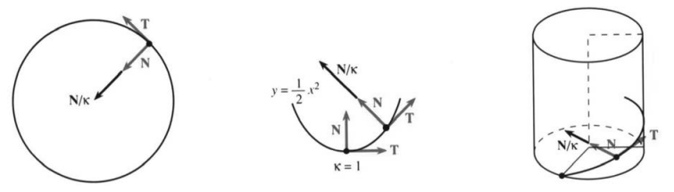
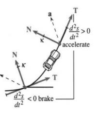

# 12.3 曲率与法向量

原书 PDF 第544–549页，印刷页531–536。状态：初译，待复审。

<!-- PDF 544 / 印刷页 531 -->

驾驶员有三种办法产生加速度：踩油门、踩刹车、转方向盘。前两者改变速率，转动方向盘改变方向。**三者都改变速度**，因而都产生加速度。匀速圆周运动中的变化来自转向，加速度 $d\mathbf v/dt$ 指向圆心。现在考察沿其他曲线的运动，把速率 $|\mathbf v|$ 的变化和方向 $\mathbf T$ 的变化分开。

运动方向为 $\mathbf T=\mathbf v/|\mathbf v|$。它依赖路径，但不依赖速率（因为除以了 $|\mathbf v|$）。转弯时，我们量两件事：

1. $\mathbf T$ 转得多快：这由**曲率** $\kappa$（kappa）表示。
2. $\mathbf T$ 朝哪个方向转：这由**法向量** $\mathbf N$ 表示。

$\kappa,\mathbf N$ 与 $s,\mathbf T$ 一样，只依赖曲线的形状。把 $t$ 换成 $2t$ 或 $t^2$，它们不变。圆的情形，答案可以先给：法向量 $\mathbf N$ 指向圆心，曲率 $\kappa$ 等于半径的倒数。

转弯半径越小，曲率越大，弯得越厉害。

曲率 $\kappa$ 是**方向的变化量 $|d\mathbf T|$ 除以位置的变化量 $|ds|$**。有三个公式：一个直接用于函数图像 $y(x)$；一个繁琐却有用，适用于任意参数平面曲线 $(x(t),y(t))$；还有一个用向量 $\mathbf v,\mathbf a$，很简洁。先讲定义和简洁公式。

$$
\boxed{\text{定义： }\kappa=\left|\frac{d\mathbf T}{ds}\right|}
\qquad
\boxed{\text{公式： }\kappa=\frac{|\mathbf v\times\mathbf a|}{|\mathbf v|^3}}.\tag{1}
$$

定义不涉及参数 $t$，计算却涉及。由位置向量 $\mathbf R(t)$ 得到 $\mathbf v=d\mathbf R/dt$ 和 $\mathbf a=d\mathbf v/dt$。若把 $t$ 换成 $2t$，速度加倍，加速度变成4倍。于是 $|\mathbf v\times\mathbf a|$ 与 $|\mathbf v|^3$ 都变成8倍，比值 $\kappa$ 不变。

**式(1)的证明。**从 $\mathbf v=|\mathbf v|\mathbf T$ 出发，求导得到 $\mathbf a$。由乘积法则，

$$
\mathbf a=\frac{d|\mathbf v|}{dt}\mathbf T+|\mathbf v|\frac{d\mathbf T}{dt}.
$$

再与 $\mathbf v=|\mathbf v|\mathbf T$ 作叉积。记住 $\mathbf T\times\mathbf T=\mathbf0$：

$$
\mathbf v\times\mathbf a=|\mathbf v|\mathbf T\times|\mathbf v|\frac{d\mathbf T}{dt}.\tag{2}
$$

已知 $|\mathbf T|=1$。式(4)将说明 $\mathbf T$ 垂直于 $d\mathbf T/dt$，因此 $|\mathbf v\times\mathbf a|$ 等于第一个长度 $|\mathbf v|$ 乘以第二个长度 $|\mathbf v||d\mathbf T/dt|$。两者夹角 $90^\circ$，叉积长度公式里的 $\sin\theta$ 因子为1。换句话说，

$$
\left|\frac{d\mathbf T}{dt}\right|=\frac{|\mathbf v\times\mathbf a|}{|\mathbf v|^2},
\qquad
\kappa=\left|\frac{d\mathbf T}{ds}\right|
=\left|\frac{d\mathbf T/dt}{ds/dt}\right|
=\frac{|\mathbf v\times\mathbf a|}{|\mathbf v|^3}.\tag{3}
$$

链式法则在分母中多带来一个 $|ds/dt|=|\mathbf v|$。

在看例子以前，先说明 $d\mathbf T/dt$ 垂直于 $\mathbf T$。原因是 $\mathbf T$ 为单位向量。对 $\mathbf T\cdot\mathbf T=1$ 两边求导：

$$
\frac{d\mathbf T}{dt}\cdot\mathbf T+\mathbf T\cdot\frac{d\mathbf T}{dt}=0,
\qquad\text{即 }2\mathbf T\cdot\frac{d\mathbf T}{dt}=0.\tag{4}
$$

这个证明使用点积 $\mathbf U\cdot\mathbf V$ 的乘积求导法则 $\mathbf U'\cdot\mathbf V+\mathbf U\cdot\mathbf V'$（第23题，取 $\mathbf U=\mathbf V=\mathbf T$）。设想向量 $\mathbf T$ 在单位球面上运动。

<!-- PDF 545 / 印刷页 532 -->

要保持长度不变，即 $(\mathbf T+d\mathbf T)\cdot(\mathbf T+d\mathbf T)=1$，须有 $2\mathbf T\cdot d\mathbf T=0$。变化方向 $d\mathbf T$ 垂直于半径向量 $\mathbf T$。

先看**平面曲线**。位置向量 $\mathbf R(t)$ 有 $x(t),y(t)$ 分量，没有 $z(t)$ 分量。看看 $\mathbf v,\mathbf a,\mathbf v\times\mathbf a$ 的分量（$x'$ 表示 $dx/dt$）：

$$
\begin{array}{c|ccc}
&x\text{分量}&y\text{分量}&z\text{分量}\\\hline
\mathbf R&x(t)&y(t)&0\\
\mathbf v&x'(t)&y'(t)&0\\
\mathbf a&x''(t)&y''(t)&0\\
\mathbf v\times\mathbf a&0&0&x'y''-y'y''
\end{array}
\qquad
\begin{aligned}
|\mathbf v|&=\sqrt{|x'|^2+|y'|^2},\\
\kappa&=\frac{|x'y''-y'x''|}{((x')^2+(y')^2)^{3/2}}.
\end{aligned}\tag{5}
$$

式(5)就是那个繁琐但有用的曲率公式。把它用于圆周运动，应得到 $\kappa=1/a$，其中 $a$ 是半径。

**例1**　$x=a\cos\omega t,y=a\sin\omega t$ 时，把 $x',y',x'',y''$ 代入式(5)：

$$
\kappa=
\frac{(-\omega a\sin\omega t)(-\omega^2a\sin\omega t)
-(\omega a\cos\omega t)(-\omega^2a\cos\omega t)}
{[(\omega a\sin\omega t)^2+(\omega a\cos\omega t)^2]^{3/2}}
=\frac{\omega^2a^2}{[\omega^2a^2]^{3/2}}.
$$

这就是 $\omega^3a^2/(\omega^3a^3)$，$\omega$ 约去。速率不影响 $\kappa=1/a$。

第三个曲率公式适用于普通平面曲线 $y(x)$。参数 $t$ 就是 $x$！速率 $|\mathbf v|=ds/dx$ 中出现平方根：

$$
\begin{array}{c|ccc}
\mathbf R&x&y(x)&0\\
\mathbf v&1&dy/dx&0\\
\mathbf a&0&d^2y/dx^2&0\\
\mathbf v\times\mathbf a&0&0&d^2y/dx^2
\end{array}
\qquad
\begin{aligned}
|\mathbf v|&=\sqrt{1+(dy/dx)^2},\\
\kappa&=\frac{|d^2y/dx^2|}{(1+(dy/dx)^2)^{3/2}}.
\end{aligned}\tag{6}
$$

实际应用中，这是最常用的曲率公式。最常用的近似是 $|d^2y/dx^2|$，即省去分母。梁的弯曲问题里，非线性方程用 $\kappa$，线性方程用 $d^2y/dx^2$。抛物线能显示出区别：

**例2**　$y=\tfrac12x^2$ 的曲率为

$$
\kappa=\frac{|y''|}{(1+(y')^2)^{3/2}}=\frac1{(1+x^2)^{3/2}}.
$$

图12.7　圆、抛物线及单位螺旋线的法向量 $\mathbf N$ 除以曲率 $\kappa$。

近似值是 $y''=1$。在 $x=0$ 处——抛物线在这里拐弯——近似值与 $\kappa$ 相同。但当 $x$ 很大时，曲率趋于零。在抛物线远处，要走很长一段距离，方向才改变一点点。

开口向下的抛物线 $y=-\tfrac12x^2$ 有相同曲率。现在来看空间曲线。

<!-- PDF 546 / 印刷页 533 -->

**例3**　求单位螺旋线 $\mathbf R=\cos t\,\mathbf i+\sin t\,\mathbf j+t\mathbf k$ 的曲率。

把 $\mathbf v=-\sin t\,\mathbf i+\cos t\,\mathbf j+\mathbf k$ 与 $\mathbf a=-\cos t\,\mathbf i-\sin t\,\mathbf j$ 叉乘：

$$
\mathbf v\times\mathbf a
=\begin{vmatrix}\mathbf i&\mathbf j&\mathbf k\\-\sin t&\cos t&1\\-\cos t&-\sin t&0\end{vmatrix}
=\sin t\,\mathbf i-\cos t\,\mathbf j+\mathbf k.
$$

这个叉积的长度为 $\sqrt2$，速率也是 $|\mathbf v|=\sqrt{\sin^2t+\cos^2t+1}=\sqrt2$，所以

$$
\kappa=\frac{|\mathbf v\times\mathbf a|}{|\mathbf v|^3}
=\frac{\sqrt2}{(\sqrt2)^3}=\frac12.
$$

与单位圆比较：如果没有爬升项 $t\mathbf k$，曲率就是1。因为爬升，每一圈螺旋线更长，且 $\kappa=1/2$。

这让人想到：螺旋线一圈是圆周的两倍长吗？不是。长度只变为 $|\mathbf v|=\sqrt2$ 倍。另一个 $\sqrt2$ 因子来自切向量 $\mathbf T$ 向上倾斜。底面上的投影转满 $360^\circ$，但 $\mathbf T$ 转动的总量较少。

## 法向量 $\mathbf N$

讨论把我们带到一个重要向量。曲率 $\kappa$ 度量转弯的快慢，单位向量 $\mathbf N$ 给出转弯的方向。$\mathbf N$ 垂直于 $\mathbf T$，在平面内实际上几乎没有选择：左转或右转。空间曲线就沿 $d\mathbf T$ 的方向走。记住式(4)：$d\mathbf T$ 垂直于 $\mathbf T$。

**法向量 $\mathbf N$ 是沿 $d\mathbf T/dt$ 方向的单位向量，且垂直于 $\mathbf T$。**

$$
\text{定义： }\mathbf N=\frac{d\mathbf T/ds}{|d\mathbf T/ds|}
=\frac1\kappa\frac{d\mathbf T}{ds},
\qquad
\text{公式： }\mathbf N=\frac{d\mathbf T/dt}{|d\mathbf T/dt|}.\tag{7}
$$

**例4**　求同一条螺旋线 $\mathbf R=\cos t\,\mathbf i+\sin t\,\mathbf j+t\mathbf k$ 的法向量 $\mathbf N$。

**解**　把例3的 $\mathbf v$ 除以 $|\mathbf v|$，再求 $d\mathbf T/dt$：

$$
\mathbf T=\frac{\mathbf v}{|\mathbf v|}
=\frac{-\sin t\,\mathbf i+\cos t\,\mathbf j+\mathbf k}{\sqrt2},
\qquad
\frac{d\mathbf T}{dt}=\frac{-\cos t\,\mathbf i-\sin t\,\mathbf j}{\sqrt2}.
$$

要把 $d\mathbf T/dt$ 化为单位向量，约掉 $\sqrt2$ 即可。**法向量为** $\mathbf N=-\cos t\,\mathbf i-\sin t\,\mathbf j$。它垂直于 $\mathbf T$。由于 $\mathbf k$ 分量为零，$\mathbf N$ 是水平的。切向量 $\mathbf T$ 向上倾斜 $45^\circ$，绕着单位球面上那个纬度的圆转。法向量 $\mathbf N$ 与这个圆相切（$\mathbf N$ 是切向量轨迹的切向量！）。因此螺旋线上升时，$\mathbf N$ 始终水平。

还有第三个方向，同时垂直于 $\mathbf T,\mathbf N$。它是**副法向量** $\mathbf B=\mathbf T\times\mathbf N$，第25–30题将计算它。单位向量 $\mathbf T,\mathbf N,\mathbf B$ 为路径提供自然坐标系：沿曲线、在曲线的平面内、垂直于该平面。理论很美，但这些计算并不常做，我们到此为止。

## 加速度的切向与法向分量

容我最后一次回到油门、刹车和方向盘。前两者产生沿 $\mathbf T$ 的加速度，转向产生沿 $\mathbf N$ 的加速度。转弯快慢（曲率 $\kappa$）和方向 $\mathbf N$ 已经确定，现在来问需要多大的力。

<!-- PDF 547 / 印刷页 534 -->

牛顿定律为 $\mathbf F=m\mathbf a$，因此需要求加速度 $\mathbf a$，尤其是它沿 $\mathbf T$ 和 $\mathbf N$ 的分量：

$$
\boxed{\mathbf a=\frac{d^2s}{dt^2}\mathbf T+\kappa\left(\frac{ds}{dt}\right)^2\mathbf N.}\tag{8}
$$

沿直线路径时，$d^2s/dt^2$ 是唯一的加速度分量，就是普通二阶导数。$\kappa(ds/dt)^2$ 是转弯产生的加速度分量。两者量纲都是长度/时间$^2$。

转弯所需的力依赖曲率和速率，所有驾驶员都知道。加速度是 $\mathbf v=|\mathbf v|\mathbf T=(ds/dt)\mathbf T$ 的导数：

$$
\mathbf a=\frac{d^2s}{dt^2}\mathbf T+\frac{ds}{dt}\frac{d\mathbf T}{dt}
=\frac{d^2s}{dt^2}\mathbf T+\frac{ds}{dt}\frac{d\mathbf T}{ds}\frac{ds}{dt}.\tag{9}
$$

由式(7)，$d\mathbf T/ds=\kappa\mathbf N$，所以最后一项就是 $\kappa(ds/dt)^2\mathbf N$。式(8)得证。

**例5**　恒定速率 $ds/dt=1$ 给出 $d^2s/dt^2=0$。唯一的加速度为 $\kappa\mathbf N$。

**例6**　对加速圆周运动 $\mathbf R(t)=\cos(t^2)\mathbf i+\sin(t^2)\mathbf j$，求 $\mathbf a$ 的分量。

直接计算 $d\mathbf R/dt=\mathbf v$、$ds/dt=|\mathbf v|$ 和 $\mathbf v/|\mathbf v|=\mathbf T$：

$$
\mathbf v=-2t\sin(t^2)\mathbf i+2t\cos(t^2)\mathbf j,\quad
|\mathbf v|=2t,\quad
\mathbf T=-\sin(t^2)\mathbf i+\cos(t^2)\mathbf j.
$$

$ds/dt=|\mathbf v|$ 的导数为 $d^2s/dt^2=2$，$\mathbf v$ 的导数为 $\mathbf a$：

$$
\mathbf a=-2\sin(t^2)\mathbf i+2\cos(t^2)\mathbf j
-4t^2\cos(t^2)\mathbf i-4t^2\sin(t^2)\mathbf j.
$$

前两项是 $2\mathbf T$，后两项必定是 $\kappa|\mathbf v|^2\mathbf N$。显然 $|\mathbf v|^2=4t^2$；圆半径为1，所以 $\kappa=1$。因此 $\mathbf a=2\mathbf T+4t^2\mathbf N$，切向分量为2，法向分量为 $4t^2$：前者沿圆周，后者指向圆心。

### 公式表

$$
\begin{aligned}
\mathbf v&=d\mathbf R/dt,&\mathbf a&=d\mathbf v/dt,\\
|\mathbf v|&=ds/st,&\mathbf T&=\mathbf v/|\mathbf v|=|d\mathbf R/ds|.
\end{aligned}
$$

$$
\begin{aligned}
\text{曲率： }\quad\kappa
&=|d\mathbf T/ds|=\frac{|\mathbf v\times\mathbf a|}{|\mathbf v|^3},\\
\text{平面曲线： }\quad\kappa
&=\frac{|x'y''-y'x''|}{((x')^2+(y')^2)^{3/2}}
=\frac{|d^2y/dx^2|}{(1+(dy/dx)^2)^{3/2}},\\
\text{法向量： }\quad\mathbf N
&=\frac1\kappa\frac{d\mathbf T}{ds}=\frac{d\mathbf T/dt}{|d\mathbf T/dt|},\\
\text{加速度： }\quad\mathbf a
&=(d^2s/dt^2)\mathbf T+\kappa|\mathbf v|^2\mathbf N.
\end{aligned}
$$

图12.8　汽车转弯时 $\mathbf a$ 的分量。图内 accelerate＝加速；brake＝制动；$d^2s/dt^2>0$ 表示速率增加，$d^2s/dt^2<0$ 表示速率减小。

<!-- PDF 548 / 印刷页 535 -->

## 12.3 习题

### 阅读填空

曲率告诉我们曲线 **(a)____** 的快慢。对于半径为 $a$ 的圆，在距离 **(b)____** 内方向改变 $2\pi$，所以 $\kappa=$ **(c)____**。对于平面曲线 $y=f(x)$，公式为 $\kappa=|y''|/$ **(d)____**。$y=\sin x$ 的曲率是 **(e)____**。在 $y''=0$ 的点（一个 **(f)____** 点），曲线在瞬间是直的，$\kappa=$ **(g)____**。空间曲线有 $\kappa=|\mathbf v\times\mathbf a|/$ **(h)____**。

法向量 $\mathbf N$ 垂直于 **(i)____**。它是沿 $\mathbf T$ 导数方向的 **(j)____** 向量，所以 $\mathbf N=$ **(k)____**。沿圆运动时，$\mathbf N$ 指向 **(l)____**；沿螺旋线上升时，$\mathbf N$ 也指向 **(m)____**。以单位速率沿任意曲线运动，时间 $t$ 与 **(n)____** $s$ 相同。于是 $|\mathbf v|=$ **(o)____**，$d^2s/dt^2=$ **(p)____**，$\mathbf a$ 沿 **(q)____** 的方向。

加速度等于 **(r)____** $\mathbf T+$ **(s)____** $\mathbf N$。以单位速率绕单位圆运动时，这两个分量为 **(t)____**。宇航员以一秒一圈、半径一米旋转，有 $|\mathbf a|=$ **(u)____** 米/秒$^2$，约为 **(v)____** $g$。

**第1–8题计算曲率 $\kappa$。**

1. $y=e^x$。
2. $y=\ln x$（$\kappa$ 在哪里最大？）。
3. $x=2\cos t,y=2\sin t$。
4. $x=\cos(t^2),y=\sin(t^2)$。
5. $x=1+t^2,y=3t^2$（路径是一条 ____）。
6. $x=\cos^3t,y=\sin^3t$。
7. $r=\theta=t$（所以 $x=t\cos t,y=$ ____）。
8. $x=t,y=\ln\cos t$。
9. 求第4题的 $\mathbf T,\mathbf N$。
10. 说明第6题中 $\mathbf N=\sin t\,\mathbf i+\cos t\,\mathbf j$。
11. 计算第8题的 $\mathbf T,\mathbf N$。
12. 求抛体 $x=(v_0\cos\alpha)t,y=(v_0\sin\alpha)t-\tfrac12gt^2$ 的速率 $|\mathbf v|$ 和曲率 $\kappa$。
13. 对螺旋线 $\mathbf R=3\cos t\,\mathbf i+3\sin t\,\mathbf j+4t\mathbf k$，求 $\mathbf T,|\mathbf v|,\kappa$。螺旋线一圈比相应圆周长多少？$\mathbf T$ 向上的斜率是多少？
14. 当 $\kappa=0$ 时，路径是一条 ____。当 $\mathbf v,\mathbf a$ ____ 时出现这种情形，此时 $\mathbf v\times\mathbf a=$ ____。
15. 求摆线 $x=a(t-\sin t),y=a(1-\cos t)$ 的曲率。
16. 若把曲线上所有点到原点的距离加倍（$x\mapsto2x,y\mapsto2y$），$\kappa$ 怎样变化？$\mathbf N$ 怎样变化？
17. 对内摆线 $x=4\cos\theta+\cos4\theta,y=4\sin\theta-\sin4\theta$，求 $\theta=\pi$ 时的 $\kappa,\mathbf N$。
18. 从 $\mathbf v=|\mathbf v|\mathbf T$ 和式(8)中的 $\mathbf a$ 推导 $\kappa=|\mathbf v\times\mathbf a|/|\mathbf v|^3$。
19. 从曲线上一点沿向量 $\mathbf N/\kappa$ 前进，就到达**曲率中心**。分别求圆 $x=\cos t,y=\sin t$、椭圆 $x=\cos t,y=2\sin t$ 和抛物线 $y=\tfrac12(x^2-1)$ 在点 $(1,0)$ 处的曲率中心。曲率中心的轨迹称为曲线的“渐屈线”。
20. 下列量哪些只依赖曲线形状，哪些还依赖速率？$\mathbf v,\mathbf T,|\mathbf v|,s,k,\mathbf a,\mathbf N,\mathbf B$。
21. 经过 $(0,0)$ 与 $(2,0)$、曲率恒为 $\kappa$ 的平面曲线是圆弧 ____。哪些 $\kappa$ 不存在这样的曲线？
22. 画一条经过 $(0,0),(1,-1),(2,0)$ 的光滑曲线。某处 $d^2y/dx^2$ 至少为 ____；某处曲率至少为 ____。（证明只供教师参考。）
23. 对平面向量，将普通乘积法则用于 $U_1V_1+U_2V_2$，可得 $(\mathbf U\cdot\mathbf V)'=\mathbf U'\cdot\mathbf V+$ ____。
24. 若 $\mathbf v$ 垂直于 $\mathbf a$，证明速率恒定。判断正误：路径是一条圆。

**第25–30题讨论 $\mathbf T$—$\mathbf N$—$\mathbf B$ 系统：沿曲线、在曲线局部平面内、垂直于该平面。**

25. 对例3、4的螺旋线 $\mathbf R=\cos t\,\mathbf i+\sin t\,\mathbf j+t\mathbf k$，计算 $\mathbf B=\mathbf T\times\mathbf N$。
26. 使用第23题，对 $\mathbf B\cdot\mathbf T=0$ 和 $\mathbf B\cdot\mathbf B=1$ 求导，说明 $\mathbf B'$ 垂直于 $\mathbf T,\mathbf B$。因此 $d\mathbf B/ds=-\tau\mathbf N$，其中数 $\tau$ 称为**挠率**。
27. 对第25题中的螺旋线，计算挠率 $\tau=|d\mathbf B/ds|$。
28. 对曲线 $x=1,y=t,z=t^2$，求 $\mathbf B=\mathbf T\times\mathbf N$。
29. 一个圆位于 $xy$ 平面内，其法向量 $\mathbf N$ 位于 ____，$\mathbf B=$ ____，$\tau=|d\mathbf B/ds|=$ ____。
30. 塞雷—弗雷内公式为 $d\mathbf T/ds=\kappa\mathbf N$、$d\mathbf N/ds=-k\mathbf T+\tau\mathbf B$、$d\mathbf B/ds=-\tau\mathbf N$。第一和第三个公式已知，对 $\mathbf N=-\mathbf T\times\mathbf B$ 求导得到第二个。
31. 从 $x$ 轴到切线的角为 $\theta=\tan^{-1}(dy/dx)$，其中 $dy/dx$ 是曲线斜率。(a) 计算 $d\theta/dx$。(b) 除以 $ds/dx=(1+(dy/dx)^2)^{1/2}$，说明 $|d\theta/ds|$ 就是式(5)中的 $\kappa$。曲率等于方向变化量 $|d\theta|$ 除以位置变化量 $|ds|$。
32. 若切线方向角为 $\theta$，则 $\mathbf T=\cos\theta\,\mathbf i+\sin\theta\,\mathbf j$。第31题中 $|d\theta/ds|$ 与 $\kappa=|d\mathbf T/ds|$ 相同，因为 $|d\mathbf T/d\theta|=$ ____。

**第33–37题求加速度的 $\mathbf T$ 分量与 $\mathbf N$ 分量。**

33. $x=5\cos\omega t,y=5\sin\omega t,z=0$（圆）。
34. $x=1+t,y=1+2t,z=1+3t$（直线）。

<!-- PDF 549 / 印刷页 536 -->

35. $x=t\cos t,y=t\sin t,z=0$（螺线）。
36. $x=e^t\cos t,y=e^t\sin t,z=0$（螺线）。
37. $x=1,y=t,z=t^2$。
38. 对第36题的螺线，说明 $\mathbf R$ 与 $\mathbf a$（位置与加速度）之间的夹角恒定，并求出这个角。
39. 求极坐标曲线 $r=F(\theta)$ 的曲率。
