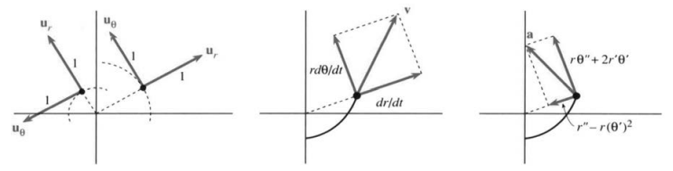
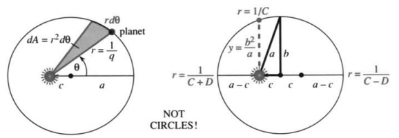
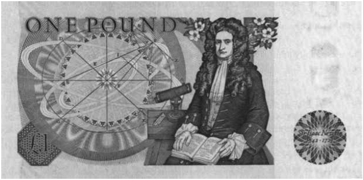

# 12.4 极坐标与行星运动

原书 PDF 第550–556页，印刷页537–543。状态：初译，待复审。

<!-- PDF 550 / 印刷页 537 -->

本节有一个一般目标：在**极坐标**中研究向量微积分。还有一个具体目标：研究**中心力**与**行星运动**。行星所受的主要引力来自太阳。这是一种中心力，因为它来自力中心处的太阳。极坐标很自然，因此两个目标结合在一起。

你也许觉得行星这个话题对本课程而言太古老了。但开普勒定律不仅是几个定理，它们在人类历史上有特殊地位——“有史以来最伟大的科学发现”。如果能够重温那份荣耀，我们就应该这样做。伟大之处部分在于困难：开普勒工作时，距离牛顿发现微积分还有六十年。从一页页观测资料和一些了不起的猜想中，诞生了一套理论。我们将尽力保留这份伟大，而避开那些困难，展示椭圆轨道怎样从微积分产生。第一个结论很快就能得到：

**中心力场中的运动始终保持在一个平面内。**

$\mathbf F$ 是从原点出发的位置向量 $\mathbf R$ 的倍数（中心力），同时 $\mathbf F=m\mathbf a$（牛顿定律）。因此 $\mathbf R$ 与 $\mathbf a$ 共线，$\mathbf R\times\mathbf a=\mathbf0$。于是 $\mathbf R\times\mathbf v$ 的导数为零，它是常向量：

$$
\text{由乘积法则：}\qquad
\frac d{dt}(\mathbf R\times\mathbf v)
=\mathbf v\times\mathbf v+\mathbf R\times\mathbf a
=\mathbf0+\mathbf0.\tag{1}
$$

$\mathbf R\times\mathbf v$ 是常向量 $\mathbf H$，所以 $\mathbf R$ 始终位于垂直于 $\mathbf H$ 的平面内。

行星怎样在这个平面内运动？转用极坐标。在除原点（太阳所在位置）之外的每一点，**$\mathbf u_r$ 是指向外侧的单位向量**。它等于位置向量 $\mathbf R$ 除以长度 $r=\sqrt{x^2+y^2}$：

$$
\mathbf u_r=\frac{\mathbf R}{r}
=\frac{x\mathbf i+y\mathbf j}{r}
=\cos\theta\,\mathbf i+\sin\theta\,\mathbf j.\tag{2}
$$

因为 $\cos^2\theta+\sin^2\theta=1$，它是单位向量，并从中心向外指。图12.9还画出了与它成 $90^\circ$ 的第二个单位向量 $\mathbf u_\theta$：

$$
\mathbf u_\theta=-\sin\theta\,\mathbf i+\cos\theta\,\mathbf j.\tag{3}
$$

点积为 $\mathbf u_r\cdot\mathbf u_\theta=0$。下标 $r,\theta$ 表示方向，不表示导数。

**问题1：**当 $r$ 改变（沿射线向外）时，$\mathbf u_r,\mathbf u_\theta$ 怎样变化？**它们不变。**

**问题2：**当 $\theta$ 改变时，它们怎样变化？**求导即可：**

$$
\begin{aligned}
\frac{d\mathbf u_r}{d\theta}&=-\sin\theta\,\mathbf i+\cos\theta\,\mathbf j=\mathbf u_\theta,\\
\frac{d\mathbf u_\theta}{d\theta}&=-\cos\theta\,\mathbf i-\sin\theta\,\mathbf j=-\mathbf u_r.
\end{aligned}\tag{4}
$$

图12.9　$\mathbf u_r$ 向外，$\mathbf u_\theta$ 绕中心方向；$\mathbf v,\mathbf a$ 在这两个方向上的分量。

<!-- PDF 551 / 印刷页 538 -->

由 $\mathbf u_r=\mathbf R/r$，立刻得到一个简单公式：**位置向量为 $\mathbf R=r\mathbf u_r$。**求导 $\mathbf v=d\mathbf R/dt$ 时，使用链式法则 $d\mathbf u_r/dt=(d\mathbf u_r/d\theta)(d\theta/dt)=(d\theta/dt)\mathbf u_\theta$：

$$
\text{速度为 }\quad
\mathbf v=\frac d{dt}(r\mathbf u_r)
=\frac{dr}{dt}\mathbf u_r+r\frac{d\theta}{dt}\mathbf u_\theta.\tag{5}
$$

向外的速度分量为 $dr/dt$，绕中心的速度分量为 $r\,d\theta/dt$。它们的平方和是 $|\mathbf v|^2$。

再回到匀速圆周运动，例如 $r=3,\theta=2t$。速度为 $\mathbf v=6\mathbf u_\theta$，完全沿圆周方向；加速度为 $-12\mathbf u_r$，完全朝内。对圆而言，$\mathbf u_\theta$ 就是切向量 $\mathbf T$。但 $\mathbf u_r$ 向外，而 $\mathbf N$ 向内，指向曲线弯转的一侧。

现在求任意极坐标运动的加速度。$r$ 和 $\theta$ 都可能加速变化，方向也可能改变。对式(5)中的 $\mathbf v$ 使用乘积法则：

$$
\frac{d\mathbf v}{dt}
=\frac{d^2r}{dt^2}\mathbf u_r
+\frac{dr}{dt}\frac{d\mathbf u_r}{dt}
+\frac{dr}{dt}\frac{d\theta}{dt}\mathbf u_\theta
+r\frac{d^2\theta}{dt^2}\mathbf u_\theta
+r\frac{d\theta}{dt}\frac{d\mathbf u_\theta}{dt}.
$$

把式(4)乘以 $d\theta/dt$，就得到 $d\mathbf u_r/dt$ 和 $d\mathbf u_\theta/dt$。于是每项都含 $\mathbf u_r$ 或 $\mathbf u_\theta$。加速度公式很有名，却不太讨人喜欢（但它把我们送上了月球）：

$$
\mathbf a=\frac{d\mathbf v}{dt}
=\left(\frac{d^2r}{dt^2}-r\left(\frac{d\theta}{dt}\right)^2\right)\mathbf u_r
+\left(r\frac{d^2\theta}{dt^2}+2\frac{dr}{dt}\frac{d\theta}{dt}\right)\mathbf u_\theta.\tag{6}
$$

在 $r=3,\theta=2t$ 的匀速运动中，只有一项非零：$\mathbf a=-12\mathbf u_r$。也许可以把式(6)背下来。第14题给出使用 $re^{i\theta}$ 推导它的新方法。

**例1**　沿圆 $r=1$ 以 $\theta=t^2$ 加速运动，求 $\mathbf R,\mathbf v,\mathbf a$。

**解**　位置向量为 $\mathbf R=\mathbf u_r$。由式(5)、(6)，

$$
\mathbf v=(r\,d\theta/dt)\mathbf u_\theta=2t\mathbf u_\theta,
\qquad
\mathbf a=-(2t)^2\mathbf u_r+2\mathbf u_\theta.
$$

上一节例6讨论过同一个问题，答案为 $\mathbf a=2\mathbf T+4t^2\mathbf N$。再注意，绕圆运动时 $\mathbf T=\mathbf u_\theta,\mathbf N=-\mathbf u_r$。

**例2**　对螺线运动 $r=3t,\theta=2t$，求 $\mathbf R,\mathbf v,|\mathbf v|,\mathbf a$。

**解**　位置向量为 $\mathbf R=3t\mathbf u_r$。式(5)给出速度和速率：

$$
\mathbf v=3\mathbf u_r+6t\mathbf u_\theta,
\qquad |\mathbf v|=\sqrt{3^2+(6t)^2}.
$$

运动既向外，又绕中心旋转。由式(6)，加速度为 $-12t\mathbf u_r+12\mathbf u_\theta$。从 $\mathbf R=3t\cos2t\,\mathbf i+3t\sin2t\,\mathbf j$ 出发也能得到相同答案，但更费工夫。

这个例子使用极坐标，**运动却不是圆周运动**。开普勒经历许多挫折后的一项灵感，就是摆脱圆形轨道。

## 开普勒定律

你可能知道，在牛顿、莱布尼茨、微积分和极坐标出现以前，约翰内斯·开普勒就发现了行星运动的三条定律。他是神圣罗马帝国皇帝的宫廷数学家，而皇帝主要想要的是战争预言。开普勒还计算每年的复活节日期，这并不是小问题。他的伟大成就是从天文学家的观测，尤其是第谷·布拉赫的观测中发现规律。伽利略和哥白尼期待圆形，开普勒却找到了椭圆。

<!-- PDF 552 / 印刷页 539 -->

**第一定律：**每颗行星沿椭圆运动，太阳位于一个焦点上。

**第二定律：**从太阳指向行星的向量以恒定速率扫过面积，即 $dA/dt$ 为常数。

**第三定律：**行星一年的长度为 $T=ka^{3/2}$，其中 $a$ 是离椭圆中心（不是太阳）的最大距离，$k=2\pi/\sqrt{GM}$ 对所有行星相同。

用微积分证明这些定律快上一千倍，不过只有第二定律容易。太阳施加中心力；由式(1)，中心力下 $\mathbf R\times\mathbf v=\mathbf H$ 为常向量。把 $\mathbf R$ 换成 $r\mathbf u_r$，把 $\mathbf v$ 换成式(5)：

$$
\mathbf H=r\mathbf u_r\times\left(\frac{dr}{dt}\mathbf u_r+r\frac{d\theta}{dt}\mathbf u_\theta\right)
=r^2\frac{d\theta}{dt}(\mathbf u_r\times\mathbf u_\theta).\tag{7}
$$

$\mathbf H$ 是常向量，所以**长度 $h=r^2d\theta/dt$ 是常数**。极坐标中的面积微元为 $dA=\tfrac12r^2d\theta$。行星扫过这个面积（图12.10），于是第二定律得到证明：

$$
\frac{dA}{dt}=\frac12r^2\frac{d\theta}{dt}=\frac12h=\text{常数}.\tag{8}
$$

靠近太阳时 $r$ 较小，所以 $d\theta/dt$ 较大，行星绕行得更快。

图12.10　行星在椭圆上，太阳位于一个焦点。注意 $a,b,c,q$。图内 planet＝行星；NOT CIRCLES!＝不是圆！〔图内面积微元漏了 $1/2$，应以正文式(8)为准。〕

现在证明关于椭圆的第一定律。目标是得到 $1/r=C-D\cos\theta$，即椭圆的极坐标方程。用 $q$ 代替 $1/r$ 更容易书写，我们来求 $q$ 的方程。最终要得到 $d^2q/d\theta^2+q=C$。所需的 $q=C-D\cos\theta$ 满足这个方程（请检验），并给出开普勒的椭圆。

第一步通过链式法则把 $dr/dt$ 与 $dq/d\theta$ 联系起来：

$$
\frac{dr}{dt}=\frac d{dt}\left(\frac1q\right)
=-\frac1{q^2}\frac{dq}{dt}
=-\frac1{q^2}\frac{dq}{d\theta}\frac{d\theta}{dt}
=-h\frac{dq}{d\theta}.\tag{9}
$$

特别注意 $d\theta/dt=h/r^2=hq^2$。真正需要的是二阶导数：

$$
\frac{d^2r}{dt^2}
=-h\frac d{dt}\left(\frac{dq}{d\theta}\right)
=-h\frac d{d\theta}\left(\frac{dq}{d\theta}\right)\frac{d\theta}{dt}
=-h^2q^2\frac{d^2q}{d\theta^2}.\tag{10}
$$

引入 $q$ 的技巧完成后，可以使用物理定律了。行星服从牛顿定律 $\mathbf F=m\mathbf a$，中心力 $\mathbf F$ 就是太阳引力。比较径向分量，得到

$$
-\frac{GM}{r^2}=\frac{d^2r}{dt^2}-r\left(\frac{d\theta}{dt}\right)^2.\tag{11}
$$

<!-- PDF 553 / 印刷页 540 -->

右端就是式(6)中 $\mathbf a$ 的 $\mathbf u_r$ 分量。将 $r$ 换为 $1/q$，$d\theta/dt$ 换为 $hq^2$。利用式(10)重写式(11)中的 $d^2r/dt^2$，得到

$$
-GMq^2=-h^2q^2\frac{d^2q}{d\theta^2}-\frac1q(hq^2)^2.
$$

除以 $-h^2q^2$，便得到期待的简单方程：

$$
\frac{d^2q}{d\theta^2}+q=\frac{GM}{h^2}=C\quad(\text{常数}).\tag{12}
$$

**解为 $q=C-D\cos\theta$。**第9.3节给出过这种椭圆、抛物线或双曲线的极坐标方程。要确定它是椭圆，天文学家根据太阳质量 $M$、常数 $G$ 以及地球的位置和速度计算 $C,D$。关键在于 $C>D$，于是 $q$ 永不为零，$r$ 永不无穷大。排除了双曲线和抛物线，图12.10的轨道必是椭圆。†

天文学实在令人赞叹。你应该去伦敦的格林尼治天文台，看看哈雷怎样观测他的彗星。他预测了彗星返回的日期，震惊世界。海王星的发现也是纯粹数学的成果：太阳和已知行星不能充分解释天王星的轨道。勒维耶算出天空中的一个位置，请一位柏林天文学家观察，果然在那里发现了海王星。

原书写作时，另一个问题也刚获解释：木星附近小行星轨道中的空隙。原因是“混沌”——三体问题出现不稳定性，小行星不能停留在那条轨道上。我们已经离圆形轨道的观念很远了。

**皇家错误专栏。**皇家铸币局最后发行的一英镑纸币，画着牛顿从巨著《自然哲学的数学原理》上抬起头。他没有微笑，原因显而易见：画家把太阳放在椭圆中心！牛顿刚刚证明它应该在焦点。确实，焦点标作 $S$，行星标作 $P$。但中心的那些光芒给铸币局带来数不清的头痛，这张纸币已经退出流通。我花了三英镑硬币，从古董商那里买到一张。

**开普勒第三定律**给出绕椭圆一周的时间 $T$，也就是行星的一年。公式中特别的是 $a^{3/2}$；而对开普勒本人，1618年5月15日难以忘怀：“借助我花十七年研究布拉赫观测资料所提供的重大证明，正确的比例战胜了我心中的黑暗。”第二定律 $dA/dt=\tfrac12h$ 是关键，还需要椭圆的两个事实：面积为 $\pi ab$，太阳正上方的高度为 $b^2/a$。

1. 面积 $A=\int_0^T(dA/dt)\,dt=\tfrac12hT$ 必须等于 $\pi ab$，所以 $T=2\pi ab/h$。
2. 在 $\theta=\pi/2$ 处，距离 $r=1/C$ 必须等于 $b^2/a$，所以 $b=\sqrt{a/C}$。

高度 $b^2/a$ 见图12.10和第25、26题，常数 $C=GM/h^2$ 见式(12)。把它们合起来，得到周期：

$$
T=\frac{2\pi ab}{h}
=\frac{2\pi a}{h}\sqrt{\frac aC}
=\frac{2\pi}{\sqrt{GM}}a^{3/2}.\tag{13}
$$

† 业余爱好者看到行星又转回来一圈，就会投椭圆一票。

<!-- PDF 554 / 印刷页 541 -->

原书纸币插图。ONE POUND＝一英镑。

想到开普勒猜出了 $a^{3/2}$，就令人惊叹。想到牛顿用微积分证明开普勒定律，也同样美妙——因为我们也能做到。

**例3**　卫星沿圆周运行时，求周期 $T$。

设半径为 $r$，角速度为 $\omega$。转过一整圈（角度 $2\pi$）的时间为 $T=2\pi/\omega$。由引力，加速度大小为 $GM/r^2$；由圆周运动，它又等于 $r\omega^2$。因此开普勒是正确的：

$$
r\omega^2=\frac{GM}{r^2}
\Rightarrow\omega=\sqrt{\frac{GM}{r^3}}
\Rightarrow T=\frac{2\pi}{\omega}=\frac{2\pi r^{3/2}}{\sqrt{GM}}.
$$

## 12.4 习题

### 阅读填空

中心力指向 **(a)____**。于是 $\mathbf R\times d^2\mathbf R/dt^2=\mathbf0$，因为 **(b)____**。因此 $\mathbf R\times d\mathbf R/dt$ 是一个 **(c)____**（记作 $\mathbf H$）。

在极坐标中，向外的单位向量为 $\mathbf u_r=\cos\theta\,\mathbf i+$ **(d)____**。转过 $90^\circ$ 后得到 $\mathbf u_\theta=$ **(e)____**。位置向量 $\mathbf R$ 是距离 $r$ 乘以 **(f)____**。速度 $\mathbf v=d\mathbf R/dt$ 为 **(g)____** $\mathbf u_r+$ **(h)____** $\mathbf u_\theta$。以 $\theta=4t$ 沿圆 $r=5$ 匀速运动时，$\mathbf v=$ **(i)____**，$|\mathbf v|=$ **(j)____**，$\mathbf a=$ **(k)____**。

在中心力作用下运动时，$r^2$ 乘以 **(l)____** 为常数。除以2得到开普勒第二定律 $dA/dt=$ **(m)____**。第一定律说轨道是一条 **(n)____**，太阳位于 **(o)____**。圆锥曲线的极坐标方程为 **(p)____** $=C-D\cos\theta$。使用 $\mathbf F=m\mathbf a$，得到 $q_{\theta\theta}+$ **(q)____** $=C$。所以路径是圆锥曲线；由于 **(r)____**，它必为椭圆。椭圆的性质给出周期 $T=$ **(s)____**，即开普勒第三定律。

1. 求点 $(0,2)$ 处的单位向量 $\mathbf u_r,\mathbf u_\theta$。速度 $\mathbf v=\mathbf i+\mathbf j$ 在该点的 $\mathbf u_r,\mathbf u_\theta$ 分量为 ____。
2. 求 $(3,3)$ 处的 $\mathbf u_r,\mathbf u_\theta$。若 $\mathbf v=\mathbf i+\mathbf j$，则 $\mathbf v=$ ____ $\mathbf u_r$。式(5)给出 $dr/dt=$ ____，$d\theta/dt=$ ____。
3. 在点 $(1,2)$ 处，沿 ____ 方向的速度使 $dr/dt=0$，沿 ____ 方向的速度使 $d\theta/dt=0$。
4. 沿心形线 $r=1-\cos\theta$ 以 $d\theta/dt=2$ 运动，速度 $\mathbf v$ 是多少？绕完心形线一周需要多久（不必积分）？
5. 若 $r=e^\theta,\theta=3t$，求 $t=1$ 时的 $\mathbf v,\mathbf a$。
6. 若 $r=1,\theta=\sin t$，描述路径，并由式(5)、(6)求 $\mathbf v,\mathbf a$。速度在哪里为零？
7. **（重要）**$\mathbf R=4\cos5t\,\mathbf i+4\sin5t\,\mathbf j=4\mathbf u_r$ 沿半径4的圆运动，$\theta=5t$，速率为20。分别在三种坐标方向下求 $\mathbf v,\mathbf a$ 的分量：$\mathbf i,\mathbf j$；$\mathbf T,\mathbf N$；$\mathbf u_r,\mathbf u_\theta$。
8. 若速率为 $8t$，何时绕圆 $r=4$ 完成一周？求返回起点 $(4,0)$ 时的 $\mathbf v,\mathbf a$。
9. 对沿 ____ 方向的中心力，加速度的 $\mathbf u_\theta$ 分量为 ____ $=0$。于是 $r^2d\theta/dt$ 是常数（另一个证明），因为它的导数等于 $r$ 乘以 ____。

<!-- PDF 555 / 印刷页 542 -->

10. 沿直线 $x=1$ 向上运动，若 $r^2d\theta/dt=2$，画一个三角形说明 $r=\sec\theta$，并积分求到达 $(1,1)$ 的时间。
11. 卫星距地心 $r=10000$ 千米，以4千米/秒沿垂直于半径向量的方向运动。求 $d\theta/dt$ 和 $h$。
12. 由 $|\mathbf u_r|=1$ 可知 $d\mathbf u_r/dr$ 与 $d\mathbf u_r/d\theta$ 都与 $\mathbf u_r$ ____（第12.3节）。实际上，$d\mathbf u_r/dr$ 是 ____，$d\mathbf u_r/d\theta$ 是 ____。
13. 动量为 $m\mathbf v$，其导数是 $m\mathbf a=$ 力。角动量为 $m\mathbf H=m\mathbf R\times\mathbf v$，其导数为 ____ $=$ 力矩。中心力下角动量守恒，因为 ____ 为零。
14. 要推导并记住极坐标中的 $\mathbf v,\mathbf a$，从复数 $re^{i\theta}$ 出发求导：

$$
R=re^{i\theta},\qquad
\frac{dR}{dt}=\frac{dr}{dt}e^{i\theta}+ir\frac{d\theta}{dt}e^{i\theta},
$$

$$
\frac{d^2R}{dt^2}=\underline{\qquad}+\underline{\qquad}+\underline{\qquad}+\underline{\qquad}+\underline{\qquad}.
$$

   **关键思想：**$e^{i\theta}$ 与 $ie^{i\theta}$ 的系数就是 $\mathbf R,\mathbf v,\mathbf a$ 的 $\mathbf u_r,\mathbf u_\theta$ 分量：

$$
\mathbf R=r\mathbf u_r+0\mathbf u_\theta,\qquad
\mathbf v=\frac{dr}{dt}\mathbf u_r+r\frac{d\theta}{dt}\mathbf u_\theta,\qquad
\mathbf a=\underline{\qquad}.
$$

   (a) 填出 $dR/dt$ 的导数中的五项。(b) 把 $e^{i\theta}$ 换成 $\mathbf u_r$，$ie^{i\theta}$ 换成 $\mathbf u_\theta$，求 $\mathbf a$。(c) 将 $\mathbf R,\mathbf v,\mathbf a$ 与式(5)、(6)比较。(d)（仅供教师）为什么这种方法有效？

   注意 $e^{i\theta}=\cos\theta+i\sin\theta$ 对应于 $\mathbf u_r=\cos\theta\,\mathbf i+\sin\theta\,\mathbf j$。在这里，电气工程师可以用 $j$ 代替 $i$ 表示 $\sqrt{-1}$。

15. 若周期为 $T$，由式(13)求距离 $a$ 的公式。
16. 要停留在纽约上空，卫星周期应为多少？距地心的距离 $a$ 应是多少？
17. 由 $T,a$ 求质量 $M$ 的公式。
18. 若月球周期为28天，平均距离为 $a=380000$ 千米，估计 ____ 的质量。
19. 地球以距离 $a\approx9300$ 万英里 $\approx1.5$ 亿千米，历时 $365\tfrac14$ 天绕太阳一周。求太阳质量。
20. 判断正误：(a) 所有彗星的路径都是椭圆。(b) 圆轨道上的行星速率恒定。(c) 中心力场中的轨道都是圆锥曲线。
21. 根据地球质量 $M=6\times10^{24}$ 千克和常数 $G=6.67\times10^{-11}\,\mathrm{N\,m^2/kg^2}$，$\sqrt{GM}\approx2\times10^7$ 的单位是什么？1千克·米/秒$^2$ 的力为1牛顿，记作 $\mathrm N$。
22. 若卫星以距地心9000千米的半径绕地球运行，估计周期 $T$（秒）。
23. 维京2号火星轨道器的周期约为10000秒。若火星质量为 $M=6.4\times10^{23}$ 千克，$a$ 是多少？
24. 将 $1/r=C-D\cos\theta$，即 $1=Cr-Dx$，化为椭圆的 $xy$ 方程。
25. 椭圆中的距离 $a,c$ 决定 $r=1/(C-D\cos\theta)$ 中的常数。按图12.10代入 $\theta=0,\pi$，求得 $D=c/(a^2-c^2)$ 和 $C=a/(a^2-c^2)=a/b^2$。
26. 证明点 $x=-c,y=b^2/a$ 在椭圆 $x^2/a^2+y^2/b^2=1$ 上。因此 $y$ 是图12.10中太阳正上方的高度 $1/C$。太阳距中心的距离满足 $c^2=a^2-b^2$。
27. 点 $x=a\cos(2\pi t/T),y=b\sin(2\pi t/T)$ 沿中心在 $(0,0)$ 的椭圆运动，在时刻 $T$ 返回。由对称性，它在长轴两端扫过面积的速率相同。为什么这违反开普勒第二定律？
28. 若中心力为 $\mathbf F=-ma(r)\mathbf u_r$，说明为何 $d^2r/dt^2-r(d\theta/dt)^2=-a(r)$。引力对应的 $a(r)$ 是什么？对 $q=1/r$，式(12)的一般形式为 $q_{\theta\theta}+q=r^2a(r)/h^2$。〔译注：原题漏去 $h^2$，这里补明一般式。〕
29. $\mathbf F=\mathbf0$ 时，物体应沿一条直 ____ 运动。方程 $q_{\theta\theta}+q=0$ 允许 $q=\cos\theta$，此时路径 $1/r=\cos\theta$ 是 ____。附加题：在直线上标出等距点，把它们连接到太阳，解释为什么这些三角形面积相等。因此 $dA/dt$ 仍是常数。
30. 强核力随距离增加，取 $a(r)=r$。原书称，它把夸克束缚得如此紧密，以至于“迄今尚未可靠地观测到顶夸克”。第28题在相应归一化下给出 $q_{\theta\theta}+q=1/q^3$。

   (a) 乘以 $q_\theta$ 并积分，得到 $\tfrac12q_\theta^2+\tfrac12q^2=$ ____ $+C$。

   (b) **★** 令 $u=q^2,u_\theta=2qq_\theta$，再积分一次（使用积分表）。

31. 第30(b)题的夸克路径可以写成 $r^2(A+B\cos2\theta)=1$。证明它等价于以原点为中心的椭圆 $(A+B)x^2+(A-B)y^2=1$。原子核不在焦点，因此如果牛顿观察的是夸克，纸币倒是画对了。（没有考虑量子力学。）
32. 哈雷彗星何时再次出现？它在1986年消失，与太阳的平均距离（$a+c$ 与 $a-c$ 的平均）为 $a=1.6\times10^9$ 千米。
33. 一个旋转木马每十秒转一圈，你以2英尺/秒向其中心走去。从 $r=20,\theta=0$ 出发，求 $r(t),\theta(t),\mathbf v(t),\mathbf a(t)$，以及走到中心的路径长度。

<!-- PDF 556 / 印刷页 543 -->

34. 由开普勒定律 $r=1/(C-D\cos\theta)$ 与 $r^2d\theta/dt=h$，证明

$$
\text{① }\frac{dr}{dt}=-Dh\sin\theta,\qquad
\text{② }\frac{d^2r}{dt^2}=\left(\frac1r-C\right)\frac{h^2}{r^2},\qquad
\text{③ }\frac{d^2r}{dt^2}-r\left(\frac{d\theta}{dt}\right)^2=-\frac{Ch^2}{r^2}.
$$

   牛顿推导到③时，便知道开普勒定律要求大小与 $Ch^2/r^2$ 相应的中心力。这就是他的平方反比定律。随后他倒过来推导，如我们的式(8)–(12)，证明这种力产生开普勒定律。

35. 我们的一年有多长？地球轨道有 $a=149.57\times10^6$ 千米。

## 译注与待复审事项

- 原书说 $\mathbf R$ 与 $\mathbf a$ “同方向”，但吸引力实际反向；正文改为“共线”以对应零叉积，并在此记录。若 $\mathbf H=\mathbf0$，不能凭它唯一指定垂直平面；这是径向运动的退化情形，轨迹仍可包含于某平面内。之后除以 $h$ 的推导要求非零角动量。
- 式(4)第二行原书将 $-\sin\theta\,\mathbf j$ 误印为加号，已据式(3)求导更正。例2速度式原有多余等号，已删除。图12.10的 $dA$ 标注漏掉 $1/2$，保留原图并在图注指出。
- $h$ 既称长度又写为 $r^2\dot\theta$，默认选取使 $\dot\theta>0$ 的方向。圆周运动中 $\mathbf T=\mathbf u_\theta$ 也依赖这个方向约定；例1与上一节对应的加速描述取正时间。
- $q=C-D\cos\theta$ 需要适当选择极轴；一般解还可含正弦项或相位。椭圆要求 $C>|D|$，文中以 $D\ge0$ 约定写作 $C>D$。开普勒定律在此为理想两体近似，未计行星相互扰动等效应。
- 原书关于“最近”的发现、顶夸克尚未观测、纸币发行机关及退出流通、哈雷预测与天文史等叙述属于原书时代的文字，非对当前状态的核验；顶夸克段尤其不应作为现状陈述。相应时代措辞已明确归于原书，未擅自重写历史教材。
- 第16题按字面“停留在纽约上空”无法由自由地球同步圆轨道实现：静止轨道须在赤道平面，纽约不在赤道。保留题目供复审，不填答案。第27题面积须理解为相对焦点太阳扫过的面积；相对椭圆中心的面积速率不等于第二定律所指的量。
- 第28题一般中心力方程原书漏了 $1/h^2$，正文补明；第30题相应公式按 $h=1$ 的归一化理解。第30、31题是经典力学类比，不能当作可靠的夸克动力学模型。
- 第34题第③式原书漏写 $(d\theta/dt)^2$ 的平方，已据式(6)及量纲补上。该处 $Ch^2/r^2$ 是单位质量的力（加速度）大小；原文直接称力，译文用“相应的中心力”并在此明确。
- 第10题未明说初点或起始时刻，通常从 $\theta=0$ 即 $(1,0)$ 起算；此为复审提示，不补入题目。阅读填空的 circular force 按上下文译为“中心力”。
