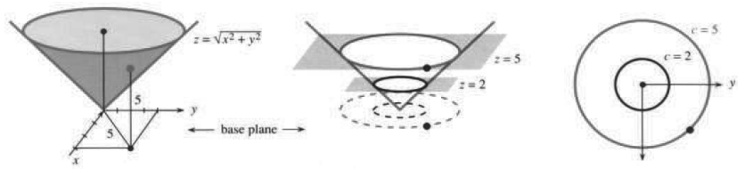
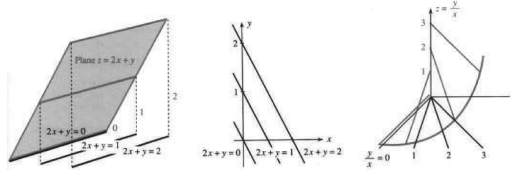
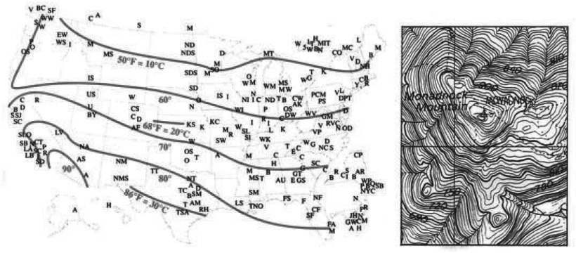
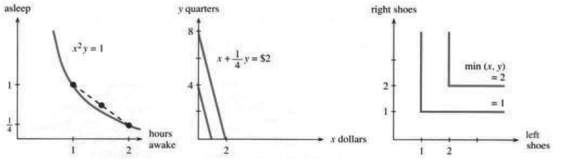

# 第13章　偏导数

原书 PDF 第557–561页，印刷页544–548；含第13章导言和第13.1节。状态：初译，待复审。

<!-- PDF 557 / 印刷页 544 -->

本章处在多维微积分的中心。其他章节、其他主题可以选学，本章及其主题却是必学内容。我们回到微积分的基本思想——**导数**。有一个函数 $f$，变量稍微变化，$f$ 也随之变化。问题是 $f$ 变化多少、变化多快。第1–4章回答这些问题时，函数 $f(x)$ 还只有一个变量。现在有 $f(x,y)$ 或 $f(x,y,z)$，两个、三个乃至更多变量独立变化。$x,y$ 改变时，$f$ 也改变。微分学的基本问题是把 $\Delta x,\Delta y$ 与 $\Delta f$ 联系起来。微积分在极限意义下解决这个问题，**把 $dx,dy$ 与 $df$ 联系起来**。我用这套说法，是在已经完成的工作上继续讲。你知道 $df/dx$ 是 $\Delta f/\Delta x$ 的极限。微积分计算变化率，也就是切线的斜率。目标是把这些思想推广到

$$
f(x,y)=x^2-y^2,\qquad
f(x,y)=\sqrt{x^2+y^2},\qquad
f(x,y,z)=2x+3y+4z.
$$

这些函数有图像、有导数，也必须有切线。

本章核心可以概括为六行。主题是**微分学**，研究短时间内的微小变化。后面还要学习**积分学**，把这些微小变化累加起来。下面把 $f(x,y)$ 的术语和符号，与 $f(x)$ 的相应部分对照列出。请拿这份概要当向导，看看微积分要往哪儿去。

| 曲线 $y=f(x)$ | 曲面 $z=f(x,y)$ |
|---|---|
| $df/dx$ | 变为两个偏导数 $\partial f/\partial x$ 与 $\partial f/\partial y$ |
| $d^2f/dx^2$ | 变为四个二阶偏导数 $\partial^2f/\partial x^2,\ \partial^2f/(\partial x\partial y),\ \partial^2f/(\partial y\partial x),\ \partial^2f/\partial y^2$ |
| $\Delta f\approx(df/dx)\Delta x$ | 变为线性近似 $\Delta f\approx(\partial f/\partial x)\Delta x+(\partial f/\partial y)\Delta y$ |
| 切线 | 变为切平面 $z-z_0=(\partial f/\partial x)(x-x_0)+(\partial f/\partial y)(y-y_0)$ |
| $dy/dt=(dy/dx)(dx/dt)$ | 变为链式法则 $dz/dt=(\partial z/\partial x)(dx/dt)+(\partial z/\partial y)(dy/dt)$ |
| $df/dx=0$ | 变为两个极大极小值方程 $\partial f/\partial x=0,\ \partial f/\partial y=0$ |

<!-- PDF 558 / 印刷页 545 -->

# 13.1 曲面与等值线

$y=f(x)$ 的图像是 $xy$ 平面内的一条曲线。有两个变量：$x$ 是自由的自变量，$y$ 依赖 $x$。在基线上的 $x$ 上方，是曲线上的点 $(x,y)$。这条曲线可以画在二维纸面上。

$z=f(x,y)$ 的图像是 **$xyz$ 空间中的曲面**。有三个变量：$x,y$ 是自变量，$z$ 是因变量。在底平面上的 $(x,y)$ 上方，是曲面上的点 $(x,y,z)$（图13.1）。纸面仍是二维的，所以要用明暗、色彩或投影表示曲面。眼睛极善于把二维图像读成三维，因为练得多。大脑负责数学的部分也有了新任务——**两个偏导数**。

本节用例子和图形说明曲面及其等值线。下一节也很短，然后正式展开计算。

**例1**　描述 $z=f(x,y)=\sqrt{x^2+y^2}$ 的曲面与等值线。

**曲面是圆锥面。**原因是 $\sqrt{x^2+y^2}$ 为底平面上从 $(0,0)$ 到 $(x,y)$ 的距离。在底平面上向外走5，就要向上升5才到曲面。圆锥以斜率1上升。向外到 $(x,y)$ 的距离等于向上到 $z$ 的距离，这是一个 $45^\circ$ 圆锥。

**等值线是圆。**在高度5处，圆锥面包含一圈点，它们都处在曲面上的同一“高度”。平面 $z=5$ 与曲面 $z=\sqrt{x^2+y^2}$ 在这些点相交（图13.1b）。它们正下方底平面里的那个圆，就是等值线。

> **定义**　$z=f(x,y)$ 的**等值线**或**等高线**包含所有具有相同函数值 $f(x,y)=c$ 的点 $(x,y)$。在这些点上方，曲面高度为 $z=c$。

不同的 $c$ 对应不同等值线。要看 $c=2$ 的等值线，就用水平平面 $z=2$ 截曲面。平面与曲面的交点位于满足 $f(x,y)=2$ 的点上方。**底平面内的等值线方程为 $f(x,y)=2$。**在它上方，是曲面上所有“高度2”的点；一般情形则是“高度 $c$”的点。

每条曲线 $f(x,y)=c$ 都标上常数 $c$，从而得到**等值线图**（底平面上布满曲线）。对圆锥，等值线为 $\sqrt{x^2+y^2}=c$，等值线图由半径为 $c$ 的圆组成。

**问**　$z=f(x,y)=x^2+y^2$ 的等值线是什么？

**答**　仍然是圆。但曲面不是圆锥面，而是像抛物线一样向上弯。半径3的圆是等值线 $x^2+y^2=9$，它上方的曲面高度为9。

**例2**　线性函数 $f(x,y)=2x+y$ 的曲面是平面，等值线是直线。**曲面 $z=2x+y$ 与平面 $z=c$ 交于直线 $2x+y=c$。**$c>0$ 时交线在底平面上方，$c<0$ 时在下方。等值线本身位于底平面。图13.2b按它们在曲面上对应的高度，给这些平行直线标号。

**问**　若等值线都是直线，它们一定平行吗？

**答**　不一定。曲面 $z=y/x$ 的等值线为 $y/x=c$。这些直线 $y=cx$ 绕原点转动，而曲面像游乐场的螺旋滑梯一样升高。

<!-- PDF 559 / 印刷页 546 -->

图13.1　$z=f(x,y)=\sqrt{x^2+y^2}$ 的曲面是圆锥面，等值线是圆。base plane＝底平面。

图13.2　平面具有平行的等值直线；螺旋滑梯状曲面 $z=y/x$ 的等值线为 $y/x=c$。Plane＝平面。

**例3**　天气图显示温度函数的等值线。

每条等值线连接温度相同的点。一条线从西雅图经过奥马哈、辛辛那提到华盛顿。冬天光是想到穿过洛杉矶、得克萨斯和佛罗里达的那条线，就让人难受。《今日美国》用颜色区分等值线，效果更好。我们以前没有见过这样的大学地图。

**问**　从等值线图怎样找最高点？

**答**　等值线围绕极大值点形成闭合环。随着 $c$ 增大，环越来越紧。类似地，$c$ 减小时，等值线向最低点收拢。

**例4**　山地等高线图也许是最好的例子。

通常相邻等高线的高度相差100英尺。陡峭山路上的等高线挤在一起，说明上升很快；平坦地带的等高线相距很远。水流的方向与等高线垂直。在我的新罕布什尔地图上，小溪似乎如此，河流就有些可疑。

**问**　底平面里哪个方向，对应曲面上的上坡方向？

**答**　最陡的方向垂直于等值线。这很重要，后面会证明。

**例5**　在经济学中，$x^2y$ 是一个**效用函数**，$x^2y=c$ 是一条**无差异曲线**。

效用函数 $x^2y$ 表示清醒 $x$ 小时、睡眠 $y$ 小时的价值。清醒两小时、睡眠十五分钟的价值为 $f=(2^2)(1/4)$，这与两者各一小时的价值相同：

<!-- PDF 560 / 印刷页 547 -->

图13.3　美国和加拿大许多大学所在地的温度。新罕布什尔的莫纳德诺克山每年有125000人攀登，据说是攀登人数最多的山（富士山除外？）。右图等高距为6米。

$f=(1^2)(1)$。这两个点位于图13.4a的同一条等值线上。我们对这两点无差异，愿意互换同一条等值线上的任意两点。

无差异曲线是“凸”的。**我们更喜欢任意两点的平均点。**连接这两个点的线段位于更高的等值线上。

图13.4b显示一个极端情形：等值线是直线 $4x+y=c$。四枚25美分硬币可以自由替换一美元。价值为 $f=4x+y$ 美元。

图13.4c是另一个极端。多余的左鞋或右鞋没有用，价值（或效用）是 $x,y$ 中较小的数，它表示鞋的双数。

图13.4　效用函数 $x^2y,4x+y,\min(x,y)$：凸形无差异曲线、直线型替代、互补品。图内 asleep＝睡眠；hours awake＝清醒小时数；y quarters＝$y$ 枚25美分硬币；x dollars＝$x$ 美元；right shoes＝右鞋；left shoes＝左鞋。中图金额关系为 $x+\tfrac14y=2$ 美元。

<!-- PDF 561 / 印刷页 548 -->

## 13.1 习题

### 阅读填空

$z=f(x,y)$ 的图像是 **(b)____** 维空间中的一个 **(a)____**。**(c)____** 线 $f(x,y)=7$ 位于底平面内，它上方是曲面上所有高度为 **(d)____** 的点。**(e)____** $z=7$ 在这些点处截过曲面。等值线 $f(x,y)=$ **(f)____** 画在 $xy$ 平面中，并标记 **(g)____**。这一族带标号的曲线构成 **(h)____** 图。

对于 $z=f(x,y)=x^2-y^2$，等值线方程为 **(i)____**，曲线是 **(j)____**。对于 $z=x-y$，等值线是 **(k)____**。等值线不会相交，因为 **(l)____**。当曲面 **(m)____** 时，它们聚得很近；当 **(n)____** 时，它们收缩为一点。山上最陡方向与 **(p)____** **(o)____**。

1. 画出下列四个函数的曲面 $z=f(x,y)$：

$$
f_1=\sqrt{4-x^2-y^2},\quad
f_2=2-\sqrt{x^2+y^2},\quad
f_3=2-\tfrac12(x^2+y^2),\quad
f_4=1+e^{-x^2-y^2}.
$$

2. 这四个函数的等值线都是 ____，围绕着位于 ____ 的极大值。画出四条 $f(x,y)=1$ 的曲线，并按半径递增排序。
3. 令 $y=0$，计算每个函数在 $x=2$ 处对 $x$ 的导数。在该点，哪座“山”最平，哪座最陡？
4. 令 $y=1$，计算每个函数在 $x=1$ 处对 $x$ 的导数。

**对第5–10题，画出 $f=0,1,2$ 及 $f=-4$ 的等值线。**

5. $f_5=x-y$。
6. $f_6=(x+y)^2$。
7. $f_7=xe^{-y}$。
8. $f_8=\sin(x-y)$。
9. $f_9=y-x^2$。
10. $f_{10}=y/x^2$。
11. 假设等值线是平行直线，曲面一定是平面吗？
12. 构造一个函数，使等值线 $f=0$ 分成两个分离部分。
13. 构造一个函数，使 $f=0$ 是圆，而 $f=1$ 不是圆。
14. 找一个函数，使 $f=0$ 有无穷多个分离部分。
15. 画 $f=xy$ 的等值线图，取 $f=-2,-1,0,1,2$，并描述曲面。
16. 找一个函数 $f(x,y)$，使 $f=0$ 的等值线由一个圆及其内部所有点组成。

**第17–20题各画两条等值线。它们是椭圆、抛物线还是双曲线？在两边平方以前，先把 $\sqrt{\cdots}-2x=c$ 写成 $\sqrt{\cdots}=c+2x$。**

17. $f=\sqrt{4x^2+y^2}$。
18. $f=\sqrt{4x^2+y^2}-2x$。
19. $f=\sqrt{5x^2+y^2}-2x$。
20. $f=\sqrt{3x^2+y^2}-2x$。
21. $f=(y-2)/(x-1)$ 的等值线是经过 $(1,2)$ 的 ____，但这个点本身不在 ____ 中。
22. 根据今天的报纸，画一幅美国地图，标出温度恒定的线（等温线）。
23. (a) $z=x^2+y^2-2x-2y$ 的等值线是围绕点 ____ 的圆，$z$ 在该点最小。(b) 函数 $f=$ ____ 的等值线为圆 $x^2+y^2=c+1$，圆上有 $f=c$。
24. 画任意一个州或国家的等高线图（海拔相同的线）。佛罗里达州可能太平了。
25. $w=F(x,y,z)$ 的图像是 $xyzw$ 空间中的 ____ 维曲面；等值集 $F(x,y,z)=c$ 是 $xyz$ 空间中的 ____ 维曲面。对于 $w=x-2y+z$，这些等值集是 ____；对于 $w=x^2+y^2+z^2$，它们是 ____。
26. 曲面 $x^2+y^2-z^2=-1$ 见图13.8。$z^2<1$ 时那里没有曲面上的点，因为 ____。
27. $F=x^2+y^2+qz^2$ 的等值面，在 $q$ 为 ____ 时像橄榄球，$q$ 为 ____ 时像篮球，$q$ 为 ____ 时像飞盘。
28. 设 $T(x,y)$ 是从家 $(0,0)$ 开车到附近城镇 $(x,y)$ 所需的时间。画出等值线。
29. (a) $f(x,y)=\sin(x-y)$ 的等值线是 ____。(b) $g(x,y)=\sin(x^2-y^2)$ 的等值线是 ____。(c) $h(x,y)=\sin(x-y^2)$ 的等值线是 ____。
30. 证明：若 $x_1y_1=1,x_2y_2=1$，则平均点 $x=\tfrac12(x_1+x_2),y=\tfrac12(y_1+y_2)$ 满足 $xy\ge1$。函数 $f=xy$ 有凸形等值线（双曲线）。
31. 一天的小时数受到 $x+y=24$ 限制。将 $x^2y$ 写成 $x^2(24-x)$ 并求最大值，确定最优的清醒小时数。
32. 在 $x=16$ 附近画出等值线 $x^2y=2048$ 与直线 $x+y=24$。说明曲线是凸的，直线与它相切。
33. 曲面 $z=4x+y$ 是一个 ____；曲面 $z=\min(x,y)$ 由两个 ____ 构成。我们愿意把6只左鞋、2只右鞋换成2只左鞋、4只右鞋，但更喜欢平均组合 ____。
34. 画出你鞋面顶部的等高线图。
