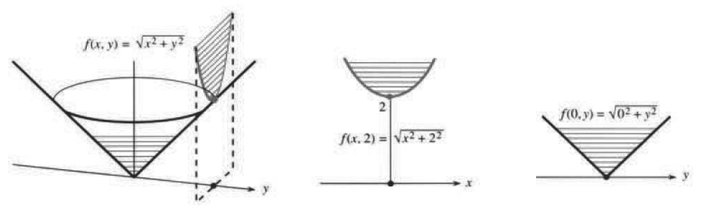
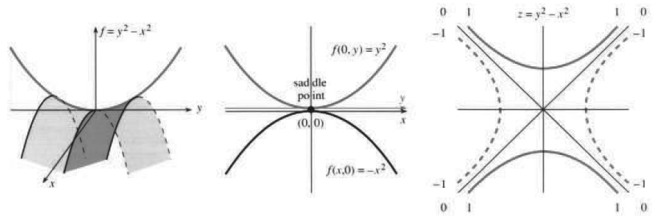
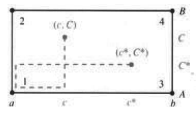

# 13.2 偏导数

原文：PDF 第 562–566 页，印刷页 549–553。状态：初译，已逐页自校，尚未复审。

<!-- PDF 562 / 印刷页 549 -->

微分学的核心概念是导数。$x$ 的变化引起 $f$ 的变化，比值 $\Delta f/\Delta x$ 趋近于导数，也就是斜率或变化率。如果 $f$ 同时依赖于 $x$ 和 $y$，该怎么办？

新办法是让 $x$ 和 $y$ **一次只变化一个**。先只改变 $x$。若函数为 $x+xy$，则 $\Delta f=\Delta x+y\Delta x$，比值 $\Delta f/\Delta x=1+y$。所以 $x+xy$ 的“$x$ 导数”是 $1+y$。对所有函数，方法都一样：**保持 $y$ 不变，改变 $x$，取 $\Delta f/\Delta x$ 的极限。**

**定义**

$$
\frac{\partial f}{\partial x}(x,y)=\lim_{\Delta x\to0}\frac{\Delta f}{\Delta x}
=\lim_{\Delta x\to0}\frac{f(x+\Delta x,y)-f(x,y)}{\Delta x}. \tag{1}
$$

左边出现了新记号 $\partial f/\partial x$。它表示只允许 $x$ 变化——$\partial f/\partial x$ 是一个**偏导数**。字母的变体 $\partial$（英语中仍可读作“d”）提醒我们：$x$ 不是唯一的变量，还有一个变量 $y$，只是它保持不动。

**例 1**

$$
f(x,y)=x^2y^2+xy+y,\qquad \frac{\partial f}{\partial x}(x,y)=2xy^2+y+0.
$$

**不要把 $y$ 当成零！** 要把它当成像 6 那样的常数。它对 $x$ 的导数为零。若 $f(x)=\sin6x$，则 $df/dx=6\cos6x$；若 $f(x,y)=\sin xy$，则 $\partial f/\partial x=y\cos xy$。

英语中 $\partial f/\partial x$ 仍可读作“df dx”。它是 $x$ 和 $y$ 的函数。需要说得更明确时，就称它为“$f$ 对 $x$ 的偏导数”。记号 $f'$ 在这里不够用，因为它没有特别指明 $x$。代替它的是 $f_x$，读作“f x”或“f 下标 x”；它比 $\partial f/\partial x$ 简短，含义却相同。

我们也可能需要注明求导的点 $(x_0,y_0)$：

$$
\frac{\partial f}{\partial x}(x_0,y_0),\quad f_x(x_0,y_0),\quad
\left.\frac{\partial f}{\partial x}\right|_{(x_0,y_0)},\quad
\text{或简记为 }\left(\frac{\partial f}{\partial x}\right)_0.
$$

**例 2** $f(x,y)=\sin2x\cos y$，$f_x=2\cos2x\cos y$（对 $x$ 求偏导时，$\cos y$ 是常数）。

取特定点 $(x_0,y_0)=(0,0)$。曲面的高度是 $f(0,0)=0$，沿 $x$ 方向的斜率为 $f_x=2$。换到点 $x_0=\pi,y_0=\pi$，则 $f_x(\pi,\pi)=-2$。

**现在保持 $x$ 不变，改变 $y$。** 比值 $\Delta f/\Delta y$ 趋近于 $\partial f/\partial y$：

$$
f_y(x,y)=\lim_{\Delta y\to0}\frac{\Delta f}{\Delta y}
=\lim_{\Delta y\to0}\frac{f(x,y+\Delta y)-f(x,y)}{\Delta y}. \tag{2}
$$

这就是沿 $y$ 方向的斜率。要认识到：曲面可以沿 $x$ 方向上升，同时沿 $y$ 方向下降。平面 $f(x,y)=3x-4y$ 有 $f_x=3$（上升）、$f_y=-4$（下降）。我们很快会问：沿 $45^\circ$ 方向又会怎样？

**例 3**

$$
f(x,y)=\sqrt{x^2+y^2},\qquad
\frac{\partial f}{\partial x}=\frac{x}{\sqrt{x^2+y^2}}=\frac{x}{f},\qquad
\frac{\partial f}{\partial y}=\frac{y}{\sqrt{x^2+y^2}}=\frac{y}{f}.
$$

对 $x$ 求 $\sqrt{x^2+y^2}$ 的导数，其实仍是一元微积分，因为 $y$ 是常数。指数由 $\tfrac12$ 降为 $-\tfrac12$，再由链式法则产生因子 $2x$。**这个距离函数有一个有趣的导数：$\partial f/\partial x=x/f$。**

<!-- PDF 563 / 印刷页 550 -->

它的图像是圆锥面。在点 $(0,2)$ 上方，高度为 $\sqrt{0^2+2^2}=2$。两个偏导数是 $f_x=0/2$ 和 $f_y=2/2$。图 13.5 在该点沿 $y$ 方向上升，沿 $x$ 方向则是水平的。实际迈出一步 $\Delta x$，会使 $0^2+2^2$ 增加到 $(\Delta x)^2+2^2$。但这个变化是 $(\Delta x)^2$ 阶的，所以对 $x$ 的导数为零。

图 13.5 相当重要。它说明 $\partial f/\partial x$ 和 $\partial f/\partial y$ 分别是 $f(x,y_0)$ 和 $f(x_0,y)$ 的普通导数。自然可以把后两者称为**偏函数**。第一个把 $y$ 固定为 $y_0$，让 $x$ 变化；第二个把 $x$ 固定为 $x_0$，让 $y$ 变化。它们的图像是**曲面的竖直截线**，由竖直平面 $y=y_0$ 和 $x=x_0$ 截出。记住，等高线则由水平面 $z=c$ 截出。

图 13.5　距离函数 $f=\sqrt{x^2+y^2}$ 的偏函数 $\sqrt{x^2+2^2}$ 和 $\sqrt{0^2+y^2}$。

$\Delta f/\Delta x$ 和 $\Delta f/\Delta y$ 的极限仍按通常方法计算。考察偏函数时，我们又回到了一元情形。**偏导数就是偏函数（$y$ 或 $x$ 为常数）的普通导数。** 对圆锥面，除 $(0,0)$ 外，各点的 $\partial f/\partial y$ 都存在。图中显示，穿过圆锥中心的截线给出绝对值函数 $f(0,y)=|y|$。它有单侧导数，却没有双侧导数。

同样，在圆锥的尖点，$\partial f/\partial x$ 也不存在。我们将在需要时建立二元函数 $f(x,y)$ 的连续性概念（定义见习题）。每个偏导数只涉及一个方向，但极限和连续性涉及所有方向。距离函数在 $(0,0)$ 连续，却在那里不可微。

**例 4** $f(x,y)=y^2-x^2$，$\partial f/\partial x=-2x$，$\partial f/\partial y=2y$。

从 $(1,3)$ 沿 $x$ 方向移动，$y^2-x^2$ 给出偏函数 $9-x^2$。把 $y$ 固定为 3，得到一条开口向下的抛物线。沿 $y$ 方向（即沿 $x=1$），偏函数 $y^2-1$ 的图像开口向上。图 13.6 的曲面称为**双曲抛物面**，因为等高线 $y^2-x^2=c$ 是双曲线。多数人把它称为马鞍面，原点这个特殊的点称为**鞍点**。原点之所以对 $y^2-x^2$ 特殊，是因为两个偏导数都为零。**$y$ 方向抛物线在 $(0,0)$ 的最低点，同时又是 $x$ 方向抛物线的最高点。** 曲面在该点沿所有方向瞬时水平。它既像山丘顶，又像山脉间的谷底。虽然两个偏导数都为零，鞍点却既不是极大值点，也不是极小值点。

**注意** 不要以为 $f(x,y)$ 必须含有 $y^2$ 和 $x^2$ 才有鞍点。函数 $2xy$ 同样可以。等高线 $2xy=c$ 仍是双曲线，而偏函数 $2xy_0$ 和 $2x_0y$ 的图像现在竟然是直线。沿 $45^\circ$ 直线 $x=y$，函数为 $2x^2$，向上升；沿 $-45^\circ$ 直线——

<!-- PDF 564 / 印刷页 551 -->

图 13.6　一个马鞍形函数、它的偏函数及其等高线。图内 saddle point：鞍点。

——$x=-y$，函数为 $-2x^2$，向下降。$2xy$ 的图像就是把图 13.6 旋转 $45^\circ$ 得到的。

**例 5–6**

$$
f(x,y,z)=x^2+y^2+z^2,\qquad P(T,V)=nRT/V.
$$

例 5 的变量更多。例 6 表明，变量未必叫作 $x$ 和 $y$，函数也未必叫作 $f$！压强、温度和体积分别记为 $P,T,V$。字母改变，方法不变：

$$
\frac{\partial P}{\partial T}=\frac{nR}{V},\qquad
\frac{\partial P}{\partial V}=-\frac{nRT}{V^2}\quad\text{（注意 }1/V\text{ 的导数）。}
$$

这里没有 $\partial P/\partial R$，因为 $R$ 是化学中的一个常数，不是变量。

物理学中，一个运动物体会带来六个变量：坐标 $x,y,z$ 和动量 $p_x,p_y,p_z$。经济学和社会科学中的变量还要更多。有 26 种产品，就有 26 个变量；有时用 52 个，同时表示价格和数量。利润可以是这些变量的复杂函数。**只改变这 52 个变量中的一个时，相应的偏导数就是边际利润。** 电子表格可以列出这 52 个数值及其变化的影响；“无穷小电子表格”则显示导数。

## 二阶导数

进一步研究二阶导数，并不需要天才。唯一的困难是：两个一阶导数 $f_x,f_y$ 会产生四个二阶导数 $f_{xx},f_{xy},f_{yx},f_{yy}$。（两个下标：$f_{xx}$ 是先对 $x$ 求导，再对所得导数对 $x$ 求导。其他记法有 $\partial^2f/\partial x^2$、$\partial^2f/\partial x\partial y$、$\partial^2f/\partial y\partial x$、$\partial^2f/\partial y^2$。）幸运的是，$f_{xy}$ 与 $f_{yx}$ 相等，我们先看例子。

**例 7** $f=x/y$ 有 $f_x=1/y$，再求导得 $f_{xx}=0$、$f_{xy}=-1/y^2$。

函数 $x/y$ 关于 $x$ 是线性的（这解释了 $f_{xx}=0$）。它对 $y$ 的导数为 $f_y=-x/y^2$，再对 $x$ 求导得到 $f_{yx}=-1/y^2$。**混合偏导数 $f_{xy}$ 和 $f_{yx}$ 相等。**

只沿 $y$ 方向求二阶导数，则有 $f_{yy}=2x/y^3$。所有这些导数都可以用一元微积分求出，因为每次只有一个变量变化。

<!-- PDF 565 / 印刷页 552 -->

**例 8** $f=4x^2+3xy+y^2$ 有 $f_x=8x+3y$ 和 $f_y=3x+2y$。

两个“交叉偏导数”$f_{xy}$ 和 $f_{yx}$ 都等于 3。沿 $x$ 方向的二阶导数是 $\partial^2f/\partial x^2=8$，也写为 $f_{xx}=8$。因此，“f x x”表示“f 对 x 的二阶偏导数”。同样，$\partial^2f/\partial y^2=2$。记号上只是把 $d$ 换成了 $\partial$。

**如果 $f(x,y)$ 有连续的二阶偏导数，那么 $f_{xy}=f_{yx}$。** 第 43 题给出一个基于中值定理的证明提纲。对于三阶导数，几乎随便举个例子，就能看出 $f_{xxy}=f_{xyx}=f_{yxx}$ 与另一组 $f_{yyx}=f_{yxy}=f_{xyy}$ 通常不同。

**问题　怎样在平面上画出空间曲线 $x(t),y(t),z(t)$？** 一种方法是沿平行于 $(1,1,1)$ 的方向观察。在 $XY$ 屏幕上画

$$
X=\frac{y-x}{\sqrt2},\qquad Y=\frac{2z-x-y}{\sqrt6}.
$$

直线 $x=y=z$ 会映到点 $(0,0)$！

**怎样画曲面 $z=f(x,y)$？** 使用同样的 $X,Y$。固定 $x$，让 $y$ 变化，得到曲面上一个方向的一族曲线；再固定 $y$，改变 $x$，得到另一种偏函数。对于参数曲面，例如

$$
x=(2+v\sin\tfrac12u)\cos u,\qquad y=(2+v\sin\tfrac12u)\sin u,\qquad z=v\cos\tfrac12u,
$$

先改变 $u$，再改变 $v$。迪克·威廉姆森展示了如何用这种方法画出只有一个面的“莫比乌斯带”。

## 13.2 习题

### 阅读填空

(a) ______ 导数 $\partial f/\partial y$ 是固定 (b) ______、改变 (c) ______ 得到的。它是 (d) ______ 的极限。若 $f=e^{2x}\sin y$，则 $\partial f/\partial x=$ (e) ______，$\partial f/\partial y=$ (f) ______。若 $f=(x^2+y^2)^{1/2}$，则 $f_x=$ (g) ______，$f_y=$ (h) ______。在 $(x_0,y_0)$，偏导数 $f_x$ 是 (i) ______ 函数 $f(x,y_0)$ 的普通导数。同样，$f_y$ 来自 $f($ (j) ______ $)$。这些函数的图像由竖直平面 $x=x_0$ 和 (k) ______ 截出，而等高线由 (l) ______ 平面截出。

四个二阶导数为 $f_{xx}$、(m) ______、(n) ______、(o) ______。对于 $f=xy$，它们为 (p) ______；对于 $f=\cos2x\cos3y$，它们为 (q) ______。这些例子中，导数 (r) ______ 和 (s) ______ 相同。当二阶导数 (t) ______ 时，这总成立。在原点，$\cos2x\cos3y$ 沿 $x,y$ 方向都向 (u) ______ 弯曲，而 $xy$ 沿 $45^\circ$ 方向向 (v) ______，沿 $-45^\circ$ 方向向 (w) ______。

求第 1–12 题各函数的 $\partial f/\partial x$ 和 $\partial f/\partial y$。

1. $3x-y+x^2y^2$。
2. $\sin(3x-y)+y$。
3. $x^3y^2-x^2-e^y$。
4. $xe^{x+4}$。
5. $(x+y)/(x-y)$。
6. $1/\sqrt{x^2+y^2}$。
7. $(x^2+y^2)^{-1}$。
8. $\ln(x+2y)$。
9. $\ln\sqrt{x^2+y^2}$。
10. $y^x$。
11. $\tan^{-1}(y/x)$。
12. $\ln(xy)$。

计算第 13–20 题各函数的 $f_{xx}$、$f_{xy}=f_{yx}$ 和 $f_{yy}$。

13. $x^2+3xy+2y^2$。
14. $(x+3y)^2$。
15. $(x+iy)^3$。
16. $e^{ax+by}$。
17. $1/\sqrt{x^2+y^2}$。
18. $(x+y)^n$。
19. $\cos ax\cos by$。
20. $1/(x+iy)$。

求第 21–26 题各函数的定义域和值域（所有输入和输出），再计算 $f_x,f_y,f_z,f_t$。

21. $1/(x-y)^2$。
22. $\sqrt{x^2+y^2-t^2}$。
23. $(y-x)/(z-t)$。
24. $\ln(x+t)$。
25. $x^{\ln t}$。为什么它等于 $t^{\ln x}$？
26. $\cos x\cos^{-1}y$。
27. 对 $f=x^my^n$，验证 $f_{xy}=f_{yx}$。若 $f_{xy}=0$，则 $f_x$ 不依赖于 ______，而 $f_y$ 与 ______ 无关。函数必定具有形式 $f(x,y)=G(x)+$ ______。
28. 对 $f(x,y)=\int_x^y v(t)\,dt$，用 $v$ 表示 $f_x,f_y$。先改变 $x$，再改变 $y$。
29. 对 $f=\int_0^{xy}v(t)\,dt$，计算 $\partial f/\partial x$。保持 $y$ 不变。
30. $f(x,y)=\int_x^y dt/t$ 是什么函数？$f_x,f_y$ 分别是什么？
31. 计算 $f=x^3y^3$ 的全部八个三阶导数 $f_{xxx},f_{xxy},\ldots$。其中有多少个互不相同？

第 32–35 题：选择 $g(y)$，使 $f(x,y)=e^{cx}g(y)$ 满足给定方程。

32. $f_x+f_y=0$。
33. $f_x=7f_y$。
34. $f_y=f_{xx}$。
35. $f_{xx}=4f_{yy}$。

<!-- PDF 566 / 印刷页 553 -->

36. 证明 $t^{-1/2}e^{-x^2/(4t)}$ 满足**热方程** $f_t=f_{xx}$。这个 $f(x,t)$ 表示在 $x=0,t=0$ 处有一个点热源时，位置 $x$、时刻 $t$ 的温度。
37. $xy$ 平面中的热传导方程为 $f_t=f_{xx}+f_{yy}$。证明 $f(x,y,t)=e^{-2t}\sin x\sin y$ 是一个解。在 $f=e^{\text{______}}\sin2x\sin3y$ 中，指数取什么才能得到一个解？
38. 求热方程 $f_t=f_{xx}+f_{yy}$ 形如 $f=e^{\text{______}}\sin mx\cos ny$ 的解。证明 $t^{-1}e^{-x^2/(4t)}e^{-y^2/(4t)}$ 也是一个解。
39. 基本的**波动方程**是 $f_{tt}=f_{xx}$。验证 $f(x,t)=\sin(x+t)$ 和 $f(x,t)=\sin(x-t)$ 都是解。画出 $t=\pi/4$ 时的两个图像。哪一个波向左移动，哪一个向右移动？
40. 接第 39 题。时间变化 $\Delta t=\pi/4$ 时，波峰移动的距离为 $\Delta x=$ ______。波速为 $\Delta x/\Delta t=$ ______。
41. 下列哪些函数满足波动方程 $f_{tt}=c^2f_{xx}$？$\sin(x-ct)$；$\cos(x+ct)$；$e^{x-ct}$；$e^x-e^{ct}$；$e^x\cos ct$。
42. 设 $\partial f/\partial t=\partial f/\partial x$。证明 $\partial^2f/\partial t^2=\partial^2f/\partial x^2$。
43. 证明 $f_{xy}=f_{yx}$ 时，考察一个小矩形上的 $f(x,y)$。上下两边的函数值之差为 $g(x)=f(x,B)-f(x,A)$。四个角点 $1,2,3,4$ 上的差为：

    $$
    \begin{aligned}
    Q&=[f_4-f_3]-[f_2-f_1]\\
     &=g(b)-g(a)&&\text{（}g\text{ 的定义）}\\
     &=(b-a)g_x(c)&&\text{（中值定理）}\\
     &=(b-a)[f_x(c,B)-f_x(c,A)]&&\text{（计算 }g_x\text{）}\\
     &=(b-a)(B-A)f_{xy}(c,C)&&\text{（再次用中值定理）。}
    \end{aligned}
    $$

    (a) 右边与左边的函数值之差为 $h(y)=f(b,y)-f(a,y)$。同一个 $Q$ 也等于 $h(B)-h(A)$。相应地改变上述步骤，得到 $Q=(B-A)(b-a)f_{yx}(c^*,C^*)$。

    (b) $Q$ 的两个表达式说明，$(c,C)$ 处的 $f_{xy}$ 等于 $(c^*,C^*)$ 处的 $f_{yx}$。让矩形向 $(a,A)$ 收缩。需要什么假设，才能在这个一般的点得到 $f_{xy}=f_{yx}$？

    

44. 根据式 (1)、(2)，求下列函数在偏导数存在处的 $\partial f/\partial x$ 和 $\partial f/\partial y$：(a) $f=|xy|$；(b) $x\ne0$ 时 $f=x^2+y^2$，$x=0$ 时 $f=0$。

第 45–52 题讨论二维情形的极限。

45. 补全下列四种正确的极限定义。① 若 $x_n$ 收敛到 $a$，并且 ______，则点 $(x_n,y_n)$ 趋近于点 $(a,b)$。② 对围绕 $(a,b)$ 的任意一个圆，点 $(x_n,y_n)$ 最终都进入圆的 ______，并始终留在 ______。③ 从 $(x_n,y_n)$ 到 $(a,b)$ 的距离为 ______，它趋近于 ______。④ 对任意 $\varepsilon>0$，存在一个 $N$，使得对所有 $n>$ ______，距离 ______ $<\varepsilon$。
46. 从 $(x_0,y_0)=(1,0)$ 出发，求 $(x_2,y_2)$、$(x_4,y_4)$，并在极限存在时求 $(a,b)$。

    (a) $(x_n,y_n)=(1/(n+1),n/(n+1))$；
    (b) $(x_n,y_n)=(x_{n-1},y_{n-1})$；
    (c) $(x_n,y_n)=(y_{n-1},x_{n-1})$；
    (d) $(x_n,y_n)=(x_{n-1}+y_{n-1},x_{n-1}-y_{n-1})$。

47. （$f(x,y)$ 的极限）① 非正式定义：当点 $(x_n,y_n)$ 趋近于 $(a,b)$ 时，数 $f(x_n,y_n)$ 趋近于 $L$。② $\varepsilon$–$\delta$ 定义：对每个 $\varepsilon>0$，存在 $\delta>0$，使得当 $(x,y)$ 到 $(a,b)$ 的距离为 ______ 时，$|f(x,y)-L|$ 小于 ______。这里不涉及 $f$ 在 $(a,b)$ 的值。（两个空按中文语序排列，分别对应原文的距离条件与误差界。）
48. 写出 $(x,y)\to(a,b)$ 时的极限 $L$。在哪些点 $(a,b)$，$f(x,y)$ 没有极限？(a) $f(x,y)=\sqrt{x^2+y^2}$；(b) $f(x,y)=x/y$；(c) $f(x,y)=1/(x+y)$；(d) $f(x,y)=xy/(x^2+y^2)$。对于 (d)，沿直线 $y=mx$ 求趋近 $(0,0)$ 时的极限。极限随 $m$ 改变，因此 $(0,0)$ 处的极限 $L$ 不存在。$x/y$ 也一样。
49. 连续性定义：若 $f(a,b)$ 有定义，且当 $(x,y)$ 趋近于 $(a,b)$ 时，$f(x,y)$ 趋近于极限 ______，则 $f(x,y)$ 在 $(a,b)$ 连续。构造一个在 $(1,2)$ 不连续的函数。
50. 证明：沿每条直线 $y=mx$ 趋近原点时，$x^2y/(x^4+y^2)\to0$；但沿抛物线 $y=x^2$ 趋近时，这个比值等于 ______。
51. 能否适当定义 $f(0,0)$，使 $f(x,y)$ 在 $(0,0)$ 连续？(a) $f=|x|+|y-1|$；(b) $f=(1+x)^y$；(c) $f=x^{1+y}$。
52. 当 $(x,y)\to(0,0)$ 时，下列哪些函数趋近于零？为什么？(a) $xy^2/(x^2+y^2)$；(b) $x^2y^2/(x^4+y^4)$；(c) $x^my^n/(x^m+y^n)$。

## 译注与待复审事项

- 偏函数一词对应原文 partial function，指固定其余变量得到的一元函数。混合下标按正文 $f_{xy}=(f_x)_y$ 使用；分式形式若用通常的算子复合顺序，应相应写作 $\partial_y\partial_x f$。原文并列列出两种混合分式，未逐一指定对应关系。
- 混合偏导数交换次序需要相应正则性假设；正文稍后明确给出二阶偏导数连续这一充分条件。三阶导数分组相等也须有适当正则性，“两组不同”并非对每个函数必然成立。第 42 题同样需要使二阶导数存在并可交换的条件。
- 第 27 题关于分离成 $G(x)+H(y)$ 的说法需在适当的区域（例如矩形）上理解。第 30 题的积分区间不能穿过零；第 36、38 题热核公式取 $t>0$。
- 第 38 题原文把含时间的解记为 $f(x,y)$，译文仅写 $f$，保留待填的指数；完整变量应为 $(x,y,t)$。第 40 题原文称 $\Delta x$ 为 distance，但求有向波速时应区分带符号位移与距离。
- 第 47 题极限定义应要求 $0<\sqrt{(x-a)^2+(y-b)^2}<\delta$；序列形式也需排除序列点等于极限点的情况。此处作为待填题保留，未填答案。
- 第 51(c) 题须在实幂有定义的区域内讨论趋近；第 52(c) 题没有交代 $m,n$ 的取值及变量区域，分母还可能发生抵消，不能未经条件分析就作统一结论。第 26 题 $\cos^{-1}y$ 按反余弦记号理解。
- 已核对全部 5 页、图 13.5–13.6、第 43 题附图与 52 道编号习题；未进行独立复审。
