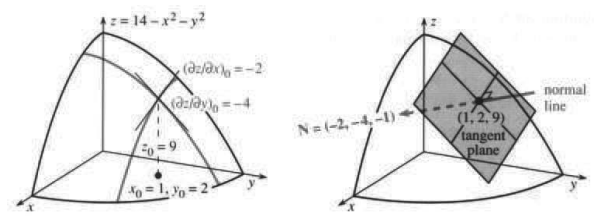
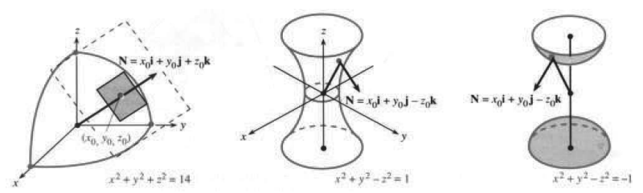
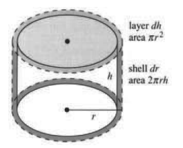
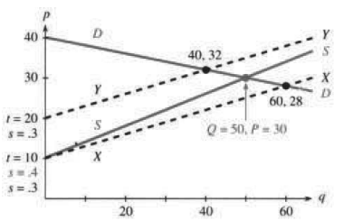
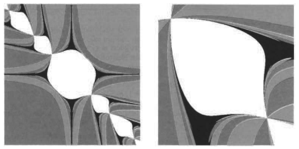

# 13.3 切平面与线性近似

原文：PDF 第 567–577 页，印刷页 554–564。状态：初译，已逐页自校，尚未复审。

<!-- PDF 567 / 印刷页 554 -->

在很小的范围内，光滑曲线 $y=f(x)$ 几乎是直的。曲线会改变方向，而切线 $y-y_0=f'(x_0)(x-x_0)$ 的斜率始终不变。切线立即给出 $y=f(x)$ 的线性近似：$y\approx y_0+f'(x_0)(x-x_0)$。

**两个变量时会怎样？** 函数是 $z=f(x,y)$，图像是一个**曲面**。我们站在曲面上一点，而且是近视眼，看不远。曲面可能弯曲着消失在地平线外，也可能呈碗状或马鞍状。在我们近视的眼睛看来，它是平的。我们以为自己站在一个平面上（未必是水平面），并想求这个**切平面**的方程。

**记号** 基点的坐标为 $x_0,y_0$，曲面上该点的高度为 $z_0=f(x_0,y_0)$。也可以使用其他字母：点可以记作 $(a,b)$，高度记作 $w$。下标 0 表示 $x,y,z,\partial f/\partial x,\partial f/\partial y$ **在该点的取值**。

一个变量时，切线斜率是 $df/dx$。两个变量时，有两个导数 $\partial f/\partial x$ 和 $\partial f/\partial y$；在指定点，它们是 $(\partial f/\partial x)_0$ 和 $(\partial f/\partial y)_0$。**这就是切平面的两个斜率。** 它的方程是本章的关键：

**13A** 在 $(x_0,y_0,z_0)$ 处，切平面与曲面 $z=f(x,y)$ 有相同的斜率。切平面的方程是线性方程

$$
z-z_0=\left(\frac{\partial f}{\partial x}\right)_0(x-x_0)+\left(\frac{\partial f}{\partial y}\right)_0(y-y_0). \tag{1}
$$

该平面的法向量 $\mathbf N$ 的分量是 $(\partial f/\partial x)_0,(\partial f/\partial y)_0,-1$。

**例 1** 求 $z=14-x^2-y^2$ 在 $(x_0,y_0,z_0)=(1,2,9)$ 处的切平面。

**解** 偏导数为 $\partial f/\partial x=-2x$ 和 $\partial f/\partial y=-2y$。在 $x=1,y=2$ 时，它们分别为 $-2,-4$。切平面方程为

$$
z-9=-2(x-1)-4(y-2),\qquad\text{即 }z+2x+4y=19. \tag{2}
$$

这个 $z(x,y)$ 的偏导数是 $-2,-4$，和曲面一样，所以这个平面与曲面相切。

法向量 $\mathbf N$ 的分量为 $-2,-4,-1$。**法线方程**为 $(x,y,z)=(1,2,9)+t(-2,-4,-1)$。直线从 $(1,2,9)$ 出发，沿 $\mathbf N$ 方向延伸，垂直于切平面和曲面。

图 13.7 展示了切平面的更多细节。虚线是 $x,y$ 方向的切线，它们都在切平面内。所有切线都在切平面内！这两条特定的切线与“偏函数”的图像相切，分别对应 $y=y_0=2$ 和 $x=x_0=1$ 这两种固定方式。平面仿佛平衡在曲面上，在切点与曲面接触。

还可以说得更多：曲面上通过该点的每一条曲线都与这个平面相切。从几何上说，曲线来到该点，便“亲吻”这个平面。† 曲线的切向量 $\mathbf T$ 与曲面的法向量 $\mathbf N$ 垂直：$\mathbf T\cdot\mathbf N=0$。

† 更稳妥的词是“osculate”（密切接触）。在鞍点处，平面会受到来自两侧的“亲吻”。

**例 2** 求球面 $z^2=14-x^2-y^2$ 在 $(1,2,3)$ 处的切平面。

<!-- PDF 568 / 印刷页 555 -->

图 13.7　切平面包含 $x,y$ 方向的切线，并与 $\mathbf N$ 垂直。图内 normal line：法线；tangent plane：切平面。

**解** 现在不是 $z=14-x^2-y^2$，而是 $z=\sqrt{14-x^2-y^2}$。在 $x_0=1,y_0=2$ 处，高度变为 $z_0=3$。该曲面是半径为 $\sqrt{14}$ 的球面。平方根带来的唯一麻烦是求导：

$$
\frac{\partial z}{\partial x}=\frac{\partial}{\partial x}\sqrt{14-x^2-y^2}
=\frac{\tfrac12(-2x)}{\sqrt{14-x^2-y^2}},\qquad
\frac{\partial z}{\partial y}=\frac{\tfrac12(-2y)}{\sqrt{14-x^2-y^2}}. \tag{3}
$$

在 $(1,2)$ 处，这两个斜率是 $-\tfrac13,-\tfrac23$。切平面方程是线性的：$z-3=-\tfrac13(x-1)-\tfrac13(y-2)$。我忍不住把方程整理一下：两边乘以 3，再把各项移到左边：

$$
\text{球面的切平面：}\quad 1(x-1)+2(y-2)+3(z-3)=0. \tag{4}
$$

如果数学是“研究模式的科学”，那么式 (4) 非常值得研究。数字 $1,2,3$ 出现了两次。坐标是 $(x_0,y_0,z_0)=(1,2,3)$，法向量是 $\mathbf i+2\mathbf j+3\mathbf k$，切平面方程是 $x+2y+3z=14$。这一切不可能是巧合，可是 $14-x^2-y^2$ 的平方根把简单的模式弄得复杂了。

**这个平方根并非必需。** 微积分有个直接求 $dz/dx$ 的办法——隐函数求导。只需按原样对每一项求导：

$$
x^2+y^2+z^2=14\quad\Longrightarrow\quad
2x+2z\frac{\partial z}{\partial x}=0,\qquad
2y+2z\frac{\partial z}{\partial y}=0. \tag{5}
$$

约去 2，球面上的两个偏导数就是 $-x/z,-y/z$，与式 (3) 一样。切平面的方程形式非常对称：

$$
z-z_0=-\frac{x_0}{z_0}(x-x_0)-\frac{y_0}{z_0}(y-y_0),
\quad\text{即 }x_0(x-x_0)+y_0(y-y_0)+z_0(z-z_0)=0. \tag{6}
$$

<!-- PDF 569 / 印刷页 556 -->

图 13.8　球面的切平面与法向量 $\mathbf N$；单叶双曲面与双叶双曲面。

从最后一个方程读出 $\mathbf N=x_0\mathbf i+y_0\mathbf j+z_0\mathbf k$，微积分证明了我们已经知道的事实：**球面的法向量沿半径向外。**

## $F(x,y,z)=c$ 的切平面

球面引出一个问题，它对别的曲面同样重要：如果方程是 $F(x,y,z)=c$，而不是 $z=f(x,y)$，能否直接由 $F$ 求出偏导数和切平面？

答案是能。无须先解出 $z$。在 $(x_0,y_0,z_0)$ 处计算 $F$ 的偏导数，就得到切平面和法向量的第二组公式。

**13B** 曲面 $F(x,y,z)=c$ 的切平面具有线性方程

$$
\left(\frac{\partial F}{\partial x}\right)_0(x-x_0)
+\left(\frac{\partial F}{\partial y}\right)_0(y-y_0)
+\left(\frac{\partial F}{\partial z}\right)_0(z-z_0)=0. \tag{7}
$$

法向量为

$$
\mathbf N=\left(\frac{\partial F}{\partial x}\right)_0\mathbf i
+\left(\frac{\partial F}{\partial y}\right)_0\mathbf j
+\left(\frac{\partial F}{\partial z}\right)_0\mathbf k.
$$

注意，它包含了原来的情形 $z=f(x,y)$。此时**函数 $F$ 取为 $f(x,y)-z$**，它的三个偏导数是 $\partial f/\partial x,\partial f/\partial y,-1$（$-1$ 来自 $-z$ 的导数）。于是式 (7) 就与原来的切平面方程 (1) 相同。

**例 3** 曲面 $F=x^2+y^2-z^2=c$ 是双曲面。求它的切平面。

**解** 偏导数为 $F_x=2x,F_y=2y,F_z=-2z$，式 (7) 给出

$$
\text{切平面：}\quad 2x_0(x-x_0)+2y_0(y-y_0)-2z_0(z-z_0)=0. \tag{8}
$$

可以约去 2。法向量为 $\mathbf N=x_0\mathbf i+y_0\mathbf j-z_0\mathbf k$。当 $c>0$ 时，双曲面只有一叶（图 13.8）；$c=0$ 时是圆锥面；$c<0$ 时分成两叶（第 13.1.26 题）。

<!-- PDF 570 / 印刷页 557 -->

## 微分

回到切平面的线性方程 $z-z_0=(\partial z/\partial x)_0(x-x_0)+(\partial z/\partial y)_0(y-y_0)$。这也许是本章最重要的公式。现在我们沿切平面走，不走弯曲的曲面。平面上的变化记为 $dx,dy,dz$，曲面上的变化记为 $\Delta x,\Delta y,\Delta z$。$d$ 由切平面方程控制，$\Delta$ 由 $z=f(x,y)$ 控制。在第 2 章，$d$ 表示沿切线的**微分**：

$$
dy=(dy/dx)\,dx\quad\text{（直线上）},\qquad
\Delta y\approx(dy/dx)\Delta x\quad\text{（曲线上）}. \tag{9}
$$

现在 $y$ 与 $x$ 一样是自变量，因变量是 $z$，思想仍相同。切平面上的坐标差 $x-x_0,y-y_0,z-z_0$ 分别是 $dx,dy,dz$。平面方程为

$$
dz=(\partial z/\partial x)_0\,dx+(\partial z/\partial y)_0\,dy,
\quad\text{或 }df=f_x\,dx+f_y\,dy. \tag{10}
$$

这就是**全微分**。可以使用 $dz,df,dw$ 等记号，但不用 $\partial z,\partial f$。微分让人想到 $x,y$ 的小变化，$dz$ 则是由此产生的 $z$ 的变化。在切平面上，式 (10) 精确成立。

“中心化变换”把 $x_0,y_0,z_0$ 放到坐标中心，随后“放大变换”把曲面伸展成它的切平面。

**例 4** 三角形面积为 $A=\tfrac12ab\sin\theta$。求全微分 $dA$。

**解** 底边长 $b$，斜边长 $a$，夹角是 $\theta$。你也许更喜欢 $A=\tfrac12bh$，其中 $h=a\sin\theta$ 是垂直高度。无论哪种写法，都需要求偏导数。若 $A=\tfrac12ab\sin\theta$，则

$$
\frac{\partial A}{\partial a}=\frac12b\sin\theta,\qquad
\frac{\partial A}{\partial b}=\frac12a\sin\theta,\qquad
\frac{\partial A}{\partial\theta}=\frac12ab\cos\theta. \tag{11}
$$

由此立即得到全微分（类似乘积法则）：

$$
dA=\frac{\partial A}{\partial a}\,da+\frac{\partial A}{\partial b}\,db+\frac{\partial A}{\partial\theta}\,d\theta
=\frac12b\sin\theta\,da+\frac12a\sin\theta\,db+\frac12ab\cos\theta\,d\theta.
$$

**例 5** 圆柱体积为 $V=\pi r^2h$。判断 $V$ 对哪种变化更敏感：$r$ 从 1.0 变为 1.1，还是 $h$ 从 1.0 变为 1.1？

**解** 偏导数为 $\partial V/\partial r=2\pi rh$ 和 $\partial V/\partial h=\pi r^2$。**它们衡量对变化的敏感程度。** 从几何意义看，分别是圆柱的侧面积和底面积。体积微分 $dV$ 来自侧面的一层薄壳，加上顶部的一层薄片：

$$
dV=\text{薄壳}+\text{薄层}=2\pi rh\,dr+\pi r^2\,dh. \tag{12}
$$

从 $r=h=1$ 出发，微分是 $dV=2\pi\,dr+\pi\,dh$。取 $dr=dh=0.1$，薄壳体积为 $0.2\pi$，薄层体积只有 $0.1\pi$，所以这里 $V$ 对 $dr$ 更敏感。圆柱要是矮得像一枚一美分硬币，薄层体积就更大，$V$ 对 $dh$ 更敏感。在本例中，$V=\pi r^2h$ 从 $\pi(1)^3$ 增加到 $\pi(1.1)^3$。**比较 $\Delta V$ 和 $dV$：**

$$
\Delta V=\pi(1.1)^3-\pi(1)^3=0.331\pi,\qquad
dV=2\pi(0.1)+\pi(0.1)=0.300\pi.
$$

两者相差 $\Delta V-dV=0.031\pi$。图 13.9 中，薄壳和薄层漏掉的那点体积，就在薄壳上方、薄层周围。误差为 $(dr)^2+(dh)^2$ 阶。对 $V=\pi r^2h$，微分 $dV=2\pi rh\,dr+\pi r^2\,dh$ 是真实变化 $\Delta V$ 的**线性近似**。现在来准确说明这一点。

<!-- PDF 571 / 印刷页 558 -->

## 线性近似

**一相切，立刻就有线性近似。** 切线如此，切平面也如此。正如切线贴近曲线，切平面也贴近曲面。线性函数比 $f(x),f(x,y),F(x,y,z)$ 简单。我们只需要这一点上的一阶导数，附近就能有良好的近似。

微积分的这个关键思想已经体现在微分中。在平面上，$df$ 等于 $f_x\,dx+f_y\,dy$；在弯曲的曲面上，这给出 $\Delta f$ 的线性近似：

**13C** 在点 $(x_0,y_0)$ 附近，$f(x,y)$ 的线性近似为

$$
f(x,y)\approx f(x_0,y_0)+\left(\frac{\partial f}{\partial x}\right)_0(x-x_0)
+\left(\frac{\partial f}{\partial y}\right)_0(y-y_0). \tag{13}
$$

换言之，$\Delta f\approx f_x\Delta x+f_y\Delta y$，第 24 题给出证明。式 (13) 右边是线性函数 $f_L(x,y)$。在 $(x_0,y_0)$，$f$ 与 $f_L$ 有相同的斜率。随后 $f(x,y)$ 就弯着离开 $f_L$，产生“二阶”误差：

$$
|f(x,y)-f_L(x,y)|\le M[(x-x_0)^2+(y-y_0)^2]. \tag{14}
$$

这里假定，从 $(x_0,y_0)$ 到 $(x,y)$ 的线段上，$f_{xx},f_{xy},f_{yy}$ 连续，且以 $M$ 为界。第 13.5 节例 3 表明，沿该直线有 $|f_{tt}|\le2M$。一元情形下，误差 $f-f_L$ 的公式 3.8.12 还给出一个因子 $\tfrac12$。

回到圆柱体积：$r,h$ 从 1.0 变为 1.1。$V=\pi r^2h$ 的二阶导数是 $V_{rr}=2\pi h,V_{rh}=2\pi r,V_{hh}=0$，均不超过 $M=2.2\pi$。式 (14) 给出的误差界为 $2.2\pi(0.1^2+0.1^2)=0.044\pi$，比实际误差 $0.031\pi$ 大得不多。关键在于：**线性近似的误差来自二次项**，这些正是 $f_L$ 首先忽略的项。

图 13.9　薄壳加薄层给出 $dV=0.300\pi$；计入顶部圆环后，得到 $\Delta V=0.331\pi$。图内 layer $dh$：厚度 $dh$ 的薄层，面积 $\pi r^2$；shell $dr$：厚度 $dr$ 的薄壳，面积 $2\pi rh$。

图 13.10　数量 $Q$ 和价格 $P$ 随直线移动而改变。

**例 6** 求距离函数 $r=\sqrt{x^2+y^2}$ 的线性近似。

**解** 偏导数为 $x/r,y/r$，所以 $\Delta r\approx(x/r)\Delta x+(y/r)\Delta y$。当 $(x,y,r)$ 接近 $(1,2,\sqrt5)$ 时：

$$
\sqrt{x^2+y^2}\approx\sqrt{1^2+2^2}+\frac{x-1}{\sqrt5}+\frac{2(y-2)}{\sqrt5}.
$$

若把 $y$ 固定为 2，这是 $\sqrt{x^2+2^2}$ 的一元近似；若把 $x$ 固定为 1，这是关于 $y$ 的线性近似。两个变量都变化时，你也许以为 $dr$ 会把 $dx,dy$ 放进一个平方根中——

<!-- PDF 572 / 印刷页 559 -->

——其实不会。距离公式把 $x,y$ 放在平方根中，但在一阶近似下，**距离的变化对 $\Delta x,\Delta y$ 是线性的**。

在 $x=0,y=0$ 有一个不光滑点。从 $(0,0)$ 出发的任意移动都给出 $\Delta r=\sqrt{(\Delta x)^2+(\Delta y)^2}$，平方根又回来了。这是因为偏导数 $x/r,y/r$ 在 $(0,0)$ 不连续。圆锥有一个尖点，那里没有切平面，线性近似失效。

下一个例子说明，方程写成 $F(x,y,z)=c$ 时，怎样用 $\Delta x,\Delta y$ 近似求出 $\Delta z$。我们使用式 (7) 中的隐式求导结果，而不是式 (1) 中的显式偏导数。思想一样：把切平面方程看成求 $\Delta z$ 的方法，而不只是关于 $z$ 的方程。下面只是给例 6 换了字母。

**例 7** 从 $F=-x^2-y^2+z^2=0$ 求 $\Delta z$ 的线性近似。

**解（隐函数求导）** 用 $F$ 的偏导数得到 $-2x\Delta x-2y\Delta y+2z\Delta z\approx0$。解出 $\Delta z$，得到 $\Delta z\approx(x/z)\Delta x+(y/z)\Delta y$，与例 6 相同。

**例 8** 供给曲线改变时，均衡价格怎样变化？

均衡价格对应供给曲线和需求曲线的交点（**供给量＝需求量**）。价格 $p$ 上升时，需求量 $q$ 下降（这里的直线斜率为 $-0.2$）：

$$
\text{需求线 }DD:\quad p=-0.2q+40. \tag{15}
$$

供给量（也记为 $q$）则随价格上升而增加，斜率 $s$ 为正（这里 $s=0.4$）：

$$
\text{供给线 }SS:\quad p=sq+t=0.4q+10.
$$

图 13.10 画出了这些直线。它们相交于**均衡价格** $P=30$ 美元处。在价格 $P$ 下，供给量（$SS$ 上）和需求量（$DD$ 上）都是 $Q=50$，因此这 50 个单位能售出。

偏导数从哪里出现？现实是，$DD,SS$ 并非永远固定。技术会变，竞争会变，货币价值也会变。因此直线会移动，交点 $(Q,P)$ 也随之移动。请注意，这几句话里已经藏着导数。

要点是：**均衡价格 $P$ 是 $s,t$ 的函数。** 改进技术，降低 $s$，会使供给线降为 $p=0.3q+10$。需求线没有改变，顾客的购买意愿仍然一样，但价格 $P$ 和数量 $Q$ 不同了。新的均衡是 $Q=60,P=28$ 美元，即新直线 $XX$ 与 $DD$ 的交点。

如果技术成本高，供应商会在降低 $s$ 的同时提高 $t$。直线 $YY$ 为 $p=0.3q+20$，对应更高的均衡价格 $P=32$ 美元和更低的数量 $Q=40$——需求不足以支持这项技术。

**微积分问题** 求 $\partial P/\partial s$ 和 $\partial P/\partial t$。困难在于，题目没有把 $P$ 写成 $s,t$ 的显函数。因此，对供需相等的方程隐式求导：

$$
\text{供给＝需求：}\quad P=-0.2Q+40=sQ+t. \tag{16}
$$

$$
\begin{aligned}
\text{对 }s\text{ 求导：}\quad P_s&=-0.2Q_s=sQ_s+Q&&\text{（注意 }t_s=0\text{）},\\
\text{对 }t\text{ 求导：}\quad P_t&=-0.2Q_t=sQ_t+1&&\text{（注意 }t_t=1\text{）。}
\end{aligned}
$$

现在代入 $s=0.4,t=10,P=30,Q=50$。这是我们建立线性近似的起点。后两个方程给出 $P_s=50/3$ 和——

<!-- PDF 573 / 印刷页 560 -->

——$P_t=1/3$（第 25 题）。线性近似为

$$
P=30+\frac{50(s-0.4)}3+\frac{t-10}3. \tag{17}
$$

**评注** 这个例子相当微妙（经济学也是如此），我曾犹豫是否把它放进来。方程是线性的，求导很容易，可问题中仍有困难：没有给出 $P$ 的显式公式，函数 $P(s,t)$ 尚未知。我们追踪的是两条直线的交点，而不是曲面上的一点。方程改变，解也随之改变。**解的导数来自对方程求导。**

**小结** 本节的基础是切平面方程 (1)。全微分、线性近似、对微小变化的敏感程度，全都建立在它上面。后续各节将讨论链式法则、“方向导数”和“梯度”。微分学的核心思想是 $\Delta f\approx f_x\Delta x+f_y\Delta y$。

## 两个方程的牛顿法

线性近似可用来**解方程**。想知道函数在哪里为零，先看它的近似在哪里为零；想知道图像在哪里与 $xy$ 平面相交，先看切平面在哪里与它相交。

回忆求解 $f(x)=0$ 的牛顿法。当前猜测是 $x_n$，在它附近，$f(x)$ 接近 $f(x_n)+(x-x_n)f'(x_n)$。这个近似在下一个猜测 $x_{n+1}=x_n-f(x_n)/f'(x_n)$ 处为零，也就是切线与 $x$ 轴相交的地方。

两个变量时思想相同，但两个未知数 $x,y$ 需要两个方程。我们求解 $g(x,y)=0$ 和 $h(x,y)=0$。两个函数都可在当前点 $(x_n,y_n)$ 处建立线性近似，导数也在该点计算：

$$
\begin{aligned}
g(x,y)&\approx g(x_n,y_n)+(\partial g/\partial x)(x-x_n)+(\partial g/\partial y)(y-y_n),\\
h(x,y)&\approx h(x_n,y_n)+(\partial h/\partial x)(x-x_n)+(\partial h/\partial y)(y-y_n).
\end{aligned} \tag{18}
$$

自然的想法是**令这些近似等于零**，从而得到关于 $x-x_n,y-y_n$ 的线性方程。这两个差就是牛顿法走向下一个猜测的步长 $\Delta x,\Delta y$：

**13D** 用牛顿法求解 $g(x,y)=0,h(x,y)=0$ 时，从 $(x_n,y_n)$ 到 $(x_{n+1},y_{n+1})$ 的步长满足线性方程

$$
\frac{\partial g}{\partial x}\Delta x+\frac{\partial g}{\partial y}\Delta y=-g(x_n,y_n),\qquad
\frac{\partial h}{\partial x}\Delta x+\frac{\partial h}{\partial y}\Delta y=-h(x_n,y_n). \tag{19}
$$

**例 9** $g=x^3-y=0$ 与 $h=y^3-x=0$ 有三个解：$(1,1),(0,0),(-1,-1)$。

我将从不同的点 $(x_0,y_0)$ 出发。下一个猜测为 $x_1=x_0+\Delta x,y_1=y_0+\Delta y$。牛顿法会选择哪个解——假如它收敛的话——是一个极有趣的问题。我做了三个小实验。

<!-- PDF 574 / 印刷页 561 -->

**1.** 设 $(x_0,y_0)=(2,1)$。此时 $g=2^3-1=7$，$h=1^3-2=-1$。导数为 $g_x=3x^2=12,g_y=-1,h_x=-1,h_y=3y^2=3$。解式 (19) 得步长：

$$
\begin{cases}12\Delta x-\Delta y=-7,\\-\Delta x+3\Delta y=1\end{cases}
\Longrightarrow
\begin{cases}\Delta x=-4/7,\\\Delta y=1/7\end{cases}
\Longrightarrow
\begin{cases}x_1=x_0+\Delta x=10/7,\\y_1=y_0+\Delta y=8/7.\end{cases}
$$

新点 $(10/7,8/7)$ 更接近解 $(1,1)$。下一个点是 $(1.1,1.05)$，收敛趋势很清楚，再往后收敛就快了。

**2.** 从 $(x_0,y_0)=(\tfrac12,0)$ 出发。此时 $g=1/8,h=-1/2$：

$$
\begin{cases}(3/4)\Delta x-\Delta y=-1/8,\\-\Delta x+0\Delta y=1/2\end{cases}
\Longrightarrow
\begin{cases}\Delta x=-1/2,\\\Delta y=+1/4\end{cases}
\Longrightarrow
\begin{cases}x_1=x_0+\Delta x=0,\\y_1=y_0+\Delta y=-1/4.\end{cases}
$$

牛顿法从 $x$ 轴上的 $(\tfrac12,0)$ 跳到 $y$ 轴上的 $(0,-\tfrac14)$。下一步到 $(1/32,0)$，又回到 $x$ 轴。我们处在 $(0,0)$ 的“吸引域”内。

**3.** 现在从轴上更远的 $(1,0)$ 出发，此时 $g=1,h=-1$：

$$
\begin{cases}3\Delta x-\Delta y=-1,\\-\Delta x+0\Delta y=1\end{cases}
\Longrightarrow
\begin{cases}\Delta x=-1,\\\Delta y=-2\end{cases}
\Longrightarrow
\begin{cases}x_1=x_0+\Delta x=0,\\y_1=y_0+\Delta y=-2.\end{cases}
$$

牛顿法从 $(1,0)$ 到 $(0,-2)$，再到 $(16,0)$。收敛失败，迭代发散。只要起点远离解，就始终存在这种危险。

请注意，即使小型计算机，也能揭示惊人的模式。它可以从几百个点 $(x_0,y_0)$ 出发，执行牛顿迭代。每个解都有一个**吸引域**，包含所有会趋近该解的起点 $(x_0,y_0)$。还有一个通向无穷远的区域。图 13.11 中各吸引域相互交织，彩色图会显示出它们的分形结构。最极端的行为出现在吸引域边界上，此时牛顿法似乎拿不定主意该往哪里走。我们经常看到混沌。

混沌是遵循确定规则的不规则运动。牛顿法确定了从 $(x_n,y_n)$ 到下一个点的迭代。在科学问题中，它通常会收敛到我们想要的解（我们选的起点足够近）。但有了计算机，我们就能研究从远处起点出发的迭代，于是开辟了数学的一个新领域——它新到你所做的任何实验都很可能具有原创性。

第 3.7 节在求解 $x^2+1=0$ 时遇到了混沌。但不要因此以为牛顿法失败了。恰恰相反，它是求解非线性方程最好的方法。随着算法收敛，误差按平方量级减小，因为线性近似的误差为 $(\Delta x)^2+(\Delta y)^2$ 阶。在解附近，每一步的正确位数增加一倍。这个例子说明，靠近解为什么重要。

<!-- PDF 575 / 印刷页 562 -->

图 13.11　分别趋向 $(1,1),(0,0),(-1,-1)$ 以及无穷远的吸引域。

## 13.3 习题

### 阅读填空

$y=f(x)$ 的切线是 $y-y_0=$ (a) ______。$w=f(x,y)$ 的切平面是 $w-w_0=$ (b) ______，法向量是 $\mathbf N=$ (c) ______。对于 $w=x^3+y^3$，在 $(1,1,2)$ 处的切平面方程为 (d) ______，法向量为 $\mathbf N=$ (e) ______。对于球面，$\mathbf N$ 的方向是 (f) ______。

由 $F(x,y,z)=c$ 隐式给出的曲面，其切平面方程为 $(\partial F/\partial x)_0(x-x_0)+$ (g) ______。对于 $xyz=6$，在 $(1,2,3)$ 处的切平面是 (h) ______。在该平面上，微分满足 (i) ______ $dx+$ (j) ______ $dy+$ (k) ______ $dz=0$。$z=f(x,y)$ 的微分为 $dz=$ (l) ______。这在切平面上精确成立，而 $\Delta z\approx$ (m) ______ 在 (n) ______ 上近似成立。高度 $z=3x+7y$ 对 (o) ______ 的变化比对 $x$ 的变化更敏感，因为偏导数 (p) ______ 大于 (q) ______。

$f(x,y)$ 的线性近似是 $f(x_0,y_0)+$ (r) ______。这也就是 $\Delta f\approx$ (s) ______ $\Delta x+$ (t) ______ $\Delta y$，误差为 (u) ______ 阶。对于 $f=\sin xy$，在 $(0,0)$ 附近的线性近似为 $f_L=$ (v) ______。我们沿着 (w) ______，而不是 (x) ______ 移动。若方程写为 $F(x,y,z)=c$，线性近似为 (y) ______ $\Delta x+$ (z) ______ $\Delta y+$ (A) ______ $\Delta z=0$。

牛顿法利用 (B) ______ 近似求解 $g(x,y)=0,h(x,y)=0$。从 $x_n,y_n$ 出发，把方程替换为 (C) ______ 和 (D) ______。步长 $\Delta x,\Delta y$ 把我们带到下一点 (E) ______。每个解都有一个 (F) ______ 域，这些区域很可能是 (G) ______。

第 1–8 题：求 $P$ 点处的切平面和法向量。

1. $z=\sqrt{x^2+y^2}$，$P=(0,1,1)$。
2. $x+y+z=17$，$P=(3,4,10)$。
3. $z=x/y$，$P=(6,3,2)$。
4. $z=e^{x+2y}$，$P=(0,0,1)$。
5. $x^2+y^2+z^2=6$，$P=(1,2,1)$。
6. $x^2+y^2+2z^2=7$，$P=(1,2,1)$。
7. $z=x^y$，$P=(1,1,1)$。
8. $V=\pi r^2h$，$P=(2,2,8\pi)$。
9. 证明 $z^2-x^2-y^2=0$ 的切平面经过原点，并与 $z$ 轴成 $45^\circ$ 角。
10. 平面 $z=x+4y$ 和 $z=2x+3y$ 相交于 $(1,1,5)$，整条交线为 $(x,y,z)=(1,1,5)+\mathbf v t$。求 $\mathbf v=\mathbf N_1\times\mathbf N_2$。
11. 若 $z=3x-2y$，用 $dx,dy$ 求 $dz$。若 $z=x^3/y^2$，在 $x_0=y_0=1$ 处用 $dx,dy$ 求 $dz$。当 $x$ 变为 1.02、$y$ 变为 1.03 时，分别求这两个函数的近似变化 $dz$ 和精确变化 $\Delta z$。第一个曲面是第二个曲面的 ______。
12. 曲面 $z=x^2+4y$ 和 $z=2x+3y^2$ 相交于 $(1,1,5)$。求法向量 $\mathbf N_1,\mathbf N_2$，以及 $\mathbf v=\mathbf N_1\times\mathbf N_2$。沿 $\mathbf v$ 方向的直线与哪条曲线相切？
13. 曲面 $F(x,y,z)=0$ 的法向量 $\mathbf N$ 的分量为 $F_x,F_y,F_z$。法线为 $x=x_0+F_xt,y=y_0+F_yt,z=$ ______。对曲面 $xyz-24=0$，求 $(4,2,3)$ 处的切平面和法线。
14. 对曲面 $x^2y^2-z=0$，$(1,2,4)$ 处的法线为 $x=$ ______，$y=$ ______，$z=$ ______。
15. 对球面 $x^2+y^2+z^2=9$，求经过 $(2,1,2)$ 的切平面方程，再求法线方程，并证明法线经过 $(0,0,0)$。

<!-- PDF 576 / 印刷页 563 -->

16. 若 $F(x,y,z)=0$ 上每一点的法线都经过 $(0,0,0)$，证明 $F_x=cx,F_y=cy,F_z=cz$。这个曲面必为球面。
17. 对 $(x_0,y_0)$ 附近的 $w=xy$，线性近似为 $dw=$ ______。这类似求导的 ______ 法则。$\Delta w=xy-x_0y_0$ 与这个近似之差为 ______。
18. 若 $f=xyz$（三个独立变量），$df$ 是什么？
19. 以 $R=8\%$ 的利率投资 $P=4000$ 美元，每年得到 $I=320$ 美元。若数值分别改变 $dP,dR$，$dI$ 是什么？若利率下降 $dR=0.002$（降至 7.8%），应使 $P$ 改变多少才能保持 $dI=0$？求这样改变 $R,P$ 后的精确利息 $I$。
20. 电阻 $R_1,R_2$ 并联后的电阻为 $R$，满足 $1/R=1/R_1+1/R_2$。当 $R_1=1,R_2=2$ 时，$R$ 对 $\Delta R_1$ 还是对 $\Delta R_2$ 更敏感？
21. (a) 若棒球打击率为 $A=(25\text{ 支安打})/(100\text{ 次打数})=0.250$，计算再击出一支安打后的增幅（变为 $26/101$），以及一次出局后的降幅（变为 $25/101$）。(b) 若 $A=x/y$，则 $dA=$ ______ $dx+$ ______ $dy$。一支安打（$dx=dy=1$）给出 $dA=(1-A)/y$；一次出局（$dy=1$）给出 $dA=-A/y$。所以在 $A=0.250$ 时，一支安打的影响是一次出局的 ______ 倍。
22. (a) 两支安打、三次出局（$dx=2,dy=5$）会提高打击率（$dA>0$），条件是 $A$ 小于 ______。(b) 一位已有 $y=400$ 次打数、打击率 $A=0.500$ 的球员，需要再击出 $dx=$ ______ 支安打，才能把打击率提高到 0.505。
23. 若 $x,y$ 分别改变 $\Delta x,\Delta y$，求角度 $\theta=\tan^{-1}(y/x)$ 的近似变化 $\Delta\theta$。
24. 式 (13) 背后的基本引理把变化写为 $\Delta f=a\Delta x+b\Delta y$。引理说，当 $\Delta x\to0,\Delta y\to0$ 时，$a\to f_x(x_0,y_0)$，$b\to f_y(x_0,y_0)$。证明先取 $\Delta x$，再取 $\Delta y$：

    (1) $f(x_0+\Delta x,y_0)-f(x_0,y_0)=\Delta x f_x(c,y_0)$，其中 $c$ 在 ______ 与 ______ 之间（根据哪个定理？）。

    (2) $f(x_0+\Delta x,y_0+\Delta y)-f(x_0+\Delta x,y_0)=\Delta y f_y(x_0+\Delta x,C)$，其中 $C$ 在 ______ 与 ______ 之间。

    (3) $a=f_x(c,y_0)\to f_x(x_0,y_0)$，只要 $f_x$ ______。

    (4) $b=f_y(x_0+\Delta x,C)\to f_y(x_0,y_0)$，只要 $f_y$ ______。

25. 若供应商降低 $s$，图 13.10 表明 $P$ 减小，而 $Q$ ______。(a) 从式 (17) 上方的方程解出 $Q_s,Q_t$，从而得到经济学公式 (17) 中的 $P_s=50/3,P_t=1/3$。(b) 在 $s=0.4,t=10,P=30,Q=50$ 附近，$Q$ 的线性近似是什么？
26. 联立 $P=-0.2Q+40$ 和 $P=sQ+t$，解出 $P,Q$，再显式求 $\partial P/\partial s,\partial P/\partial t$。在同样的 $s,t,P,Q$ 处，核对结果 $50/3,1/3$。
27. 若供需相等的式 (16) 改为 $P=sQ+t=-Q+50$，求 $s=1,t=10$ 时的 $P_s,P_t$。
28. 要研究 $x^2+bx+c=0$ 的根如何随 $b$ 改变，应对方程关于 ______ 求偏导。比较 $\partial x/\partial b$ 和 $\partial x/\partial c$，说明位于 $x=2$ 的根对 $b$ 更敏感。
29. 求 $z=xy$ 和 $z=x^2-y^2$ 在 $x=2,y=1$ 处的切平面。求这两个平面与 $xy$ 平面共同相交处的牛顿迭代点（令切平面方程中的 $z=0$）。
30. (a) 求解 $g(x,y)=0,h(x,y)=0$，就是求三个曲面 $z=g(x,y)$、$z=h(x,y)$ 和 ______ 的交点。(b) 牛顿法求三个平面的交点：$g$ 的图像的切平面、______ 和 ______。

第 31–36 题进一步研究 $g=x^3-y,h=y^3-x$ 的牛顿法。这就是例 9，解为 $(1,1),(0,0),(-1,-1)$。

31. 从 $x_0=1,y_0=1$ 出发，求 $\Delta x,\Delta y$。$x_1,y_1$ 在哪里？牛顿法沿哪条直线移动？
32. 从 $(\tfrac12,\tfrac12)$ 出发，求下一点。这个起点属于哪个解的吸引域？
33. 从 $(a,-a)$ 出发，求 $\Delta y$，它也等于 $-\Delta x$。牛顿法趋向 $(0,0)$。你能找出图 13.11 中柠檬形区域与黑桃形区域相接的尖点吗？
34. 从 $(a,0)$ 出发，证明牛顿法下一步到 $(0,-2a^3)$，并求再下一点 $(x_2,y_2)$。哪些 $a$ 导致收敛？哪个特殊的 $a$ 导致循环，即 $(x_2,y_2)$ 与起点 $(a,0)$ 相同？
35. 证明 $x^3=y,y^3=x$ 恰有三个解。
36. 找出一个使牛顿法发散的起点。
37. 把牛顿法用于线性问题 $g=x+2y-5=0,h=3x-3=0$。证明从任意起点出发，$(x_1,y_1)$ 就是精确解（**一步收敛**）。
38. 复方程 $(x+iy)^3=1$ 包含两个实方程：实部给出 $x^3-3xy^2=1$，虚部给出 $3x^2y-y^3=0$。用计算机寻找三个解 $(1,0),(-1/2,\sqrt3/2),(-1/2,-\sqrt3/2)$ 的吸引域；它们对应 1 的三个立方根。
39. 牛顿法由 $(x_n,y_n)$ 通过迭代得到新猜测：$x_{n+1}=G(x_n,y_n),y_{n+1}=H(x_n,y_n)$。对于 $g=x^2-y=0,h=x-y=0$，$G,H$ 是什么？先求 $\Delta x,\Delta y$，再由 $x_n+\Delta x$ 得到 $G$，由 $y_n+\Delta y$ 得到 $H$。
40. 在第 39 题中，求解 $(0,0)$ 和 $(1,1)$ 的吸引域。
41. 牛顿法中的矩阵是**雅可比矩阵**：

    $$
    J=\begin{bmatrix}\partial g/\partial x&\partial g/\partial y\\\partial h/\partial x&\partial h/\partial y\end{bmatrix},\qquad
    J\begin{bmatrix}\Delta x\\\Delta y\end{bmatrix}=\begin{bmatrix}-g_n\\-h_n\end{bmatrix}.
    $$

    对 $g=e^x-1,h=e^y+x$，求 $J,\Delta x,\Delta y$。

42. 当 $g=x^2+y^2,h=xy$ 时，求 $(1,1)$ 处的雅可比矩阵。该矩阵是 ______，牛顿法失效。$g,h$ 的图像具有 ______ 的切平面。

<!-- PDF 577 / 印刷页 564 -->

43. 从三个起点 $(0,2),(-1,1),(2,0)$ 出发，用牛顿法求解 $g=x^2-y^2+1=0,h=2xy=0$。用计算机做十步，或手算一步。$y_0>0$ 时，迭代被解 $(0,1)$ 吸引。若 $y_0=0$，应得到混沌迭代 $x_{n+1}=\tfrac12(x_n-x_n^{-1})$。
