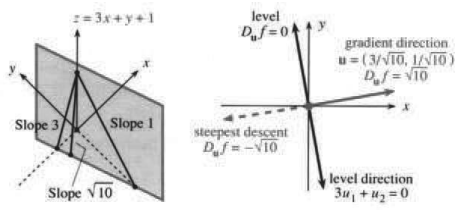
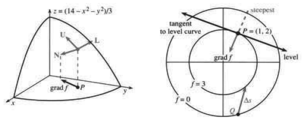
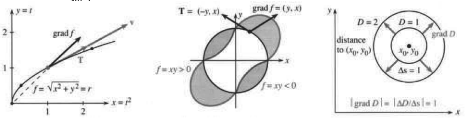
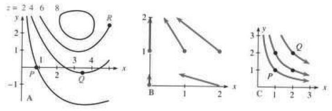

# 13.4 方向导数与梯度

原文：PDF 第 578–585 页，印刷页 565–572。状态：初译，已逐页自校，尚未复审。

<!-- PDF 578 / 印刷页 565 -->

当 $x$ 改变时，我们知道 $f(x,y)$ 怎样改变：偏导数 $\partial f/\partial x$ 把 $y$ 当作常数。同样，$\partial f/\partial y$ 保持 $x$ 不变，给出沿 $y$ 方向的斜率。但东西方向和南北方向并不是仅有的移动方向。我们也可以沿 $45^\circ$ 的直线移动，此时 $\Delta x=\Delta y$。原则上，在画出坐标轴之前，没有哪个方向受到优待。函数的图像是曲面，在各个方向都有斜率。

在这个曲面上，微积分要寻找变化率（或斜率）。无论哪个方向，都有相应的**方向导数**。在 $45^\circ$ 的情形，我们可能想用 $\Delta f$ 除以 $\Delta x$，但那是不对的。把问题说清楚：已知点 $P=(x_0,y_0)$ 附近的 $f(x,y)$，还给定方向 $\mathbf u$（一个单位向量），我们要自然地定义 $D_{\mathbf u}f$——**$f$ 沿 $\mathbf u$ 方向的导数**。为了计算 $P$ 点处这个斜率，需要一个公式，最好用已经知道的 $\partial f/\partial x,\partial f/\partial y$ 表示。

注意，$45^\circ$ 方向的单位向量是 $\mathbf u=\mathbf i/\sqrt2+\mathbf j/\sqrt2$。导数中将出现 $\sqrt2$，这说明不能用 $\Delta f$ 除以 $\Delta x$，而应除以步长 $\Delta s$。

**例 1** 保持在曲面 $z=xy$ 上。当 $(x,y)$ 从 $(1,1)$ 沿 $45^\circ$ 方向移动距离 $\Delta s$ 时，$\Delta z/\Delta s$ 是多少？

**解** 位移是单位向量 $\mathbf u$ 乘以 $\Delta s$。从 $x=y=1$ 出发，终点是 $x=y=1+\Delta s/\sqrt2$（$\mathbf u\Delta s$ 的两个分量都是 $\Delta s/\sqrt2$）。因此

$$
z=(1+\Delta s/\sqrt2)^2=1+\sqrt2\Delta s+\tfrac12(\Delta s)^2,
\qquad \Delta z=\sqrt2\Delta s+\tfrac12(\Delta s)^2.
$$

当 $\Delta s\to0$ 时，$\Delta z/\Delta s$ 趋近于 $\sqrt2$。这就是 $45^\circ$ 方向的斜率。

**定义** $f$ 在点 $P$ 沿 $\mathbf u$ 方向的导数记为 $D_{\mathbf u}f(P)$：

$$
D_{\mathbf u}f(P)=\lim_{\Delta s\to0}\frac{\Delta f}{\Delta s}
=\lim_{\Delta s\to0}\frac{f(P+\mathbf u\Delta s)-f(P)}{\Delta s}. \tag{1}
$$

从 $P=(x_0,y_0)$ 出发，步长 $\Delta s$ 把我们带到 $(x_0+u_1\Delta s,y_0+u_2\Delta s)$。算出变化 $\Delta f$，再除以 $\Delta s$ 即可。不过，下面的式 (2) 可以节省时间。

$x$ 方向对应 $\mathbf u=(1,0)$。此时 $\mathbf u\Delta s=(\Delta s,0)$，我们重新得到 $\partial f/\partial x$：

$$
\frac{\Delta f}{\Delta s}=\frac{f(x_0+\Delta s,y_0)-f(x_0,y_0)}{\Delta s}
\longrightarrow D_{(1,0)}f=\frac{\partial f}{\partial x}.
$$

同样，$\mathbf u=(0,1)$ 沿 $y$ 方向时，$D_{\mathbf u}f=\partial f/\partial y$。若 $\mathbf u=(0,-1)$ 呢？这是 $y$ 轴负方向，因此 $D_{\mathbf u}f=-\partial f/\partial y$。

## 计算方向导数

$D_{\mathbf u}f$ 是曲面 $z=f(x,y)$ 沿 $\mathbf u$ 方向的斜率。怎样计算？从两个特殊方向的偏导数 $\partial f/\partial x,\partial f/\partial y$，可以迅速求出所有方向的 $D_{\mathbf u}f$。**记住，$\mathbf u$ 是单位向量。**

**13E** 沿 $\mathbf u=(u_1,u_2)$ 方向的方向导数为

$$
D_{\mathbf u}f=\frac{\partial f}{\partial x}u_1+\frac{\partial f}{\partial y}u_2. \tag{2}
$$

<!-- PDF 579 / 印刷页 566 -->

推理回到 $\Delta f$ 的线性近似：

$$
\Delta f\approx\frac{\partial f}{\partial x}\Delta x+\frac{\partial f}{\partial y}\Delta y
=\frac{\partial f}{\partial x}u_1\Delta s+\frac{\partial f}{\partial y}u_2\Delta s.
$$

除以 $\Delta s$，再令 $\Delta s\to0$。当近似趋于精确时，式 (2) 就是 $\Delta f/\Delta s$ 的极限。更仔细的论证表明，只要 $f_x,f_y$ 在基点 $(x_0,y_0)$ 连续，就能保证这个极限。要点是：**知道两个方向的斜率，就知道所有方向的斜率。**

**例 1（再算一次）** $f=xy$，$P=(1,1)$，$\mathbf u=(1/\sqrt2,1/\sqrt2)$。求 $D_{\mathbf u}f(P)$。

偏导数 $f_x=y,f_y=x$ 在 $P$ 点均为 1。$45^\circ$ 方向的导数为

$$
D_{\mathbf u}f(P)=f_xu_1+f_yu_2=1(1/\sqrt2)+1(1/\sqrt2)=\sqrt2,
$$

与之前相同。

**例 2** 线性函数 $f=3x+y+1$ 的斜率为 $D_{\mathbf u}f=3u_1+u_2$。

$x$ 方向是 $\mathbf u=(1,0)$，因此 $D_{\mathbf u}f=3$，也就是 $\partial f/\partial x$。沿 $y$ 方向，$D_{\mathbf u}f=1$。**还有两个特殊方向：沿 $f(x,y)$ 的等高线方向，以及与它垂直的方向。**

等高方向：$D_{\mathbf u}f=0$，因为 $f$ 不变。

最陡方向：在 $u_1^2+u_2^2=1$ 的条件下，使 $D_{\mathbf u}f$ 尽可能大。

求这些方向，只需看 $D_{\mathbf u}f=3u_1+u_2$。等高方向满足 $3u_1+u_2=0$，所以 $\mathbf u$ 与 $(1,-3)$ 成比例。$x$ 改变 1、$y$ 改变 $-3$，不会改变 $f=3x+y+1$。

在最陡方向，$\mathbf u$ 与 $(3,1)$ 成比例。注意偏导数 $f_x=3,f_y=1$。$(3,1)$ 与 $(1,-3)$ 的点积为零——最陡方向垂直于等高方向。把 $(3,1)$ 除以 $\sqrt{10}$，就得到单位向量：

$$
\text{最陡上升：}\quad D_{\mathbf u}f=3(3/\sqrt{10})+1(1/\sqrt{10})=10/\sqrt{10}=\sqrt{10}.
$$

最陡下降：反向取 $\mathbf u=(-3/\sqrt{10},-1/\sqrt{10})$，则 $D_{\mathbf u}f=-\sqrt{10}$。

山上的等高线满足 $D_{\mathbf u}f=0$，溪流与等高线垂直。在 $f=3x+y+1$ 这样的平面上，这些方向在所有点都不变（图 13.12）；山地上，斜率改变时最陡方向也会改变。

图 13.12　最陡方向沿梯度方向，等高方向与它垂直。图内 Slope：斜率；level / level direction：等高方向；gradient direction：梯度方向；steepest descent：最陡下降。

<!-- PDF 580 / 印刷页 567 -->

## 梯度向量

再看方向导数 $D_{\mathbf u}f=f_xu_1+f_yu_2$。**这是两个向量的点积。** 一个是确定方向的 $\mathbf u=(u_1,u_2)$，另一个是由函数得到的 $(f_x,f_y)$。第二个向量就是**梯度**。

**定义** $f(x,y)$ 的**梯度**是以 $\partial f/\partial x,\partial f/\partial y$ 为分量的向量：

$$
\operatorname{grad}f=\nabla f=\frac{\partial f}{\partial x}\mathbf i+\frac{\partial f}{\partial y}\mathbf j
\quad\text{（三维时再加上 }\frac{\partial f}{\partial z}\mathbf k\text{）。}
$$

简洁记号 $\nabla$ 在这里读作“grad”，到了第 15 章则称为“del”。

对线性函数 $3x+y+1$，梯度是常向量 $(3,1)$，指出沿平面上升的方向。对非线性函数 $x^2+xy$，梯度是非常向量 $(2x+y,x)$。注意，$\operatorname{grad}f$ 与 $\mathbf N=(f_x,f_y,-1)$ 含有相同的两个偏导数，但梯度不是这个法向量。$\mathbf N$ 是三维向量，指离曲面 $z=f(x,y)$；**梯度向量在 $xy$ 平面内！** 梯度告诉我们曲面上哪个方向向上，但它是在下面的底平面中指出方向的。

等高线也在 $xy$ 平面内，并与梯度垂直。等高线图是登山者所见山形在底平面上的投影。向量 $\operatorname{grad}f$ 指出**上升方向**，长度 $|\operatorname{grad}f|$ 给出**陡峭程度**。

**13F** 方向导数为 $D_{\mathbf u}f=(\operatorname{grad}f)\cdot\mathbf u$。等高方向垂直于 $\operatorname{grad}f$，因为该方向上 $D_{\mathbf u}f=0$。**当 $\mathbf u$ 与 $\operatorname{grad}f$ 同向时，斜率最大。** 最大斜率是长度 $|\operatorname{grad}f|=\sqrt{f_x^2+f_y^2}$：

$$
\mathbf u=\frac{\operatorname{grad}f}{|\operatorname{grad}f|}
\quad\Longrightarrow\quad
(\operatorname{grad}f)\cdot\mathbf u=\frac{|\operatorname{grad}f|^2}{|\operatorname{grad}f|}=|\operatorname{grad}f|.
$$

例子 $f=3x+y+1$ 有 $\operatorname{grad}f=(3,1)$。最陡方向为 $\mathbf u=(3,1)/\sqrt{10}$，最大斜率为 $\sqrt{10}$，即 $|\operatorname{grad}f|=\sqrt{9+1}$。

重要的一点：**$(\operatorname{grad}f)\cdot\mathbf u$ 的最大值等于 $|\operatorname{grad}f|$。** 非线性例子中，梯度、最陡方向和斜率都会变化。但在图 13.13 中某个特定点附近，如同在任意点附近一样，线性图景会占据主导。

在 $f$ 的图像上，三个特殊向量分别是等高方向 $\mathbf L=(f_y,-f_x,0)$、上坡方向 $\mathbf U=(f_x,f_y,f_x^2+f_y^2)$ 和法向量 $\mathbf N=(f_x,f_y,-1)$。第 18 题验证它们互相垂直。

**例 3** $f(x,y)=(14-x^2-y^2)/3$ 的梯度是 $\nabla f=(-2x/3,-2y/3)$。

曲面上的法向量为 $\mathbf N=(-2x/3,-2y/3,-1)$。在点 $(1,2,3)$ 处，$\mathbf N=(-2/3,-4/3,-1)$；下面底平面的点 $(1,2)$ 处，梯度为 $(-2/3,-4/3)$。梯度的长度就是斜率 $\sqrt{20}/3$。

登山者可能不会直接沿最陡方向向上。$\sqrt{20}/3$ 的坡度相当陡，接近 150%。估计其他方向的斜率，可以测量两条等高线之间沿路径的距离。若距离 $\Delta s=3$ 对应 $\Delta f=1$，斜率约为 $1/3$。直到取 $\Delta f/\Delta s$ 的极限，即 $D_{\mathbf u}f$，这个计算才精确。

<!-- PDF 581 / 印刷页 568 -->

图 13.13　$\mathbf N$ 垂直于曲面，$\operatorname{grad}f$ 垂直于底平面中的等高线。图内 tangent to level curve：等高线的切线；steepest：最陡方向；level：等高方向。

**例 4** $f(x,y,z)=xy+yz+xz$ 的梯度有三个分量。

规律从 $f(x,y)$ 推广到 $f(x,y,z)$。梯度现在是三维向量 $(f_x,f_y,f_z)$，本例中为 $(y+z,x+z,x+y)$。若要画出 $w=f(x,y,z)$ 的图像，需要一幅四维图，坐标轴沿 $x,y,z,w$ 方向。

注意维数：图像是四维空间中的三维“曲面”，梯度在下面的三维底空间内。$f$ 的等值集由 $xy+yz+zx=c$ 给出，它们是二维的。梯度垂直于这个等值集（仍在三维空间内）。梯度不是 $\mathbf N$！法向量是 $(f_x,f_y,f_z,-1)$，垂直于四维空间中的函数图像。

**例 5** $z(x,y)$ 由 $F(x,y,z)=x^2+y^2-z^2=0$ 隐式给出，求 $\operatorname{grad}z$。

此时可以解出 $z=\pm\sqrt{x^2+y^2}$，偏导数为 $\pm x/\sqrt{x^2+y^2}$ 和 $\pm y/\sqrt{x^2+y^2}$，它们组成 $\operatorname{grad}z$。但重点在于：要更快求出梯度，只需按原样对 $F(x,y,z)$ 求微分，再除以 $F_z$：

$$
F_x\,dx+F_y\,dy+F_z\,dz=0,\qquad
\text{即 }dz=\frac{-F_x\,dx-F_y\,dy}{F_z}. \tag{3}
$$

**梯度为 $(-F_x/F_z,-F_y/F_z)$。** 这些导数在所考察的点求值。计算不需要显式函数 $z=f(x,y)$：

$$
F=x^2+y^2-z^2\Longrightarrow F_x=2x,F_y=2y,F_z=-2z
\Longrightarrow\operatorname{grad}z=(x/z,y/z).
$$

在圆锥面上向上走，就沿 $(x/z,y/z)$ 方向移动。在上半锥面，这个梯度方向沿径向向外。圆锥的陡峭程度就是梯度向量的长度：

$$
|\operatorname{grad}z|=\sqrt{(x/z)^2+(y/z)^2}=1,
\quad\text{因为圆锥上 }z^2=x^2+y^2.
$$

## 沿曲线路径的导数

沿直线路径，$f$ 的导数是 $D_{\mathbf u}f=(\operatorname{grad}f)\cdot\mathbf u$。沿曲线路径又怎样？**路径的方向 $\mathbf u$ 就是切向量 $\mathbf T$。** 因而把 $\mathbf u$ 换成给出曲线方向的 $\mathbf T$。

路径由位置向量 $\mathbf R(t)=x(t)\mathbf i+y(t)\mathbf j$ 给出，速度为 $\mathbf v=(dx/dt)\mathbf i+(dy/dt)\mathbf j$，单位切向量为 $\mathbf T=\mathbf v/|\mathbf v|$。注意，这里可以选择——

<!-- PDF 582 / 印刷页 569 -->

——以任意速率运动（用 $\mathbf v$），或以单位速率运动（用 $\mathbf T$）。沿这条曲线求 $f(x,y)$ 的导数时，也有同样的选择：

$$
\text{变化率：}\quad \frac{df}{dt}=(\operatorname{grad}f)\cdot\mathbf v
=\frac{\partial f}{\partial x}\frac{dx}{dt}+\frac{\partial f}{\partial y}\frac{dy}{dt}, \tag{4}
$$

$$
\text{斜率：}\quad \frac{df}{ds}=(\operatorname{grad}f)\cdot\mathbf T
=\frac{\partial f}{\partial x}\frac{dx}{ds}+\frac{\partial f}{\partial y}\frac{dy}{ds}. \tag{5}
$$

第一个涉及**时间**。走得更快，$f$ 随时间的变化也更快。第二个涉及**距离**。不论速率如何，走过距离 $ds$，函数就改变 $df$，所以该方向的斜率为 $df/ds$。第 1 章把速度写成 $df/dt$，斜率写成 $dy/dx$，并交织讨论。现在终于看清两者的区别。匀速直线运动有 $\mathbf R=\mathbf R_0+\mathbf vt$，速度 $\mathbf v$ 为常量，方向 $\mathbf T=\mathbf u=\mathbf v/|\mathbf v|$ 也为常量。方向导数是 $(\operatorname{grad}f)\cdot\mathbf u$，而随时间的变化率是 $(\operatorname{grad}f)\cdot\mathbf v$。

式 (4)、(5) 看起来像链式法则，它们确实就是。下一节将把 $df/dt=(df/dx)(dx/dt)$ 推广到更多变量，并证明这两个公式。这里着重说明含义：**$df/ds$ 是沿曲线的方向 $\mathbf u=\mathbf T$ 上，$f$ 的导数。**

**例 7** 对 $f=r$，沿图 13.14a 的曲线 $x=t^2,y=t$，求 $df/dt$ 和 $df/ds$。

**解** 沿曲线的速度为 $\mathbf v=2t\mathbf i+\mathbf j$。取代表性时刻 $t=1$，有 $\mathbf v=2\mathbf i+\mathbf j$，单位切向量为 $\mathbf T=\mathbf v/\sqrt5$。当 $f(x,y)$ 是到中心的距离 $r$ 时，该点的梯度是向外的单位向量 $\mathbf i/\sqrt2+\mathbf j/\sqrt2$。与 $\mathbf v$ 的点积给出 $df/dt=3/\sqrt2$，与 $\mathbf T$ 的点积给出 $df/ds=3/\sqrt{10}$。

当速率降为 1（用 $\mathbf T$）时，$f(x,y)$ 的变化也慢下来。

**例 8** 对 $f=xy$，沿圆形路径 $x=\cos t,y=\sin t$ 求 $df/ds$。

先直接计算。圆上 $xy=(\cos t)(\sin t)$，由乘积法则，$df/dt=\cos^2t-\sin^2t$。通常这不同于 $df/ds$，因为时间 $t$ 不一定等于弧长 $s$；还要除以速率因子 $ds/dt$。但这里速率为 1（到 $t=2\pi$ 时，恰好走完周长为 $s=2\pi$ 的圆），所以图 13.14 中过山车轨道的斜率 $df/ds$ 为 $\cos^2t-\sin^2t$。

图 13.14　距离 $f=r$ 沿曲线改变；过山车的斜率为 $(\operatorname{grad}f)\cdot\mathbf T$；到 $(x_0,y_0)$ 的距离 $D$ 的梯度是单位向量。图内 distance to $(x_0,y_0)$：到该点的距离。

第二种方法用 $\operatorname{grad}f$ 和 $\mathbf T$。$f=xy$ 的梯度为 $(y,x)=(\sin t,\cos t)$，路径的单位切向量为 $\mathbf T=(-\sin t,\cos t)$。它们的——

<!-- PDF 583 / 印刷页 570 -->

——点积给出相同的 $df/ds$：

$$
\text{沿路径的斜率}=(\operatorname{grad}f)\cdot\mathbf T=-\sin^2t+\cos^2t.
$$

## 不依赖坐标的梯度

本节以一点“哲学”结束。梯度的不依赖坐标的定义是什么？到目前为止，$\operatorname{grad}f=(f_x,f_y)$ 完全依赖 $x,y$ 轴的选择。但曲面的陡峭程度与坐标轴无关，坐标轴是后来为了计算方便才添加的。

陡峭程度 $df/ds$ 只涉及 $f$ 和方向，没有其他因素。梯度应该是一种“张量”：它的意义不依赖坐标系。在不同坐标系（$xy$、$r\theta$ 等）中，梯度有不同的表达式，但 $\operatorname{grad}f$ 的方向和长度由 $df/ds$ 决定，不需要任何坐标轴：

$\operatorname{grad}f$ 的方向，是使 $df/ds$ 最大的方向。

长度 $|\operatorname{grad}f|$，就是这个最大斜率。

关键关系是：**$f$ 的变化 $\approx$ $f$ 的梯度 $\cdot$ 位置的变化**。这是 $\Delta f\approx f_x\Delta x+f_y\Delta y$ 的另一种写法，也是基本线性近似 $\Delta y\approx(dy/dx)\Delta x$ 的多变量形式；这里用了两个变量。

**例 9** $D(x,y)$ 是从 $(x,y)$ 到 $(x_0,y_0)$ 的距离。不用求导，证明 $|\operatorname{grad}D|=1$。$D(x,y)$ 的图像是斜率为 1、在 $(x_0,y_0)$ 上方有尖点的圆锥面。

**第一个问题** 沿哪个方向，距离 $D(x,y)$ 增加最快？

**回答** 沿直接远离 $(x_0,y_0)$ 的方向。因此这就是 $\operatorname{grad}D$ 的方向。

**第二个问题** 沿这个最陡方向，$D$ 增加得多快？

**回答** 迈出长度为 $\Delta s$ 的一步，$D$ 就增加 $\Delta s$，所以 $|\operatorname{grad}D|=\Delta s/\Delta s=1$。

**结论** $\operatorname{grad}D$ 是单位向量。第 48 题中，$D$ 的偏导数是 $(x-x_0)/D$ 和 $(y-y_0)/D$；它们的平方和为 1，因为 $(x-x_0)^2+(y-y_0)^2=D^2$。

## 13.4 习题

### 阅读填空

$D_{\mathbf u}f$ 给出 (a) ______ 沿方向 (b) ______ 的变化率。它可以由两个特殊方向 (d) ______ 上的两个偏导数 (c) ______ 算出。用 $u_1,u_2$ 表示，公式为 $D_{\mathbf u}f=$ (e) ______。这是 $\mathbf u$ 与向量 (g) ______ 的 (f) ______ 积；该向量称为 (h) ______。对线性函数 $f=ax+by$，梯度是 $\operatorname{grad}f=$ (i) ______，方向导数是 $D_{\mathbf u}f=$ (j) ______ $\cdot$ (k) ______。

梯度 $\nabla f=(f_x,f_y)$ 不是 (l) ______ 维向量，而是 (m) ______ 内的向量。它垂直于 (n) ______ 线，指向 (o) ______ 上升方向，其大小 $|\operatorname{grad}f|$ 为 (p) ______。对 $f=x^2+y^2$，梯度指向 (q) ______，沿这个最陡方向的斜率为 (r) ______。

$f(x,y,z)$ 的梯度是 (s) ______。这不同于由曲面 $F(x,y,z)=0$ 隐式确定的高度函数 $z(x,y)$ 的梯度，后者为 $-(F_x/F_z)\mathbf i+$ (t) ______。沿曲线路径以速度 $\mathbf v$ 运动时，$f$ 的变化率是 $df/dt=$ (u) ______。切线方向为 $\mathbf T$ 时，$f$ 的斜率为 $df/ds=$ (v) ______。沿直线方向 $\mathbf u$，$df/ds$ 与 (w) ______ 相同。

<!-- PDF 584 / 印刷页 571 -->

先计算 $\operatorname{grad}f$，再计算 $D_{\mathbf u}f=(\operatorname{grad}f)\cdot\mathbf u$，最后求 $P$ 点处的 $D_{\mathbf u}f$。

1. $f(x,y)=x^2-y^2$，$\mathbf u=(\sqrt3/2,1/2)$，$P=(1,0)$。
2. $f(x,y)=3x+4y+7$，$\mathbf u=(3/5,4/5)$，$P=(0,\pi/2)$。
3. $f(x,y)=e^x\cos y$，$\mathbf u=(0,1)$，$P=(0,\pi/2)$。
4. $f(x,y)=y^{10}$，$\mathbf u=(0,-1)$，$P=(1,-1)$。
5. $f(x,y)$ 为到 $(0,3)$ 的距离，$\mathbf u=(1,0)$，$P=(1,1)$。

第 6–8 题来自物理学，求 $\operatorname{grad}f=(f_x,f_y,f_z)$。

6. $1/\sqrt{x^2+y^2+z^2}$（位于原点的点源）。
7. $\ln(x^2+y^2)$（沿 $z$ 轴的线源）。
8. $1/\sqrt{(x-1)^2+y^2+z^2}-1/\sqrt{(x+1)^2+y^2+z^2}$（偶极子）。
9. 对 $f=3x^2+2y^2$，求 $(1,2)$ 处的最陡方向和等高方向，并计算这些方向上的 $D_{\mathbf u}f$。
10. 例 2 称 $f=3x+y+1$ 的最大斜率为 $\sqrt{10}$。求 $D_{\mathbf u}f=3u_1+u_2=3u_1+\sqrt{1-u_1^2}$ 的最大值。
11. 当 $f(x,y)$ 是任意光滑函数时，判断正误：(a) 存在方向 $\mathbf u$，使 $P$ 点处的 $D_{\mathbf u}f=0$；(b) 存在方向 $\mathbf u$，使 $D_{\mathbf u}f=\operatorname{grad}f$；(c) 存在方向 $\mathbf u$，使 $D_{\mathbf u}f=1$；(d) $f(x)g(x)$ 的梯度等于 $g\operatorname{grad}f+f\operatorname{grad}g$。
12. $f(x)$ 的梯度是什么（只有一个分量）？两个可能的方向 $\mathbf u$ 和相应的 $D_{\mathbf u}f$ 是什么？曲线 $y=f(x)$ 的法向量 $\mathbf N$ 是什么（两个分量）？

第 13–16 题：在 $P=(1,2)$ 处，求 $f$ 增加最快的方向 $\mathbf u$。增加得多快？

13. $f(x,y)=ax+by$。
14. $f(x,y)$ 为 $2x$ 和 $y$ 中较小者。
15. $f(x,y)=e^{x-y}$。
16. $f(x,y)=\sqrt{5-x^2-y^2}$（小心）。
17. （预览后文）在 $f(x,y)$ 取得极大值的点，$\operatorname{grad}f$ 是多少？描述包含该极大值点 $(x,y)$ 的等高线。
18. (a) 用点积检验图像上的法向、上坡和等高方向互相垂直：$\mathbf N=(f_x,f_y,-1)$，$\mathbf U=(f_x,f_y,f_x^2+f_y^2)$，$\mathbf L=(f_y,-f_x,0)$。(b) $\mathbf N$ 与切平面 ______，$\mathbf U,\mathbf L$ 与切平面 ______。(c) 梯度是 ______ 在 $xy$ 平面上的投影，也是 ______ 的投影。$\mathbf L$ 的投影沿着 ______。
19. 对 $f=1-x+y$，计算 $\mathbf N,\mathbf U,\mathbf L$，并在这个平面上的一点把它们画出来。
20. 对 $x^2+y^2-z^2=0$，计算 $\mathbf N,\mathbf U,\mathbf L$，并在圆锥面的一般点把它们画出来。

重力沿 $z$ 轴负方向时，第 21–24 题屋顶上的水会沿哪个 $-\mathbf U$ 方向流下？

21. $z=2x$（平面屋顶）。
22. $z=4x-3y$（平面屋顶）。
23. $z=\sqrt{1-x^2-y^2}$（球面）。
24. $z=-\sqrt{x^2+y^2}$（圆锥面）。
25. 选两个只依赖 $x+2y$ 的函数 $f(x,y)$。它们在 $(1,1)$ 处的梯度沿 ______ 方向，等高线是 ______。
26. $f=y/x$ 经过 $(1,1)$ 的等高线为 ______。梯度方向必为 ______。计算 $\operatorname{grad}f$ 核对。
27. $\operatorname{grad}f$ 垂直于 $2\mathbf i+\mathbf j$，长度为 1；$\operatorname{grad}g$ 平行于 $2\mathbf i+\mathbf j$，长度为 5。求 $\operatorname{grad}f,\operatorname{grad}g,f,g$。
28. 判断正误：(a) 知道 $\operatorname{grad}f$ 就知道 $f$；(b) 直线 $x=y=-z$ 垂直于平面 $z=x+y$；(c) $z=x+y$ 的梯度沿这条直线。
29. 写出 $\theta=\tan^{-1}(y/x)$ 在点 $(3,4)$ 处的等高方向 $\mathbf u$，再求 $\operatorname{grad}\theta$，验证 $D_{\mathbf u}\theta=0$。
30. 绕原点的圆上，路程为 $\Delta s=r\Delta\theta$，所以 $d\theta/ds=1/r$。计算 $\operatorname{grad}\theta,\mathbf T$ 和 $(\operatorname{grad}\theta)\cdot\mathbf T$，验证这个结论。
31. 在山面 $z=9-x-y^2$ 上的点 $(2,1,6)$，哪个方向向上？在屋顶 $z=x+2y+2$ 上，哪个方向向下？这个屋顶与山面 ______。
32. 在点 $(1,-2)$ 附近，温度 $T=e^{-x^2-y^2}$ 满足 $\Delta T\approx$ ______ $\Delta x+$ ______ $\Delta y$。沿哪个方向 $\mathbf u$ 升温最快？
33. 图 A 给出 $z=f(x,y)$ 的等高线。(a) 估计 $P,Q,R$ 处梯度的方向和长度；(b) 找出梯度平行于 $\mathbf i+\mathbf j$ 的两个点；(c) 哪里 $|\operatorname{grad}f|$ 最大？哪里最小？(d) 估计图中的 $z_{\max}$；(e) 沿从 $P$ 到 $R$ 的直线描述 $z$ 的变化，并估计其最大值。

<!-- PDF 585 / 印刷页 572 -->

第 33–37 题附图：A 为等高线，B 为梯度向量，C 为双曲线。

34. 二次函数 $ax^2+by^2+cx+dy$ 的梯度如图 B 所示。估计 $a,b,c,d$，并画出两条等高线。
35. $f(x,y)$ 的等高线是以 $(1,1)$ 为中心的圆，曲线 $f=c$ 的半径为 $2c$。$f$ 是什么？$(0,0)$ 处的 $\operatorname{grad}f$ 是什么？
36. 设 $\operatorname{grad}f$ 与图 C 中的双曲线 $xy=\text{常数}$ 相切。画出 $f(x,y)$ 的三条等高线。$|\operatorname{grad}f|$ 在 $P$ 还是 $Q$ 较大？沿这些双曲线，$|\operatorname{grad}f|$ 是否不变？从 $x^2+y^2,x^2-y^2,xy,x^2y^2$ 中选一个可能的 $f$。
37. 若 $\operatorname{grad}f$ 与图 C 的双曲线垂直，重做第 36 题。
38. 若 $f$ 在 $(0,1),(1,0),(2,1)$ 处分别为 $0,1,2$，假定 $f=Ax+By+C$，估计 $\operatorname{grad}f$。
39. 哪些函数具有下列梯度？(a) $(2x+y,x)$；(b) $(e^{x-y},-e^{x-y})$；(c) $(y,-x)$（小心）。
40. 若 $\operatorname{grad}f=(y,x)$，画出 $f(x,y)$ 的等高线。

第 41–46 题：求速度 $\mathbf v$ 和单位切向量 $\mathbf T$，再计算变化率 $df/dt=\operatorname{grad}f\cdot\mathbf v$ 与斜率 $df/ds=\operatorname{grad}f\cdot\mathbf T$。

41. $f=x^2+y^2$，$x=t,y=t^2$。
42. $f=x$，$x=\cos2t,y=\sin2t$。
43. $f=x^2-y^2$，$x=x_0+2t,y=y_0+3t$。
44. $f=xy$，$x=t^2+1,y=3$。
45. $f=\ln xyz$，$x=e^t,y=e^{2t},z=e^{-t}$。
46. $f=2x^2+3y^2+z^2$，$x=t,y=t^2,z=t^3$。
47. (a) 对过山车函数 $f=xy$，沿路径 $x=\cos2t,y=\sin2t$ 求 $df/ds,df/dt$；(b) 改为 $f=x^2+y^2$，解释为什么斜率为零。
48. 从 $(x,y)$ 到 $(1,2)$ 的距离 $D$ 满足 $D^2=(x-1)^2+(y-2)^2$。证明 $\partial D/\partial x=(x-1)/D$、$\partial D/\partial y=(y-2)/D$，且 $|\operatorname{grad}D|=1$。$D(x,y)$ 的图像是 ______，顶点位于 ______。
49. 若点 $(4,5)$ 处 $f=1$、$\operatorname{grad}f=(2,3)$，求该处的切平面。若 $f$ 为线性函数，求 $f(x,y)$。
50. 定义 $f(x,y)$ 在点 $P=(x_0,y_0)$ 沿 $\mathbf u=(u_1,u_2)$ 方向的导数。$\Delta f$ 的近似表达式是什么？$D_{\mathbf u}f$ 的精确表达式是什么？
51. $f$ 沿等高线的斜率为 $df/ds=$ ______ $=0$。这表明 $\operatorname{grad}f$ 垂直于等高方向的向量 ______。

## 译注与待复审事项

- 原页开头把 $45^\circ$ 单位向量写为 $\mathbf i/2+\mathbf j/2$，但该向量长度不为 1，且与紧随的例 1 不符。已改为 $\mathbf i/\sqrt2+\mathbf j/\sqrt2$。
- 本节采用 $\Delta s\to0$ 的双侧方向导数定义，此时 $\Delta s$ 是有符号参数，实际位移长度为 $|\Delta s|$。13E 需要可微性，正文给出偏导连续这一充分条件；不能仅由偏导存在推出所有方向的公式。13F 归一化梯度需梯度非零；梯度为零时所有方向导数均为零，不能指定唯一最陡方向。
- 例 5 原文说导数在 $(x_0,y_0)$ 求值，严格说 $F_x,F_y,F_z$ 应在 $(x_0,y_0,z_0)$ 求值；译文用“所考察的点”避免漏坐标。原文对双锥面统称梯度“径向向外”，只适用于上半锥面；下半锥面上坡向内，已在正文注明上半锥面。除以 $F_z$ 的推导排除锥顶。
- 原书例号从 5 直接跳到 7，译文保留。例 7 给出的数值均在 $t=1$。沿曲线的 $s$ 是自变量空间中的路径弧长，并不是函数图像上空间曲线的弧长；坡度与爬升角不能混同。$\mathbf T=\mathbf v/|\mathbf v|$ 要求速度非零，第 44 题 $t=0$ 需单独处理。
- 例 9 与第 48 题的单位梯度结论均排除距离为零的中心点。第 17 题的零梯度必要条件要求可微且极值点为定义域内点；等高集未必是一条普通光滑曲线。第 14、16 题涉及不可微或边界情况，按原题保留，不能机械套公式。
- 第 25 题的梯度可以是零或反向，具体取决于所选一元外函数导数。第 31 题给出的屋顶与山面在指定点的梯度互为相反数，不能直接填成“相切”；保留待核对。第 36、37 题仅有梯度方向信息不足以唯一决定长度比较，需结合所选函数理解。
- 已核对 8 页、图 13.12–13.14、习题图 A–C 和全部 51 道编号习题；未独立复审。
