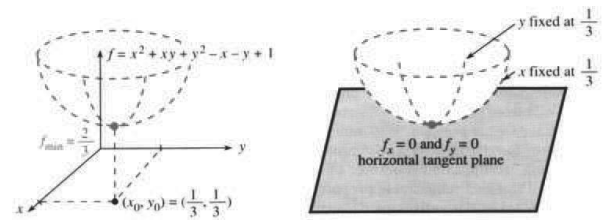
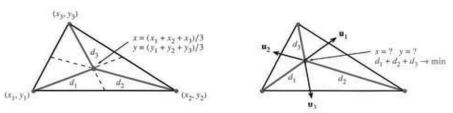
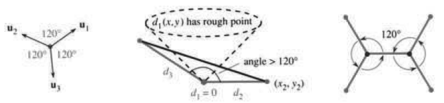
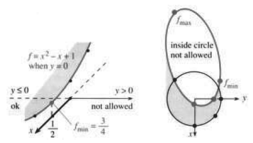
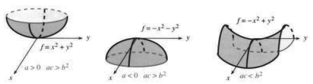

# 13.6 极大值、极小值与鞍点

原文：PDF 第 594–603 页，印刷页 581–590。状态：初译，已逐页自校，尚未复审。

<!-- PDF 594 / 印刷页 581 -->

微分学中最突出的方程也是最简单的：$df/dx=0$。斜率为零，切线水平。此时很可能位于图像的顶端或底端——极大值或极小值处。这正是工程师、管理人员、科学家或投资者要寻找的点：最大的应力、产量、速度或利润。$f(x,y)$、$f(x,y,z)$ 里的变量一多，问题就更符合实际。问题仍然是：**怎样确定最大值和最小值的位置？**

答案在偏导数中。图像水平时，偏导数为零。推导 $f_x=0,f_y=0$ 是纯粹的数学，也充满乐趣；应用它们则需要认真对待。要小心鞍点，也要注意边界点处的最小值——这一节需要多花些时间。回顾一元微积分求 $f(x)$ 极值的步骤：

1. 主要候选点是**驻点**，即 $df/dx=0$ 的点。
2. 其他候选点是**不光滑点**（导数不存在）和**端点**（$a$ 或 $b$）。
3. 利用**二阶导数**的符号区分极大值和极小值。

在二维情形，驻点要求 $\partial f/\partial x=0$ 且 $\partial f/\partial y=0$。切线变成切平面，端点 $a,b$ 变成边界曲线。实际应用中，大约 40% 的最小值和 80% 的工作量落在边界上。

最后有三个二阶导数 $f_{xx},f_{xy},f_{yy}$。它们告诉我们图像怎样偏离切平面而弯曲：在极小值处向上，在极大值处向下，在鞍点处有的方向向上、有的向下。这取决于 $(f_{xx})(f_{yy})$ 与 $(f_{xy})^2$ 的比较。

## 驻点 → 水平切面 → 导数为零

假设 $f$ 在 $(x_0,y_0)$ 取得极小值。它可能是绝对最小值，也可能只是局部极小值。无论哪种情况，在该点附近都有 $f(x_0,y_0)\le f(x,y)$。对于绝对最小值，这个不等式在 $f$ 定义的所有地方都成立；对于局部极小值，远离 $(x_0,y_0)$ 后不等式可能不成立。你的脚底是绝对最低处，指尖可能是局部最低处。目前假定 $(x_0,y_0)$ 是 $f$ 定义域的**内点**；在边界点不能期待切平面水平、导数为零。

主要结论：在极小值或极大值处（绝对的或局部的），导数不可能非零。否则切平面会倾斜，$f$ 会沿某个方向减小。注意，极小值**点**是 $(x_0,y_0)$，极小**值**是 $f(x_0,y_0)$。

> **13J** 如果内点处取得极小值或极大值，而且偏导数存在，那么偏导数为零：
> $$\partial f/\partial x=0,\qquad\partial f/\partial y=0
> \quad\text{（合起来即 }\operatorname{grad}f=0\text{）。}\tag{1}$$
> 对于三元函数 $f(x,y,z)$，再加上第三个方程 $\partial f/\partial z=0$。

理由可以归结到一元情形，因为我们沿直线 $x=x_0$ 和 $y=y_0$ 考察。$f(x,y)$ 的极小值在两条直线的交点取得，所以单独沿每一条直线看，它也是极小值。

沿 $y=y_0$ 朝 $x$ 方向移动，得到 $\partial f/\partial x=0$；沿 $y$ 方向移动，在同一点得到 $\partial f/\partial y=0$。每个方向上的斜率都为零，换言之 $\operatorname{grad}f=0$。

<!-- PDF 595 / 印刷页 582 -->

从图形看，$(x_0,y_0)$ 是曲面 $z=f(x,y)$ 的最低点。图 13.16 的两个截面都在这里触底。“如果导数存在”排除了圆锥顶点这种不光滑点。绝对值函数 $f=|x|$ 在极小值处没有 $df/dx=0$；距离函数 $f=r$ 也是如此。不光滑点是 $(0,0)$。

**图 13.16** 极小值处 $\partial f/\partial x=0$ 且 $\partial f/\partial y=0$。二次函数 $f$ 的导数是线性的。右图分别固定 $y=1/3$ 与 $x=1/3$，切平面水平。

**例 1** 求二次函数 $f(x,y)=x^2+xy+y^2-x-y+1$ 的最小值。

为确定极小值（或极大值）的位置，令 $f_x=0,f_y=0$：

$$f_x=2x+y-1=0,\qquad f_y=x+2y-1=0.\tag{2}$$

关键在于：**两个方程对应两个未知数 $x,y$。** 因为 $f$ 是二次函数，方程是线性的，解为 $x_0=1/3,y_0=1/3$（驻点）。这实际上是极小值点，但要证明它还需往下读。

常数 $1$ 影响最小值 $f=2/3$，却不影响最小值点。它使图像向上平移 $1$。一次项 $-x-y$ 影响 $f_x,f_y$，使最小值点离开 $(0,0)$。二次部分 $x^2+xy+y^2$ 使曲面向上弯曲。没有这个弯曲部分，平面的最大值和最小值就要到边界点寻找。

**例 2（施泰纳问题）** 找出离三个给定点最近的点。

这个例子值得注意。我们要在靠近三个城市的地方建机场，或者选择靠近三个工作地点的住宅。问题是尽量接近一个三角形的三个顶点。最佳点取决于“近”的含义。

到第一个顶点 $(x_1,y_1)$ 的距离是 $d_1=\sqrt{(x-x_1)^2+(y-y_1)^2}$。到另外两个顶点 $(x_2,y_2),(x_3,y_3)$ 的距离分别为 $d_2,d_3$。费用若等于距离、距离平方或距离的 $p$ 次方，就分别要求：

$$\text{最小化 }d_1+d_2+d_3,\quad d_1^2+d_2^2+d_3^2,
\quad\text{或 }d_1^p+d_2^p+d_3^p.$$

第二个问题最容易，因为 $d_1^2,d_2^2,d_3^2$ 都是二次式：

$$\begin{aligned}
f(x,y)&=(x-x_1)^2+(y-y_1)^2+(x-x_2)^2+(y-y_2)^2+(x-x_3)^2+(y-y_3)^2,\\
\partial f/\partial x&=2[x-x_1+x-x_2+x-x_3]=0,\\
\partial f/\partial y&=2[y-y_1+y-y_2+y-y_3]=0.
\end{aligned}$$

解 $\partial f/\partial x=0$ 得 $x=(x_1+x_2+x_3)/3$，解 $\partial f/\partial y=0$ 得 $y=(y_1+y_2+y_3)/3$。最佳点是**三角形的重心**（图 13.17a）。

<!-- PDF 596 / 印刷页 583 -->

当费用等于距离平方时，重心就是离各顶点最近的点。注意，平方使导数成为线性函数。应用数学的很大一部分，都由最小二乘法主导。

**图 13.17** 重心使 $d_1^2+d_2^2+d_3^2$ 最小；施泰纳点使 $d_1+d_2+d_3$ 最小。

真正的“施泰纳问题”是最小化 $f(x,y)=d_1+d_2+d_3$。我们从各顶点修路，费用与长度成正比。因为有平方根，方程 $f_x=0,f_y=0$ 看起来很复杂。但图 13.17b 中的最近点有一个很妙的性质。

对 $d_1^2=(x-x_1)^2+(y-y_1)^2$ 关于 $x$ 求导，得到 $2d_1(\partial d_1/\partial x)=2(x-x_1)$。两边除以 $2d_1$：

$$\frac{\partial d_1}{\partial x}=\frac{x-x_1}{d_1},\qquad
\frac{\partial d_1}{\partial y}=\frac{y-y_1}{d_1},\qquad
\operatorname{grad}d_1=\left(\frac{x-x_1}{d_1},\frac{y-y_1}{d_1}\right).\tag{3}$$

**这个梯度是单位向量。** $(x-x_1)^2/d_1^2$ 与 $(y-y_1)^2/d_1^2$ 之和为 $d_1^2/d_1^2=1$。第 13.4 节已讨论过：离开中心时，距离以斜率 $1$ 增大。$d_1$ 的梯度（记为 $\mathbf u_1$）是从中心点 $(x_1,y_1)$ 指向外的单位向量。

同理，$d_2,d_3$ 的梯度是单位向量 $\mathbf u_2,\mathbf u_3$，分别从三角形的另外两个顶点直接朝外指。总费用是 $f=d_1+d_2+d_3$，所以把梯度相加。方程 $f_x=0,f_y=0$ 合成一个向量方程：

$$\operatorname{grad}f=\mathbf u_1+\mathbf u_2+\mathbf u_3=\mathbf0
\qquad\text{（在极小值处）。}$$

**三个单位向量的和为零！** 离开一个顶点会使我们靠近另一个顶点。离三个顶点最近的点，就是这些移动彼此抵消的地方。这就是“极小值处 $\operatorname{grad}f=0$”的含义。

三个单位向量相加为零并不常见，而且只能以一种方式发生：**三个方向两两夹角必须为 $120^\circ$。** 最佳点具有这一性质，图 13.18a 再次画出了它。单位向量相互抵消。在“施泰纳点”，通向各顶点的道路夹角为 $120^\circ$。这个最优点解决了问题，但还有另一种可能。

<!-- PDF 597 / 印刷页 584 -->

**图 13.18** 夹角为 $120^\circ$ 时，梯度满足 $\mathbf u_1+\mathbf u_2+\mathbf u_3=0$。若一个顶角很大，则该顶点最优。四个顶点时，图示情形采用两个分支点更好，交角仍为 $120^\circ$。中图距离函数在顶点不光滑。

另一种可能是最小值发生在**不光滑点**。距离函数 $d_1(x,y)$ 的图像是圆锥，在中心 $(x_1,y_1)$ 有尖点。三角形的三个顶点都是 $d_1+d_2+d_3$ 的不光滑点，因而都是可能的最小值点。

**假设某个顶角超过 $120^\circ$。** 那么就没有内部施泰纳点。在三角形内部看该顶点所对的两点，相关角度会更大。最佳点必须是不光滑点，也就是某个顶点；胜出的是那个大角的顶点。图中这意味着 $d_1=0$，此时 $d_2+d_3$ 就是两条较短边的长度之和。

**小结** 解在一个 $120^\circ$ 交角点或一个大角顶点。这是理论；真正的问题是计算施泰纳点，希望你能动手做。

**说明 1** 四个点的施泰纳问题颇出人意料。我们并非最小化 $d_1+d_2+d_3+d_4$，而是研究更好的问题：用道路连接四点，使总长度最小，并且**允许道路分支**。图 13.18c 给出一种典型解。分支点处的夹角是 $120^\circ$，分支点至多有两个（比顶点数少两个）。

**说明 2** 对于其他幂次 $p$，费用为 $d_1^p+d_2^p+d_3^p$。关于 $x$ 的偏导数为

$$\frac{\partial f}{\partial x}
=pd_1^{p-2}(x-x_1)+pd_2^{p-2}(x-x_2)+pd_3^{p-2}(x-x_3).\tag{4}$$

关键方程仍是 $\partial f/\partial x=0,\partial f/\partial y=0$。解它们需要计算机和算法。为了公平分工，我提供算法（牛顿法），你提供计算机。认真地说，这个例子非常好：它代表实际问题中常见的情况——知道 $\partial f/\partial x,\partial f/\partial y$，却不知道它们在哪一点为零。你可以计算这个最近点，它随 $p$ 改变而移动；还可以发现新数学：这个最近点究竟怎样移动。我会收集读者寄来的第 38、39 题的所有结果。

## 边界上的最小值或最大值

施泰纳问题没有边界，道路可以通向任何地方。但大多数应用会限制 $x,y$，例如 $x\ge0$、$y\le0$ 或 $x^2+y^2\ge1$。在这些约束下，最小值很可能高于无约束的绝对最小值。有三种可能：

$$\text{(1) 驻点 }f_x=0,f_y=0;\qquad
\text{(2) 不光滑点};\qquad\text{(3) 边界点}.$$

第三种可能要求沿边界最大化或最小化 $f(x,y)$。

<!-- PDF 598 / 印刷页 585 -->

**例 3** 在半平面 $x\ge0$ 内最小化 $f=x^2+xy+y^2-x-y+1$。

例 1 的最小值为 $2/3$，在 $x_0=y_0=1/3$ 取得。这个点仍然允许，因为它满足 $x\ge0$，所以最小值的位置不变。

**例 4** 把同一个 $f$ 限制在下半平面 $y\le0$ 内，求最小值。

现在绝对最小值点 $(1/3,1/3)$ 不允许，又没有不光滑点。我们在图 13.19a 的边界直线 $y=0$ 上寻找。令 $y=0$，$f$ 就只依赖 $x$，再选取最佳 $x$：

$$f(x,0)=x^2+0-x-0+1,\qquad f_x=2x-1=0.$$

最小值在 $x=1/2,y=0$ 取得，值为 $f=3/4$，比原来的 $2/3$ 增大了。

**图 13.19** 边界 $y=0$ 和 $x^2+y^2=1$ 上包含最小值点。左图允许 $y\le0$；右图不允许圆内部。

**例 5** 在圆 $x^2+y^2=1$ 上及其外部最小化同一个 $f(x,y)$。

一种可能是 $f_x=f_y=0$，可它落在圆内的 $(1/3,1/3)$。另一种可能是最小值在边界点，即圆上取得。

沿边界可以令 $y=\sqrt{1-x^2}$。这样 $f$ 变得复杂，$df/dx$ 更复杂。有一种避开平方根的方法：令 $x=\cos t,y=\sin t$。于是 $f=x^2+xy+y^2-x-y+1$ 成为角度 $t$ 的函数：

$$\begin{aligned}
f(t)&=1+\cos t\sin t-\cos t-\sin t+1,\\
\frac{df}{dt}&=\cos^2t-\sin^2t+\sin t-\cos t\\
&=(\cos t-\sin t)(\cos t+\sin t-1).
\end{aligned}$$

现在 $df/dt=0$ 确定沿边界的极小值或极大值位置。第一因子在 $x=y$ 时为零；第二因子在 $\cos t+\sin t=1$，即 $x+y=1$ 时为零。圆上满足这些关系的点都是候选点。第 24 题会将它们分辨清楚，第 13.7 节则用“拉格朗日乘子”以新方法求最小值。在边界上求最小值是个重要问题，而且很快会变难；乘子法最终是最好的办法。

## 极大值、极小值与鞍点的区分

怎样区分极大值和极小值？如果可行，就试遍所有候选点再判断：计算各驻点及其他临界点处的 $f$（也许还要考察无穷远处），然后比较。微积分提供了另一种基于二阶导数的方法。

<!-- PDF 599 / 印刷页 586 -->

一元情形的二阶导数判别法很简单：$f_{xx}>0$ 对应极小值，$f_{xx}<0$ 对应极大值；拐点处可能有 $f_{xx}=0$。这是局部判别，未必给出全局答案，但它能判断斜率是在增大（图像底部）还是减小（图像顶部）。现在寻找 $f(x,y)$ 的类似判别法。

新判别涉及全部三个二阶导数，适用于 $f_x=f_y=0$ 的点，此时切平面水平。**问题是 $f$ 的图像位于切平面上方还是下方。** $f_{xx}>0,f_{yy}>0$ 保证在 $x,y$ 方向是极小值，但还有其他方向。

**例 6** $f=x^2+10xy+y^2$ 有 $f_{xx}=2,f_{xy}=10,f_{yy}=2$。这是极小值吗？

所有二阶导数都为正，但先别急。驻点是 $(0,0)$，两个一阶偏导数都为零。函数就是向上弯的 $x^2+y^2$ 与带鞍形的 $10xy$ 之和。到底哪一部分更强，得由二阶导数来定。

在 $x$ 轴上，$y=0,f=x^2$，这个点在底部；沿 $x$ 方向的最小值在 $(0,0)$。$y$ 方向也一样。但由于 $10xy$，$(0,0)$ **不是整个函数的极小值点**。

试取 $x=1,y=-1$，则 $f=1-10+1<0$，图像沿这个方向降到 $xy$ 平面下方。$x=y=0$ 这个驻点是**鞍点**。

**图 13.20** 根据 $a$ 与 $ac-b^2$ 的符号区分极小值、极大值和鞍点。

**例 7** $f=x^2+xy+y^2$ 有 $f_{xx}=2,f_{xy}=1,f_{yy}=2$。这是极小值吗？

二阶导数 $2,1,2$ 又都为正，图像沿 $x,y$ 方向向上弯曲。但与例 6 有重大区别：$f_{xy}$ 从 $10$ 降为 $1$。决定差别的是 **$f_{xy}$ 的大小，而不是符号**！例 1 中附加的 $-x-y+1$ 把驻点移到 $(1/3,1/3)$，二阶导数仍为 $2,1,2$，满足极小值判别条件：

> **13K** 在 $(0,0)$，二次函数 $f(x,y)=ax^2+2bxy+cy^2$：
>
> - 若 $a>0,\ ac>b^2$，有极小值；
> - 若 $a<0,\ ac>b^2$，有极大值；
> - 若 $ac<b^2$，有鞍点。

直接证明可用“配平方”把 $f$ 拆成两部分：

$$ax^2+2bxy+cy^2=a\left(x+\frac ba y\right)^2+\frac{ac-b^2}{a}y^2.$$

<!-- PDF 600 / 印刷页 587 -->

可以核对这个代数恒等式（注意 $2b$）。重要的是结论：

- 若 $a>0,ac>b^2$，两部分都非负，$(0,0)$ 是极小值点；
- 若 $a<0,ac>b^2$，两部分都非正，$(0,0)$ 是极大值点；
- 若 $ac<b^2$，两部分的系数异号，$(0,0)$ 是鞍点。

判别涉及 $b$ 的平方，所以其符号不重要。例 6 中 $b=5$，得到鞍点；例 7 中 $b=1/2$，得到极小值。把函数反号为 $-x^2-xy-y^2$ 就得到极大值；$-x^2+xy-y^2$ 也一样。

最后一步是从 $ax^2+2bxy+cy^2$ 推广到一般函数 $f(x,y)$。无论是否为二次函数，要检验的都是**二阶项**。

**例 8** $f(x,y)=e^x-x-\cos y$ 在 $x=y=0$ 有驻点。

一阶导数为 $e^x-1,\sin y$，都为零。二阶导数在该点为 $f_{xx}=e^x=1,f_{yy}=\cos y=1,f_{xy}=0$。我们只使用驻点处的导数。一阶导数为零，故在 $e^x-x-\cos y$ 的级数中，二阶项成为主要部分：

$$(1+x+\tfrac12x^2+\cdots)-x-(1-\tfrac12y^2+\cdots)
=\tfrac12x^2+\tfrac12y^2+\text{高阶项}.\tag{7}$$

原点处有极小值。二次部分 $\tfrac12x^2+\tfrac12y^2$ 向上，$x^3,y^4$ 项太小，抗议不起来。远处这些项最终会变大，但在驻点附近起决定作用的是二次部分。不必知道整个级数，因为 $f_{xx}=f_{yy}=1,f_{xy}=0$ 已告诉我们级数以 $\tfrac12x^2+\tfrac12y^2$ 开始。

> **13L** 13K 的判别法可用于任意函数 $f(x,y)$ 的任意驻点，取 $a=f_{xx},b=f_{xy},c=f_{yy}$。在一般点，它判别图像向上弯曲、向下弯曲还是“不定”。

**例 9** $f=e^{xy}$ 有 $f_x=ye^{xy},f_y=xe^{xy}$，驻点为 $(0,0)$。

该点二阶导数为 $a=f_{xx}=0,b=f_{xy}=1,c=f_{yy}=0$。因为 $b^2>ac$，这是鞍点。看其无穷级数：

$$e^{xy}=1+xy+\tfrac12x^2y^2+\cdots.$$

没有一次项，因为 $f_x=f_y=0$：原点是驻点。没有 $x^2,y^2$ 项，只有 $xy$：这个驻点是鞍点。

在 $x=2,y=-2$，有 $f_{xx}f_{yy}>(f_{xy})^2$。图像在该点向上弯曲，但它不是极小值点，因为一阶导数不为零。

级数先是常数项——不重要；然后是一次项——极其重要。一次项由一阶导数决定，给出切平面。只有在驻点处，一次部分消失且切平面水平，二阶导数才接管判断。在任意基点附近，这些**常数、一次和二次项就是泰勒级数的开头**。

## 泰勒级数

现在把整个无穷级数组合起来。这是“泰勒级数”，即在基点处与 $f$ 的所有导数匹配的幂级数。一元情形若基点是 $0$，幂为 $x^n$。

<!-- PDF 601 / 印刷页 588 -->

二元情形若基点是 $(0,0)$，幂为 $x^ny^m$。第 10 章用 $x^n/n!$ 乘以 $n$ 阶导数 $d^nf/dx^n$。现在每个混合偏导数 $(\partial/\partial x)^n(\partial/\partial y)^mf(x,y)$ 都在基点处计算（用下标 $0$ 表示）。

用 $x^ny^m/(n!m!)$ 乘以这些数，就能匹配 $f$ 的每个导数：

> **13M** 基点为 $(0,0)$ 时，泰勒级数是二重和 $\sum\sum a_{nm}x^ny^m$。项 $a_{nm}x^ny^m$ 在 $(0,0)$ 的相应混合偏导数与 $f(x,y)$ 相同。级数为
> $$\begin{aligned}
> f(0,0)&+x\left(\frac{\partial f}{\partial x}\right)_0
> +y\left(\frac{\partial f}{\partial y}\right)_0
> +\frac{x^2}{2}\left(\frac{\partial^2f}{\partial x^2}\right)_0
> +xy\left(\frac{\partial^2f}{\partial x\partial y}\right)_0\\
> &+\frac{y^2}{2}\left(\frac{\partial^2f}{\partial y^2}\right)_0
> +\sum_{n+m>2}\frac{x^ny^m}{n!m!}
> \left(\frac{\partial^{n+m}f}{\partial x^n\partial y^m}\right)_0.
> \end{aligned}$$
> 这个级数在基点处的各阶导数与 $f(x,y)$ 的各阶导数一致。

前三项是 $f$ 的线性近似，给出基点处的切平面。$x^2$ 项有 $n=2,m=0$，所以 $n!m!=2$；$xy$ 项有 $n=m=1$，所以 $n!m!=1$。**当一次部分为零时，二次部分 $\tfrac12(ax^2+2bxy+cy^2)$ 起主导作用。**

**例 10** $e^{x+y}$ 在原点的所有导数都等于 $1$。泰勒级数为

$$e^{x+y}=1+x+y+\frac{x^2}{2}+xy+\frac{y^2}{2}+\cdots
=\sum_{n,m\ge0}\frac{x^ny^m}{n!m!}.$$

这里恰有 $ac=b^2$，是前面判别中略去的特殊情况。原书把它比作拐点的二维版本。遇到这种等号情形，二阶导数判别就没法直接判定。当 $f_{xx}f_{yy}=(f_{xy})^2$ 时，要进一步考察高阶项。不过实际计算通常把泰勒级数截在二次项。

若基点移到 $(x_0,y_0)$，各幂改为 $(x-x_0)^n(y-y_0)^m$，并在这个新基点计算全部导数。

**最后一个问题：怎样数值计算最小值？** 一个好办法是解 $f_x=0,f_y=0$。这就是第 13.3 节牛顿法中的函数 $g,h$。在当前点 $(x_n,y_n)$，$g=f_x,h=f_y$ 的导数给出关于步进量 $\Delta x,\Delta y$ 的线性方程。下一点是 $x_{n+1}=x_n+\Delta x,y_{n+1}=y_n+\Delta y$。输入当前点，输出新点，线性方程为

$$\begin{cases}
g_x\Delta x+g_y\Delta y=-g(x_n,y_n),\\
h_x\Delta x+h_y\Delta y=-h(x_n,y_n),
\end{cases}\quad\text{即}\quad
\begin{cases}
f_{xx}\Delta x+f_{xy}\Delta y=-f_x(x_n,y_n),\\
f_{xy}\Delta x+f_{yy}\Delta y=-f_y(x_n,y_n).
\end{cases}\tag{5}$$

能够得到 $f$ 的二阶导数时，可以使用牛顿法。

若问题太复杂，只能计算一阶导数，还有另一种方法：**最速下降法**。目标是沿 $f$ 的图像向下走，像巨石滚下山坡。每一点的最陡方向由梯度给出，加负号就从上升改为下降。因此沿以下方向移动：

$$\Delta x=-s\,\partial f/\partial x,\qquad
\Delta y=-s\,\partial f/\partial y.$$

问题是：走多远？像巨石一样，起初最陡的方向未必直接指向最小值。需要控制步长 $s$，在函数 $f$ 开始重新上升时结束这一步（第 54 题）。

<!-- PDF 602 / 印刷页 589 -->

每一步结束时重新计算一阶导数，再沿新的最陡方向开始。

## 13.6 习题

### 阅读填空

极小值发生在 **a____** 点（$f_x=f_y=0$）、**b____** 点（无导数）或 **c____** 点。$f=x^2-xy+2y$ 有 $f_x=$ **d____**，$f_y=$ **e____**，所以驻点为 $x=$ **f____**，$y=$ **g____**。这不是极小值，因为当 **h____** 时 $f$ 减小。

$d^2=(x-x_1)^2+(y-y_1)^2$ 的最小值在不光滑点 **i____** 取得。$d$ 的图像是 **j____**，$\operatorname{grad}d$ 是一个指向 **l____** 的 **k____** 向量。$f=|xy|$ 的图像沿直线 **m____** 触底。这些是“不光滑线”，因为导数 **n____**。$d$ 和 $f$ 的最大值必须在允许区域的 **o____** 上取得，因为它不会在 **p____** 取得。

若边界曲线为 $x=x(t),y=y(t)$，则 $f(x,y)$ 沿边界的导数为 **q____**（链式法则）。若 $f=x^2+2y^2$，边界为 $x=\cos t,y=\sin t$，则 $df/dt=$ **r____**，在点 **s____** 处为零。最大值在 **t____** 取得，最小值在 **u____** 取得。圆内 $f$ 的绝对最小值在 **v____** 取得。

为区分极大值、极小值和 **w____**，在 **y____** 点计算 **x____** 阶导数。极小值判别条件是 **z____**，极大值判别条件是 **A____**。若 $ac<$ **B____** 或 $f_{xx}f_{yy}<$ **C____**，就有 **D____**。在一般点，这些判别区分向上弯曲、**E____** 与“不定”。对于 $f=8x^2-6xy+y^2$，原点是 **F____**，$f(1,0)$ 和 $f(1,3)$ 的符号为 **G____**。

$f(x,y)$ 的泰勒级数以六项 **H____** 开始。$x^ny^m$ 的系数为 **I____**。数值寻找驻点可以使用 **J____** 或 **K____**。

第 1–16 题求全部驻点（$f_x=f_y=0$），区分极小值、极大值与鞍点。判别 13K 取 $a=f_{xx},b=f_{xy},c=f_{yy}$。

1. $x^2+2xy+3y^2$。
2. $xy-x+y$。
3. $x^2+4xy+3y^2-6x-12y$。
4. $x^2-y^2+4y$。
5. $x^2y^2-x$。
6. $xe^y-e^x$。
7. $-x^2+2xy-3y^2$。
8. $(x+y)^2+(x+2y-6)^2$。
9. $x^2+y^2+z^2-4z$。
10. $(x+y)+(x+2y-6)$。
11. $(x-y)^2$。
12. $(1+x^2)/(1+y^2)$。
13. $(x+y)^2-(x+2y)^2$。
14. $\sin x-\cos y$。
15. $x^3+y^3-3x^2+3y^2$。
16. $8xy-x^4-y^4$。
17. 一个矩形的两边位于 $x,y$ 轴上，一个顶点在直线 $x+3y=12$ 上。求最大面积。
18. 一个长方体有一个顶点在 $(0,0,0)$，各棱与坐标轴平行。若对角顶点 $(x,y,z)$ 在平面 $3x+2y+z=1$ 上，什么位置使体积最大？先说明问题等价于最大化 $xy-3x^2y-2xy^2$。
19. （直线拟合，第 11.4 节）求使误差 $E=(x+y)^2+(x+2y-5)^2+(x+3y-4)^2$ 最小的 $x,y$。说明得到的是极小值而非鞍点。
20. （最小二乘）哪些数 $x,y$ 最接近同时满足 $x-y=1,2x+y=-1,x+2y=1$？把误差平方相加：$(x-y-1)^2+$ ____ $+$ ____，再最小化。
21. 在下列限制下最小化 $f=x^2+xy+y^2-x-y$：(a) $x\le0$；(b) $y\ge1$；(c) $x\le0$ 且 $y\ge1$。
22. 在下列区域最小化 $f=x^2+y^2+2x+4y$：(a) 所有 $x,y$；(b) $y\ge0$；(c) $x\ge0,y\ge0$。
23. 在圆 $x=\cos t,y=\sin t$ 上求 $f=x+\sqrt3\,y$ 的最大值和最小值。
24. 例 5 沿圆 $x^2+y^2=1$ 考察 $f=x^2+xy+y^2-x-y+1$。四个驻点满足 $x=y$ 或 $x+y=1$。计算这些点处的 $f$ 并确定最小值。
25. (a) 在圆 $x^2+y^2=1$ 上最大化 $f=ax+by$。(b) 在直线 $ax+by=1$ 上最小化 $x^2+y^2$。
26. 对 $f=\tfrac14x^4-xy+\tfrac14y^4$，方程 $f_x=0,f_y=0$ 是什么？有哪些解？$f_{\min}$ 是多少？
27. 选择 $c>0$，使 $f=x^2+xy+cy^2$ 在 $(0,0)$ 有鞍点。注意，在直线 $x=0,y=0,y=x,y=-x$ 上（除原点外）都有 $f>0$，所以检查四个方向还不能确认极小值。

第 28–42 题最小化施泰纳距离 $f=d_1+d_2+d_3$ 及相关函数。第 33、36–39 题需要计算机。

28. 画出顶点为 $(0,0),(1,1),(1,-1)$ 的三角形。由对称性，施泰纳点在 $x$ 轴上。写出到 $(x,0)$ 的距离 $d_1,d_2,d_3$，求使距离和最小的 $x$，并检查 $120^\circ$ 交角。
29. 假设三个单位向量的和为零，证明它们之间的夹角必须是 $120^\circ$。

<!-- PDF 603 / 印刷页 590 -->

30. 在三维空间，施泰纳问题最小化到四个点的总距离 $f(x,y,z)=d_1+d_2+d_3+d_4$。说明 $\operatorname{grad}d_1$ 仍是单位向量（方向是什么？）。四个单位向量在怎样的夹角下和为零？
31. 平面上有四个点时，施泰纳问题允许分支（图 13.18c）。求连接矩形各顶点的最短网络，边长分别为：(a) $1,2$；(b) $1,1$（正方形有两个解）；(c) $1,0.1$。
32. 证明施泰纳点（交角为 $120^\circ$）不可能在三角形外部。
33. 编程，用式 (5) 的牛顿法最小化 $f=d_1+d_2+d_3$。固定两个顶点为 $(0,0),(3,0)$，第三个顶点依次取 $(1,1),(2,1),(3,1),(4,1)$，计算施泰纳点。
34. 设三角形一边从 $(-1,0)$ 到 $(1,0)$。在边的上方，有些点到这两个端点的连线夹角为 $120^\circ$。这些点位于一段圆弧上：画出圆弧，求圆心和半径。
35. 接第 34 题，三角形三条边都有这样的圆弧。圆弧上每一点看相应一边的视角都是 $120^\circ$。施泰纳点在哪里？画出三条边及其圆弧。
36. 根据第 35 题设计一个收敛到施泰纳点的算法，并在第 33 题的三角形上测试。
37. 编程，通过求解 $f_x=0,f_y=0$ 最小化 $f=d_1^4+d_2^4+d_3^4$。使用式 (5) 的牛顿法。
38. 扩展程序，使其支持所有 $p\ge1$，而不只是 $p=4$。跟踪最小值点从 $p=2$ 的重心移动到 $p=1$ 的施泰纳点（试 $p=1.8,1.6,1.4,1.2$）。
39. 用程序跟踪 $p$ 增大时的最小值点：$p=2,4,8,16$。猜测 $p\to\infty$ 时的极限，并检验它到三个顶点是否等距。
40. 当 $p\to\infty$ 时，我们使 $d_1,d_2,d_3$ 中最大的距离尽可能小。对于边长 $1,1,\sqrt2$ 的直角三角形，最佳点为 ____。
41. 假设从顶点 1 出发的路比其他路宽，总费用是 $f=\sqrt2\,d_1+d_2+d_3$。求 $f$ 的梯度及最优道路相交的角度。
42. 解两个点的施泰纳问题：$d_1+d_2$ 在哪里最小？再解三个点的情形，但只允许在三个顶点中选择。

第 43–45 题求 $(0,0)$ 处的所有导数，并构造泰勒级数。

43. $f(x,y)=(x+y)^3$。
44. $f(x,y)=xe^y$。
45. $f(x,y)=\ln(1-xy)$。

第 46–49 题求基点处的 $f_x,f_y,f_{xx},f_{xy},f_{yy}$，写出 $f$ 的二次近似，即保留到二阶项的泰勒级数。

46. $f=e^{x+y}$，基点 $(0,0)$。
47. $f=e^{x+y}$，基点 $(1,1)$。
48. $f=\sin x\cos y$，基点 $(0,0)$。
49. $f=x^2+y^2$，基点 $(1,-1)$。
50. 以 $(x,y)$ 为中心的泰勒级数也可用步进量 $h,k$ 写成：$f(x+h,y+k)=f(x,y)+h$ ____ $+k$ ____ $+\tfrac12h^2$ ____ $+hk$ ____ $+\cdots$。填四个空。
51. 求使 $f(x,y)$ 沿其保持常数的直线（这些函数满足 $f_{xx}f_{yy}=f_{xy}^2$，即 $ac=b^2$）：(a) $f=x^2-4xy+4y^2$；(b) $f=e^xe^y$。
52. 对 $f(x,y,z)$，泰勒级数中紧接在 $f(0,0,0)$ 后面的三项为 ____，再接下来的六项为 ____。
53. (a) 线性近似误差 $f-f_L$ 在 $(0,0)$ 的泰勒级数从二次项 ____ 开始。(b) 若 ____，则 $f$ 的图像从切平面向上离开（$f>f_L$），此时 $f$ 向上弯曲。(c) 要使 $(0,0)$ 成为极小值点，还需要 ____。
54. $x^2+2y^2$ 在 $(1,1)$ 的梯度为 $(2,4)$。最速下降沿直线 $x=1-2s,y=1-4s$（负号表示下降）。关于步长 $s$ 最小化 $x^2+2y^2$，确定下一点 ____，然后从那里重新开始最速下降。
55. 牛顿法一步就能最小化 $x^2+2y^2$。从 $(x_0,y_0)=(1,1)$ 出发，用式 (5) 求 $\Delta x,\Delta y$。
56. 若 $f_{xx}+f_{yy}=0$，证明 $f(x,y)$ 不可能在内部有极大值或极小值（只能有鞍点）。
57. $x$ 个定理与 $y$ 道习题的价值也许是 $f=x^2y$。学生或作者最多能处理 $4x+y=12$。代入 $y=12-4x$ 并最大化 $f$。证明直线 $4x+y=12$ 与等值线 $x^2y=f_{\max}$ 相切。
58. $x$ 栋房子与 $y$ 艘游艇的效用是 $f(x,y)$。约束 $px+qy=k$ 限制可用资金。每栋房子价格为 ____，每艘游艇价格为 ____。把 $y=(k-px)/q$ 代入 $f(x,y)$，记为 $F(x)$，用链式法则求 $dF/dx$，证明最佳 $x$ 处的斜率 $-f_x/f_y$ 等于 $-p/q$。
59. 解释为什么棒球场中距本垒最远的点处，围栏垂直于从本垒连到该点的直线。假定该点不是不光滑点（拐角），也不是端点（边线处）。

## 译注与待复审事项

- 式 (4) 原书最后一项写成 $pd_1^{p-2}(x-x_3)$，依费用定义应为 $pd_3^{p-2}(x-x_3)$，正文已修正。例 7 回引例 1 时原书常数写作 $4$，例 1 实为 $1$；这里已统一。原图 13.16 左图最低值标注疑似 $1/3$，与正文正确值 $2/3$ 不符，图像保留原样。
- 原书把一元“极小值处 $f_{xx}>0$、拐点处 $f_{xx}=0$”写得过于绝对。正、负二阶导数是在驻点的充分判别；二阶导数为零既不充分也不必然排除极值。正文表述已避免把其误当必要条件。偏导存在本身也不足以保证切平面或全部方向导数；关于切平面、梯度的推论应置于可微假设下，二阶判别通常假定邻域内二阶连续可微。
- 配平方公式须 $a\ne0$；当 $a=0$ 而 $ac<b^2$ 时仍是鞍点，需另行论证。13K、13L 的严格不等式不覆盖退化情形。例 10 原书回引“13M 和 13N”应为前述 13K、13L；$ac=b^2$ 不等于一定是拐点，$e^{x+y}$ 实际为凸函数，但在 $x+y$ 恒定方向平坦。正文保留作者类比并明确为原书说法。
- 13M 原书末项混合偏导分母漏印 $y$，已写为 $\partial x^n\partial y^m$。泰勒级数存在并不自动保证它在邻域等于原函数；还须讨论收敛和余项。原式编号先 (7) 后 (5)，照原书保留。
- 阅读填空原书把 $d^2$ 的最小值点称为不光滑点，实际不光滑的是 $d$ 而不是 $d^2$；题干原样保留。第 9 题是三元函数，应同时使用 $f_z=0$。第 30 题四个单位向量和为零并不唯一确定两两夹角；第 39 题极限点也未必到任意三角形的三顶点等距。第 56 题需区分邻域内调和与仅一点的等式，并排除常数等退化情形，不能仅凭一点 $f_{xx}+f_{yy}=0$ 得出题述结论。题干均保留，待复审。
- 施泰纳问题顶角恰为 $120^\circ$ 时最优点也在该顶点。例 5 的正平方根只描述上半圆，而参数式描述整圆。牛顿法解驻点方程并非无条件收敛到最小值。上述边界、退化和收敛条件须在统一复审时再次核对。
