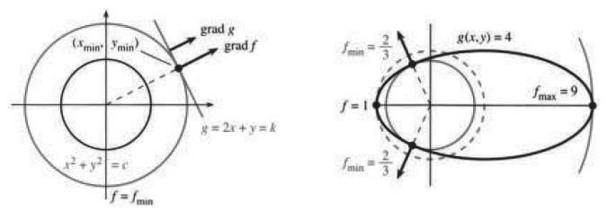
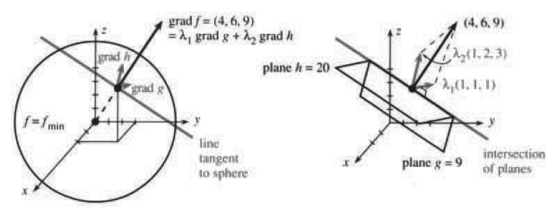
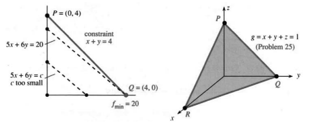

# 13.7 约束与拉格朗日乘子

原文：PDF 第 604–610 页，印刷页 591–597。状态：初译，已逐页自校，尚未复审。

<!-- PDF 604 / 印刷页 591 -->

本节面对一个实际问题：我们常常要在另一个函数 $g(x,y)$ 固定时，最小化函数 $f(x,y)$。$x,y$ 受到**约束** $g(x,y)=k$。这个约束限制了能用的材料、资金或能量。有了这个约束，问题就是做到最好：求 $f_{\max}$ 或 $f_{\min}$。

在 $f(x,y)$ 的绝对最小值点，条件 $g(x,y)=k$ 很可能不成立。这时，那个最小值点就不能取了。我们不能使用 $f_x=0,f_y=0$，因为它们没有考虑 $g$。

**步骤 1** 找出约束极小值或约束极大值应满足的方程。方程里既有 $f_x,f_y$，也有 $g_x,g_y$；它们给出 $f,g$ 的局部信息。看两个例子。

**例 1** 在约束 $g=2x+y=k$ 下最小化 $f=x^2+y^2$。

**试算** 约束允许 $x=0,y=k$，此时 $f=k^2$。$(k/2,0)$ 也满足约束，且 $f=k^2/4$ 更小。$x=y=k/3$ 给出 $f=2k^2/9$，是目前最好的。

**解题思路** 看图 13.21 中 $f$ 的等值线，它们是圆 $x^2+y^2=c$。$c$ 很小时，圆不接触直线 $2x+y=k$；也就是说，$c$ 太小时没有满足约束的点。现在增大 $c$。

不断长大的圆最终恰好接触直线 $x+2y=k$。接触点就是最佳点，它给出这条直线上能达到的最小 $c$。这个点就是 $(x_{\min},y_{\min})$，而 $c$ 就是 $f_{\min}$。

什么方程描述该点？圆碰到直线时，两者相切，斜率相同。**圆和直线的法向方向相同。** 这就是图 13.21a 中的关键事实。垂直于 $f=c$ 的方向由 $\operatorname{grad}f=(f_x,f_y)$ 给出，垂直于 $g=k$ 的方向由 $\operatorname{grad}g=(g_x,g_y)$ 给出。关键方程说这两个向量平行：一个梯度是另一个的倍数，倍数就是那个未知的乘子 $\lambda$（读作 lambda）。

> **13N** 在约束 $g(x,y)=k$ 下，$f(x,y)$ 的极小值处，其梯度与 $g$ 的梯度平行，未知数 $\lambda$ 为乘子：
> $$\operatorname{grad}f=\lambda\operatorname{grad}g,
> \qquad\frac{\partial f}{\partial x}=\lambda\frac{\partial g}{\partial x},
> \qquad\frac{\partial f}{\partial y}=\lambda\frac{\partial g}{\partial y}.\tag{1}$$

**步骤 2** 现在有三个未知数 $x,y,\lambda$，也有三个方程：

$$\begin{aligned}
\partial f/\partial x=\lambda\partial g/\partial x&:\quad2x=2\lambda,\\
\partial f/\partial y=\lambda\partial g/\partial y&:\quad2y=\lambda,\\
g(x,y)=k&:\quad2x+y=k.
\end{aligned}\tag{2}$$

在第三式中用 $2\lambda$ 代替 $2x$，用 $\lambda/2$ 代替 $y$，则 $2x+y=5\lambda/2=k$。知道 $\lambda=2k/5$ 后，回到前两式求 $x,y,f_{\min}$：

$$x=\lambda=\frac25k,\qquad y=\frac12\lambda=\frac15k,\qquad
f_{\min}=\left(\frac25k\right)^2+\left(\frac15k\right)^2=\frac5{25}k^2=\frac15k^2.$$

<!-- PDF 605 / 印刷页 592 -->

最佳点 $(x_{\min},y_{\min})=(2k/5,k/5)$ 使 $f=x^2+y^2=k^2/5$ 最小，也就是原点到直线的“距离平方”最小。

**问题** 拉格朗日乘子 $\lambda$ 有什么意义？

**神秘的答案** $k^2/5$ 的导数是 $2k/5$，恰好等于 $\lambda$。**乘子 $\lambda$ 是 $f_{\min}$ 对 $k$ 的导数。** 把直线移动 $\Delta k$，$f_{\min}$ 约改变 $\lambda\Delta k$。因此拉格朗日乘子衡量对 $k$ 的敏感度。

Lagrange 的名字可近似读作“Lagronge”；照法语念，更接近“Lagrongh”。

**图 13.21** 圆 $f=c$ 分别与直线 $g=k$、椭圆 $g=4$ 相切，梯度平行。

**例 2** 在椭圆 $g=(x-1)^2+4y^2=4$ 上求 $f=x^2+y^2$ 的最大值和最小值。

**思路与方程** 圆 $x^2+y^2=c$ 不断长大，直到接触椭圆。接触点是 $(x_{\min},y_{\min})$，最小的 $c$ 就是 $f_{\min}$。圆继续长大，穿过椭圆，最后在 $(x_{\max},y_{\max})$ 再次相切，最大的 $c$ 就是 $f_{\max}$。

最大值和最小值都服从同一规则：圆与椭圆相切（图 13.21b），法向方向相同。所以 $(f_x,f_y)$ 是 $(g_x,g_y)$ 的倍数，未知乘子仍为 $\lambda$：

$$\begin{aligned}
f_x=\lambda g_x&:\quad2x=2\lambda(x-1),\\
f_y=\lambda g_y&:\quad2y=8\lambda y,\\
g=k&:\quad(x-1)^2+4y^2=4.
\end{aligned}\tag{3}$$

**求解** 第二式有两种可能：$y=0$ 或 $\lambda=1/4$。先取 $y=0$，最后一式给出 $(x-1)^2=4$，所以 $x=3$ 或 $x=-1$。第一式再给出 $\lambda=3/2$ 或 $1/2$。对应的 $f$ 为 $3^2+0^2=9$ 和 $(-1)^2+0^2=1$。

再取 $\lambda=1/4$。第一式得 $x=-1/3$，最后一式要求 $y^2=5/9$。因为 $x^2=1/9$，得到 $x^2+y^2=6/9=2/3$，这就是 $f_{\min}$。

**结论** 方程组 (3) 有四个解，圆和椭圆在这些点相切：$(3,0),(-1,0),(-1/3,\sqrt5/3),(-1/3,-\sqrt5/3)$。相应的 $f$ 值为 $9,1,2/3,2/3$。

**小结** 三个方程是 $f_x=\lambda g_x,f_y=\lambda g_y,g=k$；未知数是 $x,y,\lambda$。解这些方程没有一套通用的办法，除非方程是线性的——那时可用消元或克拉默法则。通常先用前两式把 $x,y$ 写成 $\lambda$ 的表达式，

<!-- PDF 606 / 印刷页 593 -->

再代入 $g=k$ 得到关于 $\lambda$ 的方程。

在极小值处，等值线 $f(x,y)=c$ 与约束曲线 $g(x,y)=k$ 相切。若把约束曲线写成参数式 $x(t),y(t)$，要最小化 $f(x(t),y(t))$，用链式法则即可：

$$\frac{df}{dt}=\frac{\partial f}{\partial x}\frac{dx}{dt}
+\frac{\partial f}{\partial y}\frac{dy}{dt}=0,
\quad\text{即}\quad(\operatorname{grad}f)\cdot(\text{曲线的切向量})=0.$$

这就是微积分的证明：$\operatorname{grad}f$ 垂直于曲线，因此与 $\operatorname{grad}g$ 平行，即 $(f_x,f_y)=\lambda(g_x,g_y)$。

我们失去了 $f_x=f_y=0$，但新函数 $L$ 有三个导数为零：

> **13O** 拉格朗日函数为 $L(x,y,\lambda)=f(x,y)-\lambda(g(x,y)-k)$。在解处，三个偏导数满足 $L_x=L_y=L_\lambda=0$：
> $$\frac{\partial L}{\partial x}=\frac{\partial f}{\partial x}-\lambda\frac{\partial g}{\partial x}=0,
> \quad\frac{\partial L}{\partial y}=\frac{\partial f}{\partial y}-\lambda\frac{\partial g}{\partial y}=0,
> \quad\frac{\partial L}{\partial\lambda}=-g+k=0.\tag{4}$$

注意，$\partial L/\partial\lambda=0$ 自动给出 $g=k$，约束已“内置”在 $L$ 中。拉格朗日引入了 $\lambda(g-k)$ 这一项，它注定在解处为零，但其导数在方程中必不可少！在解处，$g=k,L=f,\partial L/\partial k=\lambda$。

关键是由 $L_x=L_y=0$ 得到的 $f_x=\lambda g_x,f_y=\lambda g_y$。换成文字就是：约束 $g=k$ 强制 $dg=g_xdx+g_ydy=0$，限制了位移 $dx,dy$，使它们必须留在曲线上。方程说明 $df=f_xdx+f_ydy=\lambda dg$，所以 **$df$ 沿允许方向为零**，这是核心。

## 两个约束下的最大值与最小值

专门研究最小化与最大化的学科，叫作**优化**。它在商业决策中的应用构成**运筹学**。线性函数的特殊情形始终重要，在这里称为**线性规划**。这些领域的专著塞不进一本微积分教材，但我们还能往前再走一步：允许第二个约束。

现在要最小化或最大化 $f(x,y,z)$，约束为 $g(x,y,z)=k_1,h(x,y,z)=k_2$，乘子为 $\lambda_1,\lambda_2$。至少需要三个变量，因为两个约束会完全确定 $x,y$。

> **13P** 在约束 $g(x,y,z)=k_1,h(x,y,z)=k_2$ 下最小化 $f(x,y,z)$，对 $x,y,z,\lambda_1,\lambda_2$ 求解五个方程：将两个约束与下式联立：
> $$\begin{aligned}
> \frac{\partial f}{\partial x}&=\lambda_1\frac{\partial g}{\partial x}+\lambda_2\frac{\partial h}{\partial x},\\
> \frac{\partial f}{\partial y}&=\lambda_1\frac{\partial g}{\partial y}+\lambda_2\frac{\partial h}{\partial y},\\
> \frac{\partial f}{\partial z}&=\lambda_1\frac{\partial g}{\partial z}+\lambda_2\frac{\partial h}{\partial z}.
> \end{aligned}\tag{5}$$

图 13.22a 显示这些方程背后的几何关系。为方便起见，取 $f=x^2+y^2+z^2$，也就是最小化距离平方。约束 $g=x+y+z=9,h=x+2y+3z=20$ 是线性的，图像为平面。约束使 $(x,y,z)$ 同时位于两个平面上，因此位于交线上。我们在求 $(0,0,0)$ 到一条直线的距离平方。

<!-- PDF 607 / 印刷页 594 -->

应解什么方程？等值面 $x^2+y^2+z^2=c$ 是球面，随 $c$ 增大而扩大。最先碰到这条直线的那个球面，与直线相切；切点给出解，也就是最小的 $c$。**三个向量 $\operatorname{grad}f,\operatorname{grad}g,\operatorname{grad}h$ 都垂直于直线：**

$$\begin{aligned}
\text{直线与球面相切}&\Rightarrow\operatorname{grad}f\text{ 垂直于直线},\\
\text{直线位于两个平面中}&\Rightarrow\operatorname{grad}g,\operatorname{grad}h\text{ 都垂直于直线}.
\end{aligned}$$

因此三个梯度都在垂直于该直线的同一平面内。平面内的 $\operatorname{grad}f$ 可写成另外两个梯度的线性组合：

$$(f_x,f_y,f_z)=\lambda_1(g_x,g_y,g_z)+\lambda_2(h_x,h_y,h_z).\tag{6}$$

这就是关键方程 (5)，它既适用于平面，也适用于弯曲的曲面。

**例 3** 在 $x+y+z=9,x+2y+3z=20$ 时最小化 $x^2+y^2+z^2$。

图 13.22b 中，两平面的法向量是 $\operatorname{grad}g=(1,1,1),\operatorname{grad}h=(1,2,3)$。$f$ 的梯度是 $(2x,2y,2z)$，方程 (5)–(6) 为

$$2x=\lambda_1+\lambda_2,\qquad2y=\lambda_1+2\lambda_2,\qquad2z=\lambda_1+3\lambda_2.$$

将这些 $x,y,z$ 代入另外两个方程 $g=x+y+z=9,h=20$：

$$\frac{\lambda_1+\lambda_2}{2}+\frac{\lambda_1+2\lambda_2}{2}+\frac{\lambda_1+3\lambda_2}{2}=9,$$

$$\frac{\lambda_1+\lambda_2}{2}+2\frac{\lambda_1+2\lambda_2}{2}+3\frac{\lambda_1+3\lambda_2}{2}=20.$$

乘以 $2$，化简为 $3\lambda_1+6\lambda_2=18,6\lambda_1+14\lambda_2=40$。解为 $\lambda_1=2,\lambda_2=2$，进而得到 $(x,y,z)=(2,3,4)$。

有两个约束时，拉格朗日函数为 $L(x,y,z,\lambda_1,\lambda_2)=f-\lambda_1(g-k_1)-\lambda_2(h-k_2)$。它的五个偏导数为零，这五个方程正是我们需要的。引入两个乘子后，未知数从三个增加到五个。最佳点 $(2,3,4)$ 给出 $f_{\min}=29$。两个乘子给出 $\partial f/\partial k$，也就是对 $9$ 和 $20$ 变化的敏感度。

**图 13.22** 垂直于交线的向量 $\operatorname{grad}f$ 是 $\lambda_1\operatorname{grad}g+\lambda_2\operatorname{grad}h$。

<!-- PDF 608 / 印刷页 595 -->

## 不等式约束

实际应用既涉及等式，也涉及**不等式**。约束可能是 $g\le k,h\ge0$。前者表示不必用完资源 $k$，但不能超用；后者表示 $h$ 衡量一个不能为负的量。**在极小值点，对应乘子也必须满足相应的不等式：$\lambda_1\le0,\lambda_2\ge0$。** 约束中有不等式，乘子就有符号限制。

理由很简单：$g\le k$ 时，最小值可以在约束曲线上，也可以在曲线内部。落在内部时 $g<k$，各个方向都能走，约束其实没有束缚我们，于是回到 $f_x=f_y=0,\lambda=0$，也就是普通极小值。落在曲线上，若 $g=k$ 阻止最小值继续下降，则 $\lambda<0$。事先并不知道是哪种情形。

有 100 个约束 $g_i\le k_i$，就有 100 个乘子。有些为零（$g_i<k_i$），有些非零（$g_i=k_i$）。这 $2^{100}$ 种可能让优化很有意思。在两个变量的线性规划中，约束为 $x\ge0,y\ge0$。

**例 4** 在 $g=x+y=4,h=x\ge0,H=y\ge0$ 下最小化 $f=5x+6y$。

$g=4$ 是等式约束，$h,H$ 给出不等式。各自有一个拉格朗日乘子，不等式要求 $\lambda_2\ge0,\lambda_3\ge0$。$f,g,h,H$ 的导数很容易计算：

$$\begin{aligned}
\frac{\partial f}{\partial x}
&=\lambda_1\frac{\partial g}{\partial x}+\lambda_2\frac{\partial h}{\partial x}+\lambda_3\frac{\partial H}{\partial x}
&&\Rightarrow5=\lambda_1+\lambda_2,\\
\frac{\partial f}{\partial y}
&=\lambda_1\frac{\partial g}{\partial y}+\lambda_2\frac{\partial h}{\partial y}+\lambda_3\frac{\partial H}{\partial y}
&&\Rightarrow6=\lambda_1+\lambda_3.
\end{aligned}\tag{7}$$

方程使 $\lambda_3>\lambda_2$，所以 $\lambda_3>0$，意味着 $H$ 的约束必须取等号。（乘子取不等式，意味着约束取等式。）即 $H=y=0$，然后由 $x+y=4$ 得 $x=4$。解为 $(x_{\min},y_{\min})=(4,0)$，最小值 $f_{\min}=20$。

在该点，$h=x=4>0$，约束 $h\ge0$ 的乘子必须为 $\lambda_2=0$，第一式于是给出 $\lambda_1=5$。和往常一样，乘子衡量的是敏感度：把 $g=4$ 的右端增加 $\Delta k$，费用 $f_{\min}=20$ 增加 $5\Delta k$。经济学把 $\lambda_1=5$ 称为**影子价格**，即提高约束要求的代价。

例子背后是一个漂亮的几何问题。约束曲线 $x+y=4$ 是直线，不等式 $x\ge0,y\ge0$ 只留下图 13.23 中从 $P$ 到 $Q$ 的线段。等值线 $5x+6y=c$ 随 $c$ 增大向外移动，直到接触这条线段。**第一次接触的点 $Q=(4,0)$ 就是解。** 解总是一个端点，或者三角形 $PQR$ 的一个角点。它给出最低费用 $f_{\min}=c=20$。

<!-- PDF 609 / 印刷页 596 -->

**图 13.23** 线性规划中，$f,g$ 都是线性的，不等式截断 $x$ 和 $y$。

## 13.7 习题

### 阅读填空

限制 $g(x,y)=k$ 称为 **a____**。在 $g=k$ 下最小化 $f$ 的方程是 **b____**。数 $\lambda$ 是拉格朗日 **c____**。从几何上说，极小值处 $\operatorname{grad}f$ 与 $\operatorname{grad}g$ **d____**，因为 **e____** 曲线 $f=f_{\min}$ 与约束曲线 $g=k$ **f____**。$\lambda$ 恰是 **g____** 对 **h____** 的导数。拉格朗日函数 $L=$ **i____**，$x,y,\lambda$ 的三个方程为 **j____**、**k____**、**l____**。

在约束 $g=x-y=0$ 下最小化 $f=x^2-y$ 时，关于 $x,y,\lambda$ 的三个方程为 **m____**，解为 **n____**。本例中，曲线 $f(x,y)=f_{\min}=$ **o____** 是一条 **p____**，它在 $(x_{\min},y_{\min})$ 与直线 $g=0$ **q____**。

有两个约束 $g(x,y,z)=k_1,h(x,y,z)=k_2$ 时，有 **r____** 个乘子，五个未知数为 **s____**，五个方程为 **t____**。等值面 $f=f_{\min}$ 与 $g=k_1,h=k_2$ 的交线 **u____**。于是 $\operatorname{grad}f$ 与该曲线 **v____**，$\operatorname{grad}g$ 和 **w____** 也如此。因此 **x____** 是 $\operatorname{grad}g$ 与 **y____** 的线性组合。有九个变量、六个约束时，有 **z____** 个乘子，最终有 **A____** 个方程。若约束是 **B____** $g\le k$，则其乘子在极小值处必须满足 $\lambda\le0$。

1. 例 1 在 $2x+y=k$ 下最小化 $f=x^2+y^2$。解约束得 $y=k-2x$，代入 $f$，再最小化这个关于 $x$ 的函数。最小值在 $(x,y)=$ ____ 取得，此时 $f=$ ____。**注意** 这个直接方法把问题减为一个未知数 $x$，拉格朗日法则增为 $x,y,\lambda$；但要是第一步解出 $y$ 困难或不可能，拉格朗日法就更好。

第 2–6 题求 $f(x,y)$ 的最小值和最大值，并求 $x,y,\lambda$。

2. $f=x^2y$，约束 $g=x^2+y^2=1$。
3. $f=x+y$，约束 $g=1/x+1/y=1$。
4. $f=3x+y$，约束 $g=x^2+9y^2=1$。
5. $f=x^2+y^2$，约束 $g=x^6+y^6=2$。
6. $f=x+y$，约束 $g=x^{1/3}y^{2/3}=k$。若 $x$ 是资本、$y$ 是劳动，$g$ 就是经济学中的柯布—道格拉斯函数。画出它的两条等值线。
7. 求圆 $x^2+y^2=13$ 上使 $f=2x-3y$ 最大的点，并解释答案。
8. 在 $x^2+y^2+z^2=k^2$ 下最大化 $ax+by+cz$。把答案写成点积的施瓦茨不等式：$(a,b,c)\cdot(x,y,z)\le$ ____ $k$。
9. 求最佳拟合点 $(x,y,z)=(0,0,1),(1,0,0),(1,1,2),(0,1,2)$ 的平面 $z=ax+by+c$。答案 $a,b,c$ 使四点处的 $(z-ax-by-c)^2$ 之和最小。
10. 一个三角形的底边与一个矩形的顶边重合（外轮廓有五条边，总面积为 $1$）。什么尺寸使周长最小？
11. 画出双曲线 $xy=-1$ 与圆 $g=x^2+y^2=2$ 相切的情形。圆上 $f=xy$ 的最小值在点 ____ 取得。方程 $f_x=\lambda g_x,f_y=\lambda g_y$ 在这些点满足，且 $\lambda=$ ____。
12. 解 $f_x=\lambda g_x,f_y=\lambda g_y$，再把 $x,y$ 代入 $f$，求圆 $g=x^2+y^2=2$ 上 $f=xy$ 的最大值。画出与圆相切的等值线 $f=f_{\max}$。
13. 画出 $f=x^2+y^2$ 的等值线，再画一条穿过它们的闭曲线 $C$，表示 $g(x,y)=k$。标出 $C$ 与某条等值线相交穿过的点，为什么它不是 $f$ 在 $C$ 上的极小值点？再标出 $C$ 与某条等值线相切的点，它一定是 $f$ 在 $C$ 上的最小值点吗？

<!-- PDF 610 / 印刷页 597 -->

14. 第 13.6 节例 5 在圆 $g=x^2+y^2=1$ 上最小化了 $f=xy-x-y$。(a) 写出关于 $x,y,\lambda$ 的三个拉格朗日方程。(b) 前两个方程给出 $x=y=$ ____。(c) 特殊值 $\lambda=-1/2$ 还给出另一种解，此时方程变为 ____。它容易被遗漏，却在点 ____ 给出 $f_{\min}=-1$。

第 15–18 题发展拉格朗日乘子理论。

15. （敏感度）$L=f-\lambda(g-k)$ 确实有 $\partial L/\partial k=\lambda$。因为极小值点处 $L=f_{\min},g=k$，这似乎已证明关键公式 $df_{\min}/dk=\lambda$。但 $x_{\min},y_{\min},\lambda,f_{\min}$ 都随 $k$ 改变，需要 $L(x,y,\lambda;k)$ 的全导数：

    $$\frac{dL}{dk}=\frac{\partial L}{\partial x}\frac{dx}{dk}
    +\frac{\partial L}{\partial y}\frac{dy}{dk}
    +\frac{\partial L}{\partial\lambda}\frac{d\lambda}{dk}
    +\frac{\partial L}{\partial k}\frac{dk}{dk}.$$

    用极小值点处的式 (1) 推出敏感度公式 $df_{\min}/dk=\lambda$。
16. （$\lambda$ 背后的理论）从 $g(x,y)=k$ 解出 $y$，得到曲线 $y=R(x)$。沿它最小化 $f$，有

    $$\frac{\partial f}{\partial x}+\frac{\partial f}{\partial y}\frac{dR}{dx}=0,
    \qquad\frac{\partial g}{\partial x}+\frac{\partial g}{\partial y}\frac{dR}{dx}=0.$$

    它们来自：极小值处 $df/dx=0$，沿曲线 $dg/dx=0$，因为 $g=$ ____。第二式乘以 $\lambda=(\partial f/\partial y)/(\partial g/\partial y)$，再从第一式减去，得到 ____ $=0$。另外 $\partial f/\partial y=\lambda\partial g/\partial y$。这些就是式 (1)。
17. （失效的例子）若极小值点处 $g_y=0$，则 $\lambda=f_y/g_y$ 失效。(a) $g=x^2-y^3=0$ 不允许 $y<0$，因为 ____。(b) 在 $g=0$ 上，$f=x^2+y$ 的最小值点为 ____。(c) 在该点，$f_y=\lambda g_y$ 变为 ____，这是不可能的。(d) 画出有尖点的曲线 $g=0$，看它为何不与 $f$ 的等值线相切。
18. （没有最大值）在直线 $g=x+y=1$ 上找一个使 $f=2x+y>100$（或 $1000$）的点。写出 $\operatorname{grad}f=\lambda\operatorname{grad}g$，说明无解。
19. 当 $(x,y,z)$ 同时位于平面 $g=x+y+z=0,h=x-z=1$ 上时，求 $f=x^2+2y^2+z^2$ 的最小值。
20. (a) 用拉格朗日乘子法求边长之和 $x+y+z=k$ 的最大长方体体积 $V=xyz$。(b) 验证 $\lambda=dV_{\max}/dk$。(c) 联合航空允许行李尺寸之和 $x+y+z=108$ 英寸，若改为 $111$ 英寸，$V_{\max}$ 近似增加多少（用 $\lambda$），准确增加多少？
21. 平面 $x=0,y=0$ 相交于直线 $x=y=0$，即 $z$ 轴。分别写出一个垂直于这两个平面的向量。求 $\lambda_1$ 倍第一个向量加 $\lambda_2$ 倍第二个向量；这个线性组合垂直于直线 ____。
22. 在平面 $ax+by+cz=d$ 上最小化 $f=x^2+y^2+z^2$，只需一个约束和一个乘子。把 $f_{\min}$ 与第 11.2 节的距离公式 $|d|/\sqrt{a^2+b^2+c^2}$ 比较。
23. 在 $f(x,y)$ 的绝对最小值处，导数 ____ 为零。若该点恰好落在曲线 $g(x,y)=k$ 上，则方程 $f_x=\lambda g_x,f_y=\lambda g_y$ 以 $\lambda=$ ____ 成立。

第 24–33 题允许不等式约束，可选做，但值得一试。

24. 在约束 $g=x+2y=4,h=x\ge0,H=y\ge0$ 下，利用类似式 (7) 的方程求 $f=3x+5y$ 的最小值。哪个乘子为零？
25. 图 13.23 的约束平面 $g=x+y+z=1$ 被不等式 $x\ge0,y\ge0,z\ge0$ 截成三角形。三个“端点”是什么？在端点计算 $f=4x-2y+5z$，求三角形上的最小值和最大值。
26. 不等式约束 $g\le k$ 的乘子在极小值处满足 $\lambda\le0$。$k$ 增大时，$f_{\min}$ 下降，因为 $\lambda=df_{\min}/dk$。解释推理：增大 $k$ 后，满足约束的点（更多／更少），可用来最小化 $f$ 的点（更多／更少），因此 $f_{\min}$（上升／下降）。
27. 不等式约束 $g\le k$ 的乘子在极大值点满足 $\lambda\ge0$。修改第 26 题的推理。
28. 若约束 $h\ge k$ 在极小值处是严格不等式 $h>k$，则乘子 $\lambda=0$。解释：$k$ 略微增大时，原最小值点仍允许，因为 $h>k$ 留有余量，所以 $f_{\min}$（改变／不变），$\lambda=df_{\min}/dk=$ ____。
29. 在 $x+y\le4$ 下最小化 $f=x^2+y^2$。最小值显然在 ____，此处 $f_x,f_y$ 为零。乘子 $\lambda=$ ____。把 $4$ 略微改变后，仍有 $f_{\min}=$ ____，所以敏感度 $df_{\min}/dk$ 仍等于 $\lambda$。
30. 在 $x+y\ge4$ 下最小化 $f=x^2+y^2$。现在最小值点为 ____，乘子 $\lambda=$ ____，$f_{\min}=$ ____。把 $4$ 略微改为 $4+dk$，$f_{\min}$ 的变化是 $dk$ 的多少倍？
31. 在 $g=x+y=4,h=x\ge0,H=y\le0$ 下最小化 $f=5x+6y$。现在 $\lambda_3\le0$，符号变化破坏了例 4 的结论。说明式 (7) 无解，并选择 $x,y$ 使 $5x+6y<-1000$。
32. 在 $g=x+y+z=1,x,y,z\ge0$ 下最小化 $f=2x+3y+4z$。非负约束的乘子为 $\lambda_2,\lambda_3,\lambda_4\ge0$。方程为 $2=\lambda_1+\lambda_2$、____、$4=\lambda_1+\lambda_4$。解释为何 $\lambda_3>0,\lambda_4>0,f_{\min}=2$。
33. 用长 $40$ 英寸的金属丝围一个或两个正方形，边长为 $x,y$。在 $x\ge0,y\ge0,4x+4y=40$ 下最大化总面积 $x^2+y^2$。
