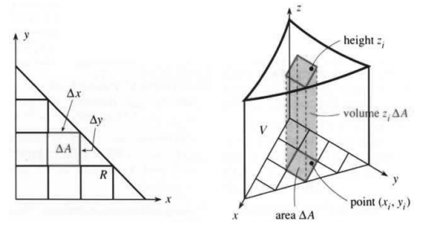
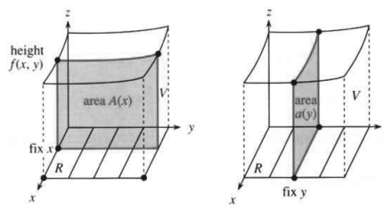
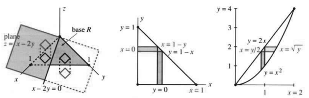
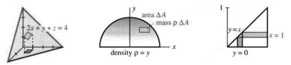

# 第 14 章 重积分
# 14.1 二重积分

原文：PDF 第 611–618 页，印刷页 598–605。状态：初译，已逐页自校，尚未复审。

<!-- PDF 611 / 印刷页 598 -->

本章介绍如何对二元或更多变量的函数积分。首先，把二重积分定义为和的极限；其次，寻找快速计算的方法。**关键是把一个二重积分化为两个普通的“一重”积分。**

二重积分 $\iint f(x,y)\,dy\,dx$ 从 $\int f(x,y)\,dy$ 开始。每固定一个 $x$，就关于 $y$ 积分，结果依赖 $x$。然后再积分一次，这次关于 $x$。积分上下限必须仔细处理！最难的部分往往正是 $y,x$ 的上下限。

为什么一开始还要费事讨论求和与极限？有两个理由。其一，一重积分很难、甚至算不出来时，总得有定义和计算方法可以依靠；其二——这一点我们要强调——重积分表示的不只是面积和体积。这两个概念及其图形最容易理解：你几乎能把体积看成“薄片之和”或“细柱的二重和”。真正的应用大多涉及别的量，但中心思想始终一样：**把小块加起来，然后取极限。**

我们先用二重积分求区域 $R$ 的面积和立体 $V$ 的体积。

## 和的极限

$z=f(x,y)$ 的图像是 $xy$ 平面上方的曲面。在平面内的点 $(x,y)$ 处，曲面高度为 $z$。（只有 $z>0$ 时曲面才在平面上方；下方的体积带负号，就像 $x$ 轴下方的面积一样。）先选一个正函数，例如 $z=1+x^2+y^2$。

立体的底面是 $xy$ 平面内的区域 $R$。把它分成边长 $\Delta x,\Delta y$ 的小矩形。若 $R$ 本身就是矩形 $0\le x\le1,0\le y\le2$，小块正好拼满；若是三角形或圆，小矩形会遗漏部分区域，但在极限中仍能贴合。边界只要分段光滑，任何区域都可以这样处理。

**问题** $R$ 上方、图像 $z=f(x,y)$ 下方的体积是多少？

**回答** 它是二重积分，即 **$f(x,y)$ 在 $R$ 上的积分**。为了得到它，先从求和开始，如图 14.1。

<!-- PDF 612 / 印刷页 599 -->

**图 14.1** 底面 $R$ 分成小块 $\Delta A$，立体 $V$ 分成细柱，$\Delta V=z\Delta A$。右图标出取样点 $(x_i,y_i)$、高度 $z_i$ 和底面积 $\Delta A$。

一重积分把区间 $[a,b]$ 分成长度 $\Delta x$ 的短段；二重积分把 $R$ 分成面积 $\Delta A=(\Delta x)(\Delta y)$ 的小矩形。

第 $i$ 个矩形上方有一根体积很小的“细柱”。体积等于底面积 $\Delta A$ 乘高度，但高度 $z=f(x,y)$ 随位置改变。因此在第 $i$ 个矩形中选一点 $(x_i,y_i)$，用该点上方的高度计算柱体积：

$$\text{一根细柱的体积}=f(x_i,y_i)\Delta A,\qquad
\text{全部细柱的体积}=\sum_i f(x_i,y_i)\Delta A.$$

这是任何积分的关键一步：把它看成许多小块的和。

现在令 $\Delta x\to0,\Delta y\to0$。每个小矩形上方的高度近乎恒定（假设 $f$ 连续）。和趋于一个只依赖底面 $R$ 和其上曲面的极限。这个极限就是立体体积，也就是 $f$ 在 $R$ 上的二重积分：

$$\iint_R f(x,y)\,dA=\lim_{\substack{\Delta x\to0\\\Delta y\to0}}
\sum_i f(x_i,y_i)\Delta A.\tag{1}$$

再说一次：无论如何选取矩形和取样点 $(x_i,y_i)$，极限都相同。底面若有曲边，小矩形不能完全贴合；上方曲面若弯曲，高度也不精确。但侧边和顶部的这些误差趋于零。误差如同包在立体外的一层“糖霜”，随 $\Delta x,\Delta y\to0$ 越来越薄。要严格证明，就得多占篇幅，我们这儿不肯给。但积分的性质值得认真关注：

1. 线性：$\iint(f+g)\,dA=\iint f\,dA+\iint g\,dA$。
2. 常数可提出：$\iint cf(x,y)\,dA=c\iint f(x,y)\,dA$。
3. 若 $R$ 分成不重叠的 $S,T$，则 $\iint_Rf\,dA=\iint_Sf\,dA+\iint_Tf\,dA$。

性质 1 中，$f+g$ 下方的体积分成两部分：高为 $f+g$ 的细柱，拆成 $f$ 下方的细柱和 $g$ 下方的细柱。性质 2 中，整个体积沿竖直方向伸缩 $c$ 倍。性质 3 中，两部分体积并排摆着。与一重积分一样，这些性质有助于计算。

写成 $dA$ 时，允许使用矩形以外的形状。极坐标面积元 $dA=r\,dr\,d\theta$ 多一个因子 $r$。写成 $dx\,dy$，就是选了直角坐标，接下来正好拆成两次积分。

<!-- PDF 613 / 印刷页 600 -->

## 把二重积分化为两个一重积分

现在把 $\iint f(x,y)\,dy\,dx$ 化为先关于 $y$、再关于 $x$ 的一重积分，也可以反过来先算 $\int f(x,y)\,dx$。第 8 章讨论旋转体时采用同样思路：先求切片面积，这是一次积分；再积分一次，把切片加起来。曲线旋转出来的立体，切片全是垂直于旋转轴的圆盘；现在该轮到别的形状了。

图 14.2 中的切片面积是 $A(x)$，它在固定 $x$ 处切过立体，从 $R$ 一侧的 $y=c$ 到另一侧的 $y=d$。本例为 $y=0$ 到 $y=2$，因为 $R$ 是矩形。切片面积就是 $f(x,y)$ 关于 $y$ 的积分。记住：$x$ 固定，$y$ 从 $c$ 变到 $d$：

$$A(x)=\text{切片面积}=\int_c^d f(x,y)\,dy
\qquad\text{（答案是 }x\text{ 的函数）。}$$

**例 1**

$$A=\int_0^2(1+x^2+y^2)\,dy
=\left[y+x^2y+\frac{y^3}{3}\right]_0^2=2+2x^2+\frac83.$$

这是求偏导的逆过程！固定 $x$ 时，$x^2\,dy$ 的积分是 $x^2y$。这个“偏积分”，实际上就叫**内层积分**。代入上下限 $y=2,0$ 相减后，得到面积 $A(x)=2+2x^2+8/3$。现在**外层积分**把切片加起来，得到体积 $\int A(x)\,dx$，答案是一个数：

$$\text{体积}=\int_0^1\left(2+2x^2+\frac83\right)dx
=\left[2x+\frac{2x^3}{3}+\frac83x\right]_0^1
=2+\frac23+\frac83=\frac{16}{3}.$$

**图 14.2** 固定 $x$ 的切片面积为 $A(x)=\int f(x,y)\,dy$；固定 $y$ 的切片面积为 $a(y)$。

最后改为先关于 $x$ 积分，核对体积：

$$\text{内层：}\quad\int_0^1(1+x^2+y^2)\,dx
=\left[x+\tfrac13x^3+y^2x\right]_0^1=\frac43+y^2,$$

$$\text{外层：}\quad\int_0^2\left(\frac43+y^2\right)dy
=\left[\tfrac43y+\tfrac13y^3\right]_0^2=\frac83+\frac83=\frac{16}{3}.$$

二重积分能化成一重积分，这个事实就叫**富比尼定理**。

<!-- PDF 614 / 印刷页 601 -->

> **14A** 若 $f(x,y)$ 在矩形 $R$ 上连续，则
> $$\iint_Rf(x,y)\,dA
> =\int_a^b\left[\int_c^df(x,y)\,dy\right]dx
> =\int_c^d\left[\int_a^bf(x,y)\,dx\right]dy.\tag{2}$$

内层积分是切片截面积 $A(x)$ 和 $a(y)$，外层积分累加体积 $A(x)dx$ 与 $a(y)dy$。注意上下限随积分次序一起交换。

通常省略式 (2) 的方括号。先关于 $y$ 积分时，$dy$ 写在 $dx$ 里面，**$y$ 的上下限也在里面**。强烈建议把内层积分和外层积分分成两行计算。

**例 2** 求底面三角形 $R$ 与平面 $z=x-2y$ 之间的有向体积。

三角形 $R$ 的边位于 $x$ 轴、$y$ 轴及直线 $x+y=1$ 上。沿 $y$ 方向的细条长短不一，沿 $x$ 方向的也一样。本例的要点在于底面不是矩形：内层积分上限随 $x$ 改变。三角形的上边界为 $y=1-x$。

图 14.3 画出细条。除矩形外，总应画出积分区域。没有图很难确定上下限；有了 $R$ 的草图就容易了：

$$y\text{ 从 }c=0\text{ 到 }d=1-x,\qquad x\text{ 从 }a=0\text{ 到 }b=1.$$

内层积分上下限可以变化，外层积分上下限为常数：

$$\begin{aligned}
\text{内层：}\quad\int_0^{1-x}(x-2y)\,dy
&=[xy-y^2]_0^{1-x}\\
&=x(1-x)-(1-x)^2=-1+3x-2x^2,\\
\text{外层：}\quad\int_0^1(-1+3x-2x^2)\,dx
&=\left[-x+\tfrac32x^2-\tfrac23x^3\right]_0^1\\
&=-1+\frac32-\frac23=-\frac16.
\end{aligned}$$

有向体积为负，立体的大部分位于 $xy$ 平面下方。为核对 $-1/6$，先关于 $x$ 积分：$x$ 从 $0$ 到 $1-y$，再令 $y$ 从 $0$ 到 $1$：

$$\begin{aligned}
\text{内层：}\quad\int_0^{1-y}(x-2y)\,dx
&=\left[\tfrac12x^2-2xy\right]_0^{1-y}\\
&=\tfrac12(1-y)^2-2(1-y)y=\tfrac12-3y+\tfrac52y^2,\\
\text{外层：}\quad\int_0^1\left(\tfrac12-3y+\tfrac52y^2\right)dy
&=\left[\tfrac12y-\tfrac32y^2+\tfrac56y^3\right]_0^1\\
&=\frac12-\frac32+\frac56=-\frac16.
\end{aligned}$$

两种结果相同，很可能是对的。下例计算 $\iint1\,dx\,dy$，即 $R$ 的面积。

**例 3** $R$ 的面积既可写为 $\displaystyle\int_0^1\int_0^{1-x}dy\,dx$，也可写为 $\displaystyle\int_0^1\int_0^{1-y}dx\,dy$。

第一个采用竖直细条，内层积分为 $1-x$。再在 $0$ 到 $1$ 上积分，面积为 $1/2$。这像是在定积分内部嵌着一个不定积分。

<!-- PDF 615 / 印刷页 602 -->

**图 14.3** 左图的细柱分处平面上下（例 2）；中、右图交换积分次序（例 3、4）。

**例 4** 交换 $\displaystyle\int_0^2\int_{x^2}^{2x}x^3\,dy\,dx$ 的积分次序。

**解** 画图！内层从抛物线 $y=x^2$ 到直线 $y=2x$，给出竖直细条。细条从 $x=0$ 到 $x=2$ 并排摆放，到直线与抛物线相交的 $2x=x^2$ 处结束。

现在要先关于 $x$ 积分，沿水平细条进行。每条 $y=\text{常数}$ 的直线上，得找出细条进入区域和离开区域时的 $x$ 值。从图中看，$x$ 从 $y/2$ 到 $\sqrt y$，这就是内层上下限。还要留意外层上下限，它们现在管的是 $y$：区域从 $y=0$ 开始，到 $y=4$ 结束。**被积函数 $x^3$ 不变**，它是立体的高度：

$$\int_0^2\int_{x^2}^{2x}x^3\,dy\,dx
=\int_0^4\int_{y/2}^{\sqrt y}x^3\,dx\,dy.\tag{3}$$

**例 5** 求平面 $x=0,y=0,z=0,2x+y+z=4$ 围成的体积。

**解** 立体为四面体，有四个面。它从 $z=0$，即 $xy$ 平面，向上延伸到 $2x+y+z=4$。该平面上 $z=4-2x-y$，这就是要积分的高度函数 $f(x,y)$。

图 14.4 给出底面 $R$。令 $z=0$ 可找到底面边界：$x=0,y=0,2x+y=4$。取竖直细条，$dy$ 在内层：

$$\text{内层：}\quad\int_0^{4-2x}(4-2x-y)\,dy
=\left[(4-2x)y-\tfrac12y^2\right]_0^{4-2x}=\tfrac12(4-2x)^2,$$

$$\text{外层：}\quad\int_0^2\tfrac12(4-2x)^2\,dx
=\left[-\frac{(4-2x)^3}{2\cdot3\cdot2}\right]_0^2
=\frac{4^3}{2\cdot3\cdot2}=\frac{16}{3}.$$

**问题** 内层积分 $\tfrac12(4-2x)^2$ 和结果 $16/3$ 各有什么意义？

**回答** 前者是切片面积 $A(x)$，后者是立体体积。

**问题** 如果内层积分 $\int f(x,y)\,dy$ 的上下限依赖 $y$，怎么办？

**回答** 在这里不可以；上下限一定找错了，需要重找。

<!-- PDF 616 / 印刷页 603 -->

**图 14.4** 例 5 的四面体、例 6 的半圆和例 7 的三角形。半圆小块面积为 $\Delta A$，质量为 $\rho\Delta A$。

**例 6** 半圆 $0\le y\le\sqrt{1-x^2}$ 上的密度为 $\rho=y$，求质量。

这是二重积分的新应用。总质量，就是把每个面积为 $\Delta A$ 的小矩形里的小质量 $\rho\Delta A$ 加起来。矩形不能完美填满半圆 $R$，每个矩形内密度也不恒定，但这些问题在极限中消失，剩下二重积分：

$$\text{总质量 }M=\iint_R\rho\,dA=\iint_R\rho(x,y)\,dx\,dy.\tag{4}$$

令 $\rho=y$。图 14.4 给出 $x,y$ 的上下限，两种次序都试一下：

$$M=\int_{-1}^1\int_0^{\sqrt{1-x^2}}y\,dy\,dx,
\qquad M=\int_0^1\int_{-\sqrt{1-y^2}}^{\sqrt{1-y^2}}y\,dx\,dy.$$

第一种内层的原函数为 $y^2/2$，代入上下限得 $(1-x^2)/2$。外层积分给出总质量 $M=2/3$。

第二种内层的原函数为 $xy$，代入 $x$ 的上下限得到 ____。外层的原函数为 $-\tfrac23(1-y^2)^{3/2}$，代入 $y=1,0$ 得 $M=$ ____。

**说明** 同一计算也给出密度 $\rho=1$ 时关于 $x$ 轴的矩。因子 $y$ 是到 $x$ 轴的距离，矩为 $M_x=\iint y\,dA=2/3$。除以半圆面积 $\pi/2$ 就能确定形心。由对称性 $\bar x=0$，而

$$\bar y=\text{形心高度}=\frac{\text{矩}}{\text{面积}}
=\frac{2/3}{\pi/2}=\frac4{3\pi}.\tag{5}$$

这是半圆内部各点的“平均高度”，第 8.5 节已求过。

**例 7** 计算 $\displaystyle\int_0^1\int_y^1\cos x^2\,dx\,dy$，避开无法用初等函数求出的 $\int\cos x^2\,dx$。

这是有名的例子：交换次序，计算才做得下去。底面 $R$ 是图 14.4 的三角形，注意 $x$ 从 $y$ 到 $1$。**反过来，$y$ 从 $0$ 到 $x$。** 于是内层 $\int_0^x\cos x^2\,dy=x\cos x^2$，出现了所需的因子 $x$：

$$\text{外层：}\quad\int_0^1x\cos x^2\,dx
=\left[\tfrac12\sin x^2\right]_0^1=\tfrac12\sin1.$$

<!-- PDF 617 / 印刷页 604 -->

## 14.1 习题

### 阅读填空

二重积分 $\iint_Rf(x,y)\,dA$ 给出 $R$ 与 **a____** 之间的体积。先把底面分成面积 $\Delta A$ 的小 **b____**。第 $i$ 块上方的体积约为 **c____**。和 **d____** 的极限就是体积积分。二重积分的三个性质为 **e____**（线性）、**f____** 和 **g____**。

若 $R$ 是矩形 $0\le x\le4,4\le y\le6$，$\iint x\,dA$ 有两种算法。一种为 $\iint x\,dy\,dx$，内层积分为 $[$ **h____** $]_4^6=$ **i____**，外层给出 $[$ **j____** $]_0^4=$ **k____**。若先关于 $x$ 积分，则 $\int x\,dx=[$ **l____** $]_0^4=$ **m____**，再关于 $y$ 积分等于 **n____**。这是 **o____** 之间的体积（描述 $V$）。

$R$ 的面积是 $\iint$ **p____** $\,dy\,dx$。若 $R$ 是 $x=0,y=2x,y=1$ 围成的三角形，$y$ 的内层上下限为 **q____**，相减得到 **r____** 细条的长度。$x$ 的外层上下限为 **s____**，面积为 **t____**。反过来，$x$ 的内层上下限为 **u____**，细条现在是 **v____** 的，外层积分为 **w____**。密度为 $\rho(x,y)$ 时，区域总质量为 $\iint$ **x____**，矩为 $M_y=$ **y____**、$M_x=$ **z____**。质心满足 $\bar x=M_y/M$。

第 1–4 题通过两次积分计算二重积分。

1. $\displaystyle\int_0^1\int_0^2x^2\,dx\,dy$；$\displaystyle\int_0^1\int_0^2y^2\,dx\,dy$。
2. $\displaystyle\int_2^{2e}\int_1^e2xy\,dx\,dy$；$\displaystyle\int_2^{2e}\int_1^e\frac1{xy}\,dx\,dy$。
3. $\displaystyle\int_0^{\pi/2}\int_0^{\pi/4}\sin(x+y)\,dx\,dy$；$\displaystyle\int_1^2\int_0^2\frac1{(x+y)^2}\,dy\,dx$。
4. $\displaystyle\int_0^1\int_1^2ye^{xy}\,dx\,dy$；$\displaystyle\int_{-1}^1\int_0^3\frac1{\sqrt{3+2x+y}}\,dy\,dx$。

第 5–10 题画出区域并计算面积。

5. $\displaystyle\int_1^2\int_1^{2x}dy\,dx$。
6. $\displaystyle\int_0^1\int_{x^3}^{x}dy\,dx$。
7. $\displaystyle\int_0^\infty\int_{e^{-2x}}^{e^{-x}}dy\,dx$。
8. $\displaystyle\int_{-1}^1\int_{x^2-1}^{1-x^2}dy\,dx$。
9. $\displaystyle\int_{-1}^1\int_{y^2}^1dx\,dy$。
10. $\displaystyle\int_{-1}^1\int_y^{|y|}dx\,dy$。
11. 交换第 5 题积分次序，求新上下限。
12. 交换第 6 题积分次序，求新上下限。
13. 交换第 7 题积分次序，求新上下限。
14. 交换第 8 题积分次序，求新上下限。
15. 交换第 9 题积分次序，求新上下限。
16. 交换第 10 题积分次序，求新上下限。

第 17–24 题求 $\iint dy\,dx$ 与 $\iint dx\,dy$ 的上下限，画出 $R$ 并计算面积。

17. $R$ 为直线 $x=0,y=1,y=2x$ 围成的三角形。
18. $R$ 为直线 $x=-1,y=0,x+y=0$ 围成的三角形。
19. $R$ 为直线 $y=x,y=-x,y=3$ 围成的三角形。
20. $R$ 为直线 $y=x,y=2x,y=4$ 围成的三角形。
21. $R$ 的顶点为 $(0,0),(4,4),(4,8)$。
22. $R$ 的顶点为 $(0,0),(-2,-1),(1,-2)$。
23. $R$ 的顶点为 $(0,0),(2,0),(1,b)$，其中 $b>0$。
24. ★ $R$ 的顶点为 $(0,0),(a,b),(c,d)$。三边为 $y=bx/a,y=dx/c,y=b+(x-a)(d-b)/(c-a)$。当 $0<a<c,0<d<b$ 时，求 $A=\iint dy\,dx$。
25. 计算 $\displaystyle\int_0^b\int_0^a\frac{\partial^2f}{\partial x\partial y}\,dx\,dy$。
26. 计算 $\displaystyle\int_0^b\int_0^a\frac{\partial f}{\partial x}\,dx\,dy$。

第 27–28 题把单位正方形 $R$ 分为三角形 $S,T$，验证 $\iint_Rf\,dA=\iint_Sf\,dA+\iint_Tf\,dA$。

27. $f(x,y)=2x-3y+1$。
28. $f(x,y)=xe^y-ye^x$。
29. $y=f(x)$ 下方的面积可写成从 $a$ 到 $b$ 的一重积分，也可写成二重积分。求二重积分的上下限：$\displaystyle\int_a^bf(x)\,dx=\iint1\,dy\,dx$。
30. 求 $y=1-x^2$ 下方的面积和上下限：$\int(1-x^2)\,dx$ 与 $\iint1\,dx\,dy$（次序与第 29 题相反）。
31. 圆 $x^2+y^2=100$ 内有一座城市，人口密度为 $\rho(x,y)=10(100-x^2-y^2)$。用积分求总人口。
32. 求平面 $x=0,y=0,z=0,ax+by+cz=1$ 围成的体积。

第 33–34 题的矩形顶点为 $(1,1),(1,3),(2,1),(2,3)$，密度 $\rho(x,y)=x^2$。矩为 $M_y=\iint x\rho\,dA,M_x=\iint y\rho\,dA$。

33. 求质量。
34. 求质心。

第 35–36 题的区域是直线 $y=x,y=-x$ 之间半径为 $1$ 的圆扇形。

35. 求面积。
36. 求形心 $(\bar x,\bar y)$。
37. 编程，用中点法计算 $\displaystyle\int_0^1\int_0^1f(x,y)\,dx\,dy$，取 $n^2$ 个小正方形的中点。哪些 $f(x,y)$ 能被程序精确积分？
38. 用中点法程序积分 $x^2,xy,y^2$。误差按 $\Delta x=\Delta y=1/n$ 的几次幂减小？

第 39–42 题用该程序求 $f(x,y)$ 下方的体积，通过精确积分或把 $n$ 加倍核对。

39. $f(x,y)=3x+4y+5$。
40. $f(x,y)=1/\sqrt{x^2+y^2}$。
41. $f(x,y)=x^y$。
42. $f(x,y)=e^x\sin\pi y$。

<!-- PDF 618 / 印刷页 605 -->

43. 在单位正方形 $0\le x\le1,0\le y\le1$ 上，$\iint x^y\,dx\,dy=\iint x^y\,dy\,dx$ 哪种次序更容易？通过交换次序，计算 $\displaystyle\int_0^1(x-1)/\ln x\,dx$；其原函数无法用通常的初等函数表示。
44. 用自己的话说明 $f(x,y)$ 在区域 $R$ 上的二重积分定义。
45. 如果只知道 $\Delta A\to0$，$\sum y_i\Delta A$ 不一定趋于 $\iint y\,dA$。在单位正方形中，取边长为 $\Delta x$ 和 $1$ 的矩形，而非 $\Delta x,\Delta y$。若取样点满足 $y_i=1$，则 $\sum y_i\Delta A=$ ____，但 $\iint y\,dA=$ ____。

## 译注与待复审事项

- 例 2 原书称负结果为“体积”，这里明确为有向体积，以区别非负的几何体积。第二种积分末行原书把 $-3/2$ 误印成 $-3/1$，已按前一步原函数与结果修正。
- 例 6 原书把不定积分的原函数和代限后的内层积分交替称为“积分”，译文已区分，原有两处填空保留。例 7 与第 43 题的“无法积分／原函数未知”是针对初等表达，译文明确这一范围。
- 对连续函数和有界、边界分段光滑的区域，本节极限定义成立；取极限要求分割小块的直径趋于零，不能只要求面积趋零，第 45 题强调这一点。第 7、40 题涉及无界区域或奇点，应按广义积分处理。第 41 题原点的 $0^0$ 边界值需作约定，不影响积分。
- 第 32 题若默认第一卦限四面体，需要 $a,b,c>0$；若允许其他卦限，则体积计算须注意绝对值。第 35–36 题只给两条直线未说明选哪一个扇形，面积相同而形心方向不同，题干保留待复审。第 29–30 题“面积”默认取曲线与横轴间的非负部分。第 11–16 题原书合并说明，已逐题展开相同要求。
