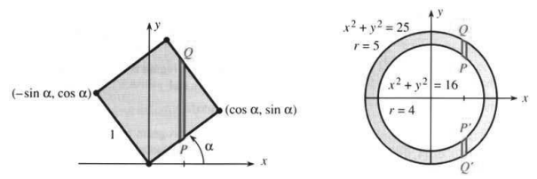
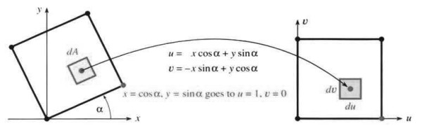
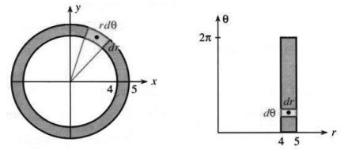
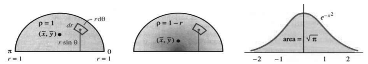
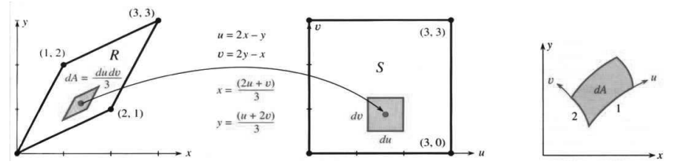

# 14.2 换用更合适的坐标

原文：PDF 第 619–627 页，印刷页 606–614。状态：初译，已逐页自校，尚未复审。

<!-- PDF 619 / 印刷页 606 -->

二重积分还没学多远，你就想**变换变量**了。许多区域跟 $x,y$ 坐标轴根本对不上。图 14.5 里那个倾斜正方形和圆环就是两个例子。坐标选对了，它们都是极好的形状。我们必须能回答这些基本问题：

$$\text{求面积 }\iint dA,\quad\text{矩 }\iint x\,dA,\quad
\text{以及转动惯量 }\int$$

问题是：**$dA$ 是什么？** 我们就要离开 $dA=dx\,dy$ 里的 $xy$ 变量了。要换的原因在这里：沿 $y$ 方向的积分限太难受了，我既不知道，也不想去找。每个 $x$ 都得去找直线 $x=\text{常数}$ 从哪点 $P$ 进区域、从哪点 $Q$ 出区域；这两点的高度就是内层 $\int dy$ 的上下限。死守 $x,y$，正方形和圆环的几何特点就全丢了。

**图 14.5** 旋转角度 $\alpha$ 的单位正方形；内外半径为 $4,5$ 的圆环。

什么坐标更好？任何明理的人都同意倾斜正方形面积是 $1$：“转过来，面积就显然了。”但他未必知道它的矩、重心或转动惯量，所以我们还真得把坐标转一转。

图 14.6a 给出新坐标 $u,v$。$v$ 的积分限是 $0,1$，$u$ 也是。但**换元不只是改积分限**，新变量还带来另外两个变化：

1. 小面积 $dA=dx\,dy$ 变为 $dA=$ ____ $du\,dv$。
2. $x$ 的积分变为 ____ 的积分。

一重积分中令 $u=\sqrt x$ 时，也有同样的变化。$x=0,4$ 变成 $u=0,2$；因为 $x=u^2$，$dx=2u\,du$。换元是为了找到原函数。二重积分换元通常是为改善积分限，但其余变化也必须一并接受。

旋转正方形时，有公式连接 $x,y$ 与 $u,v$。几何很清楚，就是把坐标轴旋转 $\alpha$，但还要转化成代数：

$$\begin{cases}u=x\cos\alpha+y\sin\alpha,\\v=-x\sin\alpha+y\cos\alpha,\end{cases}
\qquad\text{反过来}\qquad
\begin{cases}x=u\cos\alpha-v\sin\alpha,\\y=u\sin\alpha+v\cos\alpha.\end{cases}\tag{1}$$

图 14.6 显示旋转。各点移动，整个正方形也随之转动。要记住式 (1)，好办法是盯住那两个顶点，看它们怎么变成 $(1,0),(0,1)$。

<!-- PDF 620 / 印刷页 607 -->

把 $\iint x\,dA$ 改为 $\iint$ ____ $du\,dv$，一部分由式 (1) 决定：它把 $x$ 写成 $u,v$ 的函数。还差 $dA$。纯旋转时，头一次猜就对了：**面积 $dx\,dy$ 等于面积 $du\,dv$。但对多数变量变换并非如此。** 一般公式等例子讲完再给。

**图 14.6** 坐标轴旋转 $\alpha$。纯旋转时 $dA=du\,dv$。

**例 1** 对倾斜正方形求 $\iint dA,\iint x\,dA,\bar x$，以及 $\iint x^2\,dA$。

**解** 正方形面积为 $\int_0^1\int_0^1du\,dv=1$。注意这些简洁的积分限。然后

$$\iint x\,dA=\int_0^1\int_0^1(u\cos\alpha-v\sin\alpha)\,du\,dv
=\tfrac12\cos\alpha-\tfrac12\sin\alpha.\tag{2}$$

这是关于 $y$ 轴的矩。因子 $1/2$ 来自 $u^2/2,v^2/2$。重心的 $x$ 坐标是

$$\bar x=\frac{\iint x\,dA}{\iint dA}
=(\tfrac12\cos\alpha-\tfrac12\sin\alpha)/1.$$

同理，积分 $y$ 得到 $\bar y$。答案并不神秘：$(\bar x,\bar y)$ 就在正方形中心！代入 $x=u\cos\alpha-v\sin\alpha$ 使 $x\,dA$ 看起来更复杂，却让积分限 $0,1$ 好得多。

关于 $y$ 轴的转动惯量 $I_y$ 也简化了：

$$\iint x^2\,dA=\int_0^1\int_0^1(u\cos\alpha-v\sin\alpha)^2\,du\,dv
=\frac{\cos^2\alpha}{3}-\frac{\cos\alpha\sin\alpha}{2}+\frac{\sin^2\alpha}{3}.\tag{3}$$

下面这一点你知道，但我还是要写出来：**答案不含 $u,v$。** 它们像 $x,y$ 一样是哑变量。答案含 $\alpha$，因为正方形转动了，而面积始终为 $1$。关于 $x$ 轴的转动惯量 $I_x=\iint y^2\,dA$ 与式 (3) 相同，只是所有符号都是加号。

**问题** $I_x+I_y$ 化简为常数 $2/3$，为什么不依赖 $\alpha$？

**回答** $I_x+I_y=I_0$。关于 $(0,0)$ 的这个极转动惯量不随旋转改变，因为正方形绕自己的一个顶点旋转。

## 换成极坐标

下一个变换使用 $r,\theta$。小面积变为 $dA=r\,dr\,d\theta$，绝不是 $dr\,d\theta$。面积由两个长度相乘得到，$d\theta$ 不是长度。图 14.7 给出关键小区域：由射线和圆截成的“极坐标矩形”。有两种方法求其面积 $\Delta A$，都得到 $r\,dr\,d\theta$。

<!-- PDF 621 / 印刷页 608 -->

**近似法** 直边长为 $\Delta r$，圆弧长接近 $r\Delta\theta$，交角为 $90^\circ$，因此 $\Delta A$ 接近 $(\Delta r)(r\Delta\theta)$。

**精确法** 扇形面积为 $r^2\Delta\theta/2$。两个扇形的面积差为

$$\Delta A=\frac12\left(r+\frac{\Delta r}{2}\right)^2\Delta\theta
-\frac12\left(r-\frac{\Delta r}{2}\right)^2\Delta\theta
=r\Delta r\Delta\theta.$$

精确法把 $r$ 放在半径范围的正中间，见图。近似法则忽略向外移动时 $r\Delta\theta$ 的变化，只保留一阶项。

还有第三种方法，不需要图形或几何。微积分总有第三种办法！把变量变换 $x=r\cos\theta,y=r\sin\theta$ 代入 $dA$ 的一般公式，就会得到面积元 $r\,dr\,d\theta$。

**图 14.7** $xy$ 平面与 $r\theta$ 平面中的圆环和极坐标矩形。图示小块的伸缩因子为 $r=4.5$。

**例 2** 求圆环的面积、重心，以及 $\iint x^2\,dA$。

**解** $r$ 的积分限为 $4,5$，$\theta$ 的积分限为 $0,2\pi$。极坐标完全适合圆环。相比 $x=\sqrt{25-y^2}$ 这类积分限，改用 $r\,dr\,d\theta$ 的代价很小：

$$\text{面积}=\int_0^{2\pi}\int_4^5r\,dr\,d\theta
=2\pi\left[\tfrac12r^2\right]_4^5=\pi5^2-\pi4^2=9\pi.$$

$\theta$ 积分为 $2\pi$，因为是整圆。实际上，圆环是一个巨大的极坐标矩形，也可用精确公式 $r\Delta r\Delta\theta$，取 $\Delta\theta=2\pi,\Delta r=5-4$，中间半径 $r=4.5$，得到 $(4.5)(1)(2\pi)=9\pi$。

圆环关于 $(0,0)$ 对称，故 $x\,dA$ 的积分必为零：

$$\iint_Rx\,dA=\int_0^{2\pi}\int_4^5(r\cos\theta)r\,dr\,d\theta
=\left[\tfrac13r^3\right]_4^5[\sin\theta]_0^{2\pi}=0.$$

注意 $r\cos\theta$ 来自 $x$，另一个 $r$ 来自 $dA$。转动惯量为

$$\iint_Rx^2\,dA=\int_0^{2\pi}\int_4^5r^2\cos^2\theta\,r\,dr\,d\theta
=\left[\tfrac14r^4\right]_4^5\int_0^{2\pi}\cos^2\theta\,d\theta
=\tfrac14(5^4-4^4)\pi.$$

这里的 $\theta$ 积分是 $\pi$ 而非 $2\pi$，因为 $\cos^2\theta$ 的平均值是 $1/2$ 而非 $1$。

供参考，密度为 $\rho(x,y)$ 时，各转动惯量为

$$I_y=\iint x^2\rho\,dA,\quad I_x=\iint y^2\rho\,dA,\quad
I_0=\iint r^2\rho\,dA=\text{极转动惯量}=I_x+I_y.\tag{4}$$

<!-- PDF 622 / 印刷页 609 -->

**例 3** 求密度分别为 $\rho=1$ 和 $\rho=1-r$ 的半圆薄板的质量与矩。

**解** 图 14.8 的半圆半径为 $1$，角度从 $0$ 到 $\pi$，即上半圆。极坐标最合适。**质量是密度的积分：**

$$M=\int_0^\pi\int_0^1r\,dr\,d\theta=\tfrac12\pi,
\qquad M=\int_0^\pi\int_0^1(1-r)r\,dr\,d\theta=\tfrac16\pi.$$

第一个质量 $\pi/2$ 等于面积，因为 $\rho=1$；第二个质量 $\pi/6$ 较小，因为密度较低。积分 $\rho=1$ 相当于求高度 $z=1$ 下方的体积，是圆柱的一部分；积分 $\rho=1-r$ 相当于求高度 $z=1-r$ 下方的体积，是圆锥的一部分。圆锥体积多一个因子 $1/3$。重心涉及矩 $M_x=\iint y\rho\,dA$：到 $x$ 轴的距离是 $y$，小块质量为 $\rho\,dA$，积分把质量乘距离加起来。

还是极坐标最好用，$y=r\sin\theta$。两个密度分别算：

$$\iint y\,dA=\int_0^\pi\int_0^1r\sin\theta\,r\,dr\,d\theta=\frac23,$$

$$\iint y(1-r)\,dA=\int_0^\pi\int_0^1r\sin\theta(1-r)r\,dr\,d\theta=\frac16.$$

重心高度 $\bar y=M_x/M$，即矩除以质量：

$$\rho=1:\quad\bar y=\frac{2/3}{\pi/2}=\frac4{3\pi};
\qquad\rho=1-r:\quad\bar y=\frac{1/6}{\pi/6}=\frac1\pi.$$

**图 14.8** 半圆，上方堆出密度。**图 14.9** 钟形曲线。

**问题** 比较 $\rho=1$、其他正常数，以及 $\rho=1-r$ 时的 $\bar y$。

**回答** 任意常数密度都给出 $\bar y=4/(3\pi)$；$1-r$ 在 $r=0$ 附近更密，故 $\bar y$ 降至 $1/\pi$。

**问题** $\bar y=4/(3\pi)$ 与半圆内 $y$ 的“平均值”有什么关系？

**回答** 它们相同，这正是 $\bar y$ 的意义：积分除以面积。

$$\text{函数的平均值}=\frac{\iint f(x,y)\,dA}{\iint dA}.\tag{5}$$

$f$ 的积分，除以 $1$ 的积分——也就是面积。一维情形里，$\int_a^bv(x)dx$ 除以 $\int_a^b1dx=b-a$，第 5.6 节的 $v(x)$ 平均值就是这么来的。式 (5) 对 $f(x,y)$ 是同一个想法。

<!-- PDF 623 / 印刷页 610 -->

**例 4** 利用 $A^2=\displaystyle\left(\int_{-\infty}^{\infty}e^{-x^2}dx\right)\left(\int_{-\infty}^{\infty}e^{-y^2}dy\right)=\pi$，计算 $A=\displaystyle\int_{-\infty}^{\infty}e^{-x^2}dx=\sqrt\pi$。

$A$ 是钟形曲线下的面积，见图 14.9。这是概率研究里最重要的定积分。难就难在里头没有因子 $2x$：积分 $2xe^{-x^2}$ 得到 $-e^{-x^2}$，可 $e^{-x^2}$ 无法积分——除非用计算机近似。怎样证明 $A$ 精确等于 $\sqrt\pi$？诀窍是从面积积分 $A$ 转向体积积分 $A^2$。这很不寻常，也不容易喜欢，但结果证明这样做值得：

$$A^2=\int_{-\infty}^{\infty}\int_{-\infty}^{\infty}e^{-x^2}e^{-y^2}\,dy\,dx
=\int_0^{2\pi}\int_0^\infty e^{-r^2}r\,dr\,d\theta.\tag{6}$$

二重积分覆盖整个平面。$r^2$ 来自 $x^2+y^2$，关键因子 $r$ 来自极坐标。现在可以令 $u=r^2$：径向积分为 $\tfrac12\int_0^\infty e^{-u}du=1/2$，角向积分为 $2\pi$。因此 $A^2=(1/2)(2\pi)=\pi$，回到一重积分，$A=\sqrt\pi$。

**例 5** 将例 4 用于“正态分布”$p(x)=e^{-x^2/2}/\sqrt{2\pi}$。

第 8.4 节讲概率时就强调过 $p(x)$ 有多重要，只是当时还验证不了 $\int p(x)dx=1$。现在能验证了：

$$x=\sqrt2\,y\quad\Rightarrow\quad
\frac1{\sqrt{2\pi}}\int_{-\infty}^{\infty}e^{-x^2/2}dx
=\frac1{\sqrt\pi}\int_{-\infty}^{\infty}e^{-y^2}dy=1.\tag{7}$$

**问题** 为什么 $p(x)$ 中要有这些 $2$？$e^{-x^2}/\sqrt\pi$ 的积分也是 $1$。

**回答** 有了 $2$，“方差”$\int x^2p(x)dx=1$，这个数很方便。

## 换用其他坐标

前面说过还有第三种方法：不用图、不用几何，也能求出 $r\,dr\,d\theta$。它直接从 $x=r\cos\theta,y=r\sin\theta$ 出发，旋转坐标轴之后，$du\,dv$ 前的那个因子 $1$ 也照样能求出来。更要紧的是，不管作什么变量变换，它都能找出面积元 $dA=Jdu\,dv$ 里的因子 $J$。我们从 $xy$ 换到 $uv$。

一重积分里，原来的 $dx$ 和新 $du$ 之间的“伸缩因子”自然就是 $dx/du$。碰到 $dx$，就写成 $(dx/du)du$；碰到 $(du/dx)dx$，就写成 $du$。这就是换元的思想，也是简化积分的主要方法。

到了二重积分，伸缩因子落在面积上：$dx\,dy$ 变为 $|J|du\,dv$。**新旧变量通过 $x=x(u,v),y=y(u,v)$ 联系。** 坐标为 $(u,v)$ 的点对应坐标为 $(x,y)$ 的点。$uv$ 平面内整个区域 $S$ 对应于 $xy$ 平面内整个区域 $R$。面积元 $|J|du\,dv$ 对应 $dx\,dy$。$J$ 的公式是 $dx/du$ 的二维版本。

<!-- PDF 624 / 印刷页 611 -->

> **14B** 面积伸缩由二阶**雅可比行列式** $J(u,v)$ 给出：
> $$J=\begin{vmatrix}x_u&x_v\\y_u&y_v\end{vmatrix}
> =\frac{\partial x}{\partial u}\frac{\partial y}{\partial v}
> -\frac{\partial x}{\partial v}\frac{\partial y}{\partial u}.\tag{8}$$
> $xy$ 平面区域 $R$ 上的积分变为 $uv$ 平面区域 $S$ 上的积分：
> $$\iint_Rf(x,y)\,dx\,dy
> =\iint_Sf(x(u,v),y(u,v))|J|\,du\,dv.\tag{9}$$

行列式 $J$ 常记为 $\partial(x,y)/\partial(u,v)$，提醒我们它类似 $dx/du$。要求 $J\ne0$，以使伸长和缩小受控。

你自然会问：为什么式 (9) 要取绝对值 $|J|$？一重积分可没这么做。原因就在积分限里。换元 $x=-u$ 后，$\int_0^1dx=\int_0^{-1}(-du)$。我们保留负号，允许一重积分反向进行。二重积分也能按有向来算，但通常是从左到右、从下到上，所以这里用 $|J|$，按正向积分。

**例 6** 极坐标有 $x=u\cos v=r\cos\theta,y=u\sin v=r\sin\theta$。无需几何便可得到

$$J=\begin{vmatrix}x_r&x_\theta\\y_r&y_\theta\end{vmatrix}
=\begin{vmatrix}\cos\theta&-r\sin\theta\\\sin\theta&r\cos\theta\end{vmatrix}=r.\tag{10}$$

**例 7** 对线性变换 $x=au+bv,y=cu+dv$ 求 $J$。

$$J=\begin{vmatrix}x_u&x_v\\y_u&y_v\end{vmatrix}
=\begin{vmatrix}a&b\\c&d\end{vmatrix}=ad-bc.\tag{11}$$

为什么作这么简单的变换，让 $a,b,c,d$ 全是常数？它能把平行四边形变成正方形，也能旋转正方形。图 14.10 是典型例子。常识告诉我们纯旋转不改变面积，$J=1$；现在由式 (1)、(11) 得到 $ad-bc=\cos^2\alpha+\sin^2\alpha=1$。

实际选择坐标时，$xy$ 矩形一般变为 $uv$ 矩形。原来的边可以是曲线，如极坐标矩形，而交角常是 $90^\circ$；这种坐标是“正交”的。下例交角不是 $90^\circ$，$J$ 仍能给出答案。

**图 14.10** 从 $xy$ 变为 $uv$，有 $J=1/3$。**图 14.11** 曲边小区域也有 $dA=|J|du\,dv$。

<!-- PDF 625 / 印刷页 612 -->

**例 8** 求图 14.10 中 $R$ 的面积，以及 $\iint_Re^x\,dx\,dy$。

**解** 图示 $x=2u/3+v/3,y=u/3+2v/3$，所以

$$J=\begin{vmatrix}x_u&x_v\\y_u&y_v\end{vmatrix}
=\begin{vmatrix}2/3&1/3\\1/3&2/3\end{vmatrix}=\frac49-\frac19=\frac13.$$

$xy$ 平行四边形的面积变成 $uv$ 正方形上的积分：

$$\iint_Rdx\,dy=\iint_S|J|du\,dv
=\int_0^3\int_0^3\frac13du\,dv=\frac13\cdot3\cdot3=3.$$

正方形面积为 $9$，平行四边形面积为 $3$。真不知道该称 $J=1/3$ 为伸长因子还是缩小因子。另一个积分为

$$\begin{aligned}
\iint_Re^x\,dx\,dy
&=\int_0^3\int_0^3e^{2u/3+v/3}\frac13du\,dv\\
&=\left[\frac32e^{2u/3}\right]_0^3
\left[3e^{v/3}\right]_0^3\frac13
=\frac32(e^2-1)(e-1).
\end{aligned}$$

关键在于：换成 $u,v$ 后积分限变简单了，就是 $0,3$。

**为什么伸缩因子 $J$ 是行列式？** 直边情形可回到第 11.3 节的向量：平行四边形面积由行列式给出。这里的边虽然弯曲，但这只产生我们忽略的 $(du)^2$ 和 $(dv)^2$。$du$ 的变化给出图 14.11 的第一条边 $((\partial x/\partial u)\mathbf i+(\partial y/\partial u)\mathbf j)du$；第二条边为 $((\partial x/\partial v)\mathbf i+(\partial y/\partial v)\mathbf j)dv$。弯曲来自二阶导数。面积，即两边的叉积，为 $|J|du\,dv$。

**最后的说明** 我忍不住再看逆向变换。现在矩形在 $xy$ 中，平行四边形在 $uv$ 中。在所有公式中交换 $x$ 与 $u$、$y$ 与 $v$：

$$\text{新 }J=\begin{vmatrix}u_x&u_y\\v_x&v_y\end{vmatrix}
=\frac{\partial(u,v)}{\partial(x,y)}=\frac1{\text{旧 }J}.\tag{12}$$

这与 $du/dx=1/(dx/du)$ 完全类似，是反函数求导。斜率乘积为 $1$，伸出去再缩回来。二维里换成二阶矩阵，单位矩阵 $I$ 顶替 $1$：

$$\frac{dx}{du}\frac{du}{dx}=1\quad\longrightarrow\quad
\begin{bmatrix}x_u&x_v\\y_u&y_v\end{bmatrix}
\begin{bmatrix}u_x&u_y\\v_x&v_y\end{bmatrix}
=\begin{bmatrix}1&0\\0&1\end{bmatrix}.\tag{13}$$

第一行乘第一列为 $x_uu_x+x_vv_x=\partial x/\partial x=1$；第一行乘第二列为 $x_uu_y+x_vv_y=\partial x/\partial y=0$。**两个矩阵互为逆矩阵。** 矩阵和它的逆矩阵，行列式之间满足：旧 $J$ 乘新 $J$ 等于 $1$。这些 $J$ 不能为零，正如 $dx/du,du/dx$ 不为零。（反函数持续递增或持续递减。）

在二维中，面积元 $dx\,dy$ 变成 $Jdu\,dv$，再变回 $dx\,dy$。

<!-- PDF 626 / 印刷页 613 -->

## 14.2 习题

### 阅读填空

换元是为了改善积分的 **a____**。圆盘 $x^2+y^2\le9$ 变成矩形 $0\le r\le$ **b____**、$0\le\theta\le$ **c____**。$\iint dy\,dx$ 的内层积分限为 $y=\pm$ **d____**。在极坐标中，面积积分变为 $\iint$ **e____** $=$ **f____**。

极坐标矩形的边长为 $dr$ 和 **g____**，有两条边不是 **h____**，但角度仍为 **i____**。圆 $r=1,r=3$ 与射线 $\theta=0,\theta=\pi/4$ 之间的面积为 **j____**。$\iint x\,dy\,dx$ 变为 $\iint$ **k____**，它是关于 **m____** 轴的 **l____**。$\bar x$ 是比值 **n____**，也就是 **o____** 的 $x$ 坐标，是 $x$ 的 **p____** 值。

旋转 $\alpha$ 后到达 $(u,v)$ 的点原来位于 $x=u\cos\alpha-v\sin\alpha,y=$ **q____**。$uv$ 平面的矩形来自 $xy$ 平面的 **r____**。面积 **s____**，故伸缩因子 $J=$ **t____**。它是含 $\cos\alpha,\sin\alpha$ 的矩阵 **u____** 的行列式。转动惯量 $\iint x^2dx\,dy$ 变为 $\iint$ **v____** $du\,dv$。

一重积分中，$dx$ 变为 **w____** $du$；二重积分中，$dx\,dy$ 变为 $Jdu\,dv$，其中 $J=$ **x____**。伸缩因子是二阶矩阵 **y____** 的行列式。$x(u,v),y(u,v)$ 连接 $xy$ 区域 $R$ 与 $uv$ 区域 $S$，且 $\iint_Rdx\,dy=\iint_S$ **z____** $=$ **A____** 的面积。极坐标有 $x=$ **B____**，$y=$ **C____**。对于 $x=u,y=u+4v$，行列式 $J=$ **D____**，$uv$ 正方形来自 $xy$ 中的 **E____**。反向变换为 $u=x,v=(y-x)/4$，新 $J=$ **F____**。$J$ 为常数，因为变换是 **G____** 的。

第 1–12 题的 $R$ 是扇形 $0\le r\le1,\pi/4\le\theta\le3\pi/4$。

1. $R$ 的面积是多少？用极坐标积分核对。
2. 求 $\iint dy\,dx$ 的上下限，使积分给出 $R$ 的面积，再算出结果。附加题：求 $\iint dx\,dy$ 的上下限。
3. 式 (1) 取 $\alpha=\pi/4$，把 $R$ 旋转到 $uv$ 区域 $S=$ ____。求 $\iint du\,dv$ 的上下限。
4. 把 $\iint y\,dx\,dy$ 化为极坐标，再除以 $R$ 的面积，求形心高度 $\bar y$。
5. $R$ 有 $\bar x=0$，因为 ____。旋转 $\alpha=\pi/4$ 后，$R$ 的形心 $(\bar x,\bar y)$ 变成 $S$ 的形心 ____。
6. 求任意扇形 $0\le r\le a,0\le\theta\le b$ 的形心。
7. 设 $R^*$ 是把 $R$ 上移，使尖点位于 $x=0,y=1$ 得到的区域。(a) 求 $\iint dy\,dx$ 的上下限，积分区域取 $R^*$。(b) 令 $x^*=x,y^*=y-1$，$xy$ 区域 $R^*$ 对应 $x^*y^*$ 平面的什么区域？(c) 变换后 $dx\,dy=$ ____ $dx^*dy^*$。
8. 求 $\iint r\,dr\,d\theta$ 的上下限，区域是第 7 题的 $R^*$。
9. $R^*$ 的合适坐标是 $r^*,\theta^*$，其中 $x=r^*\cos\theta^*,y=r^*\sin\theta^*+1$。(a) 证明 $J=r^*$，所以 $dA=r^*dr^*d\theta^*$。(b) 求 $\iint r^*dr^*d\theta^*$ 的上下限，区域取 $R^*$。
10. 若 $R$ 的形心为 $(0,\bar y)$，则 $R^*$ 的形心为 ____。半径 $3$、圆心 $(1,2)$ 的圆盘形心为 ____，它的上半圆盘形心为 ____。
11. 原扇形 $R$ 的转动惯量 $I_x,I_y,I_0$ 为 ____。
12. 平移后扇形 $R^*$ 的转动惯量 $I_x,I_y,I_0$ 为 ____。

第 13–16 题把四边区域变为正方形。

13. $R$ 的直边为 $y=2x,x=1,y=1+2x,x=0$。确定四个顶点、画图，并用几何求面积。
14. 选择 $a,b,c,d$，使 $x=au+bv,y=cu+dv$ 把上一题的 $R$ 对应到单位正方形 $S:0\le u,v\le1$。由伸缩因子 $J=ad-bc$ 求 $R$ 的面积。
15. $R$ 的直边为 $x=0,x=1,y=0,y=2x+3$。选择 $a,b,c$，使 $x=u,y=au+bv+cuv$ 把 $R$ 对应到单位正方形 $S$。
16. 第 15 题需要非线性项 $uv$。哪些区域 $R$ 能通过线性变换 $x=au+bv,y=cu+dv$ 对应到正方形 $S$？

第 17–22 题画出对应于顶点 $(0,0),(1,0),(0,1),(1,1)$ 的 $uv$ 正方形 $S$ 的 $xy$ 区域 $R$。先找顶点，再像拼图一样确定各边。

17. $x=2u+v,y=u+2v$。
18. $x=3u+2v,y=u+v$。
19. $x=e^{2u+v},y=e^{u+2v}$。
20. $x=uv,y=v^2-u^2$。
21. $x=u,y=v(1+u^2)$。
22. $x=u\cos v,y=u\sin v$（只有三个顶点）。
23. 对第 17、19 题用式 (8) 求 $J$，再由 $\iint_S|J|du\,dv$ 求 $R$ 的面积。
24. 对第 18、20 题求 $J=\partial(x,y)/\partial(u,v)$ 及 $R$ 的面积。
25. 若 $R$ 位于 $x=0$ 与 $x=1$ 之间、图像 $y=f(x)>0$ 下方，则 $x=u,y=vf(u)$ 把 $R$ 对应到单位正方形 $S$。确定 $R$ 的顶点以及 $u=1/2,v=1$ 对应的点。计算 $J$ 以证明已知事实：$\displaystyle\operatorname{area}(R)=\int_0^1f(x)dx=\int_0^1\int_0^1Jdu\,dv$。

<!-- PDF 627 / 印刷页 614 -->

26. 从 $r=\sqrt{x^2+y^2},\theta=\tan^{-1}(y/x)$ 计算 $r_x,r_y,\theta_x,\theta_y$ 及行列式 $J=\partial(r,\theta)/\partial(x,y)$。它与 $r\,dr\,d\theta$ 中的因子 $r=\partial(x,y)/\partial(r,\theta)$ 有何关系？
27. 例 4 从 $0$ 到 $\infty$ 积分 $e^{-x^2}$，答案为 $\sqrt\pi$。同样，$B=\int_0^1e^{-x^2}dx$ 给出 $B^2=(\int_0^1e^{-x^2}dx)(\int_0^1e^{-y^2}dy)$。把单位正方形上的这个二重积分换成 $r,\theta$，找出使精确求值困难的径向积分限。
28. 用分部积分证明标准正态分布 $p(x)=e^{-x^2/2}/\sqrt{2\pi}$ 满足 $\sigma^2=\int_{-\infty}^{\infty}x^2p(x)dx=1$。
29. 求圆周上一点到圆盘内部各点的平均距离。提示：把该点取为 $(0,0)$，以 $0\le r\le2a\cos\theta,0\le\theta\le\pi$ 表示半径 $a$ 的圆盘。距离为 $r$，平均距离为 $\bar r=\iint$ ____ $/\iint$ ____。
30. 画出区域 $R:0\le x\le1,0\le y\le\infty$，用极坐标描述它，即求 $r,\theta$ 的范围。用极坐标积分 $\iint_R(x^2+y^2)^{-3/2}dx\,dy$。
31. 用极坐标求单位圆盘 $x^2+y^2\le1$ 上方、$z=x^2+y^2$ 下方的体积。
32. 例 1 最后给出了转动惯量 $\iint y^2dA$。核对该积分。
33. 在正方形 $-1\le x\le2,-2\le y\le1$ 中，应把单位质量放在哪里，使下列量最大？总质量满足 $\iint\rho\,dx\,dy=1$。(a) $\iint x^2\rho\,dA$；(b) $\iint y^2\rho\,dA$；(c) $\iint r^2\rho\,dA$。
34. 判断正误并说明理由：(a) 若 $uv$ 区域 $S$ 对应 $xy$ 区域 $R$，则二者面积相等。(b) $\iint x\,dA\le\iint x^2\,dA$。(c) $f(x,y)$ 的平均值是 $\iint f(x,y)\,dA$。(d) $\int_{-\infty}^{\infty}xe^{-x^2}dx=0$。(e) 极坐标矩形与同顶点的直边区域面积相同。
35. 若密度 $\rho=xy$，求例 1 倾斜正方形的质量。
36. 若密度 $\rho=x^2+y^2$，求例 2 圆环的质量。它等于什么密度下的哪一个转动惯量？
37. 若密度 $\rho=x^2+y^2$，求例 2 圆环的极转动惯量 $I_0$。
38. 给以下命题起一个恰当的名称：$\iint_Rf(x,y)\,dA=f(P)\operatorname{area}(R)$，其中 $P$ 是 $R$ 中一点。对 $f=x,f=y$，哪个点 $P$ 使等式成立？
39. 求图 14.6a 最上方顶点的 $xy$ 坐标，验证它对应 $(u,v)=(1,1)$。
