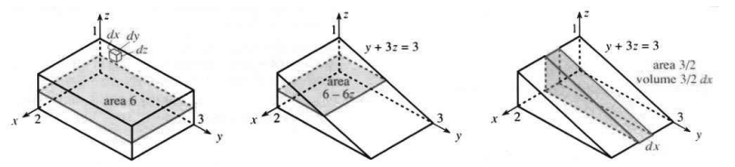
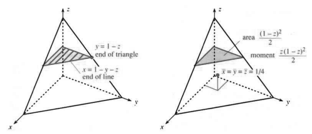
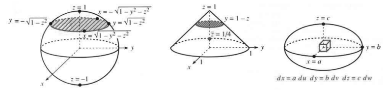

# 14.3 三重积分

原文：PDF 第 628–633 页，印刷页 615–620。状态：初译，已逐页自校，尚未复审。

<!-- PDF 628 / 印刷页 615 -->

书读到这里，我觉得可以直接与你交谈了。你大概已经猜得出三重积分是什么样子：小区间或小矩形换成了小盒子；长度 $dx$ 或面积 $dx\,dy$ 换成小盒子的体积 $dV=dx\,dy\,dz$，也就是长乘宽乘高。目标是用积分把这些小盒子合起来。主要难点将是找准 $x,y,z$ 的正确积分限。

我们当然能设想出三维空间中越来越复杂的区域。不过我认为，区域看不清楚，方法也就看不清楚。在实际应用中，下列六种形状最重要：

**长方体、棱柱、圆柱、圆锥、四面体、球。**

长方体最容易，球也许最难——不过用球坐标就没有问题。圆柱和圆锥介于两者之间，可以用 $xyz$ 坐标，但最好用 $r\theta z$。我们先用 $xyz$ 坐标讨论长方体和棱柱。

**例 1　用三重积分求长方体和棱柱的体积（图 14.12）。**

$$\iiint_{\text{长方体}}dV=\int_{z=0}^1\int_{y=0}^3\int_{x=0}^2 dx\,dy\,dz,
\qquad
\iiint_{\text{棱柱}}dV=\int_{z=0}^1\int_{y=0}^{3-3z}\int_{x=0}^2 dx\,dy\,dz.$$

两式的内层积分都是 $\int dx=2$。沿 $x$ 方向穿过这两个立体的线段，长度都是 2。中间一层积分给出 $y$ 的范围，因为 $dy$ 排在第二位：

$$\int_{y=0}^3 2\,dy=6,\qquad
\int_{y=0}^{3-3z}2\,dy=6-6z.$$

积分两次以后，结果是**面积**。第一个面积 6 是长方体的平面截面积；第二个面积 $6-6z$ 是棱柱的截面积。阴影矩形从 $y=0$ 延伸到 $y=3-3z$——这里必须用到棱柱的边界方程 $y+3z=3$。**此时 $z$ 仍是常数！** 但面积依赖于 $z$，因为棱柱越往上越薄。底面积是 $6-6z=6$，顶面积是 $6-6z=0$。

外层积分把面积乘以 $dz$，得到薄片体积。由于 $z$ 最后积分，这些薄片是水平的。积分把薄片加起来，得到总体积：

$$\text{长方体体积}=\int_{z=0}^1 6\,dz=6,
\qquad
\text{棱柱体积}=\int_{z=0}^1(6-6z)\,dz=[6z-3z^2]_0^1=3.$$

长方体体积 $2\cdot3\cdot1$ 不需要微积分。棱柱是长方体的一半，所以体积肯定是 3；但看到 $6z-3z^2$ 给出这个答案，仍令人满意。我们的目的是理解三重积分怎样运作。

**问题　按 $dz\,dy\,dx$ 的次序求棱柱体积（共有六种次序）。**

答：

$$\int_0^2\int_0^3\int_0^{(3-y)/3}dz\,dy\,dx
=\int_0^2\int_0^3\frac{3-y}{3}\,dy\,dx
=\int_0^2\frac32\,dx=3.$$

要找到 $z$ 积分的上下限，就沿 $z$ 方向看一条直线。它在 $z=0$ 处进入棱柱，在斜面 $y+3z=3$ 处离开，因此上限为 $z=(3-y)/3$。这就是第 14.1 节所说的细棒高度。本节把这个高度写成 $\int dz$；更快的解法可直接从二重积分开始。

<!-- PDF 629 / 印刷页 616 -->

**图 14.12**　长方体三条边长为 $2,3,1$。棱柱是它的一半，体积为 $\int(6-6z)\,dz$ 或 $\int\frac32\,dx$。图中 area 表示截面积，volume 表示薄片体积。

最后一个积分中的 $\frac32$ 是什么？它是平面 $x=\text{常数}$ 截得的**竖直截面的面积**。外层积分把薄片加起来。

**$\iiint f(x,y,z)\,dV$ 可通过三个单积分 $\int[\int[\int f\,dx]\,dy]\,dz$ 来计算。**

这一步得说清楚，里头有基本的微积分原理。三重积分是和 $\sum f_i\Delta V$ 的极限；求和遍及体积为 $\Delta V$ 的小盒子，$f_i$ 是第 $i$ 个盒子内 $f(x,y,z)$ 的任意一个值。（取极限时，小盒子便能贴合弯曲的区域。）现在按一定顺序排列盒子：先沿 $x$ 方向排成线，再把一条条线排成平面。沿线排好的盒子给出最内层的 $x$ 积分；结果依赖于 $y,z$。$y$ 积分把这些线组合成平面。最后，外层积分计入所有平面，也就计入全部盒子。

例 2 很重要，因为它展示了比长方体和棱柱更多的可能性。

**例 2　求四面体（有四个面的棱锥）的体积，并确定 $(\bar x,\bar y,\bar z)$。**

解：四面体有四个平面，每个面都是三角形。图 14.13 的第四个面位于平面 $x+y+z=1$ 上。一条沿 $x$ 方向的直线从 $x=0$ 处进入，从 $x=1-y-z$ 处离开。（长度依赖于 $y,z$；边界平面方程给出 $x$。）随后，$y$ 积分把这些线组合成平面截片：

$$\int_{y=0}^{1-z}\int_{x=0}^{1-y-z}dx\,dy
=\int_{y=0}^{1-z}(1-y-z)\,dy
=\left[y-\frac12y^2-zy\right]_0^{1-z}
=\frac12(1-z)^2.$$

$\frac12(1-z)^2$ 是什么？它是**高度 $z$ 处的截面积**。平面在这个高度截出一个直角三角形，两条直角边都长 $1-z$。面积是对的，但请注意积分限：**$x$ 到 $1-y-z$ 为止，为什么 $y$ 到 $1-z$ 为止？** 因为我们正在组合线段，而不是点。图上每个不超过 $1-z$ 的 $y$ 都对应一条线段。

薄片相加得到体积：

$$\int_0^1\frac12(1-z)^2\,dz
=\left[\frac16(z-1)^3\right]_0^1=\frac16.$$

这与棱锥体积公式 $\frac13(\text{底面积}\times\text{高})$ 相符。

形心的高度 $\bar z$ 就是“$z$ 的平均值”。计算 $\iiint z\,dV$，再除以体积即可。每个水平薄片都乘上自己的高度 $z$，积分限不变：

$$\iiint z\,dV
=\int_0^1\int_0^{1-z}\int_0^{1-y-z}z\,dx\,dy\,dz
=\int_0^1\frac{z(1-z)^2}{2}\,dz=\frac1{24}.$$

计算很快，因为在 $x,y$ 积分中，$z$ 是常数。每个三角形薄片的贡献是 $z$ 乘以面积 $\frac12(1-z)^2$，再乘以 $dz$。最后 $z$ 积分给出矩 $1/24$。

<!-- PDF 630 / 印刷页 617 -->

**图 14.13**　线段终止于平面 $x+y+z=1$；三角形终止于边 $y+z=1$。平均高度为 $\bar z=\iiint z\,dV/\iiint dV$。左图标示线段和三角形的终点，右图标示截面积、矩和形心。

为求平均高度，用 $1/24$ 除以体积：

$$\bar z=\text{形心的高度}=\frac{\iiint z\,dV}{\iiint dV}
=\frac{1/24}{1/6}=\frac14.$$

由对称性，$\bar x=\frac14$，$\bar y=\frac14$。形心是 $(\frac14,\frac14,\frac14)$。拿它和标准直角三角形的形心 $(\frac13,\frac13)$ 比一比，再和单位区间的中点 $\frac12$ 比一比。四维空间里一定也有一个区域，中心在 $(\frac15,\frac15,\frac15,\frac15)$，有五个边界面。

长度、面积和体积还有另一个规律。标准区间长为 1，标准三角形面积为 $\frac12$，标准四面体体积为 $\frac16$，那么四维“超体积”一定为____。区间延伸到点 $x=1$，三角形延伸到直线 $x+y=1$，四面体延伸到平面 $x+y+z=1$，四维区域则终止于超平面 $\underline{\qquad}=1$。

**例 3　求单位球面 $x^2+y^2+z^2=1$ 内的体积 $\iiint dx\,dy\,dz$。**

第一个问题：$x$ 的积分限是什么？一根沿 $x$ 方向穿过球的针，在哪里进入，在哪里离开？沿 $x$ 方向移动时，$y,z$ 不变。内层积分只处理 $x$。最小和最大的 $x$ 都位于边界 $x^2+y^2+z^2=1$ 上。这个方程发挥了作用——由它解出 $x$。请看 $x$ 积分的上下限：

$$\text{球体积}=\int_?^?\int_?^?
\int_{-\sqrt{1-y^2-z^2}}^{\sqrt{1-y^2-z^2}}dx\,dy\,dz
=\int_?^?\int_?^?2\sqrt{1-y^2-z^2}\,dy\,dz.\tag{1}$$

$y$ 的上下限是 $-\sqrt{1-z^2}$ 与 $+\sqrt{1-z^2}$。你可以对边界方程作代数运算，但注意：$x$ 已经消失了！现在，对每个 $z$，要找的是 $y$ 的最小值和最大值。在高度 $z$ 处画一个平面穿过球，很管用，见图 14.14。截面是半径 $r=\sqrt{1-z^2}$ 的圆，面积为 $\pi r^2$，也必定是 $y$ 积分的结果：

$$\int 2\sqrt{1-y^2-z^2}\,dy
=\text{截面积}=\pi(1-z^2).\tag{2}$$

我承认这里没有实际做积分。用面积公式 $\pi r^2$ 算不算作弊？我觉得不算。数学已经够难了，我们不必蒙着眼睛做事。目标是理解；若已经知道面积，就应使用它。

<!-- PDF 631 / 印刷页 618 -->

当然，如果确实需要，$\sqrt{1-y^2-z^2}$ 的积分也可以算，方法见第 7.2 节。

三重积分已化成单积分。我们先从一根针变成一圈针，现在再变成整个球里的针。体积就是这些薄片之和，每片的面积是 $\pi(1-z^2)$。南极在 $z=-1$，北极在 $z=+1$，积分给出单位球内的体积 $4\pi/3$：

$$\int_{-1}^1\pi(1-z^2)\,dz
=\pi\left[z-\frac13z^3\right]_{-1}^1
=\frac23\pi-\left(-\frac23\pi\right)=\frac43\pi.\tag{3}$$

**问题 1　圆锥的截面也是圆。上面的积分应怎样改变？**

答：圆锥截面半径为 $1-z$。所以要积的是截面积 $\pi(1-z)^2$，而球的截面积是 $\pi(1-z^2)$。

**问题 2　跟高为 1、半径为 1 的圆柱比，怎么样？**

答：圆柱的所有截面半径均为 1。在 $z=0$ 上方，圆柱体积为 $\pi$，半球体积为 $\frac23\pi$，圆锥体积为 $\frac13\pi$。

表面积相等时，球的体积最大。

**问题 3　圆锥、半球和圆柱的平均高度 $\bar z$ 各是多少？**

答：

$$\bar z=\frac{\int z(\text{截面积})\,dz}{\int(\text{截面积})\,dz}
=\frac14,\quad\frac38,\quad\frac12.$$

**图 14.14**　$\int dx$ 是针的长度，$\iint dx\,dy$ 是截面积。椭球是拉伸后的球。

**例 4　求椭球面 $x^2/a^2+y^2/b^2+z^2/c^2=1$ 内的体积 $\iiint dx\,dy\,dz$。**

现在 $x$ 的上下限为 $\pm a\sqrt{1-y^2/b^2-z^2/c^2}$。代数运算看着吓人；从几何看就好懂得多，因为所有截面都是椭圆。**变量替换**无疑是最好的方法。

引入 $u=x/a$、$v=y/b$、$w=z/c$，外边界变成 $u^2+v^2+w^2=1$，在新变量下，形状变成了球。球的三重积分为 $\iiint du\,dv\,dw=4\pi/3$。不过，边长 $du,dv,dw$ 的小盒子，在 $xyz$ 空间里对应多大的体积 $dV$？

每个 $uvw$ 盒子都来自一个 $xyz$ 盒子。盒子经过拉伸，但没有弯曲或扭转。因为 $u=x/a$，所以 $dx=a\,du$；同理，$dy=b\,dv$，$dz=c\,dw$。图 14.14 中 $xyz$ 盒子的体积就是 $dx\,dy\,dz=(abc)\,du\,dv\,dw$。

<!-- PDF 632 / 印刷页 619 -->

**伸缩因子 $J=abc$** 是常数，因此椭球体积为

$$\underbrace{\iiint_{\text{椭球}}dx\,dy\,dz}_{\text{积分限麻烦}}
=\underbrace{\iiint_{\text{球}}(abc)\,du\,dv\,dw}_{\text{积分限较好}}
=\frac{4\pi}{3}abc.\tag{4}$$

你会明白，这只是特殊情形；其他体积复杂得多。球和椭球的边界弯曲，而小小的 $xyz$ 盒子仍是直的。下一节介绍球坐标，终于可以写出“很好的积分限”，不过那时需要另一个 $J$。

## 14.3 习题

### 阅读填空

六种重要的立体形状为 **a**____。积分 $\iiint dx\,dy\,dz$ 把小 **c**____ 的体积 **b**____ 相加。计算时，它化为 **d**____ 个单积分。内层积分 $\int dx$ 是穿过立体的一条线段的 **e**____，变量 **f**____ 和 **g**____ 保持不变。二重积分 $\iint dx\,dy$ 是截片的 **h**____，此时 **i**____ 保持不变。然后 $z$ 积分把 **j**____ 的体积相加。

若立体区域 $V$ 由平面 $x=0,y=0,z=0$ 和 $x+2y+3z=1$ 围成，内层 $x$ 积分的上下限为 **k**____，$y$ 的上下限为 **l**____，$z$ 的上下限为 **m**____。采用新变量 $u=x,v=2y,w=3z$，外边界方程为 **n**____。$uvw$ 空间中四面体的体积为 **o**____。由 $dx=du$、$dy=dv/2$ 和 $dz=$ **p**____，可得 $xyz$ 盒子的体积 $dx\,dy\,dz=$ **q**____ $du\,dv\,dw$，所以 $V$ 的体积为 **r**____。

求 $V$ 内的平均高度 $\bar z$，应计算 **s**____ / **t**____。若密度为 $\rho=e^z$，求总质量应计算积分 **u**____。求平均密度应计算 **v**____ / **w**____。采用 $\iiint dz\,dx\,dy$ 次序时，内层积分限可以依赖于 **x**____，中层积分限可以依赖于 **y**____。椭球 $x^2+2y^2+3z^2\le8$ 的最外层积分限为 **z**____。

1. 设立体区域为 $0\le x\le y\le z\le1$，求 $\iiint dx\,dy\,dz$ 的积分限，并计算体积。
2. 将题 1 的次序反过来，写成 $\iiint dz\,dy\,dx$，求积分限。该四面体的四个面所在平面为 $x=0$、$y=x$ 以及____。
3. 这个四面体和另外五个同类四面体恰好填满单位立方体。改变题 1 的不等式，描述另外五个。
4. 求题 1 中的形心 $(\bar x,\bar y,\bar z)$。

**题 5—16：求 $\iiint dx\,dy\,dz$ 的积分限，并求立体体积。画出粗略示意图。**

5. 边长为 2、中心为 $(0,0,0)$ 的立方体。
6. 上述立方体位于 $xy$ 平面上方的一半，即一个长方体。
7. 同一立方体位于平面 $z=y$ 上方的部分，即一个棱柱。
8. 同一立方体同时位于 $z=y$ 和 $z=0$ 上方的部分。
9. 同一立方体位于 $z=x$ 上方、$z=y$ 下方的部分。
10. 同一立方体内满足 $x\le y\le z$ 的部分。这是什么形状？
11. 由平面 $x=0,y=0,z=0$ 和 $x+y+2z=2$ 围成的四面体。
12. 顶点为 $(0,0,0)$、$(2,0,0)$、$(0,4,0)$、$(0,0,4)$ 的四面体。先求经过后三个顶点的平面。
13. 题 11 的四面体位于 $z=\frac12$ 下方的部分。
14. 用平面 $z=1$ 切掉题 12 四面体的顶部后剩下的部分。
15. 位于 $z=0$ 上方、圆锥面 $\sqrt{x^2+y^2}=1-z$ 下方的立体。
16. ★ 题 12 的四面体绕 $x$ 轴翻倒到 $xy$ 平面上以后形成的立体。

**题 17—20：求 $\iiint dx\,dy\,dz$ 或 $\iiint dz\,dy\,dx$ 的积分限，并计算体积。**

17. 高为 6、底面为 $x^2+y^2\le1$ 的圆柱。
18. 上述圆柱位于平面 $z=x$ 下方的部分。注意底面，画出示意图。
19. 题 5 的立方体与上述圆柱的公共部分。
20. 将同一个圆柱沿 $x$ 轴横放。
21. 一个立方体内接于半径为 1 的球，二者中心都在 $(0,0,0)$。立方体的体积是多少？
22. 求由 $x=0,y=0,z=0$ 和 $x/a+y/b+z/c=1$ 围成区域的体积与形心。
23. 求立体 $0\le z\le4-x^2-y^2$ 的体积与形心。
24. 根据正文，椭球面 $x^2+4y^2+9z^2=16$ 内的体积是多少？终止于 $x+y+z+w=1$ 的四维棱锥，其“超体积”是多少？

<!-- PDF 633 / 印刷页 620 -->

25. 求下列 $I$ 的偏导数 $\partial I/\partial x$、$\partial I/\partial y$、$\partial^2I/\partial y\,\partial z$：
    $$I=\int_0^z\int_0^y dx\,dy,
    \qquad I=\int_0^z\int_0^y\int_0^x f(x,y,z)\,dx\,dy\,dz.$$
26. 定义函数 $f(x,y,z)$ 在立体 $V$ 内的平均值。
27. 求立方体 $|x|\le1,|y|\le1,|z|\le1$ 的转动惯量 $\iiint l^2\,dV$，其中 $l$ 分别为到下列直线的距离：(a) $x$ 轴；(b) 棱 $y=z=1$；(c) 对角线 $x=y=z$。
28. 在下面的求和式中补上上限，用小立方体的体积和得到单位立方体的体积：
    $$V=\sum_{i=1}^{\square}\sum_{j=1}^{\square}\sum_{k=1}^{\square}(\Delta x)^3=1.$$
29. ★ 求 $\Delta x\to0$ 时下式的极限：
    $$\sum_{i=1}^{3/\Delta x}\sum_{j=1}^{2/\Delta x}\sum_{k=1}^{j}(\Delta x)^3.$$
30. 单位立方体上积分的中点法取中心值 $f(\frac12,\frac12,\frac12)$。它能精确积分哪些函数 $f=x^my^nz^p$？
31. 梯形法把 $\int_0^1\int_0^1\int_0^1 f(x,y,z)\,dx\,dy\,dz$ 估计为八个顶点上函数值之和的 $\frac18$。它对哪些 $m,n,p$ 能精确积分 $x^my^nz^p$？
32. 请为立方体上的积分提出一种 27 点“辛普森法则”。若许多小立方体填满一个大长方体，为什么平均每个小立方体只需增加 8 个新点？

## 译注与待复审事项

- PDF 629 的重心积分中，中层 $dy$ 的上限原印为 $1-y$；由区域及本页前式可确定应为 $1-z$，本稿已更正。
- PDF 631 问题 1 原答把圆锥的 $(1-z)^2$ 与球半径 $\sqrt{1-z^2}$ 直接比较，混淆半径与面积；本稿明确比较截面积。例 4 原印的 $x$ 上下限漏掉因子 $a$，已补出，默认半轴 $a,b,c>0$。
- 式 (2) 原书省略积分上下限，沿用其简写；实际为 $y\in[-\sqrt{1-z^2},\sqrt{1-z^2}]$ 的定积分，不能理解为不定积分恒等式。
- 题 25 原书把积分变量与外部上限变量同名，第一式还以 $dx\,dy$ 配上外上限 $z$、内上限 $y$；本稿保留原式，统一复审时须明确哑变量及所求外部参数，避免擅改题意。
- 题 16 的翻倒方向、题 17—20 的底面位置及题 24 的非负坐标条件主要依赖上下文；题面按原文保留。题 32 的“每个立方体 8 个新点”指规则网格内部的共享计数，有限网格边界另计。
- 全部正文、填空与 32 题已译；三幅图保留原英文标注，补中文图注。尚未进行独立复审及最终版式验证。
