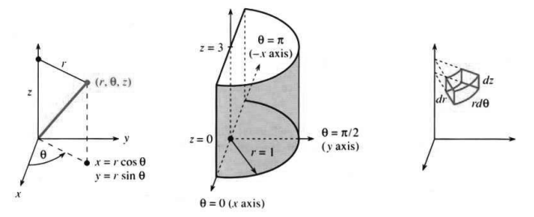
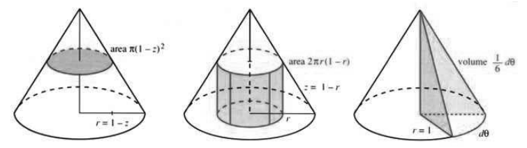
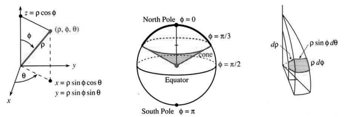
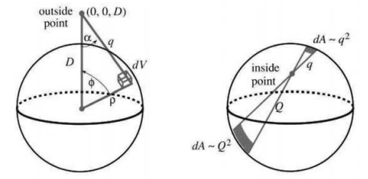

# 14.4 柱坐标与球坐标

原文：PDF 第 634–641 页，印刷页 621–628。状态：初译，已逐页自校，尚未复审。

<!-- PDF 634 / 印刷页 621 -->

柱坐标适合描述**绕一条轴对称**的立体。立体是三维的，所以需要三个坐标 $r,\theta,z$：

$$r:\text{离开轴的距离},\qquad\theta:\text{绕轴的角度},\qquad z:\text{沿轴的位置}。$$

这是平面极坐标 $r,\theta$ 与向上的 $z$ 坐标的组合。你会发现 $r\theta z$ 并不难用。先看一个以 $z$ 轴为中心轴的圆柱：

$$\text{实心圆柱： }0\le r\le1;\qquad
\text{平底与平顶： }0\le z\le3;\qquad
\text{半圆柱： }0\le\theta\le\pi.$$

在这个半圆柱上的积分为 $\int_0^3\int_0^\pi\int_0^1\underline{\quad?\quad}\,dr\,d\theta\,dz$。这些 $r,\theta,z$ 的积分限特别简单。另两种轴对称立体也几乎一样方便：

$$\text{圆锥：积分到 }r+z=1;\qquad
\text{球：积分到 }r^2+z^2=R^2.$$

我不会用柱坐标处理长方体或四面体。

积分还缺一件东西：体积元 $dV$。$dr,d\theta,dz$ 三种变化在 $xyz$ 空间中形成图 14.15c 的“弯曲盒子”。底面是极坐标小矩形，面积为 $r\,dr\,d\theta$，新增的部分是高度 $dz$。**弯曲盒子的体积为 $r\,dr\,d\theta\,dz$。** 因而三重积分中的空格应填 $r$，伸缩因子为 $J=r$。六种积分次序中，下面写出两种：

$$\text{体积}=\int_z\int_\theta\int_r r\,dr\,d\theta\,dz
=\int_\theta\int_z\int_r r\,dr\,dz\,d\theta.\tag{1}$$

**图 14.15**　一个点和半圆柱的柱坐标。小体积为 $r\,dr\,d\theta\,dz$；$x=r\cos\theta$，$y=r\sin\theta$。

**例 1　半圆柱的体积。** 从 0 到 1 的 $r\,dr$ 积分为 $\frac12$，$\theta$ 积分为 $\pi$，$z$ 积分为 3，体积为 $3\pi/2$。

**例 2　曲面 $r=1-z$ 围成图 14.16 的圆锥，求其体积。**

第一种解法：$r$ 到 $1-z$ 为止，所以 $r\,dr$ 的积分为 $\frac12(1-z)^2$。$\theta$ 积分为 $2\pi$，即转一整圈。先在这里停一下。

我们得到了 $\iint r\,dr\,d\theta=\frac12(1-z)^2\cdot2\pi$。这是**高度 $z$ 处的截面积**。截面是半径为 $1-z$ 的圆，面积为 $\pi(1-z)^2$。

<!-- PDF 635 / 印刷页 622 -->

$z$ 积分把截片相加，得到 $\pi/3$。答案正确，但不是计算体积的唯一方法。

第二种解法：先对 $z$ 和 $\theta$ 积分。由于 $z$ 到 $1-r$，$\theta$ 绕到 $2\pi$，这两个积分给出 $\iint r\,dz\,d\theta=r(1-r)2\pi$。再停一下，这必定是什么东西的面积。

对 $z,\theta$ 积分以后，得到**半径 $r$ 处的柱壳**。它的高度为 $1-r$，外层柱壳较矮。高度乘以 $2\pi r$，就是柱壳侧面的面积。选择柱壳还是截片，与第 8 章完全一样：**不同积分次序对应不同的立体分割方式。**

柱壳体积为面积乘以厚度 $dr$。整个圆锥体积为柱壳体积的积分：

$$\int_0^1r(1-r)2\pi\,dr=\pi/3.$$

第三种解法：先对 $r,z$ 积分，$\iint r\,dr\,dz=\frac16$。接着 $\theta$ 积分为 $\int\frac16\,d\theta$，得到 $\frac16$ 乘以 $2\pi$，即体积 $\pi/3$。可是 $\frac16\,d\theta$ 是什么？

第三个圆锥被分成楔形块，每块体积为 $\frac16\,d\theta$。把 $\theta$ 积分放在最后很常见，尤其当它只是乘以 $2\pi$ 时；但把它想成楔形块就不那么常见了。

**问题　体积 $\frac16\,d\theta$ 是否等于面积 $\frac16$ 乘以厚度 $d\theta$？**

答：不是！第三个圆锥中三角形的面积是 $\frac12$，不是 $\frac16$。厚度绝不是 $d\theta$。

**图 14.16**　圆锥的三种分割：高度 $z$ 处的截片、半径 $r$ 处的柱壳、角度 $\theta$ 处的楔形块。图示相应面积或体积。

这个圆锥是典型的**旋转体**，旋转轴沿 $z$ 方向。$\theta$ 积分无论排在第一、第二还是第三，都给出 $2\pi$。$r$ 积分一直到半径 $f(z)$：圆柱为 1，圆锥为 $1-z$。积分 $\iint r\,dr\,d\theta=\pi(f(z))^2$ 是圆截面的面积，剩下 $z$ 积分 $\int\pi(f(z))^2\,dz$。这正是第 8 章的体积公式 $\int\pi(f(x))^2\,dx$，只是当时的截片垂直于 $x$ 轴。

**例 3　绕 $z$ 轴的转动惯量为 $\iiint r^3\,dr\,d\theta\,dz$。** 多出的 $r^2$ 是到轴距离的平方。对于这个圆锥，三重积分为 $\pi/10$。

**例 4　相对于 $z$ 轴的一阶距离矩为 $\iiint r^2\,dr\,d\theta\,dz$。** 圆锥的这一积分为 $\pi/6$，平均距离为

$$\bar r=\frac{\text{距离矩}}{\text{体积}}=\frac{\pi/6}{\pi/3}=\frac12.$$

**例 5**　半径为 $R$ 的球在柱坐标下的边界为 $r^2+z^2=R^2$，$r$ 积分的上限为 $\sqrt{R^2-z^2}$。

<!-- PDF 636 / 印刷页 623 -->

在困难的问题中，这样的积分限难以应付。为避免它，现在改用与球天然相配的坐标。

## 球坐标

地球是实心球，至少足够接近。它的表面用两个坐标——纬度和经度。要向内挖或向外飞，还需要第三个坐标：**到球心的距离 $\rho$**。希腊字母 rho 取代 $r$，以免与柱坐标混淆。$r$ 从 $z$ 轴量起，$\rho$ 从原点量起，因此 $r^2=x^2+y^2$，而 $\rho^2=x^2+y^2+z^2$。

角 $\theta$ 与前面相同，从 0 变到 $2\pi$。它是经度，沿赤道向东走时增大。

角 $\phi$ 是新引入的。北极处为 0，南极处为 $\pi$，不是 $2\pi$。它是从 $z$ 轴向下量的**极角**。赤道纬度为 0，极角却是 $\pi/2$，即向下量到中间。几种典型形状如下：

$$\begin{array}{ll}
\text{实心球： }0\le\rho\le R,&\text{球面： }\rho=R,\\
\text{上半球： }0\le\phi\le\pi/2,&\text{东半球： }0\le\theta\le\pi.
\end{array}$$

**图 14.17**　球坐标 $\rho,\phi,\theta$。球坐标小盒子的体积为 $dV=\rho^2\sin\phi\,d\rho\,d\phi\,d\theta$。North Pole、Equator、South Pole 分别为北极、赤道、南极，cone 为圆锥面。

从原点出发的一个圆锥面上，$\phi$ 为常数。圆锥面在球面上截出一个圆，见图 14.17b，但不是大圆。从一极到另一极的一条半圆上，$\theta$ 为常数。每个内层球面上的距离 $\rho$ 为常数，从中心 $\rho=0$ 一直增加到 $\rho=R$。

**球坐标中的体积积分为 $\iiint\rho^2\sin\phi\,d\rho\,d\phi\,d\theta$。** 要解释这个出人意料的因子 $J=\rho^2\sin\phi$，先从 $x=r\cos\theta$、$y=r\sin\theta$ 出发。由图中的三角形，在球坐标下 $r=\rho\sin\phi$，$z=\rho\cos\phi$。以 $\rho\sin\phi$ 代替 $r$，得到

$$x=\rho\sin\phi\cos\theta,\qquad
y=\rho\sin\phi\sin\theta,\qquad
z=\rho\cos\phi.\tag{1}$$

记住这两步：从 $\rho\phi\theta$ 到 $r\theta z$，再到 $xyz$。检验 $x^2+y^2+z^2=\rho^2$：

$$\rho^2(\sin^2\phi\cos^2\theta+\sin^2\phi\sin^2\theta+\cos^2\phi)
=\rho^2(\sin^2\phi+\cos^2\phi)=\rho^2.$$

图 14.17c 解释了体积积分。它显示一个各边成直角、边线弯曲的“球坐标盒子”。两条边长为 $d\rho$ 和 $\rho\,d\phi$，第三条边是水平的，通常的 $r\,d\theta$ 变成 $\rho\sin\phi\,d\theta$。三个长度相乘就得到 $dV$。

<!-- PDF 637 / 印刷页 624 -->

**盒子体积为 $dV=\rho^2\sin\phi\,d\rho\,d\phi\,d\theta$。** 其中 $\rho^2d\rho$ 的量纲是长度的三次方。

**例 6**　半径为 $R$ 的实心球，其已知体积为 $V=\frac43\pi R^3$。请注意积分限：

$$\int_0^{2\pi}\int_0^\pi\int_0^R\rho^2\sin\phi\,d\rho\,d\phi\,d\theta
=\left[\frac13\rho^3\right]_0^R[-\cos\phi]_0^\pi[\theta]_0^{2\pi}
=\left(\frac13R^3\right)(2)(2\pi).$$

**问题　图 14.17 中圆锥面上方、球内的体积是多少？**

答：$\phi$ 积分到 $[-\cos\phi]_0^{\pi/3}=\frac12$ 为止。体积为 $(\frac13R^3)(\frac12)(2\pi)$。

**例 7**　球的表面积为 $A=4\pi R^2$。去掉 $\rho$ 积分：

$$A=\int_0^{2\pi}\int_0^\pi R^2\sin\phi\,d\phi\,d\theta
=R^2[-\cos\phi]_0^\pi[\theta]_0^{2\pi}=R^2(2)(2\pi).$$

**几何例子之后，来看真正的科学问题。** 我要计算物理学中最重要的三重积分之一：“实心球的万有引力”。不知为什么，牛顿曾被这个积分难住。他在解决它以前，不肯发表自己的天文学巨著。我想他没有使用球坐标；即便现在，这个积分也不算容易。

牛顿最后找到的答案非常漂亮：**球的作用就像全部质量都集中在球心。** 在外部点 $(0,0,D)$ 处，引力与 $1/D^2$ 成正比。对于每个外部点 $P$，均匀实心球的引力都等于一个质点的引力。这正是牛顿为解释太阳系、证明开普勒定律所希望和需要的结果。

困难在于：球的某些部分距离小于 $D$，另一些部分距离大于 $D$。图 14.18 给出外部点 $P$ 到内部某一点的实际距离 $q$。到球内各点的平均距离 $\bar q$ 并不等于 $D$。不过牛顿需要的是另一种平均；不知是幸运还是神奇的微积分，这个平均恰到好处：**$1/q$ 的平均值为 $1/D$。** 于是得到势能所对应的积分：

$$\text{点 }P\text{ 处的势}=\iiint_{\text{球}}\frac1q\,dV
=\frac{\text{球体积}}{D}.\tag{2}$$

距离 $q$ 处的小体积 $dV$ 对势贡献 $dV/q$，见第 8.6 节，密度取 1。积分把整个球的贡献相加。式 (2) 表明，将球压缩到球心，并不改变距离 $D$ 处的势；势等于总体积除以这一个距离 $D$。

关键在于：$1/q$ 的平均是 $1/D$，而不是 $1/\bar q$。$\frac12$ 与 $\frac14$ 的平均并不是 $\frac13$。另外一个小问题：我写的是 sphere，其实应写 ball；这里指**实心球**，其范围为 $0\le\rho\le R$、$0\le\phi\le\pi$、$0\le\theta\le2\pi$。引力又怎样？小体积的引力与 $dV/q^2$ 成正比，这就是平方反比定律。但力是向量，它把外部点拉向 $dV$，并非直接拉向球心。图中显示了几何关系与对称性。**我们需要力沿 $z$ 轴的分量。** 由对称性，总的 $x,y$ 分量为零。力的作用线与 $z$ 轴的夹角为 $\alpha$，故求轴向分量时要乘以 $\cos\alpha$。总力来自牛顿发现的积分：

<!-- PDF 638 / 印刷页 625 -->

$$\text{点 }P\text{ 处的引力大小}=\iiint_{\text{球}}\frac{\cos\alpha}{q^2}\,dV
=\frac{\text{球体积}}{D^2}.\tag{3}$$

我来计算式 (2)，把求解式 (3) 的荣幸留给你。我是认真使用“荣幸”这个词的。如果你已经学到这里，就应享受亲手做出一件曾经只有牛顿才能做到的事。题 26 给了一点提示，只是余弦定理；这个积分归你来做。

**图 14.18**　左图为外部点到内部点的距离 $q$，右图为内部点到球面的距离 $q,Q$。outside point、inside point 分别为外部点、内部点。

余弦定理也有助于式 (2)。图中的三角形给出 $q^2=D^2-2\rho D\cos\phi+\rho^2$。把右边整个量记为 $u$。先做表面积分，即固定 $\rho$，对 $\phi,\theta$ 积分。于是 $q^2=u$，$q=\sqrt u$，$du=2\rho D\sin\phi\,d\phi$：

$$\int_0^{2\pi}\int_0^\pi\frac{\rho^2\sin\phi\,d\phi\,d\theta}{q}
=\int\frac{2\pi\rho^2}{2\rho D}\frac{du}{\sqrt u}
=\left[\frac{2\pi\rho}{D}\sqrt u\right]_{\phi=0}^{\phi=\pi}.\tag{4}$$

$2\pi$ 来自 $\theta$ 积分，而 $du/\sqrt u$ 的积分为 $2\sqrt u$。上限处 $\cos\phi=-1$，所以 $u=D^2+2\rho D+\rho^2$，平方根为 $D+\rho$。下限处 $\cos\phi=1$，所以 $u=D^2-2\rho D+\rho^2$，又是完全平方，平方根为 $D-\rho$。固定 $\rho$ 时，表面积分 (4) 为

$$\iint\frac{dA}{q}
=\frac{2\pi\rho}{D}[(D+\rho)-(D-\rho)]
=\frac{4\pi\rho^2}{D}.\tag{5}$$

最后对 $\rho$ 积分：$\int_0^R4\pi\rho^2\,d\rho/D=\frac43\pi R^3/D$。这证明了式 (2)：**势等于球体积除以 $D$。**

注 1：物理学家也很喜欢式 (5)。$1/q$ 的平均为 $1/D$，不仅对实心球成立，对每个面积为 $4\pi\rho^2$ 的球壳也成立。不同球壳可以有不同密度，就像地球那样，牛顿的结论仍然正确。引力积分 (3) 也如此：**每个球壳的作用都相当于其质量集中于球心。** 最后对 $\rho$ 积分，便得到实心球的这一性质。

注 2：物理学家还知道，力等于势的负导数。对式 (2) 关于 $D$ 求导，就可得到引力积分 (3)。题 27 解释了这条通向式 (3) 的捷径。

<!-- PDF 639 / 印刷页 626 -->

**例 8　空心球壳内部各处的引力均为零。**

当 $D<\rho$ 时，积分 (4) 中下限处的 $\sqrt u$ 从 $D-\rho$ 变成 $\rho-D$，以保持平方根为正。式 (5) 的结果于是变成 $4\pi\rho^2/\rho$，势不再依赖于 $D$。**空心球壳内部的势是常数。** 力由其导数得到，因此为零。

右图给出一个更直观的证明。球面上的无穷小面积分别与 $q^2,Q^2$ 成正比；到这两处的距离为 $q,Q$，力中则含有 $1/q^2$ 与 $1/Q^2$，即平方反比定律。因此，两片面积对内部点施加大小相等、方向相反的力，彼此抵消。球壳的总引力为零。

作者接着写道：“我相信，这个等于零的积分解释了为什么汽车内部能够免遭雷击。当然，汽车不是球，但电荷会自行分布，使表面保持等势。内部的势也保持不变，所以没有力。轮胎有助于阻止电流传导，也就有助于防止驾驶员触电。”

作者附言：“不要就这样跨出汽车。让金属链把电荷导向地面，否则你自己可能成为导体。”

> 译注：以上两段忠实记录原书的雷电安全说法，尚未按现代安全资料核实，不能作为现场操作指导；尤其不应据此自行用金属链处理雷击车辆。该应用段落需专门复核。

## 坐标变换——伸缩因子 $J$

再次借助微积分寻找公式：我们需要任意 $uvw$ 坐标系中小弯曲盒子的体积。$r\theta z$ 盒子和 $\rho\phi\theta$ 盒子各边正交，可以直接从几何读出体积，图 14.15、14.17 中的伸缩因子分别是 $J=r$ 与 $J=\rho^2\sin\phi$。现在从 $xyz$ 换到按问题需要选取的其他坐标 $uvw$。

从 $xy$ 换到 $uv$ 时，面积元 $dA=J\,du\,dv$ 中的因子是二阶行列式。三维时，行列式是三阶的。相应矩阵总是由一阶偏导数组成的“雅可比矩阵”。二维时有四个偏导数，三维时有九个。

**14C　设 $x,y,z$ 表示为 $u,v,w$ 的函数。那么 $uvw$ 空间中边长为 $du,dv,dw$ 的小盒子，对应于 $xyz$ 空间中的体积 $dV=|J|\,du\,dv\,dw$，其中**

$$J=\begin{vmatrix}
\partial x/\partial u&\partial x/\partial v&\partial x/\partial w\\
\partial y/\partial u&\partial y/\partial v&\partial y/\partial w\\
\partial z/\partial u&\partial z/\partial v&\partial z/\partial w
\end{vmatrix}
=\frac{\partial(x,y,z)}{\partial(u,v,w)}.\tag{6}$$

**体积积分 $\iiint dx\,dy\,dz$ 化为 $\iiint|J|\,du\,dv\,dw$，积分限改用 $uvw$ 表示。**

记住，三阶行列式是六项的和，见第 11.5 节。其中一项为主对角线元素之积 $(\partial x/\partial u)(\partial y/\partial v)(\partial z/\partial w)$，来自纯伸缩；其余五项将旋转等变换计入。展示这个公式的最好例子是球坐标：九个偏导数容易求，行列式却不那么容易。

<!-- PDF 640 / 印刷页 627 -->

**例 9　求变换 $x=\rho\sin\phi\cos\theta$、$y=\rho\sin\phi\sin\theta$、$z=\rho\cos\phi$ 的因子 $J$。**

$$J=\frac{\partial(x,y,z)}{\partial(\rho,\phi,\theta)}
=\begin{vmatrix}
\sin\phi\cos\theta&\rho\cos\phi\cos\theta&-\rho\sin\phi\sin\theta\\
\sin\phi\sin\theta&\rho\cos\phi\sin\theta&\rho\sin\phi\cos\theta\\
\cos\phi&-\rho\sin\phi&0
\end{vmatrix}.$$

六项中有两项由于右下角的 0 而为零。其余四项为

$$\rho^2\sin\phi\cos^2\phi\sin^2\theta,\quad
\rho^2\sin\phi\cos^2\phi\cos^2\theta,\quad
\rho^2\sin^3\phi\sin^2\theta,\quad
\rho^2\sin^3\phi\cos^2\theta.$$

先把前两项相加，注意 $\sin^2\theta+\cos^2\theta$；再把后两项相加；最后合并，得到 $J=\rho^2\sin\phi$。

几何已经给过这个答案。对于大多数 $uvw$ 变量，还是要用行列式。

## 14.4 习题

### 阅读填空

三个 **a**____ 坐标是 $r,\theta,z$。点 $x=y=z=1$ 的 $r=$ **b**____、$\theta=$ **c**____、$z=$ **d**____。体积积分为 $\iiint$ **e**____。区域 $1\le r\le2$、$0\le\theta\le2\pi$、$0\le z\le4$ 是一个 **f**____，体积为 **g**____。对 $r,\theta$ 积分，得到 **h**____ 的面积等于 **i**____；对 $z,\theta$ 积分，得到 **j**____ 的面积等于 **k**____。在 $r\theta z$ 坐标下，**l**____ 这类形状很方便，**m**____ 则不方便。

三个 **n**____ 坐标是 $\rho,\phi,\theta$。点 $x=y=z=1$ 的 $\rho=$ **o**____、$\phi=$ **p**____、$\theta=$ **q**____。$\phi$ 从 **r**____ 量起，$\theta$ 从 **s**____ 量起。$\rho$ 是到 **t**____ 的距离，而 $r$ 是到 **u**____ 的距离。若已知 $\rho,\phi,\theta$，则 $x=$ **v**____、$y=$ **w**____、$z=$ **x**____。伸缩因子 $J$ 是一个三阶 **y**____，体积为 $\iiint$ **z**____。

区域 $1\le\rho\le2$、$0\le\phi\le\pi$、$0\le\theta\le2\pi$ 是一个 **A**____，体积为 **B**____。对 $\phi,\theta$ 积分，得到半径 $\rho$ 的 **C**____ 的面积为 **D**____。牛顿发现，**E**____ 对外部的引力与同质量集中于 **F**____ 时相同。

**题 1—4：将 $xyz$ 坐标化为 $r\theta z$ 与 $\rho\phi\theta$ 坐标。**

1. $(D,0,0)$。
2. $(0,-D,0)$。
3. $(0,0,D)$，注意 $\theta$。
4. $(3,4,5)$。

**题 5—7：将球坐标化为 $xyz$ 与 $r\theta z$ 坐标。**

5. $\rho=4,\phi=\pi/4,\theta=-\pi/4$。
6. $\rho=2,\phi=\pi/3,\theta=\pi/6$。
7. $\rho=1,\phi=\pi,\theta$ 任意。
8. 在哪里有 $x=r$ 且 $y=\theta$？
9. 求柱坐标为 $r,\theta,z$ 的点的极角 $\phi$。
10. 沿单位球面大圆，以速率 1 从 $\rho=1,\phi=\pi/2,\theta=0$ 走到 $\rho=1,\phi=\pi/4,\theta=\pi/2$，求 $x(t),y(t),z(t)$。

**题 11—20：根据积分限描述区域，并求体积。最内层积分采用最内层上下限。**

11. $\displaystyle\int_{\theta=0}^{2\pi}\int_{r=0}^{1/\sqrt2}\int_{z=r}^{\sqrt{1-r^2}}r\,dz\,dr\,d\theta$。
12. $\displaystyle\int_0^\pi\int_0^1\int_0^{1+r^2}r\,dz\,dr\,d\theta$。
13. $\displaystyle\int_{\theta=0}^{2\pi}\int_{z=0}^1\int_{r=0}^{2-z}r\,dr\,dz\,d\theta$。
14. $\displaystyle\int_0^\pi\int_0^\pi\int_0^\pi r\,d\theta\,dr\,dz$。
15. $\displaystyle\int_0^{\pi/2}\int_0^{\pi/2}\int_0^1\rho^2\sin\phi\,d\rho\,d\phi\,d\theta$。
16. $\displaystyle\int_0^{2\pi}\int_0^{\pi/3}\int_{\sec\phi}^2\rho^2\sin\phi\,d\rho\,d\phi\,d\theta$。
17. $\displaystyle\int_0^\pi\int_0^\pi\int_0^{\sin\phi}\rho^2\sin\phi\,d\rho\,d\phi\,d\theta$。
18. $\displaystyle\int_0^{2\pi}\int_0^{\pi/4}\int_1^3\rho^2\sin\phi\,d\rho\,d\phi\,d\theta$。
19. $\displaystyle\int_0^\pi\int_0^\pi\int_0^\pi\rho^2\sin\phi\,d\rho\,d\phi\,d\theta$。
20. $\displaystyle\int_0^1\int_0^1\int_0^1\rho^2\sin\phi\,d\rho\,d\phi\,d\theta$。
21. 例 5 给出了球在 $r\theta z$ 坐标下的体积积分。高度 $z$ 处的圆截面积是多少？半径 $r$ 处的柱壳侧面积是多少？分别对截片（$dz$）和柱壳（$dr$）积分，得到 $4\pi R^3/3$。
22. 描述 $0\le\rho\le1-\cos\phi$ 所表示的立体并求体积。

<!-- PDF 641 / 印刷页 628 -->

23. 一棵圆柱形树干的半径为 $a$。锯子水平锯入，到中间的 $x$ 轴为止；再沿与水平面夹角为 $\alpha$ 的斜面锯入，也到 $x$ 轴为止。掉下的楔形块体积是多少？
24. 半径为 $R$ 的行星，在半径 $\rho$ 处的密度为 $\delta=(\rho+1)/\rho$，求其质量。注意中心密度无穷大，但质量 $M=\iiint\delta\,dV$ 有限。这里 $\rho$ 是半径，不是密度。
25. 对延伸到 $r=1-z$ 的圆锥，到 $z$ 轴的平均距离为 $\bar r=\frac12$；对延伸到 $r=1-z$ 的三角形，平均距离为 $\bar r=\frac13$。旋转三角形就产生圆锥，为什么两者不同？

**题 26—32 讨论球的引力，使用图 14.18 及余弦定理 $q^2=D^2-2\rho D\cos\phi+\rho^2=u$。**

26. **牛顿的成就。** 证明 $\iiint(\cos\alpha)\,dV/q^2=\text{体积}/D^2$。只给一个提示：利用另一个余弦定理 $\rho^2=D^2-2qD\cos\alpha+q^2$ 求 $\cos\alpha$。$\phi$ 积分应含有 $1/q$ 与 $1/q^3$。式 (2) 已经积分了 $1/q$，剩下 $\iiint dV/q^3$ 要做。
27. 在第一个余弦定理中计算 $\partial q/\partial D$，并由图 14.18 说明它等于 $\cos\alpha$。这样，对式 (2) 关于 $D$ 求导，就能快捷地得到牛顿的式 (3)。
28. 长度为 $D,q$ 的两条线段夹角为 $\alpha$。将交点向上移动 $\Delta D$，解释为什么另一条线段伸长 $\Delta q\approx\Delta D\cos\alpha$。因此仍有 $\partial q/\partial D=\cos\alpha$。
29. 证明北极（$D=R$）到地球表面各点（$\rho=R$）的平均距离为 $\bar q=4R/3$。计算式为 $\bar q=\iint qR^2\sin\phi\,d\phi\,d\theta/(4\pi R^2)$。使用同一个换元 $u$。
30. 仿照题 29，证明外部点 $(0,0,D)$ 到半径 $\rho$ 的球壳各点的平均距离为 $\bar q=D+\frac13\rho^2/D$。然后计算 $\iiint q\,dV$，再除以 $4\pi R^3/3$，求实心球的平均距离。
31. 图 14.18b 中，球面上的面积并不严格与 $q^2,Q^2$ 成正比。为什么？例 8 的第二种证明需要怎样处理？
32. 两个实心球（太阳与行星）相互吸引时，能否把二者都集中成位于各自球心的质点？
33. ★ 计算 $\iiint\cos\alpha\,dV/q^3$，求圆柱 $x^2+y^2\le a^2$、$0\le z\le h$ 对 $(0,0,D)$ 的引力。由图解释为什么 $q^2=r^2+(D-z)^2$，且 $\cos\alpha=(D-z)/q$。
34. 线性变量替换为 $x=au+bv+cw$、$y=du+ev+fw$、$z=gu+hv+iw$。写出行列式 $J$ 的六项，其中三项带负号。
35. 纯伸缩为 $x=au,y=bv,z=cw$。求三阶矩阵及行列式 $J$。此时 $xyz$ 盒子有什么特殊之处？
36. (a) 例 9 的矩阵有三列。求这三个列向量的长度，即平方和开方，并与图 14.17 的盒子边长比较。(b) 求每一列与其他各列的点积。点积为零意味着盒子的边互相垂直，因此 $J$ 为列向量长度的乘积。
37. 用一阶偏导数矩阵求柱坐标的伸缩因子 $J$。
38. 对柱坐标重复题 36：求雅可比矩阵各列的长度，与图 14.15 的盒子比较。
39. 求半径 $\rho$、面密度为 1 的球壳绕 $z$ 轴的转动惯量。球壳上一点到轴的距离为 $r=$____。代入得到
    $$I(\rho)=\int_0^{2\pi}\int_0^\pi r^2\rho^2\sin\phi\,d\phi\,d\theta.$$
    除以 $m\rho^2$，即 $4\pi\rho^4$，求第 8.5 节滚动实验中空心球的数值 $J$。
40. 半径 $R$、密度 1 的实心球，其转动惯量由题 39 的空心球壳相加得到：$I=\int_0^R I(\rho)\,d\rho=$____。除以 $mR^2$，即 $\frac43\pi R^5$，求滚动实验中的 $J$。实心球比空心球滚得快，因为____。
41. 地球内部的引力与到球心的距离 $\rho$ 成正比。理由：半径 $\rho$ 的内球质量正比于____，假设密度恒定；引力正比于该质量除以____。地球其余部分，即中间有空洞的球壳，不产生引力，因为____。
42. 挖一条穿过地心、通往澳大利亚的隧道。在 $y=R$ 处向隧道中释放一个球，澳大利亚位于 $y=-R$。由题 41，引力为 $-cy$，牛顿定律为 $my''=-cy$。球到达澳大利亚时会怎样？

## 译注与待复审事项

- 原书柱坐标体积公式与后面的球坐标变换公式都编号 (1)，本稿保留原编号。$r$ 表示到轴距离，$\rho$ 表示到原点距离；本节 $J$ 在末尾滚动习题中另指无量纲转动惯量，不能混同雅可比。
- 定理 14C 原文第一句写 $dV=J\,du\,dv\,dw$，随后体积积分使用 $|J|$；本稿统一将体积伸缩写为 $|J|$，有向雅可比仍记为 $J$。变量替换还需适当的光滑性与一一对应条件，坐标轴、极点等退化处按积分处理。
- 引力推导省略万有引力常数与测试质量；式 (2) 使用正的核 $1/q$，物理上的引力势通常另含负号。式 (3) 是朝向球心的轴向力大小，而非正 $z$ 分量；原文“势的负导数”须结合其取正大小的约定理解。
- 例 8 的几何证明省略球面面积与垂直于视线投影面积的夹角因子，题 31 专门要求检查此点；本稿保留该论证及其后习题，不将省略步骤当作完整证明。不同壳层密度可变的结论要求每一球壳内仍保持球对称。
- 雷电段落是作者原文，并非本稿提供的安全建议；轮胎与金属链接地说法须经现代权威资料复核。牛顿发表著作的叙述亦未另作史料验证。
- 题 33 原印积分分母为 $q^3$，与同节平方反比力核 $\cos\alpha/q^2$ 不一致；保留原题并标记疑误，复审时核对。题 39 原印除以 $mr^2$，但括号明写 $4\pi\rho^4$，所需为球壳半径平方，已改为 $m\rho^2$。
- 题 1—3 默认 $D>0$；题 10 的行进方向、题 22 的完整角度范围及题 32 的不相交球体条件依赖上下文。球内引力及隧道模型使用均匀密度等理想化假设。
- 正文、填空及 42 题已完整初译；四幅原图与图注已核对，尚未独立复审及验证最终排版。
