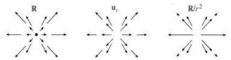
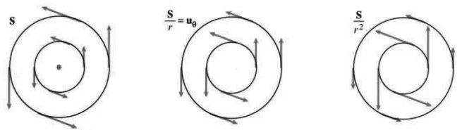
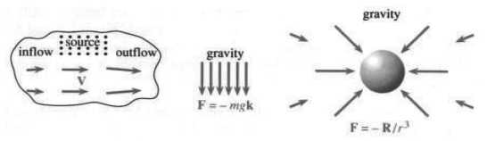
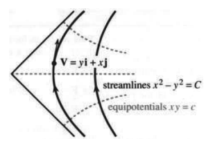

# 第 15 章　向量微积分

原文：PDF 第 642–648 页，印刷页 629–635；含章引言和第 15.1 节。状态：初译，已逐页自校，尚未复审。

<!-- PDF 642 / 印刷页 629 -->

第 14 章介绍了二重积分和三重积分，从 $\int dx$ 走到 $\iint dx\,dy$ 和 $\iiint dx\,dy\,dz$。这些积分都把小块相加，取极限后得到面积、体积或质量。还有什么比这更自然呢？重积分这么成功，我却得遗憾地说：我们还漏了一样东西。更遗憾的是，我们竟没注意到。漏掉的不是别的，正是**微积分基本定理**。

二重积分 $\iiint dx\,dy$ 等于面积。计算它时，我们并没有使用 1 的原函数，至少没有有意识地使用。方法近乎试错，难点在于找积分限。本章要更深入地说明：只要处理得当，从二重积分到单积分这一步，其实就是基本定理的一种新形式。

开始时需要两个新概念，一个讨人喜欢，另一个未必。你会喜欢**向量场**，却不一定那么喜欢**曲线积分**。曲线积分仍是像 $\int v(x)\,dx$ 那样的普通单积分，只不过它不是沿直线走，而是沿曲线走。清楚的步长 $dx$ 变成了令人困惑的 $ds$。$\int dx$ 等于区间长度，$\int ds$ 则等于曲线长度。关键在于：区域由曲线围成，我们必须沿这些曲线积分。基本定理的二维形式——格林定理——把**区域上的二重积分**与**沿其边界曲线的单积分**联系起来。

重要应用来自科学与工程，那里向量场十分自然。不过，语言会改变：原函数称为**势函数**，导数换成“散度”和“旋度”，面积换成通量、环量与功。先从例子说起。

<!-- PDF 643 / 印刷页 630 -->

# 15.1 向量场

普通的标量函数，输入是数 $x$，输出是数 $f(x)$。向量场（也叫向量函数）则不同：输入是点 $(x,y)$，输出是二维向量 $\mathbf F(x,y)$。每一点都有一个向量，形成一个“场”。三维时，输入点为 $(x,y,z)$，输出向量 $\mathbf F$ 有三个分量。

**定义　设 $R$ 是 $xy$ 平面中的区域。向量场 $\mathbf F$ 给 $R$ 内每个点 $(x,y)$ 指定一个具有两个分量的向量：**

$$\mathbf F(x,y)=M(x,y)\mathbf i+N(x,y)\mathbf j.\tag{1}$$

这个平面向量场含有两个二元函数，即分量 $M,N$，它们随位置变化。一个固定向量的分量不变，向量场的分量则随点而变。

三维向量场的分量是 $M(x,y,z)$、$N(x,y,z)$、$P(x,y,z)$，向量为 $\mathbf F=M\mathbf i+N\mathbf j+P\mathbf k$。

**例 1**　点 $(x,y)$ 的**位置向量**为 $\mathbf R=x\mathbf i+y\mathbf j$，分量为 $M=x,N=y$。离原点越远，向量越长，见图 15.1a。方向向外，长度为 $|\mathbf R|=\sqrt{x^2+y^2}=r$。向量 $\mathbf R$ 用粗体，数 $r$ 用普通字形。

**例 2**　向量场 $\mathbf R/r$ 由指向外侧的单位向量 $\mathbf u_r$ 组成。除原点外，我们在每一点都把 $\mathbf R=x\mathbf i+y\mathbf j$ 除以它自己的长度。分量为 $M=x/r,N=y/r$。图 15.1 还显示了第三个场 $\mathbf R/r^2$，它的长度为 $1/r$。

**图 15.1**　$\mathbf R$、$\mathbf R/r$、$\mathbf R/r^2$ 都是径向场，长度分别为 $r,1,1/r$。

**例 3**　**旋转场**不是离开原点，而是绕着原点。把它记为 $\mathbf S$，分量为 $M=-y,N=x$：

$$\mathbf S=-y\mathbf i+x\mathbf j,\qquad
|\mathbf S|=\sqrt{(-y)^2+x^2}=r.\tag{2}$$

$\mathbf S$ 垂直于 $\mathbf R$，因为点积为零：$\mathbf S\cdot\mathbf R=(-y)x+xy=0$。旋转场 $\mathbf S/r$ 和 $\mathbf S/r^2$ 的长度分别为 1 和 $1/r$：

$$\frac{\mathbf S}{r}=-\frac yr\mathbf i+\frac xr\mathbf j,
\qquad\left|\frac{\mathbf S}{r}\right|=1;$$

$$\frac{\mathbf S}{r^2}=-\frac{y}{x^2+y^2}\mathbf i+\frac{x}{x^2+y^2}\mathbf j,
\qquad\left|\frac{\mathbf S}{r^2}\right|=\frac1r.$$

单位向量 $\mathbf S/r$ 就是 $\mathbf u_\theta$。注意 $(0,0)$ 处的空白，因为这个场在那里没有定义。

<!-- PDF 644 / 印刷页 631 -->

**图 15.2**　旋转场 $\mathbf S$、$\mathbf S/r$、$\mathbf S/r^2$ 绕原点旋转，长度分别为 $r,1,1/r$。

**例 4**　**梯度场**从一个普通函数 $f(x,y)$ 出发，分量 $M,N$ 是偏导数 $\partial f/\partial x$、$\partial f/\partial y$。场 $\mathbf F$ 就是 $f$ 的梯度：

$$\mathbf F=\operatorname{grad}f=\nabla f
=\frac{\partial f}{\partial x}\mathbf i+\frac{\partial f}{\partial y}\mathbf j.\tag{3}$$

**向量场 $\operatorname{grad}f$ 处处垂直于等值线 $f(x,y)=c$。**

长度 $|\operatorname{grad}f|$ 表示 $f$ 的变化速率——在它变化最快的那个方向上。任取一个函数，如 $f=x^2y$，马上得到梯度场 $\mathbf F=2xy\mathbf i+x^2\mathbf j$。再说一次，$M=\partial f/\partial x$，$N=\partial f/\partial y$。

对每个向量场，都应问两个问题：**它是梯度场吗？若是，$f$ 是什么？** 径向场与旋转场的答案如下。

**15A　径向场 $\mathbf R$、$\mathbf R/r$、$\mathbf R/r^2$ 都是梯度场。旋转场 $\mathbf S$ 与 $\mathbf S/r$ 不是任何 $f(x,y)$ 的梯度。旋转场 $\mathbf S/r^2$ 是极角 $\theta=\tan^{-1}(y/x)$ 的梯度。**

$f=\frac12(x^2+y^2)$ 的两个偏导数为 $x,y$，因此 $\mathbf R$ 是梯度场。$f=r$ 的梯度是指向外侧的单位向量 $\mathbf R/r$。两者都垂直于以原点为中心的圆，这些圆分别是 $f=\frac12r^2$ 和 $f=r$ 的等值线。

**问题　每个 $\mathbf R/r^n$ 都是梯度场吗？**

答：是的。但在这些旋转场中，只有 $\mathbf S/r^2$ 是梯度。

本章有个主要目标：用简单的检验认出梯度场。排除 $\mathbf S$ 和 $\mathbf S/r$ 的过程会很有趣。不知为什么，$-y\mathbf i+x\mathbf j$ 不合格，$y\mathbf i+x\mathbf j$ 却合格，它是____的梯度。把 $\mathbf S/r^2$ 当作 $f=\theta$ 的梯度，原点附近还藏着一个意外，见第 15.3 节。

梯度场也叫**保守场**，$f$ 称为**势函数**。这些名称以及接下来的例子，都来自物理与工程。

**例 5　速度场为 $\mathbf V$，质量流场为 $\rho\mathbf V$。**

设流体稳定地沿管道流动，或者河水平稳流动而没有瀑布，或者空气按固定模式循环。不同点的速度可以不同，但不随时间变化。速度向量 $\mathbf V$ 给出每一点的流动方向和流动速率。

<!-- PDF 645 / 印刷页 632 -->

实际的速度场为 $\mathbf V(x,y,z)$，有三个分量 $M,N,P$，也就是沿 $x,y,z$ 方向的速度 $v_1,v_2,v_3$。速率 $|\mathbf V|$ 是向量长度，$|\mathbf V|^2=v_1^2+v_2^2+v_3^2$。在“平面流动”中，$\mathbf k$ 分量为零，速度场为 $v_1\mathbf i+v_2\mathbf j=M\mathbf i+N\mathbf j$。

**图 15.3**　一个稳定速度场 $\mathbf V$ 和两个力场 $\mathbf F$。

光盘或转动的车轮上，$\mathbf V$ 是旋转场：$\mathbf V=\omega\mathbf S$，其中 $\omega$ 为角速度。龙卷风也许更接近 $\mathbf V=\mathbf S/r^2$，中心静区除外；爆炸可以对应 $\mathbf V=\mathbf R/r^2$。较平静的例子是湖水流入、流出，同时持续降雨构成源项。

质量流场 $\rho\mathbf V$ 是密度 $\rho$ 乘以速度场。$\mathbf V$ 给出运动的速率，$\rho\mathbf V$ 则表示**质量输运的速率**。密度越大，“质量输运”的大小 $|\rho\mathbf V|$ 越大，就像公共汽车上的乘客数乘以车速。

**例 6　由重力产生的力场：教室里的 $\mathbf F$ 向下，空间中的 $\mathbf F$ 沿径向。**

重力向下时，只有一个非零分量：$\mathbf F=-mg\mathbf k$。这里假设指向地心的各个向量互相平行；在教室这么大的范围里，这一点近似成立。此时 $\mathbf F$ 是 $-mgz$ 的梯度，因为 $\partial f/\partial z=-mg$。

**物理学中通常的势不是 $-mgz$，而是 $+mgz$。** 在电气工程中，力场同样写作负的 $\operatorname{grad}f$。电子从高势流向低势。数学相同，只是符号相反。

空间中的引力沿径向向内：$\mathbf F=-mMG\mathbf R/r^3$。大小正比于 $1/r^2$，即牛顿平方反比定律。质量为 $m,M$；万有引力常数为 $G=6.672\times10^{-11}$，距离以米、质量以千克、时间以秒计。$G$ 的量纲为 $(\text{力})(\text{距离})^2/(\text{质量})^2$。它不同于加速度 $g=9.8\,\mathrm{m/s^2}$；后者已经包含地球质量与半径的影响。

与所有径向场一样，**引力是梯度场**，来自势函数 $f$：

$$f=\frac{mMG}{r},\qquad
\frac{\partial f}{\partial x}=-\frac{mMGx}{r^3},\qquad
\frac{\partial f}{\partial y}=-\frac{mMGy}{r^3},\qquad
\frac{\partial f}{\partial z}=-\frac{mMGz}{r^3}.\tag{4}$$

**例 7（一个简短例子）**　导线中的电流产生**磁场 $\mathbf B$**，它是绕导线的旋转场 $\mathbf S/r^2$，再乘以电流强度。

## 流线与力线

向量场并不总是容易画出来。即使旋转场，向量太长时也会显得杂乱：它们绕圆周排列，彼此交叉。圆比向量本身更能说明问题。

<!-- PDF 646 / 印刷页 633 -->

在任意向量场中，向量都与“场线”相切；旋转场的场线就是圆。

**定义　若 $\mathbf F(x,y)$ 与曲线 $C$ 相切，则 $C$ 称为场线或积分曲线。曲线斜率 $dy/dx$ 等于向量 $\mathbf F=M\mathbf i+N\mathbf j$ 的斜率 $N/M$：**

$$\frac{dy}{dx}=\frac{N(x,y)}{M(x,y)}
\qquad\left(\text{旋转场中为 }-\frac xy\right).\tag{6}$$

我们仍在画向量场，只是现在向量无限短，并连接成了曲线！失去的信息是向量长度，因为 $\mathbf S,\mathbf S/r,\mathbf S/r^2$ 都有同样的圆形场线。位置场 $\mathbf R$ 与引力型场 $\mathbf R/r^3$ 的场线则是从原点出发的射线；这时“曲线”实际上是直线。

**例 8　证明速度场 $\mathbf V=y\mathbf i+x\mathbf j$ 的场线为双曲线。**

$$\frac{dy}{dx}=\frac NM=\frac xy
\quad\Longrightarrow\quad y\,dy=x\,dx
\quad\Longrightarrow\quad\frac12y^2-\frac12x^2=\text{常数}.$$

**图 15.4**　速度场与流线相切。梯度场还有等势线。

每一点处，这些双曲线都沿速度 $\mathbf V$ 的方向。**流体的每个粒子沿一条场线运动。** 在流体中，这些双曲线叫作**流线**。把树叶放进河里，它就沿流线漂动。图 15.4 显示河道转弯处的流线。

别忘记对每个向量场都要问的基本问题：它是梯度场吗？对于 $\mathbf V=y\mathbf i+x\mathbf j$，答案是肯定的，势函数为 $f=xy$：

$$xy\text{ 的梯度}=\frac{\partial f}{\partial x}\mathbf i+\frac{\partial f}{\partial y}\mathbf j
=y\mathbf i+x\mathbf j.\tag{7}$$

势函数有等值线，它们连接势相同的点，所以曲线 $f(x,y)=c$ 叫作**等势线**。此处是 $xy=c$，也是双曲线。梯度垂直于等值线，因此**流线垂直于等势线**。图 15.4 里，流线从一个方向把它切开，等势线从另一个方向把它切开。

**梯度场 $\mathbf F=f_x\mathbf i+f_y\mathbf j$ 与场线（流线）相切，并垂直于等势线（$f$ 的等值线）。**

<!-- PDF 647 / 印刷页 634 -->

沿梯度方向，$f$ 变化最快；沿等值线方向，$f$ 完全不变。沿 $f(x,y)=c$ 用一次链式法则，就能证明这两个方向互相垂直：

$$\frac{\partial f}{\partial x}\frac{dx}{dt}
+\frac{\partial f}{\partial y}\frac{dy}{dt}=0,
\qquad\text{即 }(\operatorname{grad}f)\cdot(\text{等值线的切向量})=0.$$

**例 9**　$\mathbf S/r^2$ 的流线是绕 $(0,0)$ 的圆，等势线是射线 $\theta=c$。请给图 15.2 中的这个梯度场添上这些射线。

引力场正好反过来：物体沿场线，即射线，被拉向内；等势线则是 $f=1/r$ 为常数的圆。平面上交错排列着“正交轨线”，也就是处处以直角相交的曲线。

把磁铁凑近一堆铁屑，轻轻一抖，场线就显出来了。在力场中，它们称为“力线”。其他新术语汇总如下。

| 术语 | 表达式或含义 |
|---|---|
| 向量场 | $\mathbf F(x,y,z)=M\mathbf i+N\mathbf j+P\mathbf k$ |
| 平面场 | $\mathbf F=M(x,y)\mathbf i+N(x,y)\mathbf j$ |
| 径向场 | $\mathbf R=x\mathbf i+y\mathbf j+z\mathbf k$ 的倍数 |
| 旋转场 | $\mathbf S=-y\mathbf i+x\mathbf j$ 的倍数 |
| 梯度场，即保守场 | $M=f_x,N=f_y,P=f_z$ |
| 势函数 | $f(x,y)$，不是向量 |
| 等势线 | $f(x,y)=c$ |
| 流线、场线、积分曲线 | 切向与 $\mathbf F(x,y)$ 一致的曲线 |

## 15.1 习题

### 阅读填空

向量场给每个点 $(x,y)$ 或 $(x,y,z)$ 指定一个 **a**____。二维时，$\mathbf F(x,y)=$ **b**____ $\mathbf i+$ **c**____ $\mathbf j$。一个例子是位置场 $\mathbf R=$ **d**____，大小为 $|\mathbf R|=$ **e**____，方向为 **f**____。它是 $f=$ **g**____ 的梯度场。等值线是 **h**____，与向量 $\mathbf R$ **i**____。

将图景转过来，旋转场为 $\mathbf S=$ **j**____，大小为 $|\mathbf S|=$ **k**____，方向为 **l**____。它不是梯度场，因为没有函数能同时满足 $\partial f/\partial x=$ **m**____ 和 $\partial f/\partial y=$ **n**____。$\mathbf S$ 是沿 **o**____ 流动的速度场。流线，也叫 **p**____ 线或积分 **q**____，是 **r**____。质量流场 $\rho\mathbf V$ 给出流动输运 **s**____ 的速率。

来自原点的引力场正比于 $\mathbf F=$ **t**____，其大小 $|\mathbf F|=$ **u**____。这就是牛顿的 **v**____ 平方定律。它是梯度场，势函数为 $f=$ **w**____。等势线 $f(x,y)=c$ 为 **x**____，与场线 **y**____；场线为 **z**____。这说明函数 $f(x,y)$ 的 **A**____ 与其等值线 **B**____。

速度场 $y\mathbf i+x\mathbf j$ 是 $f=$ **C**____ 的梯度，流线为 **D**____。流线的斜率 $dy/dx$ 等于速度分量之比 **E**____。场与流线 **F**____。把树叶放到流体中，它沿 **G**____ 运动。

**题 1—8：求梯度场的势函数 $f(x,y)$，画出与等势线 $f(x,y)=c$ 垂直的流线。**

1. $\mathbf F=\mathbf i+2\mathbf j$，常向量场。
2. $\mathbf F=x\mathbf i+\mathbf j$。
3. $\mathbf F=\cos(x+y)\mathbf i+\cos(x+y)\mathbf j$。
4. $\mathbf F=(1/y)\mathbf i-(x/y^2)\mathbf j$。
5. $\mathbf F=(2x\mathbf i+2y\mathbf j)/(x^2+y^2)$。
6. $\mathbf F=x^2\mathbf i+y^2\mathbf j$。
7. $\mathbf F=xy\mathbf i+\underline{\qquad}\mathbf j$。
8. $\mathbf F=\sqrt y\,\mathbf i+\underline{\qquad}\mathbf j$。
9. 画出剪切场 $\mathbf F=x\mathbf j$。验证它不是梯度场：若 $\partial f/\partial x=0$，则不可能有 $\partial f/\partial y=x$。沿 $\mathbf F$ 方向的流线，即场线，是什么？
10. 找出所有满足 $\partial f/\partial x=-y$ 的函数，说明它们都不满足 $\partial f/\partial y=x$。由此可知旋转场 $\mathbf S=-y\mathbf i+x\mathbf j$ 不是梯度场。

<!-- PDF 648 / 印刷页 635 -->

**题 11—18：计算 $\partial f/\partial x$ 与 $\partial f/\partial y$，画出梯度场 $\mathbf F=\operatorname{grad}f$ 及等势线 $f(x,y)=c$。**

11. $f=3x+y$。
12. $f=x-3y$。
13. $f=x+y^2$。
14. $f=(x-1)^2+y^2$。
15. $f=x^2-y^2$。
16. $f=e^x\cos y$。
17. $f=e^{x-y}$。
18. $f=y/x$。

**题 19—24：解 $dy/dx=N/M$，写出包含常数 $C$ 的流线方程，并画出流线。**

19. $\mathbf F=\mathbf i-\mathbf j$。
20. $\mathbf F=\mathbf i+x\mathbf j$。
21. $\mathbf F=\mathbf S$，旋转场。
22. $\mathbf F=\mathbf S/r$，旋转场。
23. $\mathbf F=\operatorname{grad}(x/y)$。
24. $\mathbf F=\operatorname{grad}(2x+y)$。
25. 地球引力场沿径向，但房间里的场线看起来竖直进入地板。这是因为邻近的场线总显得____。
26. 一条线上的电荷产生静电力场 $\mathbf F=\mathbf R/r^2=(x\mathbf i+y\mathbf j)/(x^2+y^2)$。求势函数 $f(x,y)$。（$\mathbf F$ 也是一条线上的质量产生的引力场。）

**题 27—32：写出向量场 $M\mathbf i+N\mathbf j$。**

27. $\mathbf F$ 从原点沿径向向外，大小为 5。
28. 速度垂直于曲线 $x^3+y^3=c$，速率为 1。
29. 引力 $\mathbf F$ 来自位于 $(0,0)$、$(1,0)$ 的两个单位质量。
30. 流线沿 $45^\circ$ 方向，速率为 4。
31. 流线是绕原点顺时针的圆，速率为 1。
32. 等势线是抛物线 $y=x^2+c$，$\mathbf F$ 是梯度场。
33. 分别求斜率 $dy/dx$，证明双曲线 $xy=2$ 与 $x^2-y^2=3$ 在 $(2,1)$ 处垂直，即两斜率乘积为 $-1$。
34. 对 $f(x,y)=c$ 求导得 $f_x+f_y(dy/dx)=0$。证明等值线斜率为 $dy/dx=-M/N$。它垂直于流线，因为 $(-M/N)(N/M)=$____。
35. 由链式法则，$f(r)$ 的两个偏导数为 $\partial f/\partial x=$____、$\partial f/\partial y=$____。用 $f=r^2$ 检验。等势线是____。
36. $\mathbf F=(ax+by)\mathbf i+(bx+cy)\mathbf j$ 是梯度场。求势函数 $f$ 并描述等势线。
37. 判断正误：(a) 常向量场 $\mathbf i+2\mathbf k$ 是梯度场；(b) 非梯度场的等势线与流线以非直角相交；(c) 三维空间的等势集合是曲面而不是曲线；(d) $\mathbf F=x^2\mathbf i+y^2\mathbf j+z^2\mathbf k$ 从 $(0,0,0)$ 向外，是径向场。
38. 自行构造并画出 $f,\mathbf F$、等势线和流线。
39. 不同向量场为什么可以有相同流线？它们能否有相同等势线？能否有相同的 $f$？
40. 在六至八个点画箭头，表示下列各场的方向和大小：(a) $\mathbf R+\mathbf S$；(b) $\mathbf R/r-\mathbf S/r$；(c) $x^2\mathbf i+x^2\mathbf j$；(d) $y\mathbf i$。
