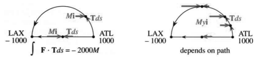
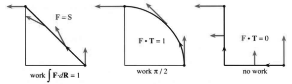
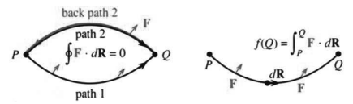

# 15.2 曲线积分

原文：PDF 第 649–657 页，印刷页 636–644。状态：已逐段对照英文原书完成忠实性复审，未作最终版式验收。

<!-- PDF 649 / 印刷页 636 -->

曲线积分是**沿曲线做的积分**。它可以等于一个面积，但那只是特殊情形，并不典型。物理和工程中有两个重要的曲线积分：

$$\text{沿曲线所做的功}=\int_C\mathbf F\cdot\mathbf T\,ds,
\qquad\text{穿过曲线的流量}=\int_C\mathbf F\cdot\mathbf n\,ds.$$

第一个积分里，$\mathbf F$ 是**力场**；第二个积分里，$\mathbf F$ 是**流场**。功涉及运动方向，所以积分 $\mathbf F\cdot\mathbf T$；流量穿过曲线 $C$，所以积分 $\mathbf F\cdot\mathbf n$。这里 $\mathbf T$ 是单位切向量，$\mathbf F\cdot\mathbf T$ 是沿曲线的力分量；$\mathbf n$ 是与 $\mathbf T$ 垂直的单位法向量，$\mathbf F\cdot\mathbf n$ 是垂直于曲线的流动分量。

我们会把这些积分写成几种形式。它们也许永远不像 $\int y(x)\,dx$ 那么亲切，但我们最终会掌握它们。先提这些应用，是让你知道目的地。本节集中讨论功，流量留到后面；它也称 flux，即通量，词源来自拉丁语的“流”。你已经知道 $ds$ 是沿曲线的步长，对应于 $x$ 轴上的 $dx$。$\int dx$ 给出区间长度 $b-a$，$\int ds$ 则给出曲线长度。

**例 1　从亚特兰大到洛杉矶，分别沿直线和半圆飞行。**

据达美航空介绍，正西方向的距离是 2000 英里。亚特兰大位于 $(1000,0)$，洛杉矶位于 $(-1000,0)$，原点放在两地中间。半圆路线 $C$ 的半径为 1000。这不是大圆航线，更像一个向北经过芝加哥的“平面圆”。飞机不可能这样飞，它大概会飞进太空。

半圆方程是 $x^2+y^2=1000^2$，参数方程为 $x=1000\cos t,y=1000\sin t$。曲线积分更适合用参数。飞机在 $t=0$ 离开亚特兰大，$t=\pi$ 到达洛杉矶，已经是三个多小时之后。若走 2000 英里的直线，达美的飞机差不多能做到；沿半圆 $C$，距离却是 $1000\pi$ 英里，速率必须达到每小时 1000 英里。记住，速率是距离微分 $ds$ 除以时间微分 $dt$：

$$\frac{ds}{dt}=\sqrt{\left(\frac{dx}{dt}\right)^2+\left(\frac{dy}{dt}\right)^2}
=1000\sqrt{(-\sin t)^2+(-\cos t)^2}=1000.\tag{1}$$

曲线的切向量与 $(dx/dt,dy/dt)=(-1000\sin t,1000\cos t)$ 成比例。$\mathbf T$ 是单位向量，因此要除以速率 1000。

假设风正向东吹，力为 $\mathbf F=M\mathbf i$，分量为 $M,0$。若 $M$ 为常数，点积与功为

$$\mathbf F\cdot\mathbf T
=M\mathbf i\cdot(-\sin t\,\mathbf i+\cos t\,\mathbf j
=M(-\sin t)+0(\cos t)=-M\sin t,$$

$$\int_C\mathbf F\cdot\mathbf T\,ds
=\int_0^\pi(-M\sin t)\frac{ds}{dt}\,dt
=\int_0^\pi-1000M\sin t\,dt=-2000M.$$

功是力乘以移动的距离。这里为负，因为风阻碍运动。你可能会说：直接按 2000 英里算，再乘以 $-M$，不就完事了？我会反对：这条直线是另一条路径。可你坚持说路径无关紧要：风沿哪条路径做的功都是 $-2000M$。这一次你说对了，可不是每次都这样。

多数曲线积分依赖路径；不依赖路径的情形尤其重要。碰到梯度场，只需知道起点 $P$ 和终点 $Q$。

<!-- PDF 650 / 印刷页 637 -->

**15B　若 $\mathbf F$ 是势函数 $f(x,y)$ 的梯度，则功 $\int_C\mathbf F\cdot\mathbf T\,ds$ 仅依赖端点 $P,Q$，等于 $f$ 的变化：**

$$\mathbf F=f_x\mathbf i+f_y\mathbf j
\quad\Longrightarrow\quad
\int_C\mathbf F\cdot\mathbf T\,ds=f(Q)-f(P).\tag{2}$$

当 $\mathbf F=M\mathbf i$ 时，分量 $M,0$ 是 $f=Mx$ 的偏导数。只需在端点求 $f$ 的值。亚特兰大的 $x=1000$，洛杉矶的 $x=-1000$，**势函数 $f=Mx$ 就像原函数**：

$$\text{功}=f(Q)-f(P)=M(-1000)-M(1000)=-2000M.\tag{3}$$

**图 15.5**　力为 $M\mathbf i$ 时，各路径上的功均为 $-2000M$；力为 $My\mathbf i$ 时，直线路径上不做功。

让我粗略解释功积分 $\int\mathbf F\cdot\mathbf T\,ds$。将微小位移 $\mathbf T\,ds$ 写成 $dx\,\mathbf i+dy\,\mathbf j$，就更清楚了。功就是这个微小位移与 $\mathbf F$ 的点积：

$$\mathbf F\cdot\mathbf T\,ds
=\left(f_x\mathbf i+f_y\mathbf j\right)\cdot(dx\,\mathbf i+dy\,\mathbf j)
=f_x\,dx+f_y\,dy=df.\tag{4}$$

无穷小的功为 $df$，总功为 $\int df=f(Q)-f(P)$。这就是**曲线积分的基本定理**。只提醒一点：若 $\mathbf F$ 不是任何 $f$ 的梯度，如例 2，这个定理就用不上。

**例 2　沿上述路线在非恒定力场 $\mathbf F=My\mathbf i$ 中飞行，求功。**

直线路径上 $y=0$，所以没有力；沿 $x$ 轴，风不做功。但半圆升到 $y=1000\sin t$ 的位置，风力很强：

$$\mathbf F\cdot\mathbf T
(My\mathbf i)\cdot(-\sin t\,\mathbf i+\cos t\,\mathbf j)
=-My\sin t=-1000M\sin^2t,$$

$$\int_C\mathbf F\cdot\mathbf T\,ds
=\int_0^\pi(-1000M\sin^2t)\frac{ds}{dt}\,dt
=\int_0^\pi-10^6M\sin^2t\,dt=-\frac\pi2\,10^6M.$$

这个功很大，也不现实。可算下来能看出一个要点：**一切都换成参数 $t$。** 第二个要点是 $\mathbf F=My\mathbf i$ 不是梯度场。第一条理由：直线上的功为零，半圆上的功不为零。第二条理由：没有函数能同时满足 $f_x=My$、$f_y=0$，前者要求 $f$ 依赖 $y$，后者不允许。这种 $\mathbf F$ 称为剪切力场。没有势函数，就不能只代入 $P,Q$，功会依赖路径。

<!-- PDF 651 / 印刷页 638 -->

## 曲线积分的定义

回到起点，定义 $\int\mathbf F\cdot\mathbf T\,ds$。可以把 $\mathbf F\cdot\mathbf T$ 看成沿路径的函数 $g(x,y)$，把积分定义为和的极限：

$$\int_C g(x,y)\,ds
=\lim_{(\Delta s)_{\max}\to0}\sum_{i=1}^N g(x_i,y_i)\Delta s_i.\tag{5}$$

点 $(x_i,y_i)$ 位于曲线 $C$ 上，最后一点 $Q=(x_N,y_N)$，第一点 $P=(x_0,y_0)$。步长 $\Delta s_i$ 是前一点到 $(x_i,y_i)$ 的距离。随着步长趋于零，直线小段贴近曲线。与第 8.2 节一样，$g=1$ 时得到弧长。只要 $g(x,y)$ 分段连续（允许跳跃）、路径分段光滑（允许拐角），这个极限便存在，曲线积分也就定义出来了。

$g$ 为细线的线密度时，积分是总质量；$g=\mathbf F\cdot\mathbf T$ 时，积分是功。但没人按式 (5) 去算。现在引入参数 $t$，它可以是时间、弧长 $s$，也可以是沿底边量的距离 $x$。

**微分 $ds$ 变成 $(ds/dt)\,dt$。** 一切改用 $t$：

$$\int_C g(x,y)\,ds
=\int_a^b g(x(t),y(t))
\sqrt{(dx/dt)^2+(dy/dt)^2}\,dt.\tag{6}$$

曲线在 $t=a$ 开始，经过 $(x(t),y(t))$，在 $t=b$ 结束。根号是速率 $ds/dt$。三维曲线的点为 $(x(t),y(t),z(t))$，根号中再加上 $(dz/dt)^2$。

**例 3**　螺旋弹簧上的点为 $(x,y,z)=(\cos t,\sin t,t)$。若线密度为 $\rho=4$，求完整两圈，即 $t=0$ 至 $t=4\pi$ 的质量。

解：关键是 $(dx/dt)^2+(dy/dt)^2+(dz/dt)^2=\sin^2t+\cos^2t+1=2$，所以 $ds/dt=\sqrt2$。积分单位长度的质量 $g=\rho=4$：

$$\text{质量}=\int_0^{4\pi}\rho\frac{ds}{dt}\,dt
=\int_0^{4\pi}4\sqrt2\,dt=16\sqrt2\pi.$$

这是三维空间中的曲线积分，说明了如何引入参数 $t$。不过，它没有体现本节的主要内容，因为没有向量场 $\mathbf F$；本节要研究功，而不仅是质量。

## 功积分的不同形式

$\int\mathbf F\cdot\mathbf T\,ds$ 可以写得更好。力为 $\mathbf F=M\mathbf i+N\mathbf j$，沿曲线的一小步为 $dx\,\mathbf i+dy\,\mathbf j$。功是力与位移的乘积，但只有沿路径的力分量起作用，点积会自动挑出这个分量。

<!-- PDF 652 / 印刷页 639 -->

**15C　曲线 $C$ 上一点的位置向量为 $\mathbf R=x\mathbf i+y\mathbf j$，于是 $d\mathbf R=\mathbf T\,ds=dx\,\mathbf i+dy\,\mathbf j$：**

$$\text{功}=\int_C\mathbf F\cdot d\mathbf R
=\int_C M\,dx+N\,dy.\tag{7}$$

**沿空间曲线，功为 $\int\mathbf F\cdot\mathbf T\,ds=\int\mathbf F\cdot d\mathbf R=\int M\,dx+N\,dy+P\,dz$。**

$M\,dx$ 是 $x$ 方向的力乘以该方向位移，任一因子为零，乘积就是零。当唯一的力是重力时，推钢琴不需要做功。费力的是摩擦。将钢琴搬上楼时，要计入 $P\,dz$，总功为钢琴的重量 $P$ 乘以 $z$ 的变化。

要把新的 $\int\mathbf F\cdot d\mathbf R$ 与原来的 $\int\mathbf F\cdot\mathbf T\,ds$ 联系起来，记住 $\mathbf T=d\mathbf R/ds$，所以 $\mathbf T\,ds=d\mathbf R$。计算时最好用 $d\mathbf R$，因为单位向量 $\mathbf T$ 要除以 $ds/dt=\sqrt{(dx/dt)^2+(dy/dt)^2}$，而将 $ds$ 化成 $(ds/dt)\,dt$ 时，又乘回同一个根号。先求根号、除掉、再乘回来没有必要；改用 $\int M\,dx+N\,dy$ 就可避免。

**例 4　向量场 $\mathbf F=-y\mathbf i+x\mathbf j$，路径从 $(1,0)$ 到 $(0,1)$，求功。**

注 1：这是旋转场 $\mathbf S$，绕着原点转；而 $\mathbf R=x\mathbf i+y\mathbf j$ 指向外。点积 $\mathbf F\cdot\mathbf R=-yx+xy=0$，但这不意味着 $\mathbf F\cdot d\mathbf R=0$。力垂直于 $\mathbf R$，却不垂直于 $\mathbf R$ 的变化。从 $(1,0)$ 到 $(0,1)$，即从 $x$ 轴到 $y$ 轴，功不为零。

注 2：我们还没有描述路径 $C$，而这一步不可少。旋转场不是梯度场，沿直线的功与沿四分之一圆的功不同：

$$\text{直线： }x=1-t,y=t;\qquad
\text{四分之一圆： }x=\cos t,y=\sin t.$$

**计算功。** 将 $\mathbf F\cdot d\mathbf R=M\,dx+N\,dy$ 改用参数 $t$：

$$\text{直线： }\int -y\,dx+x\,dy
=\int_0^1[-t(-dt)+(1-t)dt]=1;$$

$$\text{四分之一圆： }\int -y\,dx+x\,dy
=\int_0^{\pi/2}[-\sin t(-\sin t\,dt)+\cos t(\cos t\,dt)]
=\frac\pi2.$$

**一般方法：** 路径由 $x(t),y(t)$ 给出，把它们代入 $M(x,y),N(x,y)$，使 $\mathbf F$ 成为 $t$ 的函数；另求 $dx/dt,dy/dt$，再将 $M(dx/dt)+N(dy/dt)$ 从起始时刻积分到终止时刻。

**图 15.6**　三条路径的 $\int\mathbf F\cdot d\mathbf R=\int -y\,dx+x\,dy$ 分别为 $1,\pi/2,0$。

<!-- PDF 653 / 印刷页 640 -->

作为练习，先沿 $x$ 轴走到原点：$x=1-t,y=0$；再沿 $y$ 轴向上：$x=0,y=t-1$。在 $(1,0)$ 出发时 $t=0$，在原点转弯时 $t=1$，到 $(0,1)$ 时 $t=2$。路径有两段，所以积分也有两部分：

$$\text{折线路径： }\int -y\,dx+x\,dy=0+0,$$

因为一段上 $y=0$，另一段上 $x=0$。

注 3：对这个旋转场 $\mathbf F=\mathbf S$，答案依赖路径，却**不依赖参数的选择**。沿同一路径以不同速度行进，功相同。可换用参数 $\tau$，因为 $(ds/dt)dt$ 与 $(ds/d\tau)d\tau$ 都等于 $ds$。以两倍速度走直线 $x=1-2\tau,y=2\tau$，终点时刻变成 $\tau=\frac12$，而不是 $t=1$。功仍为 1：

$$\int-y\,dx+x\,dy
=\int_0^{1/2}[(-2\tau)(-2\,d\tau)+(1-2\tau)(2\,d\tau)]
=\int_0^{1/2}2\,d\tau=1.$$

## 总能量守恒：动能加势能

力场对质量为 $m$ 的物体做功，通常会改变速度。牛顿定律为 $\mathbf F=m\mathbf a=m\,d\mathbf v/dt$。这是向量定律，何必写成三个分量？功为

$$\int\mathbf F\cdot d\mathbf R
=\int(m\,d\mathbf v/dt)\cdot(\mathbf v\,dt)
=\left[\frac12m\mathbf v\cdot\mathbf v\right]_P^Q
=\frac12m|\mathbf v(Q)|^2-\frac12m|\mathbf v(P)|^2.\tag{8}$$

**功等于动能 $\frac12m|\mathbf v|^2$ 的变化。** 但对于梯度场，功也是势能的变化——按物理学的约定加一个负号：

$$\text{功}=\int\mathbf F\cdot d\mathbf R=-\int df=f(P)-f(Q).\tag{9}$$

比较式 (8)、(9)，可知 $\frac12m|\mathbf v|^2+f$ 在 $P,Q$ 两点相同。**总能量，即动能加势能，守恒。**

## 与路径无关：梯度场

旋转场 $\mathbf S$ 做的功依赖路径。例 4 的直线、四分之一圆和折线路径，分别给出 $1,\pi/2,0$。超过 99.99% 的向量场都有这种现象。但最重要的那些场不是这样。数学和物理关注非常特殊的场，它们的功仅依赖端点。现在解释积分与路径无关时发生的事情。

设从 $P$ 沿一条路径积分到 $Q$，再沿另一条路径回到 $P$，合起来就是图 15.7 中从 $P$ 到 $P$ 的**闭合路径**。反向积分是正向积分的相反数，因为 $d\mathbf R$ 变号。如果两条从 $P$ 到 $Q$ 的积分相等，那么闭合路径积分为零：

$$\underbrace{\oint_P^P\mathbf F\cdot d\mathbf R}_{\text{闭合路径}}
=\underbrace{\int_P^Q\mathbf F\cdot d\mathbf R}_{\text{路径1}}
+\underbrace{\int_Q^P\mathbf F\cdot d\mathbf R}_{\text{沿路径2返回}}
=\underbrace{\int_P^Q\mathbf F\cdot d\mathbf R}_{\text{路径1}}
-\underbrace{\int_P^Q\mathbf F\cdot d\mathbf R}_{\text{路径2}}=0.\tag{10}$$

积分号上的小圆圈表示闭合路径，后面会省去端点 $P$。

<!-- PDF 654 / 印刷页 641 -->

并非所有闭合路径积分都为零！多数场 $\mathbf F$ 里，换条路径功就不同；到了“保守场”，各条路径的功相同，绕闭合路径做功为零，体现能量守恒。大问题是：**不尝试所有路径，怎样判断一个场是否保守？** 以下是无孔洞平面区域 $R$ 内保守场的关键信息。

**15D　场 $\mathbf F=M(x,y)\mathbf i+N(x,y)\mathbf j$ 若具有以下性质，就是保守场：**

- **A.** 绕每条闭合路径的功 $\oint\mathbf F\cdot d\mathbf R$ 都为零。
- **B.** 功 $\int_P^Q\mathbf F\cdot d\mathbf R$ 仅依赖 $P,Q$，不依赖路径。
- **C.** $\mathbf F$ 是梯度场：存在势函数 $f(x,y)$，使 $M=f_x,N=f_y$。
- **D.** 分量满足 $\partial M/\partial y=\partial N/\partial x$。

**满足其中一个，就满足所有性质。D 是快速检验。**

这几条命题把保守场（也就是梯度场）的性质串起来。闭合路径沿一路到 $Q$，再沿另一路回 $P$，功相抵消，因此 A 与 B 等价。现在把它们与 C 联系起来。顺便说，检验 D 表示 $\mathbf F$ 的“旋度”为零；这要等下一节格林定理来解释，旋度的完整讨论见第 15.6 节。

首先，**梯度场是保守场**。由曲线积分基本定理，功为 $f(Q)-f(P)$，只依赖端点。因此 C 推出 B。

现在反过来，证明保守场 $M\mathbf i+N\mathbf j$ 是梯度场。假设功积分只依赖端点，必须构造势函数 $f$，使 $f_x=M,f_y=N$。

**固定点 $P$，把到达 $Q$ 所做的功定义为 $f(Q)$，则 $\mathbf F=\operatorname{grad}f$。**

检查这个推理：起点 $P$ 处 $f=0$，其他点 $Q$ 处 $f$ 为到达该点的功 $\int M\,dx+N\,dy$。由于场保守，从 $P$ 到 $Q$ 的所有路径都给出相同的 $f(Q)$。再看两个例子，然后证明这个构造确实使 $\operatorname{grad}f=\mathbf F$。

**图 15.7**　保守场有 $\oint\mathbf F\cdot d\mathbf R=0$ 及 $\int_P^Q\mathbf F\cdot d\mathbf R=f(Q)-f(P)$。这里取 $f(P)=0$。

**例 5**　当 $\mathbf F=2xy\mathbf i+x^2\mathbf j$ 时，求 $f(x,y)$。要求 $f_x=2xy,f_y=x^2$。

解法 1：取 $P=(0,0)$，先沿水平方向到 $(x,0)$，再向上到 $(x,y)$：

$$\int_{(0,0)}^{(x,0)}2xy\,dy=0\quad(y=0),\qquad
\int_{(x,0)}^{(x,y)}x^2\,dy=x^2y=f.$$

<!-- PDF 655 / 印刷页 642 -->

$f=x^2y$ 的确满足要求：$f_x=2xy,f_y=x^2$，所以 $\mathbf F=\operatorname{grad}f$。第一个积分沿 $x$ 轴，$dy=0$；第二个中 $x$ 固定，$dx=0$。两积分相加得 $f=x^2y$。

解法 2：沿直线 $(xt,yt)$，从 $t=0$ 到 1 积分：

$$\int_0^1[2(xt)(yt)(x\,dt)+(xt)^2(y\,dt)]
=\int_0^1 3x^2yt^2\,dt=[x^2yt^3]_0^1=x^2y.$$

**大多数作者用解法 1，我用解法 2，大多数学生用解法 3。**

解法 3：直接解 $f_x=M=2xy$，再调整使 $df/dy=N=x^2$ 成立：

$$f_x=2xy\quad\Longrightarrow\quad f=x^2y+\text{任意的 }y\text{ 的函数}。$$

此处 $x^2y$ 已经有正确的 $y$ 偏导数 $x^2$，不必增加其他 $y$ 函数。对 $x$ 积分时，那个通常写作 $C$ 的积分常数，得换成函数 $C(y)$。

你会练习求 $f$，但这只对保守场可行！我预先用 D 检验了 $M=2xy,N=x^2$，确认 $M_y=N_x$。

**例 6**　若 $M\mathbf i+N\mathbf j$ 是旋转场 $-y\mathbf i+x\mathbf j$，尝试寻找 $f(x,y)$。

尝试 1：沿 $(0,0)\to(x,0)\to(x,y)$ 积分：

$$\int_{(0,0)}^{(x,0)}-y\,dx=0,\qquad
\int_{(x,0)}^{(x,y)}x\,dy=xy\quad\text{看起来像 }f。$$

尝试 2：沿直线 $(xt,yt)$ 从 0 到 1 积分：

$$\int_0^1[-(yt)(x\,dt)+(xt)(y\,dt)]=0,$$

得到另一个“$f$”，同样不对。

尝试 3：先解 $f_x=-y$，再试图使 $f_y=x$：

$$f_x=-y\quad\Longrightarrow\quad f=-xy+C(y).$$

其 $y$ 偏导数为 $-x+C'(y)$，不能符合所要求的 $x$。**结论：旋转场 $-y\mathbf i+x\mathbf j$ 不保守，不存在所需的 $f$。** 检验 D 给出 $M_y=-1,N_x=1$。

结束本节之前，从例子转向证明。势函数 $f(Q)$ 定义为到达 $Q$ 的功，需要证明其两个偏导数就是 $M,N$。公式 $f(Q)=\int M\,dx+N\,dy$ 看着挺合理，但还得想清楚。

记住命题 A：所有路径给出同一个 $f(Q)$。选一条这样的路径：先从 $P$ 走到 $Q$ 的左边，再沿 $y=\text{常数}$ 的水平线进入 $Q$。最后一段 $dy=0$，仅积分 $M\,dx$，所以在 $Q$ 处对 $x$ 求导得 $f_x=M$，这就是微积分基本定理。

要证 $f_y=N$，选另一条路径：先从 $P$ 走到 $Q$ 的下方，再竖直向上进入 $Q$。此段 $dx=0$，只积分 $N\,dy$，故 $f_y=N$。

区域没有孔洞这一要求，对检验 D 至关重要。

<!-- PDF 656 / 印刷页 643 -->

**例 7　求 $f(x,y)=\int_{(0,0)}^{(x,0)}x\,dx+y\,dy$。** 检验 D 通过：$N_x=0=M_y$。

解法 1：将 $\int_{(0,0)}^{(x,0)}x\,dx=\frac12x^2$ 与 $\int_{(0,0)}^{(x,0)}y\,dy=\frac12y^2$ 相加。

解法 2：

$$\int_0^1[(xt)(x\,dt)+(yt)(y\,dt)]
=\int_0^1(x^2+y^2)t\,dt=\frac12(x^2+y^2).$$

解法 3：$f_x=x$ 给出 $f=\frac12x^2+C(y)$，再由 $f_y=y$ 得 $C(y)=\frac12y^2$。

## 15.2 习题

### 阅读填空

功是 $\mathbf F\cdot d\mathbf R$ 的 **a**____。其中 $\mathbf F$ 是 **b**____，$\mathbf R$ 是 **c**____。**d**____ 积挑出 **e**____ 在位移 $d\mathbf R=dx\mathbf i+dy\mathbf j$ 方向上的分量。直线路径 $(x,y)=(t,2t)$ 从 $t=0$ 时的 **f**____ 走到 $t=1$ 时的 **g**____，$d\mathbf R=dt\mathbf i+$ **h**____。力场 $\mathbf F=3\mathbf i+\mathbf j$ 做的功为 $\int\mathbf F\cdot d\mathbf R=\int$ **i**____ $dt=$ **j**____。

$d\mathbf R$ 的另一形式为 $\mathbf T\,ds$，$\mathbf T$ 是路径的 **k**____ 向量，$ds=\sqrt{\text{\textbf{l}____}}$。对路径 $(t,2t)$，单位向量 $\mathbf T=$ **m**____，$ds=$ **n**____ $dt$。当 $\mathbf F=3\mathbf i+\mathbf j$ 时，$\mathbf F\cdot\mathbf T\,ds$ 仍为 **o**____ $dt$。这个场是 $f=$ **p**____ 的梯度。$f=3x+y$ 从 $(0,0)$ 到 $(1,2)$ 的变化为 **q**____。

当 $\mathbf F=\operatorname{grad}f$ 时，点积 $\mathbf F\cdot d\mathbf R=f_x\,dx+$ **r**____ $=df$。从 $P$ 到 $Q$ 的功积分为 $\int df=$ **s**____。此时功依赖 **t**____，而不依赖 **u**____。沿闭合路径的功为 **v**____，这种场叫 **w**____。$\mathbf F=(1+y)\mathbf i+x\mathbf j$ 是 $f=$ **x**____ 的梯度。从 $(0,0)$ 到 $(1,2)$ 的功为 **y**____，即势函数的变化。

旋转场 $\mathbf S=$ **z**____ 的功（依赖／不依赖）路径。路径 $(x,y)=(3\cos t,3\sin t)$ 是圆，$\mathbf S\cdot d\mathbf R=$ **A**____，绕完整一圈的功为 **B**____。形式上，$\int g(x,y)\,ds$ 是和 **C**____ 的极限。

保守场 $\mathbf F=M\mathbf i+N\mathbf j$ 的四个等价性质为：A：**D**____；B：**E**____；C：**F**____；D：**G**____。$\mathbf F=(y+1)\mathbf i+x\mathbf j$（通过／不通过）检验 D。绕圆 $(\cos t,\sin t)$ 的功为 **H**____。沿上半圆的功等于沿 **I**____ 的功。该场是 $f=$ **J**____ 的梯度，因此到 $(-1,0)$ 的功为 **K**____。

**题 1—6：计算曲线积分。**

1. $\int_C ds$ 与 $\int_C dy$，其中 $x=t,y=2t,0\le t\le1$。
2. $\int_C x\,ds$ 与 $\int_C xy\,ds$，其中 $x=\cos t,y=\sin t,0\le t\le\pi/2$。
3. $\int_C xy\,ds$，路径为 $(0,0)\to(1,1)\to(1,0)$ 的折线。
4. $\int_C y\,dx-x\,dy$，路径为任意边长 3 的正方形周界。
5. $\int_C dx$ 与 $\int_C y\,dx$，路径为任意半径 3 的闭合圆周。
6. $\int_C(ds/dt)\,dt$，路径为任意长为 5 的曲线。
7. $\int_P^Q xy\,dy$ 是否等于 $[\frac12xy^2]_P^Q$？
8. $\int_P^Q x\,dx$ 是否等于 $[\frac12x^2]_P^Q$？
9. 是否有 $(\int_C ds)^2=(\int_C dx)^2+(\int_C dy)^2$？
10. $\int_C(ds)^2$ 有意义吗？

**题 11—16：求从 $(1,0)$ 到 $(0,1)$ 的功。若场保守，构造 $f$；若不保守，自行选取路径。**

11. $\mathbf F=\mathbf i+y\mathbf j$。
12. $\mathbf F=y\mathbf i+\mathbf j$。
13. $\mathbf F=xy^2\mathbf i+yx^2\mathbf j$。
14. $\mathbf F=e^y\mathbf i+xe^y\mathbf j$。
15. $\mathbf F=(x/r)\mathbf i+(y/r)\mathbf j$。
16. $\mathbf F=-y^2\mathbf i+x^2\mathbf j$。
17. 哪些幂次 $n$ 使 $\mathbf S/r^n$ 通过梯度场检验 D？
18. 哪些幂次 $n$ 使 $\mathbf R/r^n$ 通过梯度场检验 D？
19. 沿竖直圆周 $x^2+z^2=a^2$ 的细线圈，线密度为 $\rho=a+z$，求质量 $M=\int\rho\,ds$。
20. 线密度恒为 $\rho$ 的细线位于半圆 $x^2+y^2=a^2,y>0$。求质量 $M$、矩 $M_x=\int\rho y\,ds$，以及质心 $\bar x=M_y/M,\bar y=M_x/M$。
21. 圆周 $x^2+y^2=a^2$ 上的线密度为 $\rho=x^2$，求质量与质心。
22. 沿空间曲线 $x=t,y=t^2,z=t^3,0\le t\le1$ 求 $\int\mathbf F\cdot d\mathbf R$：(a) $\mathbf F=\operatorname{grad}(xy+xz)$；(b) $\mathbf F=y\mathbf i-x\mathbf j+z\mathbf k$。
23. (a) 求路径 $\mathbf R=2t\mathbf i+t^2\mathbf j$ 的单位切向量 $\mathbf T$ 与速率 $ds/dt$。

<!-- PDF 657 / 印刷页 644 -->

（第23题续）(b) 当 $\mathbf F=3x\mathbf i+4\mathbf j$ 时，先利用 (a) 求 $\mathbf F\cdot\mathbf T\,ds$，再直接求 $\mathbf F\cdot d\mathbf R$。(c) 从 $(2,1)$ 到 $(4,4)$ 的功是多少？

24. 若 $M(x,y,z)\mathbf i+N(x,y,z)\mathbf j$ 是 $f(x,y,z)$ 的梯度，证明这些函数都不能依赖 $z$。
25. 求所有形如 $M(y)\mathbf i+N(x)\mathbf j$ 的梯度场。
26. 沿直线 $(xt,yt)$ 从 $t=0$ 到 1，计算功 $W(x,y)=\int M\,dx+N\,dy$，检验是否有 $W_x=M,W_y=N$：(a) $M=y^3,N=3xy^2$；(b) $M=x^3,N=3yx^2$；(c) $M=x/y,N=y/x$；(d) $M=e^{x+y},N=e^{x+y}$。
27. 找一个场 $\mathbf F$，使其沿单位正方形周界依次经过 $y=0,x=1,y=1,x=0$ 时做功为 4。
28. 找一个非保守场，使它绕单位圆 $x^2+y^2=1$ 做功为零。

**题 29—34：分别沿直线 $\mathbf R=t\mathbf i+t\mathbf j$ 和抛物线 $\mathbf R=t\mathbf i+t^2\mathbf j$ 从 $(0,0)$ 到 $(1,1)$ 计算 $\int\mathbf F\cdot d\mathbf R$。若是梯度场，使用势函数 $f(x,y)$。**

29. $\mathbf F=\mathbf i-2\mathbf j$。
30. $\mathbf F=x^2\mathbf j$。
31. $\mathbf F=2xy^2\mathbf i+2yx^2\mathbf j$。
32. $\mathbf F=x^2y\mathbf i+xy^2\mathbf j$。
33. $\mathbf F=y\mathbf i-x\mathbf j$。
34. $\mathbf F=(x\mathbf i+y\mathbf j)/(x^2+y^2+1)$。
35. 对哪些数 $a,b$，$\mathbf F=axy\mathbf i+(x^2+by)\mathbf j$ 是梯度场？
36. 分别沿直线 $x=1-t^2,y=t^2$ 与四分之一圆 $x=\cos2t,y=\sin2t$，从 $(1,0)$ 到 $(0,1)$ 计算 $\int-y\,dx+x\,dy$。例 4 用不同参数得到 $1,\pi/2$。

**题 37—42：使用检验 $N_x=M_y$，通过检验 D 时求 $f$。**

37. $\mathbf F=y^2e^{-x}\mathbf i-2ye^{-x}\mathbf j$。
38. $\mathbf F=ye^x\mathbf i-2ye^x\mathbf j$。
39. $\displaystyle\mathbf F=\frac{x\mathbf i+y\mathbf j}{|x\mathbf i+y\mathbf j|}$。
40. $\displaystyle\mathbf F=\frac{\operatorname{grad}(xy)}{|\operatorname{grad}(xy)|}$。
41. $\mathbf F=\mathbf R+\mathbf S$。
42. $\mathbf F=(ax+by)\mathbf i+(cx+dy)\mathbf j$。
43. 绕单位圆求 $\oint ds$、$\oint dx$ 与 $\oint x\,ds$。
44. 判断正误并说明理由：(a) 当 $\mathbf F=y\mathbf i$ 时，从 $P$ 到 $Q$ 的曲线积分 $\int\mathbf F\cdot d\mathbf R$ 等于通常的曲线下方面积；(b) 该曲线积分仅依赖 $P,Q$，不依赖曲线；(c) 绕单位圆的该积分等于 $\pi$。
