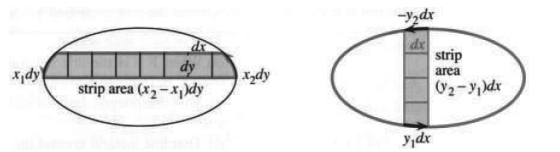
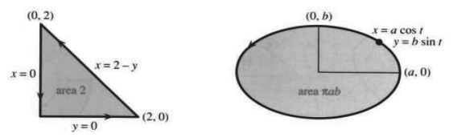
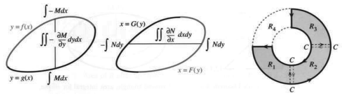
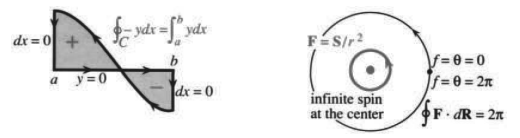
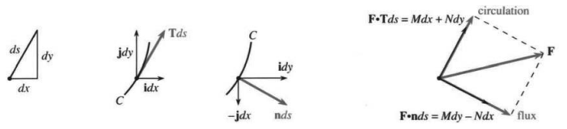
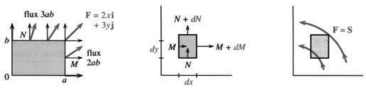

# 15.3 格林定理

> 来源：原书 PDF 第 658–668 页，印刷页 645–655。状态：中文初译，未独立复审。公式与插图已对照原页。

<!-- PDF 658 / 印刷页 645 -->

本节把微积分基本定理推广到二维。听起来很重要，事实也确实如此。牛顿和莱布尼茨之后约 150 年，一位名叫乔治·格林的普通人发现了这个公式。他的定理把区域 $R$ 上的二重积分与沿其边界 $C$ 的曲线积分联系起来。

$df/dx$ 的积分等于 $f(b)-f(a)$。这把一维积分与零维积分联系起来：边界只有 $a,b$ 两个点！答案 $f(b)-f(a)$ 可以看作某种“点积分”。利用边界上的信息求导数的积分，这是一个极其关键的思想；格林定理把它推广到了二维。

沿 $C$ 有两种重要的积分。功是 $\int\mathbf F\cdot\mathbf T\,ds=\int M\,dx+N\,dy$；通量是 $\int\mathbf F\cdot\mathbf n\,ds=\int M\,dy-N\,dx$（注意交换）。前者用于力场，后者用于流场。切向量 $\mathbf T$ 顺时针转 $90^\circ$ 就成为法向量 $\mathbf n$。二维的格林定理处理这两者；在三维中，它们分成散度定理（15.5 节）与斯托克斯定理（15.6 节）。

格林定理适用于“光滑”的函数 $M(x,y)$ 与 $N(x,y)$：它们在略大于 $R$ 的区域内具有连续的一阶导数。这样所有积分都有定义。在电、磁、流体或力学的各个应用中，$M,N$ 都有具体含义。定理的作用是一次性抓住核心思想。现在先做这件事，随后再看应用。

**15E 格林定理** 设区域 $R$ 的边界是分段光滑的简单闭曲线 $C$。则 $R$ 上的积分等于沿 $C$ 的曲线积分：

$$
\oint_C M\,dx+N\,dy=\iint_R\left(\frac{\partial N}{\partial x}-\frac{\partial M}{\partial y}\right)dx\,dy.\tag{1}
$$

曲线“简单”，是指它不自交（排除 8 字形）；“闭合”，是指终点 $Q$ 与起点 $P$ 相同，积分号上的小圆圈表示这一点；“光滑”，是指切向量 $\mathbf T$ 连续变化，而“分段”允许有限个角点。分形不在这里的讨论范围内，但通常的曲线都可以使用这个定理（稍后还会讨论 8 字形与圆环）。先用特殊情形理解公式。

图 15.8 区域 $R$ 的面积由窄条相加得到：$\oint x\,dy=\iint dx\,dy$，而 $\oint y\,dx=-\iint dy\,dx$。图中 strip area 为窄条面积。

<!-- PDF 659 / 印刷页 646 -->

**特例 1：$M=0,N=x$。** 此时 $N_x=1$，格林定理成为

$$
\oint_C x\,dy=\iint_R1\,dx\,dy\quad\text{（即 $R$ 的面积）}.\tag{2}
$$

两边看起来相等，因为对 $dx$ 的内层积分是 $x$，于是两边都有 $x\,dy$。但需要仔细考察：$R$ 中一层的面积等于 $dy$ 乘以两个 $x$ 的差，也就是窄条长度。图 15.8 中的曲线积分与此一致：右侧向上的 $dy$ 乘以右端的 $x$，加上左侧向下的 $-dy$ 乘以左端的 $x$。积分把所有窄条加起来，得到总面积。

**特例 2：$M=y,N=0$，因此 $\oint_C y\,dx=\iint_R(-1)\,dx\,dy=-\text{（$R$ 的面积）}$。** 这里有负号，因为曲线积分沿逆时针方向。每条竖条顶部向左，$dx<0$；底部向右，$dx>0$。上下两端的 $y\,dx$ 相加，得到图 15.8b 中窄条面积的负值。

**特例 3：$\oint1\,dx=0$。** 向右的 $dx$ 与向左的 $dx$ 抵消，因为曲线闭合。取 $M=1,N=0$，格林定理就是 $0=0$。

**最重要的情形：$M\mathbf i+N\mathbf j$ 是梯度场，具有势函数 $f(x,y)$。** 由于 $M_y=N_x$，格林定理仍为 $0=0$。这就是判据 D：

$$
\frac{\partial M}{\partial y}=\frac{\partial}{\partial y}\left(\frac{\partial f}{\partial x}\right)
\quad\text{与}\quad
\frac{\partial N}{\partial x}=\frac{\partial}{\partial x}\left(\frac{\partial f}{\partial y}\right)\text{相等}.\tag{3}
$$

混合偏导数满足 $f_{yx}=f_{xy}$，所以梯度场通过判据 D。

二重积分为零时，曲线积分也为零：$\oint_C M\,dx+N\,dy=0$。功为零，场是保守场！格林定理一经证明，$A\Rightarrow B\Rightarrow C\Rightarrow D\Rightarrow A$ 的最后一步也就完成了。

保守场的例子是 $\oint x\,dx=0$ 与 $\oint y\,dy=0$，这里不涉及面积。

**说明。** 特例 $\oint x\,dy$ 与 $-\oint y\,dx$ 给出了 $R$ 的面积。只要 $1=N_x-M_y$，二重积分就是 $\iint1\,dx\,dy$。这提供了用曲线积分求面积的方法：

$$
R\text{ 的面积}=\oint_Cx\,dy=-\oint_Cy\,dx=\frac12\oint_C(x\,dy-y\,dx).\tag{4}
$$

**例 1** 图 15.9 中三角形的面积为 2。验证格林定理。

式 (4) 最后的面积公式使用旋转场的一半 $\frac12\mathbf S$。取 $N=x/2,M=-y/2$，便有 $N_x-M_y=1/2+1/2=1$。格林定理一边是 $\iint1\,dx\,dy$，即三角形面积；另一边的曲线积分有三段。

图 15.9 格林定理：沿三角形边界的曲线积分；椭圆的面积积分。area 为面积。

<!-- PDF 660 / 印刷页 647 -->

其中两段为零：在 $x=0$ 和 $y=0$ 的边上，$x\,dy-y\,dx=0$。斜边满足 $x=2-y$，所以 $dx=-dy$。曲线积分与面积一致，验证了格林定理：

$$
\frac12\oint_Cx\,dy-y\,dx
=\frac12\int_{y=0}^{2}[(2-y)\,dy+y\,dy]
=\frac12\int_0^2 2\,dy=2.
$$

**例 2** 半轴长为 $a,b$ 的椭圆面积为 $\pi ab$。

这是各位作者都喜欢的经典例子。椭圆上的点可写成 $x=a\cos t,y=b\sin t$，其中 $t$ 从 0 到 $2\pi$。（椭圆方程是 $(x/a)^2+(y/b)^2=1$。）计算边界积分，就能求出内部面积。注意微分式 $x\,dy-y\,dx$ 恰为 $ab\,dt$：

$$
(a\cos t)(b\cos t\,dt)-(b\sin t)(-a\sin t\,dt)
=ab(\cos^2t+\sin^2t)\,dt=ab\,dt.
$$

曲线积分是 $\frac12\int_0^{2\pi}ab\,dt=\pi ab$。对 $a=b=r$ 的圆，面积就是 $\pi r^2$。

**格林定理的证明。** 在上述特例中公式两边相等，现在证明它们总相等。证明利用基本定理计算 $(\partial N/\partial x)\,dx$ 与 $(\partial M/\partial y)\,dy$ 的积分。坦率地说，由于不知道 $M,N$ 的具体形式，我们能依靠的就是这个一维定理。

用符号 $M,N$ 而不是具体函数来推理，是数学上的一次提升。下面式 (6) 的积分没有具体数值。思路是把 $M,N$ 分开处理，最后相加得到格林定理：

$$
\oint_C M\,dx=\iint_R-\frac{\partial M}{\partial y}\,dx\,dy,
\qquad
\oint_C N\,dy=\iint_R\frac{\partial N}{\partial x}\,dx\,dy.\tag{5}
$$

先取一个“非常简单”的区域（图 15.10a），上边界为 $y=f(x)$，下边界为 $y=g(x)$。二重积分中先对 $y$ 积分：

$$
\int_{g(x)}^{f(x)}-\frac{\partial M}{\partial y}\,dy
=-M(x,y)\Big|_{g(x)}^{f(x)}=-M(x,f(x))+M(x,g(x)).\tag{6}
$$

对 $y$ 使用基本定理，得到这个依赖 $x$ 的答案。如果知道 $M,f,g$，就能从 $x=a$ 到 $x=b$ 做外层积分。现在只能先保留它，转到格林定理另一边的曲线积分：

$$
\begin{aligned}
\oint M\,dx
&=\int_{\text{上边界}}M(x,y)\,dx+\int_{\text{下边界}}M(x,y)\,dx\\
&=\int_b^aM(x,f(x))\,dx+\int_a^bM(x,g(x))\,dx.
\end{aligned}\tag{7}
$$

<!-- PDF 661 / 印刷页 648 -->

图 15.10 非常简单的区域 (a–b)。简单区域 (c) 是若干非常简单区域的并。

比较 (7) 与 (6)：$M(x,g(x))$ 的积分相同。$M(x,f(x))$ 在 (6) 中带负号，在 (7) 中虽带正号，积分方向却从 $b$ 到 $a$，所以完全吻合。

$N$ 的部分使用相同思想。现在先对 $x$ 积分，因为 $(\partial N/\partial x)\,dx$ 正好适于这样处理：从左边的 $x=G(y)$ 积到右边的 $x=F(y)$，得到 $N(F(y),y)-N(G(y),y)$。再对 $y$ 积分，便与 $\oint N\,dy$ 一致，完成 (5)。把 (5) 两式相加就证明了格林定理。

最后讨论 $R$ 的形状。图 15.10 中缺一块的圆环并非“非常简单”：水平线会多次穿进穿出，竖直线也一样。沿 $x,y$ 的窄条会分成几段，而刚才的推理假设从下边界 $g(x)$ 到上边界 $f(x)$ 没有间断。

一个巧妙办法可以挽救定理：把缺口圆环分成三个非常简单的区域 $R_1,R_2,R_3$。三个二重积分各自等于围绕对应区域的曲线积分。相加后得到整个 $R$ 上的二重积分。曲线积分相加时，分割线 $CC$ 被走过两遍，彼此抵消：$R_1,R_2$ 间的切口绕 $R_1$ 时向上，绕 $R_2$ 时向下。最后只留下整个边界上的积分，它等于内部的二重积分，这就是格林定理。

加入 $R_4$，使 $R$ 成为完整圆环，定理仍成立。外边界仍逆时针，内圆周则顺时针。沿 $C$ 行进时，始终让区域 $R$ 位于左侧。完整圆环是“双连通”而非“单连通”的。格林定理允许有限多个子区域、分割线和孔洞。

**例 3** 曲线下面积为 $\int_a^b y\,dx$，正如我们一直相信的那样。

计算面积时，我们没有注意完整边界。实际上应沿图 15.11a 的闭曲线计算 $-\oint y\,dx$。但在 $x$ 轴上 $y=0$，在 $a,b$ 处的竖线段上 $dx=0$，所以这些部分贡献为零。唯一非零的部分是沿曲线返回，给出熟悉的面积 $-\int_b^a y\,dx=\int_a^b y\,dx$。

曲线落到 $x$ 轴下方时，符号怎么办？从第 1 章起，我们就把那部分面积计为负值，而证明留到了第 15 章。原因就在 $C$ 上的箭头：这一部分的曲线积分方向相反，是顺时针，区域位于右侧，所以面积计负。只要符号规则正确，8 字形最终也可以处理。

<!-- PDF 662 / 印刷页 649 -->

图 15.11 闭路径决定面积的符号；孔洞使右侧的场不是保守场。infinite spin at the center：中心的无穷大旋转强度。

## 保守场

我们总要回到梯度！梯度产生保守场，沿闭路径的功是 $f(P)-f(P)=0$。但只有通过判据 D，才可能有势函数 $f(x,y)$：若 $f_x=M,f_y=N$，则 $M_y=N_x$，因为 $f_{xy}=f_{yx}$。

某些应用更喜欢“微分”的语言。不是寻找 $f(x,y)$，而是寻找 $df$。

**定义** 表达式 $M(x,y)\,dx+N(x,y)\,dy$ 称为微分形式。如果它等于某个函数的微分 $df=f_x\,dx+f_y\,dy$，就称为恰当微分形式。恰当微分的判据是 D：$N_x=M_y$。

新的是语言，不是内容。$y\,dx$ 是恰当微分吗？不是，因为 $M_y=1,N_x=0$。$y\,dx+x\,dy$ 是吗？是，它是 $f=xy$ 的微分，这正是乘积法则！下面的重要例子说明为什么区域应当单连通，即没有孔洞。

**例 4** 旋转场 $\mathbf S/r^2=(-y\mathbf i+x\mathbf j)/(x^2+y^2)$ 几乎通过判据 D：

$$
\begin{aligned}
N_x&=\frac{\partial}{\partial x}\frac{x}{x^2+y^2}
=\frac{x^2+y^2-x(2x)}{(x^2+y^2)^2}\\
&=M_y=\frac{\partial}{\partial y}\frac{-y}{x^2+y^2}
=\frac{-(x^2+y^2)+y(2y)}{(x^2+y^2)^2}.
\end{aligned}\tag{8}
$$

两个分子都是 $y^2-x^2$，判据 D 看来成立。对 $M=f_x$ 积分寻找 $f$：

$$
f(x,y)=\int\frac{-y\,dx}{x^2+y^2}=\tan^{-1}(y/x)+C(y).
$$

附加项 $C(y)$ 可以取零，因为 $\tan^{-1}(y/x)$ 对 $y$ 的导数已经给出 $N$。势 $f$ 是通常的 $x,y,r$ 直角三角形中的角 $\theta$。

通过了判据 D，而且 $\mathbf F=\operatorname{grad}\theta$，还担心什么？问题是，对一个圆使用格林定理，似乎会得到 $2\pi=0$！二重积分是 $\iint(N_x-M_y)\,dx\,dy$，由 (8) 看它是零的积分；曲线积分却是 $2\pi$：

$$
\oint\mathbf F\cdot d\mathbf R
=\oint\frac{-y\,dx+x\,dy}{x^2+y^2}
=\frac{2\text{（圆面积）}}{a^2}=\frac{2\pi a^2}{a^2}=2\pi.\tag{9}
$$

用 $x=a\cos t,y=a\sin t$ 也得到同一答案。路径绕原点一周，功为 $2\pi$，不是零！

出现了悖论。若格林定理错了，微积分就有大麻烦。要得到 $2\pi=0$，必定违反了某个条件。看 $\mathbf S/r^2$ 就知道问题在原点：$r=0$ 时场无定义，并且发散。式 (8) 的导数在那里不连续。

<!-- PDF 663 / 印刷页 650 -->

判据 D 不适用于原点，因此并未在整个区域通过。可以去掉 $(0,0)$，但这样满足判据 D 的区域就有了孔洞。

一个点竟能改变一切！路径绕原点一周，曲线积分不为零，角势 $f=\theta$ 增加 $2\pi$。这与 (9) 的 $\int\mathbf F\cdot d\mathbf R=2\pi$ 一致，却与 $\iint0\,dx\,dy$ 不符。$2\pi$ 是对的，零不对。$N_x-M_y$ 必须理解为“强度为 $2\pi$ 的狄拉克 delta 函数”。

虽然别处都有 $N_x=M_y$，但原点上方的无限尖峰给二重积分贡献 $2\pi$。在流体流动中，这样的 delta 函数对应一个“涡”。

## 穿过曲线的流：将格林定理转动 90°

流场比力场容易想象，因为确实有东西在那里运动。这里不是空旷空间中的引力，而是以速度 $M(x,y)\mathbf i+N(x,y)\mathbf j$ 运动的水。水可以穿过边界 $C$ 流入或流出。格林定理的新形式是应用数学中的基本“平衡方程”：

$$
\text{穿过 $C$ 的流量（流出减流入）}=\text{$R$ 内的补充量（源减汇）}.
$$

流动是稳恒的。流出 $C$ 的量必须由 $R$ 内补充。没有源或汇（负源）时，穿过 $C$ 的总通量必为零。

这是格林定理的“法向形式”（用 $\mathbf n$），相对于其“切向形式”（用 $\mathbf T$）。

**15F** 对稳恒流场 $\mathbf F=M(x,y)\mathbf i+N(x,y)\mathbf j$，穿过边界 $C$ 的通量 $\int\mathbf F\cdot\mathbf n\,ds$ 与 $R$ 内流体的补充量相平衡：

$$
\oint_C M\,dy-N\,dx=\iint_R\left(\frac{\partial M}{\partial x}+\frac{\partial N}{\partial y}\right)dx\,dy.\tag{10}
$$

图 15.12 显示了这次 $90^\circ$ 转动。$\mathbf T$ 变成 $\mathbf n$，沿 $C$ 的“环流”变成穿过 $C$ 的通量。在原形式中，将 $N,M$ 分别换为 $M,-N$，就得到通量形式：

$$
\begin{aligned}
\oint M\,dx+N\,dy&\longrightarrow\oint -N\,dx+M\,dy,\\
\iint(N_x-M_y)\,dx\,dy&\longrightarrow\iint(M_x+N_y)\,dx\,dy.
\end{aligned}\tag{11}
$$

变换字母就证明了新定理！式 (11) 两行变换前的表达式相等，因此变换后的表达式也相等，这就是通量形式 (10)。分量 $M,N$ 可以自由选取、自由命名。

这种替换把原来的 $M\mathbf i+N\mathbf j$ 表为新分量构成的垂直场 $-N\mathbf i+M\mathbf j$。是在每个点转动场，并非把整个平面转动 $90^\circ$。按原、新分量的对应关系，旋转场 $\mathbf S=-y\mathbf i+x\mathbf j$ 对应位置场 $\mathbf R=x\mathbf i+y\mathbf j$，位置场 $\mathbf R$ 对应 $-\mathbf S$。一个场的流线是另一个场的等势线。格林定理的新形式与旧形式同样重要；其实我更喜欢新形式，因为穿过曲线的流比沿曲线的环流更容易想象。

<!-- PDF 664 / 印刷页 651 -->

图 15.12 垂直分量 $\mathbf F\cdot\mathbf n$ 穿过 $C$；注意 $\mathbf n\,ds=dy\,\mathbf i-dx\,\mathbf j$。circulation：环流；flux：通量。

字母替换只是为了证明。以下仍用 $\mathbf F=M\mathbf i+N\mathbf j$。

**例 5** 对 $\mathbf F=2x\mathbf i+3y\mathbf j$，计算新形式 (10) 的两边。$R$ 是边长 $a,b$ 的矩形。

**解** $M_x+N_y=2+3$，所以区域积分是 $\iint_R5\,dx\,dy=5ab$。矩形有四条边，曲线积分有四部分。

从左边到右边，$M=2x$ 增加 $2a$。沿左边向下、右边向上，两段 $\int M\,dy$ 相加为 $2ab$，因为边长是 $b$。同样，$N=3y$ 从下边到上边增加 $3b$，两条边长为 $a$，贡献 $3ab$。曲线积分总计 $5ab$。

**重要：** 流场的“散度”是 $M_x+N_y$。本例散度为 5。要维持这一流动，必须持续补充 5 个单位——在每个位置如此，不只在原点（例 7 将讨论点源）。散度就是源的强度，因为它等于净流出量。要理解任意场的格林定理，可以看一个边长 $dx,dy$ 的小矩形：

$$
\begin{aligned}
\text{右侧流出减左侧流入}&=(M\text{ 的变化})\,dy,\\
\text{上侧流出减下侧流入}&=(N\text{ 的变化})\,dx,\\
\text{总流出量}&=dM\,dy+dN\,dx=(M_x+N_y)\,dx\,dy.
\end{aligned}
$$

散度乘面积 $dx\,dy$ 就是总流出量。15.5 节将在三维情形作更细致的讨论，那时散度为 $M_x+N_y+P_z$。

图 15.13 $M_x+N_y=2+3=5$，所以通量为 $5\times\text{面积}=5ab$。微小矩形的通量为 $dM\,dy+dN\,dx=(M_x+N_y)\,dx\,dy$。旋转场没有净通量。

**例 6** 求旋转场 $\mathbf S=-y\mathbf i+x\mathbf j$ 穿过闭曲线 $C$ 的通量。

**解** $M=-y,N=x$，所以 $M_x+N_y=0$。二重积分为零，因此穿过任意闭曲线的总流量（流出减流入）也为零。

<!-- PDF 665 / 印刷页 652 -->

图 15.13 显示流体进入和离开正方形。没有流体被加入或移走，没有降雨，也没有蒸发。散度 $M_x+N_y=0$ 时，就没有源或汇。

## 无源流场

这非常重要。记住：保守场沿 $C$ 做功为零，具有势函数 $f$，并且“旋度为零”。把这些说法转 $90^\circ$，就得到对应的另一组：无源场穿过 $C$ 的通量为零，具有流函数 $g$，并且“散度为零”。性质 E–F–G–H 描述的就是无源场。

**15G** 场 $\mathbf F=M(x,y)\mathbf i+N(x,y)\mathbf j$ 为无源场时，具有下列性质：

- **E** 穿过每条闭曲线的总通量 $\oint\mathbf F\cdot\mathbf n\,ds$ 为零。
- **F** 对从 $P$ 到 $Q$ 的所有曲线，穿过曲线的通量 $\int_P^Q\mathbf F\cdot\mathbf n\,ds$ 都相同。
- **G** 存在流函数 $g(x,y)$，使 $M=g_y,N=-g_x$。
- **H** 分量满足 $M_x+N_y=0$，即散度为零。

具有其中一项就具有全部性质，H 是快捷判据。

旋转场 $-y\mathbf i+x\mathbf j$ 通过此判据（例 6 无源）；$2x\mathbf i+3y\mathbf j$ 没有通过（例 5 的散度为 5）。例 7 则几乎通过。

**例 7** 径向场 $\mathbf R/r^2=(x\mathbf i+y\mathbf j)/(x^2+y^2)$ 在 $(0,0)$ 有点源。

判据 H 是 $M_x+N_y=0$，两项导数为

$$
\frac{\partial}{\partial x}\frac{x}{x^2+y^2}
=\frac{x^2+y^2-x(2x)}{(x^2+y^2)^2},\qquad
\frac{\partial}{\partial y}\frac{y}{x^2+y^2}
=\frac{x^2+y^2-y(2y)}{(x^2+y^2)^2}.\tag{12}
$$

它们相加为零。若计算正确，看来没有源，那么穿过圆 $x^2+y^2=a^2$ 的通量应为零，但实际并非如此：

$$
\oint M\,dy-N\,dx=\oint\frac{x\,dy-y\,dx}{x^2+y^2}
=\frac{2\text{（圆面积）}}{a^2}=2\pi.\tag{13}
$$

必定有一个源藏在某处。看 $\mathbf R/r^2$，问题在 $(0,0)$：$r=0$ 时场无定义并发散，(12) 中的导数不连续，所以判据 H 不适用，也未被通过。散度 $M_x+N_y$ 必须理解为强度 $2\pi$ 的 delta 函数；一个点源向外送出流体，穿过所有包围它的圆。

希望你能看到与例 4 的类比：$\mathbf S/r^2$ 除 $r=0$ 外无旋，$\mathbf R/r^2$ 除 $r=0$ 外无散。数学结构平行，两场相互垂直。要由相应判据保证存在势 $f$ 和流函数 $g$，需要无孔区域。

<!-- PDF 666 / 印刷页 653 -->

## 最理想的场：既保守又无源

如果 $\mathbf F$ 既保守又无源，会怎样？这类场极其重要：旋度与散度都为零。由于保守，它来自势函数；由于无源，它具有流函数：

$$
M=\frac{\partial f}{\partial x}=\frac{\partial g}{\partial y},\qquad
N=\frac{\partial f}{\partial y}=-\frac{\partial g}{\partial x}.\tag{14}
$$

这就是柯西–黎曼方程，以一位当时的伟大数学家与一位历史上最伟大的数学家命名。结束之前必须再看一个例子。

**例 8** 证明 $y\mathbf i+x\mathbf j$ 既保守又无源，求 $f,g$。

**解** $M=y,N=x$。先检查 $M_y=1=N_x$，所以存在势函数。它是 $f=xy$，满足 $f_x=y,f_y=x$。注意 $f_{xx}+f_{yy}=0$。

再检查 $M_x+N_y=0+0$，所以存在流函数。它是 $g=(y^2-x^2)/2$，满足 $g_y=y,g_x=-x$。注意 $g_{xx}+g_{yy}=0$。

$f=\text{常数}$ 的曲线是等势线，$g=\text{常数}$ 的曲线是流线（图 15.4）。保守场有势函数，无源场有流函数，这两种性质汇合成描述平衡的基本偏微分方程——拉普拉斯方程 $f_{xx}+f_{yy}=0$。

**15H** 当 $M_y=N_x$ 且 $M_x=-N_y$ 时，存在势函数和流函数，它们满足拉普拉斯方程：

$$
f_{xx}+f_{yy}=M_x+N_y=0,\qquad
g_{xx}+g_{yy}=-N_x+M_y=0.\tag{15}
$$

如果有 $f$ 而没有 $g$，例如 $f=x^2+y^2$，$M=2x,N=2y$，就不满足拉普拉斯方程：$f_{xx}+f_{yy}=4$。这是需要源的梯度场。如果有 $g$ 而没有 $f$，例如 $g=x^2+y^2$，$M=2y,N=-2x$，同样不满足拉普拉斯方程。该场无源，但有旋转。前一个场是 $2\mathbf R$，后一个场是 $-2\mathbf S$。

无源又无旋时，我们就与拉普拉斯一起站在数学和科学的核心。

**格林定理：切向形式与法向形式**

$$
\underbrace{\oint_C M\,dx+N\,dy}_{\text{功}}
=\iint_R\underbrace{(N_x-M_y)}_{\text{旋度}}\,dx\,dy,
\qquad
\underbrace{\oint_C M\,dy-N\,dx}_{\text{通量}}
=\iint_R\underbrace{(M_x+N_y)}_{\text{散度}}\,dx\,dy.
$$

保守：闭路功为零，$N_x=M_y$；为势的梯度，$M=f_x,N=f_y$。无源：闭路通量为零，$M_x=-N_y$；有流函数，$M=g_y,N=-g_x$。保守且无源：$f,g$ 满足柯西–黎曼方程和拉普拉斯方程。

<!-- PDF 667 / 印刷页 654 -->

## 15.3 习题

### 阅读填空

由 **b____** 定理，功积分 $\oint M\,dx+N\,dy$ 等于二重积分 **a____**。对 $\mathbf F=3\mathbf i+4\mathbf j$，功为 **c____**；对 $\mathbf F=$ **d____** 和 **e____**，功等于 $R$ 的面积。当 $M=f_x,N=f_y$ 时，二重积分为零，因为 **f____**；曲线积分为零，因为 **g____**。一个例子是 $\mathbf F=$ **h____**。$C$ 在外边界沿 **i____** 方向，在孔洞边界沿 **j____** 方向。如果把 $R$ 用切口分成非常简单的区域，那么 **k____** 的积分在切口上抵消。

梯度场的判据 D 是 **l____**。通过此判据的场满足 $\oint\mathbf F\cdot d\mathbf R=$ **m____**。方程 $f_x=$ **n____**、$f_y=$ **o____** 有解，因此 $df=M\,dx+N\,dy$ 是 **p____** 微分。旋转场 $\mathbf S/r^2$ 除 **q____** 外都通过判据 D。它的势 $f=$ **r____** 绕原点一周增加 **s____**。积分 $\iint(N_x-M_y)\,dx\,dy$ 不是零，而是 **t____**。

格林定理的流量形式是 **u____** $=$ **v____**。$\mathbf F\cdot\mathbf n\,ds$ 中的法向量指向 **w____**，$|\mathbf n|=$ **x____**，且 $\mathbf n\,ds=dy\,\mathbf i-dx\,\mathbf j$。$M\mathbf i+N\mathbf j$ 的散度为 **y____**。对 $\mathbf F=x\mathbf i$，二重积分是 **z____**，这里（有／没有）源。对 $\mathbf F=y\mathbf i$，散度为 **A____**。$\mathbf R/r^2$ 的散度除 **B____** 外为零，该场有一个 **C____** 源。

无源场具有性质 E＝**D____**，F＝**E____**，G＝**F____**，H＝散度为零。流函数 $g$ 满足方程 **G____**。因此 $M_x+N_y=0$，因为 $\partial^2g/\partial x\partial y=$ **H____**。例子 $\mathbf F=y\mathbf i$ 有 $g=$ **I____**，它（有／没有）势函数。例子 $\mathbf F=x\mathbf i-y\mathbf j$ 有 $g=$ **J____**，还有 $f=$ **K____**。这个 $f$ 满足拉普拉斯方程 **L____**，因为场 $\mathbf F$ 既 **M____** 又 **N____**。函数 $f,g$ 由 **O____** 方程 $f_x=g_y$ 与 **P____** 联系起来。

计算 1–6 的曲线积分，并另行计算格林定理 (1) 中的二重积分。圆用 $x=a\cos t,y=a\sin t$ 表示；三角形的边为 $x=0,y=0,x+y=1$。

1. 沿圆的 $\oint x\,dy$。
2. 沿圆的 $\oint x^2y\,dy$。
3. 沿三角形的 $\oint x\,dx$。
4. 沿三角形的 $\oint y\,dx$。
5. 沿圆的 $\oint x^2y\,dx$。
6. 沿三角形的 $\oint x^2y\,dx$。
7. 计算格林定理形式 (10) 的两边：(a) $\mathbf F=x\mathbf i+y\mathbf j$，$R$ 为圆盘 $x^2+y^2\le1$ 的上半部分；(b) $\mathbf F=x^2\mathbf i+xy\mathbf j$，$C$ 是四边为 $y=0,x=1,y=1,x=0$ 的正方形。
8. 证明 $\oint_C(x^2y+2x)\,dy+xy^2\,dx$ 只依赖 $R$ 的面积。它是否等于该面积？
9. 用 $\frac12\oint x\,dy-y\,dx$ 求内摆线 $x=\cos^3t,y=\sin^3t$ 围成的面积。
10. 对常数 $b,c$，$\oint by\,dx+cx\,dy$ 与 $C$ 内部面积有何关系？若 $b=7$，哪个 $c$ 使积分为零？
11. 对 $\mathbf F=\operatorname{grad}\sqrt{x^2+y^2}$，用三种方法证明沿 $x=\cos t,y=\sin t$ 有 $\oint\mathbf F\cdot d\mathbf R=0$：(a) $\mathbf F$ 是梯度场，所以____；(b) 计算 $\mathbf F$，直接积分 $\mathbf F\cdot d\mathbf R$；(c) 计算格林定理中的二重积分。
12. 设法把一维定理 $\int_a^b(df/dx)\,dx=f(b)-f(a)$ 看成 $R$ 为正方形时格林定理的特例。
13. (a) 选取 $x(t),y(t)$，使路径从 $(1,0)$ 出发绕原点两周，再回到 $(1,0)$；(b) 计算 $\oint y\,dx$，与路径内部面积比较；(c) 计算 $\oint(y\,dx-x\,dy)/(x^2+y^2)$，与例 7 中的 $2\pi$ 比较。
14. 上节例 4 中，从 $(1,0)$ 到 $(0,1)$ 的功 $\int\mathbf S\cdot d\mathbf R$，沿直线为 1，沿四分之一圆为 $\pi/2$。证明功总是路径与坐标轴间面积的两倍。

15–20 计算 $\oint\mathbf F\cdot\mathbf n\,ds=\iint(M_x+N_y)\,dx\,dy$ 的两边。

15. 单位圆内的 $\mathbf F=y\mathbf i+x\mathbf j$。
16. 单位正方形 $0\le x,y\le1$ 内的 $\mathbf F=xy\mathbf i$。
17. 单位圆内的 $\mathbf F=\mathbf R/r$。
18. 单位正方形内的 $\mathbf F=\mathbf S/r$。
19. 单位三角形（边为 $x=0,y=0,x+y=1$）内的 $\mathbf F=x^2y\mathbf j$。
20. 单位圆上半部分内的 $\mathbf F=\operatorname{grad}r$。
21. 假设除原点外 $\operatorname{div}\mathbf F=0$。穿过任意两个包围原点的圆的通量 $\oint\mathbf F\cdot\mathbf n\,ds$ 相同，因为____。（两圆之间的 $\iint(M_x+N_y)\,dx\,dy$ 是多少？）
22. 例 7 中除原点外 $\operatorname{div}\mathbf F=0$，穿过每个圆 $x^2+y^2=a^2$ 的通量为 $2\pi$。穿过包围原点的正方形的通量也是 $2\pi$，因为____。（参看第 21 题。）
23. 用格林定理的两种形式计算 $\oint a(x,y)\,dx+b(x,y)\,dy$。在功形式中取 $M=a,N=b$，得到二重积分____；在通量形式中取 $M=b,N=-a$，得到二重积分____。格林其实只有一位。
24. 用格林定理计算 $\oint\cos^3y\,dy-\sin^3x\,dx$。
25. 例 7 的 $\mathbf R/r^2$ 除 $r=0$ 外散度为零。解 $g_y=x/(x^2+y^2)$，尝试求流函数 $g$。$g$ 在原点有问题吗？

<!-- PDF 668 / 印刷页 655 -->

26. 证明 $\mathbf S/r^2$ 除 $r=0$ 外散度为零。通过解 $g_y=-y/(x^2+y^2)$ 求流函数。$g$ 在原点有问题吗？
27. 哪些微分形式是恰当的：$y\,dx-x\,dy$，$x^2\,dx+y^2\,dy$，$y^2\,dx+x^2\,dy$？
28. 若 $M_x+N_y=0$，则方程 $g_y=$____、$g_x=$____ 给出流函数。若还有 $N_x=M_y$，证明 $g$ 满足拉普拉斯方程。

29–36 计算各场的散度，并在可能时解 $g_y=M,g_x=-N$ 求流函数。

29. $2xy\mathbf i-y^2\mathbf j$。
30. $3xy^2\mathbf i-y^3\mathbf j$。
31. $x^2\mathbf i+y^2\mathbf j$。
32. $y^2\mathbf i+x^2\mathbf j$。
33. $e^x\cos y\,\mathbf i-e^x\sin y\,\mathbf j$。
34. $e^{x+y}(\mathbf i-\mathbf j)$。
35. $(2y/x)\mathbf i+(y^2/x^2)\mathbf j$。
36. $xy\mathbf i-xy\mathbf j$。
37. 对 29–36 各场计算 $N_x-M_y$，并在可能时求势函数 $f$。
38. 势 $f(Q)$ 是从固定点 $P$ 到 $Q$ 的功 $\int_P^Q\mathbf F\cdot\mathbf T\,ds$（15.2 节）。类似地，流函数 $g(Q)$ 可以由积分____构造。于是 $g(Q)-g(P)$ 表示穿过从 $P$ 到 $Q$ 的路径的通量。为什么所有路径都给出相同答案？
39. $(x+iy)^3=x^3+3ix^2y-3xy^2-iy^3$ 的实部为 $f=x^3-3xy^2$。其梯度场 $\mathbf F=\operatorname{grad}f=$____；$\mathbf F$ 的散度是____。因此 $f$ 满足拉普拉斯方程 $f_{xx}+f_{yy}=0$，请验证。
40. 因第 39 题中 $\operatorname{div}\mathbf F=0$，可解 $g_y=$____、$g_x=$____。流函数为 $g=$____，它是同一个 $(x+iy)^3$ 的虚部。验证 $f,g$ 满足柯西–黎曼方程。
41. 当 $n=1,2,\ldots$ 时，$(x+iy)^n$ 的实部 $f$ 与虚部 $g$ 满足拉普拉斯方程和柯西–黎曼方程。（它们给出全部多项式解。）计算 $n=4$ 时的 $f,g$。
42. $M\,dy-N\,dx$ 何时是恰当微分 $dg$？
43. 势 $f=e^x\cos y$ 满足拉普拉斯方程，因此必有一个 $g$。求场 $\mathbf F=\operatorname{grad}f$ 及流函数 $g(x,y)$。
44. 证明旋转场 $\mathbf S$ 沿每一条简单闭曲线都做非零功。
45. 对 $\mathbf F=f(x)\mathbf j$ 与单位正方形 $R:0\le x\le1,0\le y\le1$，对格林定理 (1) 两边积分。需要一元微积分中的哪个公式？
46. 若 $R$ 内每条闭曲线都能在不离开 $R$ 的前提下收缩到一点，则称 $R$“单连通”。判断下列区域：(1) 去掉 $(0,0)$ 的 $xy$ 平面；(2) 去掉 $(0,0,0)$ 的 $xyz$ 空间；(3) 球面 $x^2+y^2+z^2=1$；(4) 环面（甜甜圈表面）；(5) 一件毛衣；(6) 人体；(7) 两个球面之间的区域；(8) 去掉一个圆的 $xyz$ 空间。

## 译注与待复审事项

- (1)、(4)、(10) 的边界采用正向：外边界逆时针、孔洞边界顺时针；法向通量取外法向。15G、15H 中由局部偏导条件推出全局函数存在，需要文中讨论的单连通及光滑性条件，不能把它当作任意带孔区域上的结论。
- 例 4 的角函数是局部角分支，不能把 $\arctan(y/x)$ 当成整个去心平面上的单值连续势。delta 函数处是分布意义的说明，不能直接套用经典格林定理把原点略去。第 11、17、18、20 题也含原点奇性，直接用定理时需另作挖孔极限或可积性论证；题目保持原意。
- PDF 663 的原、新字母与旋转方向容易混淆：式 (11) 是把旧分量替换成 $(-N,M)$，旧旋转场对应的新场才是位置场。译文保留对应关系并明确字母角色；并非声称对同一固定向量逆时针旋转会把 $\mathbf S$ 变成 $\mathbf R$。
- PDF 666 原书把 $2y\mathbf i-2x\mathbf j$ 称为 $2\mathbf S$，按本章定义应为 $-2\mathbf S$，已更正。PDF 668 第 26 题原书 $g_y=y/(x^2+y^2)$ 漏负号，与 $M=-y/(x^2+y^2)$ 不符，已补负号。
- 第 41 题“全部多项式解”应理解为实、虚部这些调和多项式及常数的线性组合；第 46 题毛衣、人体的判断依赖所取表面／实体模型，原题未进一步规定。
- 原图保留；以上为翻译自检记录，未完成独立数学复审或最终排版校验。
