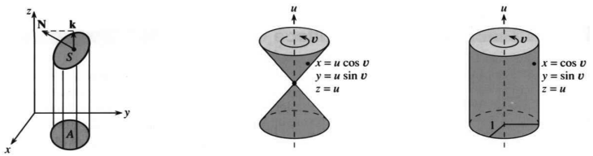
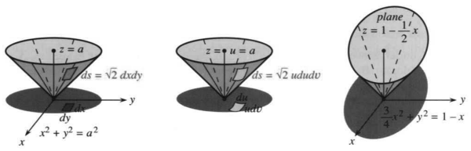
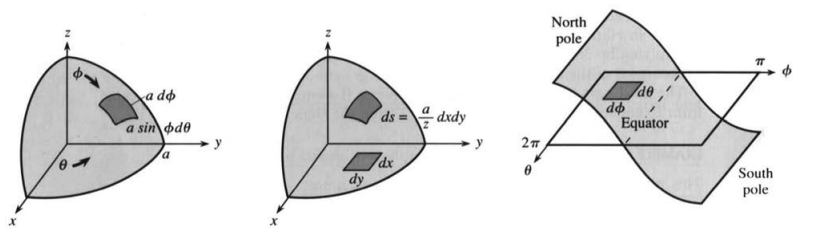
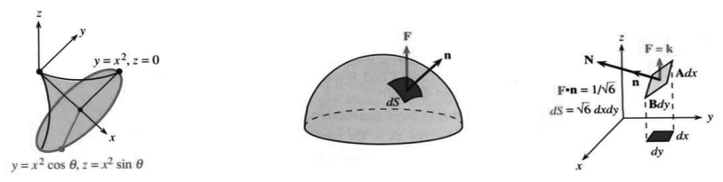
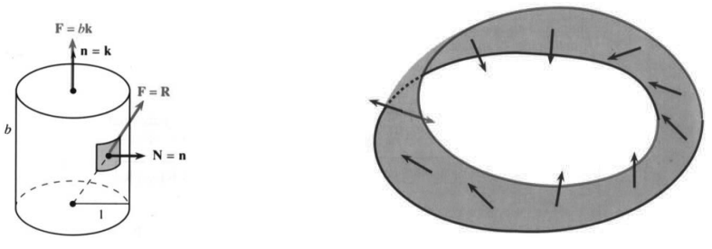
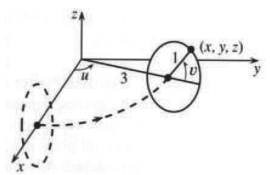

# 15.4 曲面积分

> 来源：原书 PDF 第 669–678 页，印刷页 656–665。状态：中文初译，未独立复审。公式与插图已对照原页。

<!-- PDF 669 / 印刷页 656 -->

格林定理中的二重积分是积在平面区域 $R$ 上的。现在让区域离开平面，成为弯曲的曲面 $S$，例如球面、圆柱面或圆锥面的一部分。如果每个 $(x,y)$ 只对应一个 $z$，曲面就是函数 $z(x,y)$ 的图像。其他情况下，$S$ 可以扭曲、闭合；一个球面在同一 $(x,y)$ 上有上、下两个 $z$。无论哪种情形，我们都要计算面积和通量。这是把格林定理推广到三维之前必要的一步，也是最后一步。

先简单回顾。基本积分有 $\int dx$、$\iint dx\,dy$ 与 $\iiint dx\,dy\,dz$。不属于这一列的是 $\int ds$，即曲线长度。从曲线推广到曲面时，$ds$ 变成 $dS$。面积为 $\iint dS$，通量为 $\iint\mathbf F\cdot\mathbf n\,dS$；曲面是二维的，所以用二重积分。主要困难在于 $dS$。本节末尾的表汇总所有公式。

沿曲线处理 $ds$ 有两种方法，对曲面上的 $dS$ 也适用。第一种使用 $xyz$ 坐标，第二种使用参数。趁问题还没变复杂，我先把这两种方法讲清楚。

**方法 1 适用于函数图像：曲线 $y(x)$ 或曲面 $z(x,y)$。**

曲线的一小段近似为直线：横向走 $dx$，向上走 $dy$，长度为

$$
ds=\sqrt{(dx)^2+(dy)^2}=\sqrt{1+(dy/dx)^2}\,dx.\tag{1}
$$

曲面的一小块近似为平面。想象一个很小的倾斜矩形：一条边横向走 $dx$，向上走 $z_x\,dx$；邻边沿另一个方向走 $dy$，向上走 $z_y\,dy$。求面积是第 11 章的线性问题，因为这一小块位于一个平面内。

两向量 $\mathbf A,\mathbf B$ 张成平行四边形，叉积的长度就是面积。这里 $\mathbf A=\mathbf i+z_x\mathbf k$，$\mathbf B=\mathbf j+z_y\mathbf k$，所以 $\mathbf A\,dx$ 与 $\mathbf B\,dy$ 是两条边。计算叉积：

$$
\mathbf A\times\mathbf B=
\begin{vmatrix}\mathbf i&\mathbf j&\mathbf k\\1&0&z_x\\0&1&z_y\end{vmatrix}
=-z_x\mathbf i-z_y\mathbf j+\mathbf k.\tag{2}
$$

这正是第 13 章中切平面与曲面的法向量 $\mathbf N$。注意：小平面块实际是平行四边形，不一定是矩形。它的面积元类似 $ds$，但 $\mathbf N=\mathbf A\times\mathbf B$ 的长度涉及两个导数：

$$
dS=|\mathbf A\,dx\times\mathbf B\,dy|=|\mathbf N|\,dx\,dy
=\sqrt{1+z_x^2+z_y^2}\,dx\,dy.\tag{3}
$$

**例 1** 底面积是 $A$，求上方平面 $z=x+2y$ 上的面积。

这个例子值得先在脑子里想清楚。$xy$ 平面内的底面积是 $A$，上方斜平面的面积更大：屋顶面积大于下面房间的面积。如果屋顶倾斜 $45^\circ$，两者之比为 $\sqrt2$。公式 (3) 对任何曲面都给出正确比值，也包括平面 $z=x+2y$。

<!-- PDF 670 / 印刷页 657 -->

图 15.14 屋顶面积＝底面积乘 $|\mathbf N|$；以 $u,v$ 为参数的圆锥面与圆柱面。

偏导数 $z_x=1,z_y=2$ 都是常数，平面容易处理。式 (3) 根号内为 $1+1^2+2^2=6$，所以 $dS=\sqrt6\,dx\,dy$。$xy$ 平面的面积在上方斜面中乘以 $\sqrt6$（图 15.14a）。向量 $\mathbf A,\mathbf B$ 到 (3) 就用完了，不再需要，不过还是列在这里：

$$
\mathbf A=\mathbf i+z_x\mathbf k=\mathbf i+\mathbf k,\quad
\mathbf B=\mathbf j+z_y\mathbf k=\mathbf j+2\mathbf k,\quad
\mathbf N=-\mathbf i-2\mathbf j+\mathbf k.
$$

$|\mathbf N|=\sqrt6$。$\mathbf k$ 与 $\mathbf N$ 的夹角满足 $\cos\theta=1/\sqrt6$，这也是底平面与斜平面的夹角，所以斜面面积为底面积的 $\sqrt6$ 倍。曲面弯了，道理还是一样，只是 $|\mathbf N|=1/\cos\theta$ 中的根式会随位置变化。

**方法 2 适用于参数曲线 $x(t),y(t)$ 和参数曲面 $x(u,v),y(u,v),z(u,v)$。**

曲线有一个参数 $t$；曲面是二维的，有两个参数 $u,v$。参数形式的好处之一，是把 $x,y,z$ 平等看待，不必单把 $z$ 挑出来写成 $f(x,y)$。前两个例子是

$$
\begin{array}{ll}
\text{圆锥面：}&x=u\cos v,\quad y=u\sin v,\quad z=u;\\
\text{圆柱面：}&x=\cos v,\quad y=\sin v,\quad z=u.
\end{array}\tag{4}
$$

每组 $u,v$ 给出曲面上一点，取遍参数就得到整个曲面。参数可以等于某个坐标，例如 $z=u$；有时两个参数都取坐标，如 $x=u,y=v,z=f(u,v)$，这只是换了写法的 $z=f(x,y)$。其他情形下，消去 $u,v$ 就得到 $xyz$ 方程：

$$
\begin{aligned}
\text{圆锥面：}\quad &(u\cos v)^2+(u\sin v)^2=u^2,
\quad x^2+y^2=z^2,\quad z=\sqrt{x^2+y^2}\ \text{（上半部）};\\
\text{圆柱面：}\quad &\cos^2v+\sin^2v=1,\quad x^2+y^2=1.
\end{aligned}
$$

上半圆锥面是 $f=\sqrt{x^2+y^2}$ 的图像。圆柱面不是某个 $z=f(x,y)$ 的图像：圆 $x^2+y^2=1$ 上的每个点，都对应一整条直线，线上各点的 $z$ 值互不相同。$z=u$ 正说明这一点——$u$ 取遍所有值就得到整条线，$u,v$ 都取遍便得到整个圆柱面。参数允许曲面闭合甚至自交，这是 $f(x,y)$ 的图像做不到的。

实际上，$z=\sqrt{x^2+y^2}$ 只给出圆锥面的上半部，因为函数只能产生一个 $z$；参数形式还给出下半部。类似地，$y=\sqrt{1-x^2}$ 只给出上半圆，而 $x=\cos t,y=\sin t$ 可以绕完整个圆。

<!-- PDF 671 / 印刷页 658 -->

现在用参数求 $dS$。参数的微小变化给出近似平坦的小曲面块，一条边来自 $du$，邻边来自 $dv$，分别为 $\mathbf A\,du$、$\mathbf B\,dv$，其中

$$
\mathbf A=x_u\mathbf i+y_u\mathbf j+z_u\mathbf k,\qquad
\mathbf B=x_v\mathbf i+y_v\mathbf j+z_v\mathbf k.\tag{5}
$$

求平行四边形面积 $dS$，从叉积 $\mathbf N=\mathbf A\times\mathbf B$ 开始：

$$
\mathbf N=
\begin{vmatrix}\mathbf i&\mathbf j&\mathbf k\\x_u&y_u&z_u\\x_v&y_v&z_v\end{vmatrix}
=(y_uz_v-z_uy_v)\mathbf i+(z_ux_v-x_uz_v)\mathbf j+(x_uy_v-y_ux_v)\mathbf k.\tag{6}
$$

它看起来确实复杂，不过实际例子常相当简单。小曲面块面积为 $|\mathbf N|\,du\,dv$，其中长度是一个平方根：

$$
dS=\sqrt{(y_uz_v-z_uy_v)^2+(z_ux_v-x_uz_v)^2+(x_uy_v-y_ux_v)^2}\,du\,dv.\tag{7}
$$

**例 2** 对圆锥面和圆柱面求 $\mathbf A,\mathbf B,\mathbf N=\mathbf A\times\mathbf B$ 及 $dS$。

圆锥面为 $x=u\cos v,y=u\sin v,z=u$。对 $u$ 求导得 $\mathbf A=\mathbf R_u=\cos v\,\mathbf i+\sin v\,\mathbf j+\mathbf k$；对 $v$ 求导得另一个切向量 $\mathbf B=\mathbf R_v=-u\sin v\,\mathbf i+u\cos v\,\mathbf j$。法向量为 $\mathbf A\times\mathbf B=-u\cos v\,\mathbf i-u\sin v\,\mathbf j+u\mathbf k$，其长度给出

$$
dS=|\mathbf A\times\mathbf B|\,du\,dv
=\sqrt{(u\cos v)^2+(u\sin v)^2+u^2}\,du\,dv
=\sqrt2\,|u|\,du\,dv.
$$

对上半圆锥 $u\ge0$，这就是 $\sqrt2u\,du\,dv$。圆柱更简单：$dS=du\,dv$。这些例子，还有另外许多例子，都有 $\mathbf A\perp\mathbf B$：小块是矩形，两边长为 $|\mathbf A|du$ 与 $|\mathbf B|dv$。（圆锥中 $|\mathbf A|=\sqrt2,|\mathbf B|=|u|$；圆柱中两者均为 1。）此时直接相乘即可求面积，几乎不必用叉积。

**两种方法的关系。** 方法 1 其实也用了参数，只不过特别选取 $u=x,v=y$，参数方程为 $x=x,y=y,z=f(x,y)$。在 (7) 的长根式中将 $u,v$ 换成 $x,y$，便化为 (3)：$y_x,x_y$ 为零，而 $x_x,y_y$ 为 1。不过，仍值得记住方法 1 的短公式。

求出 $dS$ 后不要忘记积分。很多时候极坐标更方便。曲面往往关于某条轴或某个点对称，那就是第 8 章讲过的旋转曲面，我们还会回到它。

严格说，积分从 $\Delta S$ 而不是 $dS$ 开始。小平面块面积是 $|\mathbf A\times\mathbf B|\Delta x\Delta y$ 或 $|\mathbf A\times\mathbf B|\Delta u\Delta v$，曲面面积应定义为极限。微积分的关键一步是从 $\Delta S$ 的和过渡到 $dS$ 的积分；曲面光滑时，这一步靠得住。

<!-- PDF 672 / 印刷页 659 -->

例题的难点通常在于算二重积分，以及把 $x,y$ 或 $u,v$ 的积分限代进去。

**例 3** 求圆锥面 $z=\sqrt{x^2+y^2}$ 从顶点到高度 $z=a$ 的面积。

采用方法 1，不显式使用参数。计算、平方并相加偏导数：

$$
z_x=\frac{x}{\sqrt{x^2+y^2}},\qquad z_y=\frac{y}{\sqrt{x^2+y^2}},\qquad
|\mathbf N|^2=1+\frac{x^2}{x^2+y^2}+\frac{y^2}{x^2+y^2}=2.
$$

因此 $|\mathbf N|=\sqrt2$，$dS=\sqrt2\,dx\,dy$。圆锥倾斜 $45^\circ$，所以底面中的面积 $dx\,dy$ 在上方曲面上乘以 $\sqrt2$（图 15.15）。$dS$ 的根式计入了倾斜增加的面积。水平面则为 $dS=\sqrt1\,dx\,dy$，这是我们早已知道的。

关键点是：积分在底平面内进行。$x,y$ 的界限由圆锥的“投影”给出。令 $z=\sqrt{x^2+y^2}=a$，平面与圆锥交于圆 $x^2+y^2=a^2$。在圆内积分，这个圆就是投影区域：

$$
\text{圆锥侧面积}=\iint_{\text{投影}}\sqrt2\,dx\,dy=\sqrt2\pi a^2.
$$

**例 4** 用例 2 的 $dS=\sqrt2u\,du\,dv$ 求同一面积。

采用参数时，$dS$ 形式不同，底部参数域也不同。圆 $x^2+y^2=a^2$ 成为 $u^2\cos^2v+u^2\sin^2v=a^2$，也就是 $u=a$。（圆锥 $z=u$ 与平面 $z=a$ 在 $u=a$ 相交。）角参数 $v$ 从 0 到 $2\pi$。这些参数相当于“自动”切换到极坐标，其面积元为 $r\,dr\,d\theta$：

$$
\text{圆锥侧面积}=\iint dS=\int_0^{2\pi}\int_0^a\sqrt2u\,du\,dv=\sqrt2\pi a^2.
$$

图 15.15 平面截圆锥后在底面留下投影，对该投影积分。plane：平面。

**例 5** 求同一圆锥面从顶点到斜平面 $z=1-x/2$ 的面积。

**解** 仍有 $dS=\sqrt2\,dx\,dy$，但积分限改变了。平面把圆锥截成椭圆，其在 $xy$ 平面上的投影也是椭圆（图 15.15c）。

<!-- PDF 673 / 印刷页 660 -->

令 $z=\sqrt{x^2+y^2}=1-x/2$ 求投影边界，两边平方：

$$
x^2+y^2=1-x+\frac14x^2,\qquad\text{即}\qquad
\frac34\left(x+\frac23\right)^2+y^2=\frac43.
$$

这就是底面上的椭圆，与高度无关，因为 $z$ 已经消去。椭圆写成 $(x/a)^2+(y/b)^2=1$ 时，面积为 $\pi ab$。上式乘 $3/4$ 后可读出半轴 $a=4/3,b=\sqrt{4/3}$。于是 $\iint\sqrt2\,dx\,dy=\sqrt2\pi ab$ 就是圆锥侧面积。

难的是找出投影椭圆，这一步我刚才讲快了。面积 $\pi ab$ 来自 15.3 节例 2；新增的因子，是斜率带来的 $\sqrt2$。

**例 6** 求半径 $a$ 的球面面积，已知答案为 $4\pi a^2$。

这是个好例子，因为两种方法都几乎奏效。球面方程为 $x^2+y^2+z^2=a^2$。方法 1 写成 $z=\sqrt{a^2-x^2-y^2}$，偏导数为 $-x/z,-y/z$：

$$
1+z_x^2+z_y^2=\frac{z^2+x^2+y^2}{z^2}=\frac{a^2}{z^2}=\frac{a^2}{a^2-x^2-y^2}.
$$

开平方得 $dS=a\,dx\,dy/\sqrt{a^2-x^2-y^2}$。$z$ 正如我们预料的，消掉了。现在在球面的圆形投影上积分，把 $dx\,dy$ 换成极坐标面积元 $r\,dr\,d\theta$：

$$
\iint_{\text{投影}}dS
=\int_0^{2\pi}\int_0^a\frac{ar\,dr\,d\theta}{\sqrt{a^2-r^2}}
=-2\pi a\sqrt{a^2-r^2}\Big|_0^a=2\pi a^2.\tag{8}
$$

计算顺利，却没有得到整球答案！$2\pi a^2$ 是 $xy$ 平面上方半球的面积，下半球应取 $z^2=a^2-x^2-y^2$ 的负平方根。这说明，曲面不是单一函数图像时，方法 1 容易漏掉一部分。

**例 7** 用方法 2 的参数再求同一球面面积。

自然选择是球坐标。每个点有从北极向下量的角 $u=\phi$，以及沿赤道方向的角 $v=\theta$。由 14.4 节，$x=a\sin\phi\cos\theta,y=a\sin\phi\sin\theta,z=a\cos\phi$。半径 $\rho=a$ 固定，不是参数。注意 $z_\theta=0$，(6) 的第一项是

$$
y_\phi z_\theta-z_\phi y_\theta=-(-a\sin\phi)(a\sin\phi\cos\theta)
=a^2\sin^2\phi\cos\theta.
$$

另两项为 $a^2\sin^2\phi\sin\theta$ 和 $a^2\sin\phi\cos\phi$。在 (7) 中平方相加，提出 $a^4$ 并化简：

$$
a^4(\sin^4\phi\cos^2\theta+\sin^4\phi\sin^2\theta+\sin^2\phi\cos^2\phi)
=a^4(\sin^4\phi+\sin^2\phi\cos^2\phi)=a^4\sin^2\phi.
$$

因此 $dS=a^2\sin\phi\,d\phi\,d\theta$。熟悉球坐标的人会立刻认出：它就是体积元 $dV=\rho^2\sin\phi\,d\rho\,d\phi\,d\theta$ 去掉 $d\rho$。小盒子的底面积是 $dS$，厚度是 $d\rho$，体积是 $dV$。这里只需要面积：

$$
\text{球面面积}=\iint dS=\int_0^{2\pi}\int_0^\pi a^2\sin\phi\,d\phi\,d\theta=4\pi a^2.\tag{9}
$$

图 15.16a 的小曲面块边长为 $a\,d\phi$ 与 $a\sin\phi\,d\theta$，乘积为 $dS$。图 15.16b 回到方法 1，其中 (8) 给出 $dS=(a/z)\,dx\,dy$。

<!-- PDF 674 / 印刷页 661 -->

你可能不喜欢图 15.16c，其实也不需要它。以 $\phi,\theta$ 为参数时，球面在参数平面上的“投影”是矩形，赤道是中间的直线 $\phi=\pi/2$，高度为 $z=a\cos\phi$。底部面积 $d\phi\,d\theta$ 对应球面上的 $dS=a^2\sin\phi\,d\phi\,d\theta$。也许这幅图正好说明：关于参数，哪些东西我们不必知道。

图 15.16 球面上的面积：(a) 球坐标；(b) $xyz$ 坐标；(c) $\phi\theta$ 参数空间。North pole：北极；Equator：赤道；South pole：南极。

**例 8** 将 $y=x^2$ 绕 $x$ 轴旋转，用参数求曲面面积。

第一参数为 $x$，从 $a$ 到 $b$；第二参数为旋转角 $\theta$，从 0 到 $2\pi$。图 15.17 的曲面点为 $x=x,y=x^2\cos\theta,z=x^2\sin\theta$。由 (7) 经过计算得到 $dS=x^2\sqrt{1+4x^2}\,dx\,d\theta$。

关键是，这与 8.3 节面积公式 $\int_a^b2\pi y\sqrt{1+(dy/dx)^2}\,dx$ 一致。$2\pi$ 来自 $\theta$ 积分，而 $y=x^2$。参数法自动给出这一公式。

## 向量场与法向分量的积分

曲面面积公式里有很多平方根，正如 $ds$ 一样，$dS$ 中也有平方根。面积就像弧长，只是高出一维。曲线通量积分 $\int\mathbf F\cdot\mathbf n\,ds$ 的好处是平方根会消失：它位于 $\mathbf n$ 的分母，被 $ds$ 抵消，留下 $M\,dy-N\,dx$。曲面积分 $\iint\mathbf F\cdot\mathbf n\,dS$ 也有同样好处。

**15I** 向量场 $\mathbf F(x,y,z)=M\mathbf i+N\mathbf j+P\mathbf k$ 穿过曲面 $z=f(x,y)$ 的通量为

$$
\text{通量}=\iint_{\text{曲面}}\mathbf F\cdot\mathbf n\,dS
=\iint_{\text{投影}}(-Mf_x-Nf_y+P)\,dx\,dy.\tag{10}
$$

给定曲面 $f$ 与场 $\mathbf F$，公式告诉我们积什么，$xy$ 积分限来自投影。式 (10) 使用方法 1 的法向量：

$$
\mathbf N=-f_x\mathbf i-f_y\mathbf j+\mathbf k,\qquad
|\mathbf N|=\sqrt{1+f_x^2+f_y^2}.
$$

<!-- PDF 675 / 印刷页 662 -->

单位法向量是 $\mathbf n=\mathbf N/|\mathbf N|$。分母里的根式与 (3) 中 $dS$ 的根式相同，因此

$$
\mathbf F\cdot\mathbf n\,dS
=\frac{\mathbf F\cdot\mathbf N}{\sqrt{1+f_x^2+f_y^2}}\sqrt{1+f_x^2+f_y^2}\,dx\,dy
=(-Mf_x-Nf_y+P)\,dx\,dy.\tag{11}
$$

根式抵消后就是 (10)。表达式 $\mathbf F\cdot\mathbf n\,dS$ 常写成 $\mathbf F\cdot d\mathbf S$，再次依靠粗体表示向量。这里 $d\mathbf S=\mathbf n\,dS$，方向为 $\mathbf n$，大小为 $dS$。

图 15.17 旋转曲面，参数为 $x,\theta$。图 15.18 $\mathbf F\cdot\mathbf n\,dS$ 给出穿过面积元 $dS$ 的流量。

**例 9** 对平面 $z=x+2y$ 求 $\mathbf n\,dS$，再对 $\mathbf F=\mathbf k$ 求 $\mathbf F\cdot\mathbf n\,dS$。

例 1 求面积时出现 $\sqrt6$，求通量时它消失了：

$$
\mathbf n\,dS=\frac{\mathbf N}{|\mathbf N|}dS
=\frac{-\mathbf i-2\mathbf j+\mathbf k}{\sqrt6}\sqrt6\,dx\,dy
=(-\mathbf i-2\mathbf j+\mathbf k)\,dx\,dy.
$$

对流场 $\mathbf F=\mathbf k$，点积化为 $\mathbf k\cdot\mathbf n\,dS=1\,dx\,dy$。斜率不影响通量！穿过底面的流也穿过斜平面。面积虽不同，通量却像雨量：落在帐篷上还是下面的地面上，都是同一场雨（图 15.18）。此时 $\iint\mathbf F\cdot\mathbf n\,dS=\iint dx\,dy$，等于底部投影面积。

**例 10** 求 $\mathbf F=x\mathbf i+y\mathbf j+z\mathbf k$ 穿过圆锥面 $z=\sqrt{x^2+y^2}$ 的通量。

**解**

$$
\mathbf F\cdot\mathbf n\,dS
=\left[-x\frac{x}{\sqrt{x^2+y^2}}-y\frac{y}{\sqrt{x^2+y^2}}+\sqrt{x^2+y^2}\right]dx\,dy=0.
$$

答案为零似乎出乎意料，其实不该如此。圆锥面沿从原点出发的直射线延伸，$\mathbf F$ 也是。$\mathbf n$ 垂直于圆锥面，也垂直于 $\mathbf F$，所以没有流穿过圆锥面：$\mathbf F\cdot\mathbf n=0$。流沿射线向外运动。

## 参数曲面的通量积分

例 10 中圆锥面为 $z=f(x,y)=\sqrt{x^2+y^2}$，我们用方法 1 求 $dS$，不必显式引入参数，更准确地说参数就是 $x,y$。遇到折叠、扭曲的曲面，$u,v$ 公式看着复杂，实际算起来却可能更简单，圆柱面的 $dS=du\,dv$ 就是这样。

小曲面块面积为 $dS=|\mathbf A\times\mathbf B|\,du\,dv$，边向量由 $\mathbf A=x_u\mathbf i+y_u\mathbf j+z_u\mathbf k$ 与 $\mathbf B=x_v\mathbf i+y_v\mathbf j+z_v\mathbf k$ 给出，它们都与曲面相切。

<!-- PDF 676 / 印刷页 663 -->

现在叉积 $\mathbf N=\mathbf A\times\mathbf B$ 有了另一个用途，因为通量不仅涉及面积，也涉及方向。需要单位向量 $\mathbf n$ 才能知道多少流穿过曲面。

方向向量为 $\mathbf n=\mathbf N/|\mathbf N|$，而 (7) 给出 $dS=|\mathbf N|\,du\,dv$。于是根式 $|\mathbf N|$ 在 $\mathbf n\,dS$ 中抵消，得到简洁的法向流量公式。

**15J** 场 $\mathbf F=M\mathbf i+N\mathbf j+P\mathbf k$ 穿过以 $u,v$ 为参数的曲面的通量为

$$
\iint\mathbf F\cdot\mathbf n\,dS
=\iint\mathbf F\cdot\mathbf N\,du\,dv
=\iint\mathbf F\cdot(\mathbf A\times\mathbf B)\,du\,dv.\tag{12}
$$

**例 11** 求 $\mathbf F=x\mathbf i+y\mathbf j+z\mathbf k$ 穿过圆柱面 $x^2+y^2=1,0\le z\le b$ 的通量。

**解** 圆柱面为 $x=\cos u,y=\sin u,z=v$。由 (5)，切向量是 $\mathbf A=-\sin u\,\mathbf i+\cos u\,\mathbf j$ 与 $\mathbf B=\mathbf k$。图 15.19 的法向量径直向外：

$$
\mathbf N=\mathbf A\times\mathbf B=\cos u\,\mathbf i+\sin u\,\mathbf j
\quad\text{（检验 $\mathbf A\cdot\mathbf N=\mathbf B\cdot\mathbf N=0$）}.
$$

将 $\mathbf F$ 改写为参数形式，就得到 $\mathbf F\cdot\mathbf N=1$：

$$
(\cos u\,\mathbf i+\sin u\,\mathbf j+v\mathbf k)\cdot(\cos u\,\mathbf i+\sin u\,\mathbf j)
=\cos^2u+\sin^2u.
$$

对它积分，代入 $u=\theta,v=z$ 的界限：

$$
\text{通量}=\int_0^b\int_0^{2\pi}1\,du\,dv=2\pi b=\text{圆柱侧面积}.
$$

注意还没有包括顶面与底面！顶面外法向为 $\mathbf n=\mathbf k$，底面为 $\mathbf n=-\mathbf k$。所以顶面 $\mathbf F\cdot\mathbf n=z=b$，底面为 $-z=0$。底面通量为零，顶面通量为 $b$ 乘面积，即 $\pi b$。总通量为 $2\pi b+\pi b=3\pi b$，下一节还会用到这个答案。

抱歉，我把 $u$ 改成了角度，$v$ 改成了高度，这样 $\mathbf N$ 就指向外而不是内。

**例 12** 求 $\mathbf F=\mathbf k$ 向外穿过球面 $x^2+y^2+z^2=a^2$ 上半部分的通量。

**解** 用球坐标。例 7 取 $u=\phi,v=\theta$，得到

$$
\mathbf N=a^2\sin^2\phi\cos\theta\,\mathbf i
+a^2\sin^2\phi\sin\theta\,\mathbf j
+a^2\sin\phi\cos\phi\,\mathbf k.
$$

与 $\mathbf k$ 点乘得 $a^2\sin\phi\cos\phi$。从极点到赤道，$\phi$ 从 0 到 $\pi/2$，绕轴一周，$\theta$ 从 0 到 $2\pi$：

$$
\text{通量}=\int_0^{2\pi}\int_0^{\pi/2}a^2\sin\phi\cos\phi\,d\phi\,d\theta
=2\pi a^2\left[\frac{\sin^2\phi}{2}\right]_0^{\pi/2}=\pi a^2.
$$

下一节会说明：任何以赤道为边界、定向适当的曲面，通量仍是 $\pi a^2$。特例是赤道处半径为 $a$ 的平面圆盘。

<!-- PDF 677 / 印刷页 664 -->

法向量 $\mathbf n=\mathbf k$ 竖直向上，所以 $\mathbf F\cdot\mathbf n=1$，通量为 $\iint1\,dS=\pi a^2$，即圆盘面积。所有流体经过赤道平面，再从上半球流出。

图 15.19 穿过圆柱面的流。图 15.20 莫比乌斯带，无法连续一致地选择法向量 $\mathbf n$。

还必须提一个问题，通常你可能不会想到：有些曲面只有一侧。著名例子是莫比乌斯带，把纸条扭转半圈，再将两端粘合就能得到。用笔沿其“内侧”移动，会发现图 15.20 的笔突然到了“外侧”；再走一周又回到“内侧”。这些词得加引号，因为在莫比乌斯带上，它们没有全局意义。

假设笔代表法向量。在球面上，$\mathbf n$ 可以向外，也可以向内，我们可以自由选择。莫比乌斯带却不允许这种选择：连续移动一周后，笔回到原点时指向反方向。这种曲面不可定向：$\mathbf n$ 的方向没法一致地决定，也就没法用 $\mathbf F\cdot\mathbf n$ 的积分定义通常的有向通量。

我们能选定 $\mathbf n$、也确实选定了，曲面就有了定向。这里用到叉积的最后一个性质：除了长度与方向，它还满足右手法则。$\mathbf A\times\mathbf B$ 与 $\mathbf B\times\mathbf A$ 给出 $\mathbf n$ 的两个方向。对开曲面，如废纸篓，可选其一；对闭曲面，如球面，通常约定外法向。一次选定后，通量符号就确定了：向外为正。

**曲面积分公式**（两种方法都取 $\mathbf N=\mathbf A\times\mathbf B$，$\mathbf n=\mathbf N/|\mathbf N|$）

| 项目 | 方法 1：参数 $x,y$ | 方法 2：参数 $u,v$ |
|---|---|---|
| 曲面坐标 | $x,y,z(x,y)$ | $x(u,v),y(u,v),z(u,v)$ |
| $\mathbf A$ | $\mathbf i+z_x\mathbf k$ | $x_u\mathbf i+y_u\mathbf j+z_u\mathbf k$ |
| $\mathbf B$ | $\mathbf j+z_y\mathbf k$ | $x_v\mathbf i+y_v\mathbf j+z_v\mathbf k$ |
| $dS$ | $\lVert\mathbf N\rVert dx\,dy=\sqrt{1+z_x^2+z_y^2}\,dx\,dy$ | $\lVert\mathbf N\rVert du\,dv$ |
| $\mathbf n\,dS$ | $\mathbf N\,dx\,dy=(-z_x\mathbf i-z_y\mathbf j+\mathbf k)\,dx\,dy$ | $\mathbf N\,du\,dv$ |

<!-- PDF 678 / 印刷页 665 -->

## 15.4 习题

### 阅读填空

曲面 $z=f(x,y)$ 的一小块近似为 **a____**。横向走 $dx$ 时，向上走 **b____**。该位移为 $\mathbf A\,dx$，其中 $\mathbf A=\mathbf i+$ **c____**。另一边为 $\mathbf B\,dy$，其中 $\mathbf B=\mathbf j+$ **d____**。叉积 $\mathbf A\times\mathbf B=\mathbf N=$ **e____**。面积为 $dS=|\mathbf N|\,dx\,dy$。对曲面 $z=xy$，$\mathbf A=$ **f____**，$\mathbf B=$ **g____**，$\mathbf N=$ **h____**，面积积分 $\iint dS=$ **i____** $dx\,dy$。

以 $u,v$ 为参数时，$45^\circ$ 圆锥面上的一点为 $x=u\cos v,y=$ **j____**，$z=$ **k____**。$u$ 的变化使该点移动 $\mathbf A\,du=(\cos v\,\mathbf i+$ **l____**$)du$；$v$ 的变化使它移动 $\mathbf B\,dv=$ **m____**。法向量 $\mathbf N=\mathbf A\times\mathbf B=$ **n____**，面积 $dS=$ **o____** $du\,dv$。这里 $\mathbf A\cdot\mathbf B=$ **p____**，所以小块是 **q____**，且 $dS=|\mathbf A||\mathbf B|\,du\,dv$。

通量需要 $\mathbf n\,dS$。**r____** 向量 $\mathbf n$ 等于 $\mathbf N=\mathbf A\times\mathbf B$ 除以 **s____**。对于 $z=f(x,y)$，$\mathbf n\,dS$ 为向量 **t____**（记住表中公式）。特例 $z=xy$ 有 $\mathbf n\,dS=$ **u____** $dx\,dy$。对 $\mathbf F=x\mathbf i+y\mathbf j+z\mathbf k$，穿过 $z=xy$ 的通量元为 $\mathbf F\cdot\mathbf n\,dS=$ **v____** $dx\,dy$。

在一个原书称作“$30^\circ$ 圆锥面”的曲面上，点为 $x=2u\cos v,y=2u\sin v,z=u$。切向量 $\mathbf A=$ **w____**，$\mathbf B=$ **x____**，且 $\mathbf n\,dS=\mathbf A\times\mathbf B\,du\,dv=$ **y____**。对 $\mathbf F=x\mathbf i+y\mathbf j+z\mathbf k$，通量元为 **z____**，原因是 **A____**。不计算穿过莫比乌斯带的通常有向通量，是因为 **B____**。

1–14 求 $\mathbf N$、$dS=|\mathbf N|\,dx\,dy$ 和曲面面积 $\iint dS$。在 $xy$ 投影上积分，其边界由两个 $z$ 相等确定，第 1 题就是 $x^2+y^2=4$。

1. 平面 $z=4$ 下方的抛物面 $z=x^2+y^2$。
2. $z=4$ 与 $z=8$ 之间的抛物面 $z=x^2+y^2$。
3. 圆柱 $x^2+y^2=1$ 内的平面 $z=x-y$。
4. 正方形 $0\le x,y\le1$ 上方的平面 $z=3x+4y$。
5. 球面 $x^2+y^2+z^2=1$ 在 $z=1/\sqrt2$ 上方的球冠。
6. 同一球面在 $z=0$ 与 $z=1/\sqrt2$ 之间的球带。
7. 面积为 $A$ 的三角形上方的平面 $z=7y$。
8. 平面 $z=a$ 与 $z=b$ 之间的圆锥面 $z^2=x^2+y^2$。
9. 圆柱 $x^2+y^2=1$ 内的猴鞍面 $z=x^3/3-xy^2$。
10. 顶点为 $(0,0),(2,2),(0,2)$ 的三角形上方的平面 $z=x+y$。
11. 第一卦限 $x,y,z\ge0$ 内的平面 $z=1-2x-2y$。
12. 圆柱 $x^2+y^2=a^2$ 内的圆柱面 $x^2+z^2=a^2$，只需列出 $\iint dS$。
13. 半径为 $a$、高为 $h$ 的直圆锥面，可选 $z=f(x,y)$ 或参数 $u,v$。
14. $z=9$ 下方、$y=\pm2$ 之间的槽面 $z=x^2$。

15–18 计算曲面积分 $\iint g(x,y,z)\,dS$。

15. 三角形 $x+y+z=1,x,y,z\ge0$ 上的 $g=xy$。
16. 球面 $x^2+y^2+z^2=1$ 上半部的 $g=x^2+y^2$，使用 $\phi,\theta$。
17. 球面 $x^2+y^2+z^2=1$ 位于圆锥面 $z^2=x^2+y^2$ 上方部分的 $g=xyz$，使用 $\phi,\theta$。
18. 圆柱面 $x^2+y^2=4$ 在 $z=0$ 与 $z=3$ 之间部分的 $g=x$。

19–22 计算 $\mathbf A,\mathbf B,\mathbf N,dS$。

19. $x=u,y=v+u,z=v+2u+1$。
20. $x=uv,y=u+v,z=u-v$。
21. $x=(3+\cos u)\cos v,y=(3+\cos u)\sin v,z=\sin u$。
22. $x=u\cos v,y=u\sin v,z=v$，注意不是 $z=u$。
23. 对第 1 题曲面，求 $\mathbf F=x\mathbf i+y\mathbf j+z\mathbf k$ 的通量 $\iint\mathbf F\cdot\mathbf n\,dS$。
24. 对第 2 题曲面求同一场的通量。
25. 对第 3 题曲面求同一场的通量。
26. 对第 4 题曲面求同一场的通量。
27. 对第 19 题的参数曲面与区域 $u^2+v^2\le1$，计算 $\mathbf F=y\mathbf i-x\mathbf j$ 的通量。
28. 对第 20 题的参数曲面与区域 $u^2+v^2\le1$，计算同一场的通量。
29. 单位圆绕 $z$ 轴旋转形成环面（见图），圆心到 $z$ 轴的距离保持为 3。证明第 21 题给出环面上的一般点 $(x,y,z)$，并求面积 $\iint dS=\iint|\mathbf N|\,du\,dv$。

30. 曲面 $x=r\cos\theta,y=r\sin\theta,z=a^2-r^2$ 以赤道 $r=a$ 为边界。求 $\mathbf N$ 和通量 $\iint\mathbf k\cdot\mathbf n\,dS$，与例 12 比较。
31. 将纸条扭转两个半圈后粘合，制作“双重莫比乌斯带”。法向量（用笔表示）走一周后方向是否相同？
32. 扭转三个半圈制作“三重莫比乌斯带”。它可定向吗？法向量返回后方向相同还是相反？
33. 如果一个起伏很大的曲面始终贴近一个光滑曲面，它们的面积也接近吗？
34. 写出一个平面方程，使屋顶面积元 $dS$ 等于底面积元 $dx\,dy$ 的 3 倍。
35. 点 $(x,f(x)\cos\theta,f(x)\sin\theta)$ 位于由 $y=f(x)$ 绕 $x$ 轴生成的旋转曲面上，参数为 $u=x,v=\theta$。求 $\mathbf N$，将 $dS=|\mathbf N|\,dx\,d\theta$ 与例 8 及 8.3 节比较。

## 译注与待复审事项

- 方法 1 的通量公式 (10) 默认向上法向；方法 2 的 (12) 默认 $\mathbf R_u\times\mathbf R_v$ 的方向。反向须改变通量符号。场的分量须先限制到曲面上再积分。
- PDF 671 例 2 原书写圆锥 $|\mathbf A|=u,|\mathbf B|=\sqrt2$，与紧前的向量定义互换，已更正为 $\sqrt2,|u|$。同页 $dS=\sqrt2u\,du\,dv$ 只适用于上半锥；译文给出一般式并保留后续 $u\ge0$ 特例。
- PDF 676 例 12 法向量的 $\mathbf k$ 分量原书多写一个 $\sin\phi$，应为 $a^2\sin\phi\cos\phi$；与前文叉积和随后点积一致，已修正。
- 阅读填空称 $x=2u\cos v,y=2u\sin v,z=u$ 为“30°圆锥”，其母线对水平面的角实际满足 $\tan\alpha=1/2$，不是精确 30°。保留参数方程并标明这是原书称呼，不自行改题。
- 圆锥顶点及球坐标极点处参数化退化；球面赤道处方法 1 的导数发散，例题需按分片或反常积分理解。第 8 题若跨越 $z=0$ 应分段，第 17 题“上方”按上半锥解释，原题未进一步限定。
- 例 12 “任何曲面”以适当光滑、可定向、相同边界及相容定向为前提；不是包括莫比乌斯带等任意曲面的无条件声明。正文关于旋转面沿用原书语境。
- 原图保留；本节未独立数学复审或作最终版式验证。
