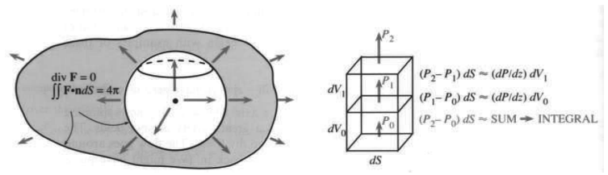
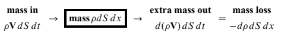

# 15.5 散度定理

> 来源：原书 PDF 第 679–685 页，印刷页 666–672。状态：中文初译，未独立复审。公式与插图已对照原页。

<!-- PDF 679 / 印刷页 666 -->

本节回到基本定律：流出量减流入量等于源的补充量。二维时，流穿过闭曲线 $C$ 进出，内部平面区域为 $R$；三维时，流穿过闭曲面 $S$ 进出，内部实体区域为 $V$。用于光滑向量场通量的格林定理法向形式，现在成为重要的三维平衡方程——散度定理。

**15K** 场 $\mathbf F=M\mathbf i+N\mathbf j+P\mathbf k$ 穿过边界曲面 $S$ 的通量，等于其散度在 $V$ 内的积分。散度定理为

$$
\iint_S\mathbf F\cdot\mathbf n\,dS
=\iiint_V\operatorname{div}\mathbf F\,dV
=\iiint_V\left(\frac{\partial M}{\partial x}+\frac{\partial N}{\partial y}+\frac{\partial P}{\partial z}\right)dx\,dy\,dz.\tag{1}
$$

格林定理中的散度是 $M_x+N_y$，新增的 $P_z$ 计入向上的流。若向上分量 $P$ 是常数，就不增加散度，因为导数为零；也不增加净通量，因为穿过顶面向上的流等于穿过底面向上的流。整个场为常向量时，定理成为 $0=0$。

还有其他满足 $\operatorname{div}\mathbf F=0$ 的场，它们极其重要。对它们，散度定理仍为 $0=0$，流体守恒：流入等于流出。先看这些“无散场”的例子。

**例 1** 旋转场 $-y\mathbf i+x\mathbf j+0\mathbf k$ 与 $0\mathbf i-z\mathbf j+y\mathbf k$ 的散度为零。

第一个是老朋友，绕 $z$ 轴旋转；第二个绕 $x$ 轴旋转。三维流动有各种旋转场。这里 $M_x,N_y,P_z$ 分别为零，所以散度为零。流沿圆运动，从 $S$ 流出的都会流回来。（也可以仿照 $\oint_C$，在 $\iint_S$ 上加圈，强调 $S$ 闭合。）

**例 2** 位置场 $\mathbf R=x\mathbf i+y\mathbf j+z\mathbf k$ 的散度是 $1+1+1=3$。

这是从原点径直向外的径向流。为了维持流动，必须在每一点加入质量。散度定理右边为 $\iiint3\,dV$，所以通量是体积的三倍。

15.4 节例 11 求出了 $\mathbf R$ 穿过圆柱边界的通量 $3\pi b$。现在由散度定理也得到 $3\pi b$，因为体积为 $\pi b$。这是三重积分比曲面二重积分更容易的许多例子之一。

**例 3** 静电场 $\mathbf R/\rho^3$ 或引力场 $-\mathbf R/\rho^3$ 几乎满足散度为零。

$\mathbf R=x\mathbf i+y\mathbf j+z\mathbf k$ 的长度是 $\rho=\sqrt{x^2+y^2+z^2}$，所以场的长度是 $\rho/\rho^3$，遵循平方反比定律。点质量的引力向内，故有负号；这里正点电荷的电场向外。以下三步几乎证明了散度为零。

**第 1 步。** $\rho_x=x/\rho,\rho_y=y/\rho,\rho_z=z/\rho$，但不要把这三者相加。$\mathbf F$ 不是标量 $\rho$ 或 $1/\rho^2$，而是向量场 $\mathbf R/\rho^3$；需要计算的是 $M_x,N_y,P_z$。

<!-- PDF 680 / 印刷页 667 -->

**第 2 步。**

$$
M_x=\frac{\partial}{\partial x}\frac{x}{\rho^3}
=\frac1{\rho^3}-\frac{3x\rho_x}{\rho^4}
=\frac1{\rho^3}-\frac{3x^2}{\rho^5}.
$$

将 $3x^2$ 分别换成 $3y^2,3z^2$，就得到 $N_y,P_z$。现在把三项相加。

**第 3 步。** $\operatorname{div}\mathbf F=3/\rho^3-3(x^2+y^2+z^2)/\rho^5=3/\rho^3-3/\rho^3=0$。

计算留下一个疑问：散度定理一边似乎是 $\iiint0\,dV=0$，那么另一边也应为零。但所有流都向外时，通量不可能为零！球面 $\rho=\text{常数}$ 的单位外法向为 $\mathbf n=\mathbf R/\rho$，故

$$
\mathbf F\cdot\mathbf n=\frac{\mathbf R}{\rho^3}\cdot\frac{\mathbf R}{\rho}
=\frac{\rho^2}{\rho^4}>0,
\qquad
\iint\mathbf F\cdot\mathbf n\,dS=\iint\frac{dS}{\rho^2}=\frac{4\pi\rho^2}{\rho^2}=4\pi.
$$

于是竟得到 $4\pi=0$。这个三维悖论与二维的 $\mathbf R/r^2$ 相同。15.3 节得出 $2\pi=0$，原因是原点存在点源；这里也一样，$\rho=0$ 时场分量无界。散度在分布意义下是 $4\pi$ 乘 delta 函数。经典散度定理不能直接应用，除非引入广义函数。这一个点改变了结果。

每个包围原点的闭曲面都有通量 $4\pi$。刚才算的是球面；若 $S$ 弯曲不规则（图 15.21a），直接积分困难得多。但散度定理处理了一切：两曲面之间的区域内散度为零，所以对两者组成的完整边界，净通量为零。流入内球面的通量 $-4\pi$，必须由流出外曲面的 $4\pi$ 平衡。

图 15.21 点源穿过所有包围曲面的通量都是 $4\pi$。向上净通量为 $\iiint P_z\,dV$。SUM → INTEGRAL：求和趋于积分。

这个例子最终得到的不是悖论，而是高斯定律。原点质量 $M$ 产生引力场 $\mathbf F=-GM\mathbf R/\rho^3$，原点电荷 $q$ 产生电场 $\mathbf E=[q/(4\pi\varepsilon_0)]\mathbf R/\rho^3$。物理常数为 $G,\varepsilon_0$，数学中固定不变的是散度与通量的联系。由 (1) 得到 (2)，其中质量密度 $M(x,y,z)$ 和电荷密度 $q(x,y,z)$ 不必集中在原点。

**15L 高斯定律的微分形式：** $\operatorname{div}\mathbf F=-4\pi GM$，$\operatorname{div}\mathbf E=q/\varepsilon_0$。

**积分形式：** 通量正比于总质量或总电荷：

$$
\iint\mathbf F\cdot\mathbf n\,dS=-\iiint4\pi GM\,dV,\qquad
\iint\mathbf E\cdot\mathbf n\,dS=\iiint q\,dV/\varepsilon_0.\tag{2}
$$

<!-- PDF 681 / 印刷页 668 -->

## 散度定理背后的推理

总体原则很清楚：流出减流入等于源。目标是理解为什么散度衡量源的强度。对每一点周围的小盒子，要说明 $\operatorname{div}\mathbf F\,dV$ 与六个面上的 $\mathbf F\cdot\mathbf n\,dS$ 平衡。

取中心为 $(x,y,z)$、边长 $\Delta x,\Delta y,\Delta z$ 的小盒子。顶、底外法向是 $\mathbf k,-\mathbf k$，与场点乘为 $P,-P$，面积为 $\Delta x\Delta y$。两个通量近似为 $P(x,y,z+\Delta z/2)\Delta x\Delta y$ 与 $-P(x,y,z-\Delta z/2)\Delta x\Delta y$。两项合并，$P$ 的差为 $\Delta P$：

$$
\text{向上净通量}\approx\Delta P\Delta x\Delta y
=\frac{\Delta P}{\Delta z}\Delta x\Delta y\Delta z
\approx P_z\Delta V.\tag{3}
$$

同理，两侧面的净通量近似 $N_y\Delta V$，前后两面近似 $M_x\Delta V$。六面相加得到关键结论：

$$
\text{流出盒子的净通量}\approx(M_x+N_y+P_z)\Delta V
=(\operatorname{div}\mathbf F)\Delta V.\tag{4}
$$

常向量场时两边为零，流直接穿过盒子。对于 $\mathbf F=x\mathbf i+y\mathbf j+z\mathbf k$，流出比流入多一些，散度为 3，内部产生 $3\Delta V$，由平衡方程净通量也为 $3\Delta V$。

近似号表示主项正确，下一阶项未必正确。$\Delta P/\Delta z$ 不完全等于 $P_z$；原书以 $\Delta z$ 阶的差估计，因此 (3) 的误差为更高阶 $\Delta V\Delta z$。对大约 $1/\Delta V$ 个小盒子求和，误差随 $\Delta z\to0$ 消失。

所有盒子的 $(\operatorname{div}\mathbf F)\Delta V$ 之和趋于 $\iiint\operatorname{div}\mathbf F\,dV$。另一边是通量之和：一个盒子顶面的通量，与它上方盒子底面的通量，法向分别为 $\mathbf k,-\mathbf k$，相互抵消，因为流只是从一个盒子进入另一个盒子。每两个相邻盒子都如此。最终只有外表面 $S$ 的通量没有被抵消。令所有边长趋零，外部各项趋于 $\iint\mathbf F\cdot\mathbf n\,dS$，局部公式 (4) 便成为整体定理 (1)。

**关于证明。** 最后一步并不简单，因为小盒子的面未必与外表面 $S$ 对齐。严格证明可仿照格林定理：在非常简单的区域，$\iiint P_z\,dx\,dy\,dz$ 等于顶面的 $\iint P\,dx\,dy$ 减去底面的对应积分。检查方向后，它就是 $\iint P\mathbf k\cdot\mathbf n\,dS$。同理，$M_x,N_y$ 的体积分分别等于 $\iint M\mathbf i\cdot\mathbf n\,dS$ 与 $\iint N\mathbf j\cdot\mathbf n\,dS$，三者相加即得定理。既然已经这样证明过格林定理，理解 (4) 的原理比再重复细节更有帮助。

散度定理的发现者可能是高斯。他的笔记只有证明提纲，不过他毕竟是高斯。原书说格林与奥斯特罗格拉茨基都在 1828 年发表了证明，一位在英国，另一位在圣彼得堡（原书写作时称列宁格勒）。随着研究深入，定理所需条件逐渐明确：场与曲面的光滑性，以及排除单侧的莫比乌斯带等。

科学家每当在小盒子中写下平衡方程，就可能发现新应用。源是已知的，方程是 $\operatorname{div}\mathbf F=\text{源}$。例 5 后再解释场 $\mathbf F$。

**例 4** 假设太阳内部温度为 $T=\ln(1/\rho)$，求热流 $\mathbf F=-\operatorname{grad}T$、源 $\operatorname{div}\mathbf F$ 与通量 $\iint\mathbf F\cdot\mathbf n\,dS$。把太阳看作半径 $\rho_0$ 的球。

<!-- PDF 682 / 印刷页 669 -->

**解** $\mathbf F=-\operatorname{grad}\ln(1/\rho)=\operatorname{grad}\ln\rho$，求导得到

$$
\mathbf F=(\rho_x\mathbf i+\rho_y\mathbf j+\rho_z\mathbf k)/\rho
=(x\mathbf i+y\mathbf j+z\mathbf k)/\rho^2.
$$

流径向向外，大小为 $1/\rho$；单位法向也径向向外，所以表面点积为 $1/\rho_0$：

$$
\iint\mathbf F\cdot\mathbf n\,dS
=\iint dS/\rho_0=\frac{4\pi\rho_0^2}{\rho_0}=4\pi\rho_0.\tag{5}
$$

用散度定理核对。例 5 将得到散度 $1/\rho^2$。在球内使用球坐标，分别积分 $d\rho,\sin\phi\,d\phi,d\theta$：

$$
\iiint_{\text{太阳}}\operatorname{div}\mathbf F\,dV
=\int_0^{2\pi}\int_0^\pi\int_0^{\rho_0}\frac{\rho^2\sin\phi}{\rho^2}\,d\rho\,d\phi\,d\theta
=(\rho_0)(2)(2\pi),
$$

与 (5) 相同。

这展示了平衡问题的基本框架。它遍布应用数学——电磁学、热流、弹性，甚至相对论。通常还有依材料而定的常数 $c$，本例取 $c=1$。名称虽变，却总是在对梯度求散度：

- 势 $f\ \longrightarrow\ $力场 $-c\operatorname{grad}f$，然后 $\operatorname{div}(-c\operatorname{grad}f)=\text{电荷源}$。
- 温度 $T\ \longrightarrow\ $流场 $-c\operatorname{grad}T$，然后 $\operatorname{div}(-c\operatorname{grad}T)=\text{热源}$。
- 位移 $u\ \longrightarrow\ $应力场 $+c\operatorname{grad}u$，然后 $\operatorname{div}(-c\operatorname{grad}u)=\text{外力}$。

你正在学微积分，而不是物理、热力学或弹性力学，但请注意核心：待解方程是 $\operatorname{div}(-c\operatorname{grad}f)=\text{已知源}$。散度和梯度恰好是应用所需的运算，微积分教的正是这些。

许多书都发展了这个框架，包括我自己的《应用数学导论》（Wellesley–Cambridge Press）。它以矩阵方程和微分方程的形式描述平衡。

## 向量的乘积法则：分部积分

回到散度的基本事实。定义为

$$
\mathbf F=M\mathbf i+N\mathbf j+P\mathbf k,
\qquad\operatorname{div}\mathbf F=\nabla\cdot\mathbf F=M_x+N_y+P_z.
$$

散度是标量而非向量，每一点上是一个数。在流体中，它表示单位体积的净流出率，即“单位体积通量”或这里所称的“通量密度”。符号 $\nabla$ 表示一个分量为运算而不是数的形式向量：

$$
\nabla=\text{“del”}=\mathbf i\frac{\partial}{\partial x}+\mathbf j\frac{\partial}{\partial y}+\mathbf k\frac{\partial}{\partial z}.\tag{6}
$$

这个形式向量虽然不属普通向量，却很有用。首先把它作用于普通函数 $f(x,y,z)$：

$$
\nabla f=\mathbf i f_x+\mathbf j f_y+\mathbf k f_z=\operatorname{grad}f.\tag{7}
$$

其次，与向量函数 $\mathbf F$ 作形式点积：

$$
\nabla\cdot\mathbf F=M_x+N_y+P_z=\operatorname{div}\mathbf F.\tag{8}
$$

<!-- PDF 683 / 印刷页 670 -->

第三，作叉积 $\nabla\times\mathbf F$，产生下一节的向量 $\operatorname{curl}\mathbf F$：

$$
\nabla\times\mathbf F=\text{“del cross F”}=\cdots\text{（待定义）}\cdots=\operatorname{curl}\mathbf F.\tag{9}
$$

梯度、散度、旋度分别用 $\nabla,\nabla\cdot,\nabla\times$，向量微积分的三大运算由同一符号统一！可根据简写和记忆需要选择使用它。拉普拉斯方程简化为

$$
\nabla\cdot\nabla f
=\frac{\partial}{\partial x}\frac{\partial f}{\partial x}
+\frac{\partial}{\partial y}\frac{\partial f}{\partial y}
+\frac{\partial}{\partial z}\frac{\partial f}{\partial z}=0.\tag{10}
$$

这是源为零时势满足的方程，很常见。$\mathbf F=\operatorname{grad}f$ 与 $\operatorname{div}\mathbf F=0$ 合并成为 $\operatorname{div}\operatorname{grad}f=0$。它重要到还有更短写法 $\nabla^2f=0$，甚至 $\Delta f=0$。当然，这里的 $\Delta f=f_{xx}+f_{yy}+f_{zz}$ 与有限差分 $\Delta f=f(x+\Delta x)-f(x)$ 无关。最要紧的是记住：$f$ 为标量，$\mathbf F$ 为向量；标量的梯度是向量，向量的散度是标量。

本章的基本思想是把微积分推广到向量。此前强调基本定理：$df/dx$ 的积分成为散度的积分，端点 $a,b$ 成为曲线 $C$ 或曲面 $S$。然而真正使微积分发挥作用的是求导、积分法则，现在也需要向量版本。回想 $uv$ 的导数与 $uv'$ 的分部积分。

**15M** 标量函数 $u(x,y,z)$ 与向量场 $\mathbf V(x,y,z)$ 满足乘积法则：

$$
\operatorname{div}(u\mathbf V)=u\operatorname{div}\mathbf V+\mathbf V\cdot\operatorname{grad}u.\tag{11}
$$

逆用乘积法则得到分部积分，即高斯公式：

$$
\iiint_Vu\operatorname{div}\mathbf V\,dx\,dy\,dz
=-\iiint_V\mathbf V\cdot\operatorname{grad}u\,dx\,dy\,dz
+\iint_{\partial V}u\mathbf V\cdot\mathbf n\,dS.\tag{12}
$$

平面场中成为格林公式，取 $u=1$ 就得到格林定理：

$$
\iint_Ru(M_x+N_y)\,dx\,dy
=-\iint_R(Mu_x+Nu_y)\,dx\,dy
+\oint_{\partial R}u(M\mathbf i+N\mathbf j)\cdot\mathbf n\,ds.\tag{13}
$$

这些公式看起来沉重，若不经常使用，很难全记住。重要的是把向量微积分与不那么复杂的标量微积分联系起来。每一个乘积求导都给出两项：

$$
(uM)_x=uM_x+Mu_x,\qquad (uN)_y=uN_y+Nu_y,\qquad (uP)_z=uP_z+Pu_z.
$$

三式相加就是 (11)。对 $\operatorname{div}(u\mathbf V)$ 的两部分积分，由散度定理得到 $\iint u\mathbf V\cdot\mathbf n\,dS$。将一部分移到另一边，就产生 (12)、(13) 的负号。二维、三维的分部积分同样留下边界项，正如一维公式 $\int uv'\,dx=-\int u'v\,dx+[uv]_a^b$。

**例 5** 从 $\operatorname{grad}\rho=\mathbf R/\rho$ 出发，求 $\mathbf F=\mathbf R/\rho^2$ 的散度。

<!-- PDF 684 / 印刷页 671 -->

**解** 在 (11) 中取 $\mathbf V=\mathbf R,u=1/\rho^2$，则

$$
\operatorname{div}\mathbf F=(\operatorname{div}\mathbf R)/\rho^2
+\mathbf R\cdot\operatorname{grad}(1/\rho^2).
$$

$\operatorname{div}\mathbf R=3$。对另一项应用链式法则：

$$
\mathbf R\cdot\operatorname{grad}(1/\rho^2)
=-2\mathbf R\cdot\operatorname{grad}\rho/\rho^3
=-2\mathbf R\cdot\mathbf R/\rho^4=-2/\rho^2.
$$

所以散度为 $3/\rho^2-2/\rho^2=1/\rho^2$，与例 4 一致。

**例 6** 求速度为 $\mathbf V$、密度为 $\rho$ 的流体的平衡方程。

$\mathbf V$ 描述流体的运动速度，而 $\rho\mathbf V$ 描述质量输运。比较海洋和大气就能看到区别：空气速度可能更大，密度却远小于水，所以通常海洋的质量流密度 $\mathbf F=\rho\mathbf V$ 更大。（不要把密度 $\rho$ 与径向距离 $\rho$ 混淆，希腊字母只有 24 个。）

水与空气还有区别：水近似不可压缩，这里取 $\rho$ 为常数；空气可压缩，密度会变。平衡方程是基本的质量守恒定律，又叫流体的“连续性方程”。它在没有质量源汇时为

$$
\operatorname{div}(\rho\mathbf V)+\frac{\partial\rho}{\partial t}=0.\tag{14}
$$

解释如下：固定区域内质量为 $\iiint\rho\,dV$，减少率为 $-\iiint\rho_t\,dV$。减少来自穿过边界曲面的流出，质量通量密度为 $\mathbf F\cdot\mathbf n=\rho\mathbf V\cdot\mathbf n$，总流出率为 $\iint\mathbf F\cdot\mathbf n\,dS$，由散度定理又等于 $\iiint\operatorname{div}\mathbf F\,dV$。

要在每个区域内与 $-\iiint\rho_t\,dV$ 平衡，就必须逐点满足 $\operatorname{div}\mathbf F=-\rho_t$。下图展示沿 $x$ 方向流动的连续性方程。

图 15.22 时间 $dt$ 内的质量守恒：流入质量 $\rho V\,dS\,dt$；盒内质量 $\rho\,dS\,dx$；多流出的质量 $d(\rho V)\,dS\,dt$ 等于减少的质量 $-d\rho\,dS\,dx$。因此 $\partial(\rho V)/\partial x+\partial\rho/\partial t=0$。

## 15.5 习题

### 阅读填空

用文字表述，基本平衡定律是 **a____**。$\mathbf F$ 穿过闭曲面 $S$ 的通量为二重积分 **b____**。$M\mathbf i+N\mathbf j+P\mathbf k$ 的散度是 **c____**，它衡量 **d____**。源的总量为三重积分 **e____**，由 **f____** 定理，它等于通量。

对 $\mathbf F=5z\mathbf k$，散度为 **g____**。若 $V$ 为边长 $a$ 的立方体，三重积分等于 **h____**。顶面 $z=a$ 上 $\mathbf n=$ **i____**，$\mathbf F\cdot\mathbf n=$ **j____**；底面与侧面上 $\mathbf F\cdot\mathbf n=$ **k____**。积分 $\iint\mathbf F\cdot\mathbf n\,dS=$ **l____**。

场 $\mathbf F=\mathbf R/\rho^3$ 除 **m____** 外散度为零。对任何包围原点的曲面，通量为 **n____**，说明了高斯定律 **o____**。场 $\mathbf F=x\mathbf i+y\mathbf j-2z\mathbf k$ 的散度为 **p____**，闭曲面通量为 **q____**。对这一场，流出棱锥侧面的流量与经底面流入的流量 **r____**。

符号 $\nabla$ 表示 **s____**。用此记号，散度是 **t____**，$f$ 的梯度是 **u____**，梯度的散度是 **v____**。方程 $\operatorname{div}\operatorname{grad}f=0$ 是 **w____** 方程。

<!-- PDF 685 / 印刷页 672 -->

乘积的散度 $\operatorname{div}(u\mathbf V)=$ **x____**。分部积分为 $\iiint u\operatorname{div}\mathbf V\,dx\,dy\,dz=$ **y____** $+$ **z____**；二维时成为 **A____**，一维时成为 **B____**。稳恒流的连续性方程为 $\operatorname{div}(\rho\mathbf V)=$ **C____**。

1–10 用散度定理求通量 $\iint\mathbf F\cdot\mathbf n\,dS$。

1. $\mathbf F=x\mathbf i+x\mathbf j+x\mathbf k$；$S$ 为单位球面 $x^2+y^2+z^2=1$。
2. $\mathbf F=-y\mathbf i+x\mathbf j$；$V$ 为单位立方体 $0\le x,y,z\le1$。
3. $\mathbf F=x^2\mathbf i+y^2\mathbf j+z^2\mathbf k$；$S$ 为单位球面。
4. $\mathbf F=x^2\mathbf i+8y^2\mathbf j+z^2\mathbf k$；$V$ 为单位立方体。
5. $\mathbf F=x\mathbf i+2y\mathbf j$；$S$ 由 $x=0,y=0,z=0,x+y+z=1$ 围成。
6. $\mathbf F=\mathbf u_r=(x\mathbf i+y\mathbf j+z\mathbf k)/\rho$；$S$ 为球面 $\rho=a$。
7. $\mathbf F=\rho(x\mathbf i+y\mathbf j+z\mathbf k)$；$S$ 为球面 $\rho=a$。
8. $\mathbf F=x^3\mathbf i+y^3\mathbf j+z^3\mathbf k$；$S$ 为球面 $\rho=a$。
9. $\mathbf F=z^2\mathbf k$；$V$ 为球 $\rho\le a$ 的上半部分。
10. $\mathbf F=\operatorname{grad}(xe^y\sin z)$；$S$ 为球面 $\rho=a$。
11. 在立方体 $0\le x,y,z\le a$ 内求 $\iiint\operatorname{div}(x^2\mathbf i+y\mathbf j+2\mathbf k)\,dV$，再分别求六个面的 $\mathbf n$ 与通量并相加。
12. 第 11 题中 $a$ 很小时，答案接近 $ca^3$。求 $c$。在哪些点有 $\operatorname{div}\mathbf F=c$？
13. (a) 在球 $\rho\le a$ 内积分 $\mathbf F=\rho\mathbf i$ 的散度；(b) 计算球面 $\rho=a$ 上的通量。
14. 对盒子 $0\le x\le1,0\le y\le2,0\le z\le3$ 的各面计算 $\iint\mathbf R\cdot\mathbf n\,dS$，再用散度定理核对。
15. 当 $\mathbf F=x\mathbf i+z^2\mathbf j+y^2\mathbf k$ 时求通量：(a) $S$ 是被上方平面 $z=1$ 截住的圆锥面 $z^2=x^2+y^2$；(b) $S$ 是顶点为 $(0,0,0),(1,0,0),(0,1,0),(0,0,1)$ 的棱锥边界。
16. 取 $\mathbf F=x(\mathbf i+\mathbf j-\mathbf k)$，$V$ 为单位立方体 $0\le x,y,z\le1$，计算散度定理中的所有积分。
17. 仿照例 5 求 $(x\mathbf i+y\mathbf j+z\mathbf k)/\rho^7$ 的散度。
18. $(\operatorname{grad}f)\cdot\mathbf n$ 是沿____方向的____导数，记作 $\partial f/\partial n$。若 $V$ 中 $f_{xx}+f_{yy}+f_{zz}=0$，由散度定理推出 $\iint\partial f/\partial n\,dS=0$。
19. 描述闭曲面 $S$ 及其外法向 $\mathbf n$：(a) 空心球域 $1\le x^2+y^2+z^2\le9$；(b) 实心圆柱 $x^2+y^2\le1,|z|\le7$；(c) 棱锥 $x,y,z\ge0,x+2y+3z\le1$；(d) 实心双圆锥 $x^2+y^2\le z^2\le1$。
20. 举例说明何时 $\iint\mathbf F\cdot\mathbf n\,dS$ 比 $\iiint\operatorname{div}\mathbf F\,dV$ 更容易算。
21. 设 $\mathbf F=M(x,y)\mathbf i+N(x,y)\mathbf j$，$R$ 为 $xy$ 平面区域，$(x,y,z)\in V$ 当且仅当 $(x,y)\in R$ 且 $|z|\le1$。(a) 描述 $V$，将体积分化为二重积分；(b) 检查顶、底、侧面，将曲面通量化为曲线积分；(c) 谁的定理说明该二重积分等于曲线积分？
22. 能否同时在 $S$ 每一点有 $\mathbf F\cdot\mathbf n=0$，在 $V$ 每一点有 $\operatorname{div}\mathbf F=0$？不允许取零场。
23. 半径 $a$、密度 1、质量 $M=4\pi a^3/3$ 的实心球内部，引力场为 $\mathbf F=-GM\mathbf R/a^3$。(a) 检查高斯定律 $\operatorname{div}\mathbf F=-4\pi G$；(b) 球面处的力与把整个质量 $M$ ____时相同；(c) 求一个梯度场，使球 $\rho\le a$ 内散度为 6，球外散度为零。
24. 向外场 $\mathbf F=\mathbf R/\rho^3$ 的大小为 $1/\rho^2$。穿过半径 $\rho$ 球面上面积 $A$ 的通量为____。一个球坐标小盒子的两个面在 $\rho_1,\rho_2$ 处，面积分别为 $\rho_1^2\sin\phi\,d\phi\,d\theta$ 与 $\rho_2^2\sin\phi\,d\phi\,d\theta$。推出盒子的净通量为零，验证散度为零。
25. 高斯定律中，什么电荷分布 $q(x,y,z)$ 产生单位径向场 $\mathbf E=\mathbf u_r$？穿过单位球面的通量是多少？
26. 若速度为 $\mathbf V$ 的流体不可压缩，且密度 $\rho$ 为常数，连续性方程化为____。若无旋，则可写成梯度场 $\mathbf F=\operatorname{grad}f$；两者兼有时，$f$ 满足____方程。
27. 判断正误并充分说明理由：(a) 若对每个闭曲面通量均为零，则 $\mathbf F$ 为常向量；(b) 若 $\mathbf F=\operatorname{grad}f$，则散度为零；(c) 若处处 $|\mathbf F|\le1$，则 $\iiint\operatorname{div}\mathbf F\,dV\le S$ 的面积；(d) 若处处 $|\mathbf F|\le1$，则处处 $|\operatorname{div}\mathbf F|\le1$。
28. 写出三维无源场 $\mathbf F(x,y,z)$ 的 E–F–G–H 性质。在 F 中，把共用端点的路径换成共用边界曲线的曲面；在 G 中，把流函数换成满足 $\mathbf F=\operatorname{curl}\mathbf g$ 的向量场。
29. 描述以圆 $x^2+y^2=1,z=0$ 为边界的两个不同曲面。若____，场 $\mathbf F$ 穿过两者的通量自动相同。
30. 有界区域 $R$ 的边界没有边界。画一个平面区域并解释其含义。对实心球又意味着什么？

## 译注与待复审事项

- 散度定理要求场在区域及其邻域适当光滑、边界分片光滑，并取外法向；内腔边界的“向外”是指离开实体进入空腔。点源例 3 必须挖孔或采用分布解释。例 4 的 $1/\rho^2$ 可积奇性需用挖孔极限处理，不能声称在原点满足经典光滑条件。
- PDF 680 原文通量推导误用了三重积分号，PDF 683 的 (12) 边界项也误排为三重积分；已按曲面二重积分更正。PDF 684 质量减少率中的 $p$ 已按上下文更正为密度 $\rho$。
- 第 21 题原书为 $|z|\ge1$，与有顶、底、侧面的有限柱体及降维题意不符，已更正为 $|z|\le1$。第 18 题原页有两处填空，均保留。
- 第 15(a) 题没有明确是否包含顶盖，原题文字保留；使用散度定理时必须明确补盖与是否扣除其通量。第 26 题原书把速度 $\mathbf V$ 改写成 $\mathbf F$，保留记号变化；由无旋推出全局势还需定义域条件。第 28 题的全局向量势存在也需区域拓扑条件，不能无条件推广。
- 原书把不可压缩直接简化为常密度，这是本例的均匀密度模型；一般不可压缩流动的物质密度沿流线保持不变，不必空间处处相同。例 4 是假设温度模型，不是对真实太阳温度的陈述。应用框架中的弹性关系为示意性简化，完整弹性理论涉及张量。
- 小盒子证明为直观推理，所给误差阶需要比一阶连续更强的正则性或改用一致连续估计。历史年份、人物优先权按原书翻译，未独立考证；“列宁格勒”明确标为原书时代称呼。
- 本节仍为初译，未独立复审或最终排版校验。
