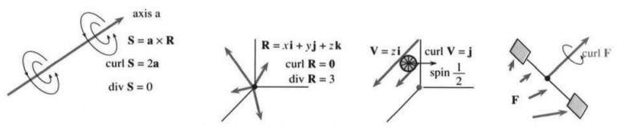
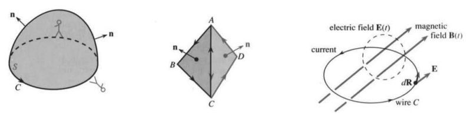

# 15.6 斯托克斯定理与场的旋度

> 来源：原书 PDF 第 686–693 页，印刷页 673–680。状态：中文初译，未独立复审。公式与插图已对照原页。

<!-- PDF 686 / 印刷页 673 -->

散度定理中的曲面是闭合的，$S$ 是实体 $V$ 的边界。现在曲面不闭合，$S$ 自己有边界，称为曲线 $C$。这又接近格林定理的原始情形：曲线围住区域，二重积分等于功积分。但斯托克斯定理（英语也写作 Stokes’s Theorem）讲的是三维空间：空间曲线 $C$ 围出一块曲面 $S$。这是我们第一次沿空间闭曲线积分。

推广到三维时，向量场也改变了。平面场 $\mathbf F(x,y)=M\mathbf i+N\mathbf j$ 成为空间场 $\mathbf F(x,y,z)=M\mathbf i+N\mathbf j+P\mathbf k$，功微元 $M\,dx+N\,dy$ 增加了 $P\,dz$。二重积分中的关键量 $N_x-M_y$ 也要改变：先前把这个标量叫作“旋度”，其实它只是一个向量的第三分量。斯托克斯定理需要该向量的全部三个分量，它就是 $\operatorname{curl}\mathbf F$。

**定义** 向量场 $\mathbf F=M\mathbf i+N\mathbf j+P\mathbf k$ 的旋度是向量场

$$
\operatorname{curl}\mathbf F=(P_y-N_z)\mathbf i+(M_z-P_x)\mathbf j+(N_x-M_y)\mathbf k.\tag{1}
$$

记号 $\nabla\times\mathbf F$ 用一个形式行列式产生这六个导数：

$$
\operatorname{curl}\mathbf F=\nabla\times\mathbf F=
\begin{vmatrix}\mathbf i&\mathbf j&\mathbf k\\
\partial/\partial x&\partial/\partial y&\partial/\partial z\\M&N&P
\end{vmatrix}.\tag{2}
$$

$\mathbf iP_y,\mathbf jM_z,\mathbf kN_x$ 三项为正号，另三项如 $\mathbf kM_y$ 为负号，具有循环对称性。这种写法有助于记忆，虽然它不是通常意义上的行列式：普通行列式里不该有一行是向量、一行是算子、一行是函数。

**例 1** 平面场 $M(x,y)\mathbf i+N(x,y)\mathbf j$ 满足 $P=0,M_z=N_z=0$，只剩两项：$\operatorname{curl}\mathbf F=(N_x-M_y)\mathbf k$，又回到格林定理。

**例 2** 叉积 $\mathbf a\times\mathbf R$ 是旋转场 $\mathbf S$，它的轴是常向量 $\mathbf a=a_1\mathbf i+a_2\mathbf j+a_3\mathbf k$。图 15.23 的流绕 $\mathbf a$ 旋转，分量为

$$
\mathbf S=\mathbf a\times\mathbf R=
\begin{vmatrix}\mathbf i&\mathbf j&\mathbf k\\a_1&a_2&a_3\\x&y&z\end{vmatrix}
=(a_2z-a_3y)\mathbf i+(a_3x-a_1z)\mathbf j+(a_1y-a_2x)\mathbf k.\tag{3}
$$

熟悉的 $-y\mathbf i+x\mathbf j$ 对应 $(a_1,a_2,a_3)=(0,0,1)$，转轴为 $\mathbf a=\mathbf k$。

旋转场的散度是 $M_x+N_y+P_z=0+0+0$。注意散度使用 $M_x$，而旋度使用 $N_x,P_x$。$\mathbf S$ 的旋度为向量 $2\mathbf a$：

$$
(P_y-N_z)\mathbf i+(M_z-P_x)\mathbf j+(N_x-M_y)\mathbf k
=2a_1\mathbf i+2a_2\mathbf j+2a_3\mathbf k=2\mathbf a.
$$

这个例子开始揭示旋度的含义：它衡量旋转！旋度方向是旋转轴，本例沿 $\mathbf a$；旋度的大小为转动角速度的两倍。

<!-- PDF 687 / 印刷页 674 -->

本例中 $|\operatorname{curl}\mathbf F|=2|\mathbf a|$，角速度大小为 $|\mathbf a|$。

图 15.23 旋转场 $\mathbf S=\mathbf a\times\mathbf R$、位置场 $\mathbf R$、速度场（剪切场）$\mathbf V=z\mathbf i$，以及一般场 $\mathbf F$。axis：轴；spin：转动角速度。

**例 3（重要！）** 每个梯度场 $\mathbf F=f_x\mathbf i+f_y\mathbf j+f_z\mathbf k$ 的旋度都为零：

$$
\operatorname{curl}\mathbf F
=\left(\frac{\partial}{\partial y}\frac{\partial f}{\partial z}-\frac{\partial}{\partial z}\frac{\partial f}{\partial y}\right)\mathbf i
+\left(\frac{\partial}{\partial z}\frac{\partial f}{\partial x}-\frac{\partial}{\partial x}\frac{\partial f}{\partial z}\right)\mathbf j
+\left(\frac{\partial}{\partial x}\frac{\partial f}{\partial y}-\frac{\partial}{\partial y}\frac{\partial f}{\partial x}\right)\mathbf k=0.\tag{4}
$$

因为混合偏导数相等，$f_{yz}=f_{zy}$、$f_{xz}=f_{zx}$、$f_{yx}=f_{xy}$，它们两两抵消，所以 $\operatorname{curl}\operatorname{grad}f=0$。

**例 4（例 3 的对应命题）** 旋度的散度也自动为零：

$$
\operatorname{div}\operatorname{curl}\mathbf F
=\frac{\partial}{\partial x}(P_y-N_z)
+\frac{\partial}{\partial y}(M_z-P_x)
+\frac{\partial}{\partial z}(N_x-M_y)=0.\tag{5}
$$

仍因混合偏导数 $P_{xy}=P_{yx},N_{xz}=N_{zx},M_{zy}=M_{yz}$ 两两抵消。“梯度的旋度”与“旋度的散度”中的各项安排得恰好使结果为零。

**15N** 对充分光滑的函数和向量场，有

$$
\operatorname{curl}\operatorname{grad}f=\nabla\times\nabla f=0,
\qquad
\operatorname{div}\operatorname{curl}\mathbf F=\nabla\cdot(\nabla\times\mathbf F)=0.
$$

旋转场 $\mathbf S$ 无散，位置场 $\mathbf R$ 无旋。$\mathbf R$ 是 $f=(x^2+y^2+z^2)/2$ 的梯度，$\mathbf S$ 是某个合适场的旋度，所以这两个零都是自动的。

你认为旋度衡量场的旋转，这是对的；认为 $\operatorname{curl}(\mathbf F+\mathbf G)=\operatorname{curl}\mathbf F+\operatorname{curl}\mathbf G$，也对。但若以为向量平行的场一定没有旋转，就错了。例 5 的向量彼此平行，长度不同却会产生旋转。

**例 5** 沿 $x$ 方向的场 $\mathbf V=z\mathbf i$，其旋度为沿 $y$ 方向的 $\mathbf j$。

把小桨轮放在 $xz$ 平面中，这个场会转动它。轮顶的速度大于轮底，所以上部运动较快，轮子旋转（图 15.23c）。旋转轴是 $\operatorname{curl}\mathbf V=\mathbf j$，角速度为 $1/2$，因为旋度大小为 1。

另一个速度场 $\mathbf v=-x\mathbf k$ 产生相同旋度 $\mathbf j$：流沿 $z$ 方向，随 $x$ 变化，旋转沿 $y$ 方向。更有意思的是它们的和：两个剪切场合成纯旋转场 $\mathbf S=z\mathbf i-x\mathbf k$，旋度为 $2\mathbf j$。

<!-- PDF 688 / 印刷页 675 -->

## 旋度的意义

例 5 把桨轮放进流中。任何场都可以这样在局部想象一下，借此理解旋度。轮子是否转动、转多快，取决于位置 $(x,y,z)$，也取决于轮轴方向。即使放在旋转场内，若轮轴 $\mathbf n$ 垂直于场的转轴 $\mathbf a$，轮子也不转！一般规则是轮子的局部角速度为 $\frac12(\operatorname{curl}\mathbf F)\cdot\mathbf n$。这叫“方向旋转率”，类似于方向导数 $(\operatorname{grad}f)\cdot\mathbf u$；$\mathbf n$ 与 $\mathbf u$ 都是单位向量。

梯度场处处没有这种旋转，称为无旋场：$\operatorname{curl}\operatorname{grad}f=0$。纯旋转场 $\mathbf a\times\mathbf R$ 的旋度为 $2\mathbf a$，轮子的角速度为 $\mathbf a\cdot\mathbf n$，其中 $1/2$ 与 2 抵消。这种自转每个位置都有，不只在原点。把硬币放在光盘上，光盘转一周，硬币自身也转一周；硬币是否在圆心不影响这一点。

当轮轴 $\mathbf n$ 与 $\mathbf a$ 同向时转速最大，点积为 $|\mathbf a|$。梯度给出增长最快的方向，旋度给出转动最快的轴方向：

$$
\begin{array}{ll}
f\text{ 的最大增长率为 }|\operatorname{grad}f|,&\text{沿 }\operatorname{grad}f;\\
\mathbf F\text{ 的最大局部旋转率为 }\tfrac12|\operatorname{curl}\mathbf F|,&\text{轴沿 }\operatorname{curl}\mathbf F.
\end{array}
$$

## 斯托克斯定理

终于来到这个大定理。像格林定理一样，它把曲线积分与曲面积分联系起来。曲线积分仍是沿闭曲线的功 $\oint\mathbf F\cdot d\mathbf R$。格林定理中的曲面积分为 $\iint(N_x-M_y)\,dx\,dy$，曲面在 $xy$ 平面内，法向为 $\mathbf k$。现在知道 $N_x-M_y$ 就是旋度的 $\mathbf k$ 分量。由于法向恒为 $\mathbf k$，格林定理只需这一分量；弯曲曲面的斯托克斯定理需要全部三个分量。

图 15.24 是帽形曲面 $S$ 和闭边界 $C$。头朝 $\mathbf n$ 方向、沿 $C$ 正向行走时，曲面应在左侧。你可能站得笔直——格林定理里 $\mathbf n=\mathbf k$ 就是这样；也可以倒立，取 $\mathbf n=-\mathbf k$，但那就必须反着绕行，才能让 (6) 两边相等，曲面仍在左侧。莫比乌斯带不适用，因为无法连续选定法向。单位法向 $\mathbf n$ 决定了边界上所谓“逆时针”的方向。

**15O 斯托克斯定理**

$$
\oint_C\mathbf F\cdot d\mathbf R=\iint_S(\operatorname{curl}\mathbf F)\cdot\mathbf n\,dS.\tag{6}
$$

右边累加曲面上的微小旋转，左边是边界的总环流或功。这不容易直观想象，可能是本书最难的定理，但一个结论很简单：若旋度为零，边界功就为零。这尤其适用于梯度场，正如我们已经知道的。

由 (4)，梯度场无旋；由 (6)，梯度场沿闭边界做功为零。三维与二维一样，梯度场就是保守场。下面先概述定理的两个证明，再回头细看这些场。

<!-- PDF 689 / 印刷页 676 -->

第一个证明说明为什么定理应当成立；第二个证明说明它确实成立，并给出可计算的公式。你也许更喜欢第一个。

**第一种证明。** 图 15.24 中三角形 $ABC$ 与 $ACD$ 相接。以后可以加入更多三角形，得到逼近曲面的分片平面 $S$。两个三角形已足以说明关键。在每个三角形所在的平面里用格林定理（两个法向不同），都有

$$
\oint_{AB+BC+CA}\mathbf F\cdot d\mathbf R=\iint_{ABC}\operatorname{curl}\mathbf F\cdot\mathbf n\,dS,
\qquad
\oint_{AC+CD+DA}\mathbf F\cdot d\mathbf R=\iint_{ACD}\operatorname{curl}\mathbf F\cdot\mathbf n\,dS.
$$

两式相加，右边是两个三角形上的曲面积分。左边沿 $CA$ 与 $AC$ 的积分抵消，内部切口消失，只剩 $AB+BC+CD+DA$，正是外边界 $C$ 上的积分，即斯托克斯定理左边。

图 15.24 曲面 $S$ 与边界 $C$。磁场 $\mathbf B$ 的变化产生电场旋度，进而在导线 $C$ 中产生电流。electric field：电场；magnetic field：磁场；current：电流；wire：导线。

**第二种证明。** 现在曲面可以弯曲。另给一个证明似乎多余，但它提供实际可用的公式。由 $z=f(x,y)$，

$$
dz=f_x\,dx+f_y\,dy,\qquad
\mathbf n\,dS=(-f_x\mathbf i-f_y\mathbf j+\mathbf k)\,dx\,dy.
$$

后一个公式见 15.4 节式 (11)。代入 $dz$，曲线积分变成

$$
\oint_C\mathbf F\cdot d\mathbf R
=\oint_{C\text{ 的投影}}M\,dx+N\,dy+P(f_x\,dx+f_y\,dy).\tag{7}
$$

将旋度与 $\mathbf n\,dS$ 点乘，曲面积分成为

$$
\iint_{S\text{ 的投影}}[(P_y-N_z)(-f_x)+(M_z-P_x)(-f_y)+(N_x-M_y)]\,dx\,dy.\tag{8}
$$

要证明 (7)＝(8)，在格林定理中把 $M$ 换成 $M+Pf_x$，把 $N$ 换成 $N+Pf_y$。那么该等式就是投影平面上的格林定理（第 47 题），从而证明曲面 $S$ 上的斯托克斯定理。注意，两种证明的关键都是平面上的格林定理。

**例 6** 在电磁学中，斯托克斯定理联系着法拉第定律。

斯托克斯定理并不总适合直接计算，式 (8) 就说明了原因。但流动的旋转、旋度或涡量是流体力学的基础。另一个重要应用是电场：法拉第定律与高斯定律的对应关系，就像斯托克斯定理与散度定理的对应关系。

<!-- PDF 690 / 印刷页 677 -->

设曲线 $C$ 是实际导线。改变磁场 $\mathbf B(t)$，可以沿 $C$ 产生电流。穿过内部曲面的磁通量 $\varphi=\iint\mathbf B\cdot\mathbf n\,dS$ 随时间变化，产生能做功的电场 $\mathbf E$：

$$
\text{法拉第定律（积分形式）：}\qquad
\text{单位电荷绕一周的功}=\oint_C\mathbf E\cdot d\mathbf R=-\frac{d\varphi}{dt}.
$$

这是物理定律——可能精确，也可能在某种模型里是近似。接下来是数学：把积分形式变成微分方程。逐点信息比整条曲线上的信息更方便。斯托克斯定理把电场曲线积分换成旋度的曲面积分：

$$
\oint_C\mathbf E\cdot d\mathbf R=\iint_S\operatorname{curl}\mathbf E\cdot\mathbf n\,dS,
\qquad
-\frac{\partial\varphi}{\partial t}=\iint_S-\frac{\partial\mathbf B}{\partial t}\cdot\mathbf n\,dS.
$$

曲线 $C$ 再小，两者也相等，所以右边对任意曲面也相等。把曲面缩到一点，得到麦克斯韦方程之一：

$$
\text{法拉第定律（微分形式）：}\qquad
\operatorname{curl}\mathbf E=-\frac{\partial\mathbf B}{\partial t}.
$$

## 保守场与势函数

本章最后回到始终重要的问题：哪些场沿闭曲线做功为零？记住平面判据 D：$M_y=N_x$ 时，在适当区域中，场保守，可写成 $\mathbf F=\operatorname{grad}f$，并有 $\oint\mathbf F\cdot d\mathbf R=0$。

现在看三维场 $\mathbf F=2xy\mathbf i+(x^2+z)\mathbf j+y\mathbf k$。它沿空间闭曲线做非零功吗，还是梯度场？要成为梯度场，必须同时有 $f_x=2xy,f_y=x^2+z,f_z=y$。一个未知函数要同时满足三个方程，一般解不出来；等到三维判据 D 通过，也就是旋度为零，才解得出来。本例通过，势为 $f=x^2y+yz$。

**15P** 保守场 $\mathbf F=M\mathbf i+N\mathbf j+P\mathbf k$ 具有下列性质：

- **A** 沿空间中每条闭路径的功 $\oint\mathbf F\cdot d\mathbf R$ 为零。
- **B** 从 $P$ 到 $Q$ 的功只依赖端点，不依赖空间路径。
- **C** 是梯度场：$M=f_x,N=f_y,P=f_z$。
- **D** 分量满足 $M_y=N_x,M_z=P_x,N_z=P_y$，即旋度为零。

在适当的定义域条件下，这些性质有一条就全有；D 是快捷的检验。

不必把 $A\Rightarrow B\Rightarrow C\Rightarrow D\Rightarrow A$ 的证明详细做一遍，只需注意：C 推 D，靠的是梯度的旋度总为零。其中最新的一环是 D 推 A——那正是斯托克斯定理给出的结论。

有趣的问题是通过 D 后如何解出 $f$。上例中

$$
\begin{aligned}
f_x=2xy&\Rightarrow f=\int2xy\,dx=x^2y+C(y,z),\\
f_y=x^2+z=x^2+C_y&\Rightarrow C=yz+c(z),\\
f_z=y=y+c'(z)&\Rightarrow c(z)\text{ 可取零}.
\end{aligned}
$$

<!-- PDF 691 / 印刷页 678 -->

第一步留下任意函数 $C(y,z)$，用来满足第二个方程；第二步留下任意函数 $c(z)$，用来满足第三个方程，本例不需要非零补项。合起来 $f=x^2y+C=x^2y+yz+c=x^2y+yz$。只有通过旋度为零的判据，才可能完成这种逐步调整。

**例 7** $\mathbf F=(z-y)\mathbf i+(x-z)\mathbf j+(y-x)\mathbf k$ 是某个函数的梯度吗？

判据 D 回答不是。它是旋转场 $\mathbf a\times\mathbf R$，旋度为 $2\mathbf a=(2,2,2)\ne0$。寻找势必然失败，但可以尝试：匹配 $f_x=z-y$ 需要 $f=zx-yx+C(y,z)$，对 $y$ 求导为 $-x+C_y$，不可能恒等于 $N=x-z$，所以势不存在。

**例 8** 选取什么 $P$，使 $\mathbf F=yz^2\mathbf i+xz^2\mathbf j+P\mathbf k$ 保守？并求 $f$。

**解** 需要旋度为零。先检查 $M_y=z^2=N_x$，另外要求

$$
P_x=M_z=2yz,\qquad P_y=N_z=2xz.
$$

$P=2xyz$ 通过全部检验。可以解三个方程求势，也可以直接看出 $f=xyz^2$ 的梯度就是该场。

第三种方法是把 $f(x,y,z)$ 定义为从原点到该点的功。路径无关，于是沿直线 $(xt,yt,zt)$、$0\le t\le1$ 积一遍，当作练习：

$$
f(x,y,z)=\int_0^1[(yt)(zt)^2x+(xt)(zt)^2y+2(xt)(yt)(zt)z]\,dt=xyz^2.
$$

**例 9** 为什么 $\operatorname{div}\operatorname{curl}\operatorname{grad}f$ 自动为零？给出两种解释。

**解** 一是梯度的旋度为零，二是任意场的旋度再取散度为零。这是向量微积分的关键恒等式。最后回顾四个公式：

$$
\begin{aligned}
\text{格林定理：}\qquad
\oint\mathbf F\cdot d\mathbf R&=\iint(N_x-M_y)\,dx\,dy,\\
\oint\mathbf F\cdot\mathbf n\,ds&=\iint(M_x+N_y)\,dx\,dy;\\
\text{散度定理：}\qquad
\iint\mathbf F\cdot\mathbf n\,dS&=\iiint(M_x+N_y+P_z)\,dx\,dy\,dz;\\
\text{斯托克斯定理：}\qquad
\oint\mathbf F\cdot d\mathbf R&=\iint\operatorname{curl}\mathbf F\cdot\mathbf n\,dS.
\end{aligned}
$$

格林定理第一种形式推广为斯托克斯定理，第二种推广为散度定理。你也许会问，为什么一开始不直接讲三维？后两个定理确实包含前两个，可令 $P=0$ 并取合适的平面或柱体。因此本章本可以只讲两个定理而不是四个。我承认，但这里有一个基本教学原则：“从特殊推广到一般，比从一般退回特殊更容易。”同样，我们先学 $df/dx$，再学偏导数和梯度。

<!-- PDF 692 / 印刷页 679 -->

## 15.6 习题

### 阅读填空

$M\mathbf i+N\mathbf j+P\mathbf k$ 的旋度是向量 **a____**，等于三阶形式行列式 **b____**。$x^2\mathbf i+z^2\mathbf k$ 的旋度为 **c____**。对 $\mathbf S=y\mathbf i-(x+z)\mathbf j+y\mathbf k$，旋度为 **d____**。这是一个 **e____** 场 $\mathbf a\times\mathbf R=\frac12(\operatorname{curl}\mathbf S)\times\mathbf R$，轴向量 $\mathbf a=$ **f____**。任意梯度场 $f_x\mathbf i+f_y\mathbf j+f_z\mathbf k$ 的旋度为 **g____**，即重要恒等式 $\operatorname{curl}\operatorname{grad}f=$ **h____**。它依据 $f_{xy}=f_{yx}$ 以及 **i____**、**j____**；对应的另一恒等式是 **k____**。

旋度衡量向量场的 **l____**。轮轴沿单位向量 $\mathbf n$ 的桨轮转速为 **m____**。当 $\mathbf n$ 沿 **n____** 方向时转动最快，此时角速度为 **o____**。

斯托克斯定理是 **p____** $=$ **q____**。曲线 $C$ 是 **s____** $S$ 的 **r____**。这是 **t____** 定理向 **u____** 维的推广。$\mathbf F$ 是梯度场时两边都为零，因为 **v____**。

保守场的四种性质为 A＝**w____**，B＝**x____**，C＝**y____**，D＝**z____**。场 $y^2z^2\mathbf i+2xy^2z\mathbf k$（通过／不通过）判据 D。原题接着要求“这个场是 $f=$ **A____** 的梯度”，并问从 $(0,0,0)$ 到 $(1,1,1)$ 的功为 **B____**（沿哪条路径？）。对每个场，旋度通量从棱锥侧面向外与从底面向上相等，因为 **C____**。

1–6 求 $\operatorname{curl}\mathbf F$。

1. $\mathbf F=z\mathbf i+x\mathbf j+y\mathbf k$。
2. $\mathbf F=\operatorname{grad}(xe^y\sin z)$。
3. $\mathbf F=(x+y+z)(\mathbf i+\mathbf j+\mathbf k)$。
4. $\mathbf F=(x+y)\mathbf i-(x+y)\mathbf k$。
5. $\mathbf F=\rho^n(x\mathbf i+y\mathbf j+z\mathbf k)$。
6. $\mathbf F=(\mathbf i+\mathbf j)\times\mathbf R$。
7. 求第 3 题的势函数。
8. 求第 5 题的势函数。
9. $x^m\mathbf i$ 与 $x^n\mathbf j$ 何时旋度为零？
10. $(a_1x+a_2y+a_3z)\mathbf k$ 何时旋度为零？

11–14 求旋度，并用斯托克斯定理计算 $\oint_C\mathbf F\cdot d\mathbf R$。

11. $\mathbf F=x^2\mathbf i+y^2\mathbf k$；$C$ 为圆 $x^2+z^2=1,y=0$。
12. $\mathbf F=\mathbf i\times\mathbf R$；$C$ 同第 11 题。
13. $\mathbf F=(\mathbf i+\mathbf j)\times\mathbf R$；$C$ 为圆 $y^2+z^2=1,x=0$。
14. $\mathbf F=(y\mathbf i-x\mathbf j)\times(x\mathbf i+y\mathbf j)$；$C$ 为圆 $x^2+y^2=1,z=0$。
15. （重要）设两个曲面 $S,T$ 共用边界 $C$，且边界方向相同。(a) 证明 $\iint_S\operatorname{curl}\mathbf F\cdot\mathbf n\,dS=\iint_T\operatorname{curl}\mathbf F\cdot\mathbf n\,dS$；(b) 另一证明：两积分之差等于 $\iiint_V\operatorname{div}\operatorname{curl}\mathbf F\,dV$。这是哪个定理？$V$ 是什么区域？为什么积分为零？
16. 在第 15 题中，$S$ 为地球上半球，法向向外，$T$ 为下半球，法向向内。$C,V$ 分别是什么？举例说明把两边的旋度改为 $\mathbf F$ 后，等式通常不成立。
17. 解释为什么对任意实体 $V$ 的闭边界，都有 $\iint\operatorname{curl}\mathbf F\cdot\mathbf n\,dS=0$。
18. 假设场既无旋又无散。(a) 为什么它是势的梯度？(b) 为什么势满足 $f_{xx}+f_{yy}+f_{zz}=0$？

19–22 若存在势函数 $f$，求出它。

19. $\mathbf F=z\mathbf i+\mathbf j+x\mathbf k$。
20. $\mathbf F=2xyz\mathbf i+x^2z\mathbf j+x^2y\mathbf k$。
21. $\mathbf F=e^{x-z}\mathbf i-e^{x-z}\mathbf k$。
22. $\mathbf F=yz\mathbf i+xz\mathbf j+(xy+z^2)\mathbf k$。
23. 求一个旋度为 $(1,0,0)$ 的场。
24. 求所有旋度为 $(1,0,0)$ 的场。
25. $\mathbf S=\mathbf a\times\mathbf R$ 为旋转场。对常向量 $\mathbf b$，计算 $\mathbf F=\mathbf b\times\mathbf S$ 及其旋度。
26. 场 $\mathbf F=y\mathbf i-x\mathbf k$ 使桨轮以多大角速度转动：(a) 轮轴 $\mathbf n=\mathbf j$；(b) 轮轴沿旋度；(c) 轮轴垂直旋度？
27. 旋转场 $\mathbf F=\omega(-y\mathbf i+x\mathbf j)$ 中，旋度与角速度 $\omega$ 有何关系？轮子位于平面 $x+y+z=1$ 内时转多快？
28. 求旋度为 $\mathbf S=y\mathbf i-x\mathbf j$ 的场。
29. 求旋度为 $\mathbf S=\mathbf a\times\mathbf R$ 的场。
30. 若两个场处处旋度相同，判断：(a) 差是常向量场；(b) 差是梯度场；(c) 散度相同。

31–34 分别计算单位球面上半部的旋度通量与沿赤道的功积分。

31. $\mathbf F=y\mathbf i-x\mathbf j$。
32. $\mathbf F=\mathbf R/\rho^2$。
33. $\mathbf F=\mathbf a\times\mathbf R$。
34. $\mathbf F=(\mathbf a\times\mathbf R)\times\mathbf R$。
35. 圆 $C$ 在平面 $x+y+z=6$ 内，半径为 $r$，圆心为 $(1,2,3)$。对 $\mathbf F=3z\mathbf j+2y\mathbf k$，求沿 $C$ 的功。
36. $S$ 为单位球上半球面，$\mathbf F=z\mathbf i+x\mathbf j+xyz\mathbf k$。求旋度通量。
37. 求 $g(x,y)$，使 $\operatorname{curl}(g\mathbf k)=y\mathbf i+x^2\mathbf j$。15.3 节把 $g$ 叫什么？它存在是因为这个场的____为零。
38. 构造场 $\mathbf F$，使其旋度为 $2x\mathbf i+3y\mathbf j-5z\mathbf k$，该目标场散度为零。
39. 将 $\mathbf F=xy\mathbf i$ 分成 $\mathbf V+\mathbf W$，使 $\mathbf V$ 无旋而 $\mathbf W$ 无散。

<!-- PDF 693 / 印刷页 680 -->

40. 稳恒磁场的安培定律为 $\operatorname{curl}\mathbf B=\mu\mathbf J$，其中 $\mathbf J$ 为电流密度，$\mu$ 为常数。根据穿过空间闭曲线 $C$ 所围曲面的电流，求 $\mathbf B$ 沿 $C$ 的环流（原书称“功”）。麦克斯韦允许电流随时间变化，由此还要引入电场。
41. 对 $\mathbf F=(x^2+y^2)\mathbf i$，求 $\operatorname{curl}\operatorname{curl}\mathbf F$、$\operatorname{grad}\operatorname{div}\mathbf F$ 以及 $\mathbf F_{xx}+\mathbf F_{yy}+\mathbf F_{zz}$。
42. 对 $\mathbf F=v(x,y,z)\mathbf i$，证明：(a) $\operatorname{curl}\operatorname{curl}\mathbf F=\operatorname{grad}\operatorname{div}\mathbf F-(\mathbf F_{xx}+\mathbf F_{yy}+\mathbf F_{zz})$；(b) $\operatorname{curl}(f\mathbf F)=f\operatorname{curl}\mathbf F+(\operatorname{grad}f)\times\mathbf F$。
43. 若 $\mathbf B=\mathbf a\cos t$，$\mathbf a$ 为恒定方向向量，用法拉第定律求 $\operatorname{curl}\mathbf E$，再求交变旋转场 $\mathbf E$。
44. 令 $\mathbf G=m\mathbf i+n\mathbf j+p\mathbf k$，写出 $\mathbf F\times\mathbf G$ 并取散度，核对结果等于 $\mathbf G\cdot\operatorname{curl}\mathbf F-\mathbf F\cdot\operatorname{curl}\mathbf G$。
45. 从斯托克斯定理写出 $xz$ 平面内的格林定理。
46. 判断：$\nabla\times\mathbf F$ 垂直于 $\mathbf F$。
47. (a) 第二种证明将 $M^*=M(x,y,f(x,y))+P(x,y,f(x,y))f_x$ 作为格林定理中的 $M$。用链式法则与乘积法则计算 $M_y^*$，共有五项；(b) 类似地，$N^*=N(x,y,f)+P(x,y,f)f_y$ 的 $x$ 导数为 $N_x+N_zf_x+P_xf_y+P_zf_xf_y+Pf_{yx}$。检查 $N_x^*-M_y^*$ 与 (8) 被积式一致，完成证明所需步骤。
48. “边界的投影就是投影的边界。”第二种证明在投影上应用格林定理时使用了这一事实。举两个 $S,C$ 及其投影的例子。
49. 当 $C=\partial S$ 或 $S=\partial V$ 时，下列哪些积分相等？

$$
\oint\mathbf F\cdot d\mathbf R,\quad
\oint(\operatorname{curl}\mathbf F)\cdot d\mathbf R,\quad
\oint(\operatorname{curl}\mathbf F)\cdot\mathbf n\,ds,\quad
\iint\mathbf F\cdot\mathbf n\,dS,
$$
$$
\iint\operatorname{div}\mathbf F\,dS,\quad
\iint(\operatorname{curl}\mathbf F)\cdot\mathbf n\,dS,\quad
\iint(\operatorname{grad}\operatorname{div}\mathbf F)\cdot\mathbf n\,dS,\quad
\iiint\operatorname{div}\mathbf F\,dV.
$$

50. 画出场 $\mathbf V=-x\mathbf k$ 使 $xz$ 平面内的轮子旋转的情形。哪些方向的轮子不转？

## 译注与待复审事项

- 斯托克斯定理要求曲面可定向且分片光滑、边界方向与法向相容，场在曲面邻域具有连续一阶导数。15N 使用混合偏导可交换的正则性。15P 中 D 推出全局保守性需单连通等定义域条件；不能直接推广到绕奇线的带孔区域。第18、24、30题相同。
- 第二种证明处理函数图像曲面；一般曲面须分片并拼接。第48题关于投影边界的断言只在这种单值图像等适当条件下成立，不是任意曲面的性质。
- PDF 690 的 C 推 D 原书写成 curl grad F，已按标量势改为 curl grad f。例8给出一个可行的 $P$，不是唯一选择；还可加只依赖 $z$ 的函数，势相应增加其原函数。
- PDF 692 阅读填空原场 $y^2z^2\mathbf i+2xy^2z\mathbf k$ 缺少与后续“梯度”问题相容的 $\mathbf j$ 分量，确实不通过判据 D。按印刷原式保留并显式提示原题续问；可能意图补 $2xyz^2\mathbf j$，不擅改为确定原文。填空 l 在原页看似 i，按字母顺序记作 l；旋转场公式中的 curl F 改为同一场的 curl S。
- 第11–14、35题未明示绕行方向，非零答案符号须随所选法向说明。第49题空间曲线的法向并非仅由曲线唯一决定，第三项需要额外约定，原选项保留。
- 桨轮解释是理想化的无穷小局部旋转模型，不是任意有限轮子的动力学定律。法拉第推导采用固定回路、固定曲面；移动回路还需相应输运项。第40题磁场环流不应理解为洛伦兹磁力对电荷的机械做功。
- 原图保留；本节尚未独立数学复审或进行最终排版验证。
